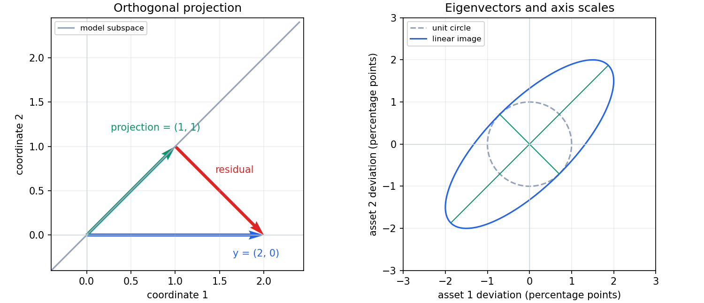

# 第一篇　数学、统计学与编程基础
# 第3章　线性代数及其金融数据应用

[返回总目录](./00_完整目录.md) · [上一章](./02_第2章_NumPy、Pandas与科学计算.md) · [实验代码](./code/ch03/linear_lab.py) · [验证代码](./code/ch03/test_linear_lab.py)

第二章解决了怎样把数据正确放进表格。本章解决：多个变量之间怎样形成结构，怎样从收益中提取共同变化，以及怎样判断一个数值答案是否可靠。

**本章所有收益、因子和图形均为人工教学示例，没有使用官方比赛数据，也不报告真实市场模型绩效。**

> 公式按 VS Code 与 GitHub 兼容写法排版，详见[数学公式阅读约定](./数学公式阅读约定.md)。

## 学习目标

先修要求：理解数组、轴、矩阵形状、收益面板和训练期之外的数据不能参与拟合。不要求先学微积分；最小二乘先用几何和平方展开推导。

完成后应能够：

1. 解释向量空间、基、维数、秩和不可识别的参数。
2. 从正交投影推导最小二乘，并解释正规方程的适用条件。
3. 理解QR、特征分解、奇异值分解和伪逆。
4. 证明共同样本协方差矩阵半正定，识别逐对缺失处理的风险。
5. 推导组合方差、因子暴露、PCA与协方差加权距离。
6. 理解条件数、近共线性和正则化的作用。
7. 在训练期拟合基与均值，再固定参数处理后续数据。
8. 运行并检验一个完整的多资产线性代数实验。

本章主要讨论实数；向量默认写成列向量。收益面板记为 $R\in\mathbb R^{T\times d}$ ，时间在行、资产在列。NumPy一维数组的`shape=(d,)`本身不区分数学中的行向量和列向量。

---

## 3.1　向量空间、线性方程组与最小二乘

### 一、从向量到线性组合

**向量，Vector**，可以表示同一时点的多资产收益：

```math
r=\begin{pmatrix}r_{\mathrm{EQ}}\\r_{\mathrm{BOND}}\\r_{\mathrm{GOLD}}\\r_{\mathrm{FX}}\end{pmatrix}
\in\mathbb R^4
```

每个坐标必须附带资产、单位和价格口径。交换坐标而不交换权重，会改变金融含义。

给定向量 $v_1,\ldots,v_k$ ，表达式：

```math
c_1v_1+\cdots+c_kv_k
```

称为**线性组合，Linear Combination**，其中 $c_i$ 为实数。

例如共同风险方向：

```math
v_1=\begin{pmatrix}1\\1\end{pmatrix},\quad
v_2=\begin{pmatrix}1\\-1\end{pmatrix}
```

则：

```math
\begin{pmatrix}3\\1\end{pmatrix}=2v_1+v_2
```

这种表达可以帮助理解“共同上涨方向”和“相对变化方向”，但仅凭数学方向不能给它们强加宏观因果解释。

### 二、空间、基、维数与秩

**向量空间，Vector Space**，是在向量加法、实数乘法下满足通常代数规则的集合。其**线性子空间，Linear Subspace**，必须包含零向量，并对加法和实数乘法封闭。

由所有线性组合组成的集合是**张成空间，Span**：

```math
\mathrm{span}(v_1,\ldots,v_k)
= \left\lbrace \sum_i c_iv_i:c_i\in\mathbb R\right\rbrace
```

若：

```math
\sum_i c_iv_i=0
```

只能由全部 $c_i=0$ 得到，则这些向量**线性无关，Linearly Independent**；否则线性相关。

既张成空间又线性无关的一组向量称为**基，Basis**；基中向量数量称为**维数，Dimension**。基决定坐标表示，维数表示独立方向数量。[基与维数](https://textbooks.math.gatech.edu/ila/dimension.html)

例如 $v_2=2v_1$ 时，两列特征仍只提供一个独立方向。增加复制特征不会增加信息维度。

“权重之和等于1”的组合集合通常不是线性子空间：两个合法权重相加后总和变为2。线性代数仍可描述该约束，但不能把所有约束集合都叫线性空间。

矩阵 $M\in\mathbb R^{m\times n}$ 的**列空间，Column Space**，是其列向量的张成空间；**秩，Rank**，是列空间维数。

**零空间，Null Space**：

```math
\mathcal N(M)=\lbrace x:Mx=0\rbrace
```

Gauss消元产生 $r$ 个主元时，有 $n-r$ 个自由变量，对应 $n-r$ 个独立零空间方向，因此：

```math
\mathrm{rank}(M)+\dim\mathcal N(M)=n
```

这就是秩与零空间维数的关系。[秩定理](https://textbooks.math.gatech.edu/ila/rank-thm.html)

### 三、内积、长度与正交

对实向量：

```math
x^\top y=\sum_{i=1}^n x_iy_i
```

称为标准**内积，Inner Product**； ${}^\top$ 表示**转置，Transpose**。

**欧几里得范数，Euclidean Norm**：

```math
\Vert x\Vert _2=\sqrt{x^\top x}
```

若 $x^\top y=0$ ，称二者**正交，Orthogonal**。

一个重要不等式可以直接推导。对 $y\neq0$ ，取：

```math
a=\frac{x^\top y}{y^\top y}
```

因为平方长度非负：

```math
0\leq\Vert x-ay\Vert _2^2
=x^\top x-2ax^\top y+a^2y^\top y
```

代入 $a$ ：

```math
0\leq x^\top x-\frac{(x^\top y)^2}{y^\top y}
```

所以：

```math
|x^\top y|\leq\Vert x\Vert _2\Vert y\Vert _2
```

即**Cauchy–Schwarz不等式**。当 $y=0$ 时不等式也成立。对非零向量，由此可以定义夹角：

```math
\cos\theta=\frac{x^\top y}{\Vert x\Vert _2\Vert y\Vert _2}
```

内积和角度依赖坐标尺度。把利率从小数改为基点而不调整度量，会改变几何关系。

正交也不等于统计独立，更不等于没有经济联系。[内积与正交](https://textbooks.math.gatech.edu/ila/dot-product.html)

### 四、矩阵表示线性映射

矩阵乘法定义：

```math
(Mx)_i=\sum_jM_{ij}x_j
```

它满足：

```math
M(ax+by)=aMx+bMy
```

因此表示**线性映射，Linear Map**。对矩阵 $M,N$ ：

```math
(MN)_{ij}=\sum_kM_{ik}N_{kj}
```

必须先检查中间维度匹配。一般而言 $MN\neq NM$ 。

**单位矩阵，Identity Matrix** $I$ 满足 $Ix=x$ 。方阵可逆时存在 $M^{-1}$ ，使：

```math
M^{-1}M=MM^{-1}=I
```

但数学上能写逆矩阵，不意味着计算时应先显式求逆。

### 五、线性方程组与消元

求解：

```math
Mx=b
```

等价于寻找用矩阵各列组合出 $b$ 的系数。

- $b$ 不在列空间：无精确解；
- 存在解且零空间为 $\lbrace 0\rbrace$ ：解唯一；
- 存在解且零空间非零：解不唯一。

因为两个解 $x_1,x_2$ 满足：

```math
M(x_1-x_2)=0
```

所以全部解为：

```math
x=x_0+z,\quad z\in\mathcal N(M)
```

其中 $x_0$ 是任意一个特解。

例如：

```math
\begin{pmatrix}2&1\\4&3\end{pmatrix}
\begin{pmatrix}x_1\\x_2\end{pmatrix}
= \begin{pmatrix}1\\3\end{pmatrix}
```

第二行减去第一行的2倍，得到 $x_2=1$ ，再回代得 $x_1=0$ 。

消元可以写成**LU分解，LU Factorization**：

```math
M=
\underbrace{\begin{pmatrix}1&0\\2&1\end{pmatrix}}_L
\underbrace{\begin{pmatrix}2&1\\0&1\end{pmatrix}}_U
```

先解 $Lz=b$ ，再解 $Ux=z$ 。实际算法通常需要选主元和换行，形成 $PM=LU$ ，其中 $P$ 为行置换矩阵。

对于明确可逆的方阵：

```python
import numpy as np

matrix = np.array([[2.0, 1.0], [4.0, 3.0]])
target = np.array([1.0, 3.0])

solution = np.linalg.solve(matrix, target)
np.testing.assert_allclose(solution, [0.0, 1.0])
```

`solve`用于方阵线性系统；非方阵或秩不足问题应采用相应方法。[NumPy solve](https://numpy.org/doc/2.1/reference/generated/numpy.linalg.solve.html)

**行列式，Determinant**，是方阵的一个标量。一般定义为：

```math
\det M=\sum_{\pi}\mathrm{sgn}(\pi)\prod_{i=1}^nM_{i,\pi(i)}
```

其中 $\pi$ 遍历列编号的排列，符号由排列的奇偶性决定。二阶时：

```math
\det\begin{pmatrix}a&b\\c&d\end{pmatrix}=ad-bc
```

方阵可逆当且仅当行列式非零。高阶数值实现不按上述排列求和；也不应把“行列式很小”直接当作数值病态的判据，因为单位缩放会改变其大小。

### 六、从投影推导最小二乘

金融因子无法完全解释全部收益，因此更常见的问题是：

```math
\min_\beta\Vert y-X\beta\Vert _2^2
```

这里：

- $y\in\mathbb R^T$ ：一个资产的收益序列；
- $X\in\mathbb R^{T\times p}$ ：设计矩阵，常含一列1作为截距；
- $\beta\in\mathbb R^p$ ：待估系数；
- $e=y-X\beta$ ：残差。

这称为**最小二乘，Least Squares，LS**；等权情形也称普通最小二乘，Ordinary Least Squares，OLS。

设候选最优解为 $\hat\beta$ ，残差为 $e=y-X\hat\beta$ 。沿任意系数方向 $h$ 移动 $a$ ：

```math
\Vert y-X(\hat\beta+ah)\Vert _2^2
= \Vert e-aXh\Vert _2^2
```

展开：

```math
=\Vert e\Vert _2^2-2a\,h^\top X^\top e+a^2\Vert Xh\Vert _2^2
```

如果某个方向使 $h^\top X^\top e\neq0$ ，选择足够小且符号合适的 $a$ ，就能降低误差。因此最优解必须满足：

```math
X^\top e=0
```

即残差与列空间正交。

代入残差定义：

```math
X^\top X\hat\beta=X^\top y
```

这就是**正规方程，Normal Equations**。[最小二乘几何](https://textbooks.math.gatech.edu/ila/least-squares.html)

条件不仅必要，也足够。对任意 $\beta$ ：

```math
y-X\beta=e+X(\hat\beta-\beta)
```

由于两项正交：

```math
\Vert y-X\beta\Vert _2^2
= \Vert e\Vert _2^2+\Vert X(\hat\beta-\beta)\Vert _2^2
\geq\Vert e\Vert _2^2
```

因此得到全局最小值，无须先使用微积分。

若 $X$ 满列秩，则对任何非零 $h$ ：

```math
h^\top X^\top Xh=\Vert Xh\Vert _2^2>0
```

所以 $X^\top X$ 可逆，数学表达为：

```math
\hat\beta=(X^\top X)^{-1}X^\top y
```

若列相关，该逆不存在，但最小二乘拟合向量仍唯一；系数可能不唯一。

### 七、手算一个完整例子

取：

```math
X=\begin{pmatrix}1&-1\\1&0\\1&1\end{pmatrix},\quad
y=\begin{pmatrix}0\\1\\3\end{pmatrix}
```

则：

```math
X^\top X=\begin{pmatrix}3&0\\0&2\end{pmatrix},
\qquad X^\top y=\begin{pmatrix}4\\3\end{pmatrix}
```

所以：

```math
\hat\beta=\begin{pmatrix}4/3\\3/2\end{pmatrix}
```

拟合值：

```math
\hat y=X\hat\beta=
\begin{pmatrix}-1/6\\4/3\\17/6\end{pmatrix}
```

残差：

```math
e=y-\hat y=
\begin{pmatrix}1/6\\-1/3\\1/6\end{pmatrix}
```

检查：

```math
\sum_te_t=0,\qquad
(-1)e_1+0e_2+1e_3=0
```

与截距列和解释变量列都正交。残差平方和：

```math
\Vert e\Vert _2^2=\frac1{36}+\frac19+\frac1{36}=\frac16
```

这些是抽象演算数值，不直接代表收益百分数。

### 八、投影矩阵和QR计算

若 $Q$ 的列构成列空间的一组**标准正交基，Orthonormal Basis**，即 $Q^\top Q=I$ ，则：

```math
\hat y=QQ^\top y
```

因为：

```math
Q^\top(y-QQ^\top y)=0
```

矩阵 $H=QQ^\top$ 满足：

```math
H^\top=H,\qquad H^2=H
```

分别表示对称与幂等，是正交投影矩阵的关键性质。[正交投影](https://textbooks.math.gatech.edu/ila/projections.html)

构造正交基的一种方法是**Gram–Schmidt正交化**：

```math
u_j=x_j-\sum_{i<j}(q_i^\top x_j)q_i,\qquad
q_j=\frac{u_j}{\Vert u_j\Vert _2}
```

若 $\Vert u_j\Vert =0$ ，说明该列由前面的列张成，不能继续除法。

记录投影系数后，得到**QR分解，QR Factorization**：

```math
X=QU
```

其中此处 $U$ 为上三角矩阵，避免与收益面板 $R$ 混淆。满列秩时：

```math
U\hat\beta=Q^\top y
```

先正交变换，再解三角方程，不必形成 $X^\top X$ 。

经典Gram–Schmidt在近相关列下可能丧失数值正交性。实用库采用更稳健的算法，例如Householder反射。单位向量 $u$ 对应：

```math
J=I-2uu^\top,\quad
J^\top J=(I-2uu^\top)^2=I
```

连续使用这种长度保持的反射可以把矩阵化为三角形。[NumPy QR](https://numpy.org/doc/2.1/reference/generated/numpy.linalg.qr.html)



图左： $y=(2,0)$ 投影到直线 $y_2=y_1$ ，投影为 $(1,1)$ ，残差为 $(1,-1)$ 。图右是单位圆的线性映射，后文解释其轴长；它不是概率置信区域。

### 九、系数不是因果效应，投影不是预测承诺

最小二乘只解决给定样本和列空间下的平方误差问题。

- 残差与样本解释变量正交，不代表残差与它们统计独立。
- 同期收益对同期因子的拟合，可以描述共同变化，不等于期初已经能预测期末。
- 列相关时，某个最小范数答案不代表真实经济参数就是该答案。
- 系数推断还需要误差、抽样和时间依赖假设，第6章再讨论。

---

## 3.2　特征分解、奇异值分解与正定矩阵

### 一、特征值描述特殊方向

对方阵 $S$ ，若非零向量 $q$ 满足：

```math
Sq=\lambda q
```

则 $\lambda$ 为**特征值，Eigenvalue**， $q$ 为**特征向量，Eigenvector**。该方向经变换后只发生比例或符号变化。

因为：

```math
(S-\lambda I)q=0
```

存在非零解要求：

```math
\det(S-\lambda I)=0
```

例如：

```math
S=\begin{pmatrix}4&3\\3&4\end{pmatrix}
```

特征方程：

```math
(4-\lambda)^2-9=0
```

所以：

```math
\lambda_1=7,\qquad \lambda_2=1
```

对应标准化方向：

```math
q_1=\frac1{\sqrt2}\begin{pmatrix}1\\1\end{pmatrix},
\quad
q_2=\frac1{\sqrt2}\begin{pmatrix}1\\-1\end{pmatrix}
```

分别表示同向和反向变化。

### 二、为什么金融中重视实对称矩阵

**对称矩阵，Symmetric Matrix**，满足 $S^\top=S$ 。它具有实特征值，并能选择一组标准正交特征向量：

```math
S=Q\Lambda Q^\top,\qquad Q^\top Q=I
```

其中 $\Lambda$ 是特征值构成的对角矩阵。这称为实对称矩阵的**谱分解，Spectral Decomposition**。

一个证明思路如下：单位球面上连续函数 $v^\top Sv$ 存在最大值。设最大点为单位向量 $q$ ，取与 $q$ 正交的单位向量 $h$ ，考察：

```math
g(a)=
\frac{(q+ah)^\top S(q+ah)}{1+a^2}
= \frac{q^\top Sq+2a\,h^\top Sq+a^2h^\top Sh}{1+a^2}
```

如果 $h^\top Sq\neq0$ ，选择足够小且符号合适的 $a$ ，线性项就能使函数大于 $g(0)$ ，与最大性矛盾。因此所有这类 $h$ 都满足：

```math
h^\top Sq=0
```

所以 $Sq$ 只能沿 $q$ 方向，即 $Sq=\lambda q$ 。

又因为对称性，对任何 $h\perp q$ ：

```math
q^\top Sh=(Sq)^\top h=\lambda q^\top h=0
```

故 $q$ 的正交补在 $S$ 下保持不变。在低一维的空间重复此过程，就得到完整正交特征基。这里使用了有限维闭有界单位球面上连续函数能取到最大值的基础定理。

不同特征值方向正交也可直接验证。若 $Sq_i=\lambda_iq_i$ 、 $Sq_j=\lambda_jq_j$ ：

```math
\lambda_iq_i^\top q_j
=(Sq_i)^\top q_j
=q_i^\top Sq_j
=\lambda_jq_i^\top q_j
```

当 $\lambda_i\neq\lambda_j$ ，只能有 $q_i^\top q_j=0$ 。

一般非对称矩阵不一定存在完整实特征基，不能无条件套用上述形式。[对角化](https://textbooks.math.gatech.edu/ila/diagonalization.html)

### 三、半正定、正定与二次型

表达式：

```math
x^\top Sx
```

称为**二次型，Quadratic Form**。本章对称矩阵若满足：

```math
x^\top Sx\geq0\quad\text{对所有 }x
```

称为**半正定，Positive Semidefinite，PSD**。

若对所有非零 $x$ 都有严格大于0，则称为**正定，Positive Definite，PD**；实对称正定也常写SPD。

令 $z=Q^\top x$ ，则：

```math
x^\top Sx
=x^\top Q\Lambda Q^\top x
=z^\top\Lambda z
=\sum_i\lambda_i z_i^2
```

所以：

- 半正定等价于全部特征值非负；
- 正定等价于全部特征值为正；
- 存在负特征值时，沿该方向二次型为负；
- 半正定允许零特征值，因此不一定可逆。

对于图中矩阵，映射 $Q\Lambda^{1/2}$ 把单位圆变成半轴长 $\sqrt7$ 、1的椭圆；这只是几何结构，不自动具有概率覆盖含义。

数值计算对称矩阵使用`eigh`，返回特征值通常按升序排列、特征向量放在列中。应先检查输入确实对称，因为该函数会使用指定三角部分，不负责证明整张输入矩阵对称。[NumPy eigh](https://numpy.org/doc/2.1/reference/generated/numpy.linalg.eigh.html)

### 四、Cholesky分解与避免显式求逆

对称正定矩阵存在：

```math
S=LL^\top
```

其中 $L$ 为对角线为正的下三角矩阵，称为**Cholesky分解**。

由 $S_{ij}=\sum_kL_{ik}L_{jk}$ 逐列得到：

```math
L_{jj}
= \sqrt{S_{jj}-\sum_{k<j}L_{jk}^2}
```

```math
L_{ij}
= \frac{S_{ij}-\sum_{k<j}L_{ik}L_{jk}}{L_{jj}},
\quad i>j
```

根号量为什么为正？把第一步写成分块形式：

```math
S=\begin{pmatrix}a&b^\top\\b&C\end{pmatrix},\qquad a>0.
```

对任意非零 $z$ ，选择向量 $x=(-b^\top z/a,z^\top)^\top$ ，有：

```math
x^\top Sx=z^\top(C-bb^\top/a)z>0.
```

因此剩余矩阵 $C-bb^\top/a$ 仍正定。在它上面递归执行同样步骤，得到每一步的正根号量和完整分解。

例如：

```math
\begin{pmatrix}4&3\\3&4\end{pmatrix}
= \begin{pmatrix}2&0\\3/2&\sqrt7/2\end{pmatrix}
\begin{pmatrix}2&3/2\\0&\sqrt7/2\end{pmatrix}
```

求解 $Sx=b$ 时可先解 $Lz=b$ ，再解 $L^\top x=z$ 。

半正定但奇异的矩阵可能无法进行普通Cholesky分解，这不意味着协方差必然构造错误，也可能是样本不足或线性依赖。[NumPy Cholesky](https://numpy.org/doc/2.1/reference/generated/numpy.linalg.cholesky.html)

### 五、奇异值分解适用于矩形矩阵

对任意实矩阵 $M\in\mathbb R^{m\times n}$ ，**奇异值分解，Singular Value Decomposition，SVD**，可写为：

```math
M=U\Sigma V^\top
```

满形式中 $U,V$ 为正交矩阵， $\Sigma$ 为矩形对角矩阵，其非负对角元：

```math
\sigma_1\geq\sigma_2\geq\cdots\geq0
```

称为**奇异值，Singular Values**。

为什么这种分解存在？先对 $M^\top M$ 谱分解。因为：

```math
v^\top M^\top Mv=\Vert Mv\Vert _2^2\geq0
```

其特征值非负。对正特征值，令：

```math
M^\top Mv_i=\sigma_i^2v_i,\qquad
u_i=\frac{Mv_i}{\sigma_i}
```

则：

```math
u_i^\top u_j
= \frac{v_i^\top M^\top Mv_j}{\sigma_i\sigma_j}
= \frac{\sigma_j^2v_i^\top v_j}{\sigma_i\sigma_j}
```

因此 $u_i$ 相互正交且长度为1。零特征值方向满足 $\Vert Mv_i\Vert ^2=0$ ，所以 $Mv_i=0$ 。

由 $v_i$ 组成完整正交基，对任意输入分解后可得：

```math
M=\sum_{i=1}^{r}\sigma_i u_i v_i^\top
```

其中 $r$ 为秩。这是紧形式SVD。完整正交基可通过补充其余正交方向得到。

它告诉我们：先在输入空间换到 $V$ 坐标，沿各方向缩放，再映射到 $U$ 方向。

NumPy使用：

```python
import numpy as np

matrix = np.array([[1.0, 1.0], [0.0, 0.0]])
u, singular, vh = np.linalg.svd(matrix, full_matrices=False)

reconstructed = (u * singular) @ vh
np.testing.assert_allclose(reconstructed, matrix, atol=1e-14)
```

返回的`vh`已经是 $V^\top$ 。约简形式形状为 $U:m\times k$ 、奇异值长度 $k$ 、`vh`为 $k\times n$ ，其中 $k=\min(m,n)$ ，仍可能包含零奇异值。[NumPy SVD](https://numpy.org/doc/2.1/reference/generated/numpy.linalg.svd.html)

### 六、伪逆与不可识别参数

将最小二乘问题投到正交基：

```math
\Vert y-M\beta\Vert _2^2
```

对每个非零奇异值方向，最小化要求：

```math
v_i^\top\beta=\frac{u_i^\top y}{\sigma_i}
```

而零空间方向不会影响拟合。加入零空间分量只会增加系数长度，因此最小长度的解为：

```math
\hat\beta
= \sum_{i=1}^{r}
v_i\frac{u_i^\top y}{\sigma_i}
=M^+y
```

$M^+$ 称为**Moore–Penrose伪逆，Pseudoinverse**。

若两个因子完全相同，数据只能识别它们系数之和。最小范数规则选择一个数学代表，不能凭空识别两个真实经济影响。

`np.linalg.lstsq`在多个最小二乘解中返回最小二范数解；小奇异值是否视作0由`rcond`等规则决定。返回的`residuals`在某些形状或秩不足时为空，不代表实际残差为0。[lstsq文档](https://numpy.org/doc/2.1/reference/generated/numpy.linalg.lstsq.html)

### 七、条件数：误差会放大多少

矩阵二范数定义为最大放大倍数：

```math
\Vert M\Vert _2=\max_{\Vert x\Vert _2=1}\Vert Mx\Vert _2=\sigma_{\max}
```

对可逆方阵，**条件数，Condition Number**：

```math
\kappa_2(M)=\Vert M\Vert _2\Vert M^{-1}\Vert _2
=\frac{\sigma_{\max}}{\sigma_{\min}}
```

固定 $M$ ，仅把右端 $b$ 改为 $b+\delta b$ 。则：

```math
\delta x=M^{-1}\delta b
```

由范数界：

```math
\Vert \delta x\Vert \leq\Vert M^{-1}\Vert \Vert \delta b\Vert
```

又因 $\Vert b\Vert =\Vert Mx\Vert \leq\Vert M\Vert \Vert x\Vert$ ，得到：

```math
\frac{\Vert \delta x\Vert }{\Vert x\Vert }
\leq
\kappa_2(M)\frac{\Vert \delta b\Vert }{\Vert b\Vert }
```

这个界针对非零解的可逆方阵系统；不能未经条件说明直接当成一般最小二乘的完整误差公式。

满列秩设计矩阵在精确运算中满足：

```math
\kappa_2(X^\top X)
= \frac{\sigma_{\max}^2}{\sigma_{\min}^2}
= \kappa_2(X)^2
```

这就是不优先形成正规方程进行数值求解的重要原因。QR或SVD通常能避免这一步额外恶化，但不能消除数据本身的信息不足。[NumPy cond](https://numpy.org/doc/2.1/reference/generated/numpy.linalg.cond.html)

### 八、截断和正则化改变了什么

小奇异值对应的 $1/\sigma_i$ 会放大误差。**截断SVD，Truncated SVD**，舍弃小奇异值方向，得到更低维的近似；舍弃规则也是模型定义的一部分。

另一方法是**岭正则化，Ridge Regularization**：

```math
\min_\beta
\Vert y-X\beta\Vert _2^2+\lambda\Vert \beta\Vert _2^2,\quad\lambda>0
```

记 $e=y-X\hat\beta$ ，考察 $\hat\beta+ah$ 的目标值。减去原值后为：

```math
-2a\,h^\top X^\top e+a^2\Vert Xh\Vert ^2
+2a\lambda h^\top\hat\beta+a^2\lambda\Vert h\Vert ^2.
```

最优时任意方向的线性项必须为0，因此
$h^\top[-X^\top e+\lambda\hat\beta]=0$ 对所有 $h$ 成立。
代入 $e$ ，得到最优条件：

```math
(X^\top X+\lambda I)\hat\beta=X^\top y
```

该矩阵正定，因为非零 $h$ 满足：

```math
h^\top(X^\top X+\lambda I)h
= \Vert Xh\Vert ^2+\lambda\Vert h\Vert ^2>0
```

SVD坐标下：

```math
\hat\beta_\lambda
= \sum_i
\frac{\sigma_i}{\sigma_i^2+\lambda}
v_i u_i^\top y
```

相比 $1/\sigma_i$ ，小奇异值方向的放大受到抑制。代价是改变估计目标并引入收缩偏差，不能保证样本外更好。

此式假设所有系数都受同样惩罚。实际常把截距单独处理，并先明确变量尺度；参数选择只能使用训练与验证数据。

---

## 3.3　协方差矩阵、因子暴露与数值条件

### 一、共同样本协方差为什么半正定

设 $R\in\mathbb R^{T\times d}$ 为同一组完整时间样本上的收益， $T\geq2$ 。按列去均值：

```math
Z=R-\mathbf1\bar r^\top
```

其中 $\mathbf1$ 为全1列向量， $\bar r$ 为各资产样本均值。样本协方差：

```math
S=\frac{Z^\top Z}{T-1}
```

第 $i,j$ 项为：

```math
S_{ij}
= \frac1{T-1}\sum_t(R_{ti}-\bar r_i)(R_{tj}-\bar r_j)
```

对任何权重向量 $w$ ：

```math
w^\top Sw
= \frac{w^\top Z^\top Zw}{T-1}
= \frac{\Vert Zw\Vert _2^2}{T-1}\geq0
```

因此 $S$ 必然半正定。这是代数性质，不需要假设金融收益服从正态分布。

由 $\Vert Zw\Vert ^2=0$ 当且仅当 $Zw=0$ ，可知 $Z^\top Z$ 和 $Z$ 具有相同零空间，故秩相等。又因为中心化后行向量之和为0：

```math
\mathrm{rank}(S)=\mathrm{rank}(Z)
\leq\min(d,T-1)
```

所以当 $d\geq T$ ，协方差必然奇异。即使 $T\gt d$ ，资产线性相关仍会使它奇异。

```python
import numpy as np

returns = np.array([
    [0.01, 0.02],
    [0.00, 0.00],
    [-0.01, -0.02],
])

centered = returns - returns.mean(axis=0)
covariance = centered.T @ centered / (len(returns) - 1)

np.testing.assert_allclose(
    covariance,
    np.cov(returns, rowvar=False, ddof=1),
)
```

`rowvar=False`明确表示资产变量在列中；不说明这个参数，可能计算成另一种形状的矩阵。[numpy.cov](https://numpy.org/doc/2.1/reference/generated/numpy.cov.html)

### 二、组合方差与相关系数

若单期简单总收益口径和基础货币一致，期初权重为 $w$ ，组合样本收益为 $Rw$ ，其方差为：

```math
s_p^2
= \frac{\Vert Zw\Vert ^2}{T-1}
=w^\top Sw
```

展开：

```math
s_p^2=\sum_iw_i^2S_{ii}+2\sum_{i<j}w_iw_jS_{ij}
```

这说明风险不仅取决于各资产自身波动，还取决于共同变化。

若每个资产方差为正，令：

```math
D=\mathrm{diag}(\sqrt{S_{11}},\ldots,\sqrt{S_{dd}})
```

则相关矩阵：

```math
C=D^{-1}SD^{-1}
```

相关系数也等于两列中心化收益的夹角余弦：

```math
C_{ij}=
\frac{z_i^\top z_j}{\Vert z_i\Vert \Vert z_j\Vert }
```

样本方差为0的资产，其对应相关系数不能按此式定义。相关性描述样本线性共变，不代表风险因果或尾部安全。

### 三、逐对计算可能破坏矩阵一致性

考虑下面6条人工观测：

| 行 | A | B | C |
|---|---:|---:|---:|
| 1 | -1 | -1 | 空 |
| 2 | 1 | 1 | 空 |
| 3 | -1 | 空 | -1 |
| 4 | 1 | 空 | 1 |
| 5 | 空 | -1 | 1 |
| 6 | 空 | 1 | -1 |

每一对使用自己的重叠样本，得到：

```math
C=
\begin{pmatrix}
1&1&1\\[0pt]
1&1&-1\\[0pt]
1&-1&1
\end{pmatrix}
```

它的特征值为 $-1,2,2$ 。沿：

```math
w=\frac1{\sqrt3}(-1,1,1)^\top
```

有：

```math
w^\top Cw=-1
```

若把它当成一张自洽相关矩阵用于方差计算，就得到负值。问题不是每对计算除法出错，而是它们不再共享同一个数据几何结构。

pandas官方文档明确指出，含缺失数据时的逐对协方差估计不保证半正定。[DataFrame.cov说明](https://pandas.pydata.org/pandas-docs/version/2.2/reference/api/pandas.DataFrame.cov.html)

可选方案包括共同样本、带明确假设的缺失值模型、适当协方差估计及结构修复。但它们分别可能减少样本、引入模型偏差或改变估计目标；必须保存数据处理与修复记录，不能直接把负特征值无声改成0。

### 四、因子暴露与风险分解

多资产因子表示：

```math
R=\mathbf1\alpha^\top+FB+E
```

其中：

- $F\in\mathbb R^{T\times k}$ ：因子观测；
- $B\in\mathbb R^{k\times d}$ ：各资产的**因子暴露，Factor Exposure**；
- $\alpha\in\mathbb R^d$ ：截距；
- $E$ ：残差。

加入截距构成 $X=[\mathbf1,F]$ ，一次最小二乘可同时求多个资产的系数。

对中心化因子和残差，直接展开协方差：

```math
S_R
= B^\top S_FB+S_E+B^\top S_{FE}+S_{EF}B
```

其中：

```math
S_{FE}=\frac{F_c^\top E_c}{T-1},\quad S_{EF}=S_{FE}^\top
```

同一训练样本中，含截距OLS的残差均值为0，并与因子列正交，所以交叉项为0：

```math
S_R=B^\top S_FB+S_E
```

这是样本内分解。把它推广到未来风险，需要进一步假设因子、残差及其依赖结构；不能用样本内正交自动保证未来交叉项为0。

### 五、PCA从最大方差问题得到

**主成分分析，Principal Component Analysis，PCA**，寻找较少的正交方向表示共同变化。

取单位方向 $v$ ，投影分数为 $Zv$ 。其样本方差：

```math
\frac{\Vert Zv\Vert ^2}{T-1}=v^\top Sv
```

设 $S=Q\Lambda Q^\top$ ，特征值按降序排列。把 $v$ 写为 $v=Qa$ ，则：

```math
\sum_i a_i^2=1,\qquad
v^\top Sv=\sum_i\lambda_i a_i^2\leq\lambda_1
```

等号在 $v=q_1$ 处达到，故第一主成分方向是最大特征值方向。约束后续方向与前面正交，重复得到后续主成分。

若保留前 $k$ 个方向 $V_k$ ：

```math
\text{分数}=ZV_k
```

```math
\hat Z=ZV_kV_k^\top
```

加回训练均值，恢复到原坐标。

**迹，Trace**记为 $\mathrm{tr}(S)$ ，即对角线之和，也等于特征值之和。因为：

```math
\mathrm{tr}(Q\Lambda Q^\top)
=\sum_j\lambda_j\sum_iQ_{ij}^2
=\sum_j\lambda_j
```

所以保留方差比例为：

```math
\frac{\lambda_1+\cdots+\lambda_k}{\sum_i\lambda_i}
```

高比例只表示这份样本的线性方差被保留，不表示市场状态分类准确率。

### 六、为什么同一方向也最小化重构误差

矩阵的**Frobenius范数，Frobenius Norm**：

```math
\Vert M\Vert _F^2=\sum_{ij}M_{ij}^2
```

保留子空间上的投影与残差正交：

```math
\Vert Z\Vert _F^2
= \Vert ZV_kV_k^\top\Vert _F^2
+
\Vert Z-ZV_kV_k^\top\Vert _F^2
```

因此总能量固定时，最大化保留方差等价于最小化重构误差。

为何前 $k$ 个方向最优？对任意 $k$ 维正交投影 $P$ ，令：

```math
p_i=q_i^\top Pq_i=\Vert Pq_i\Vert ^2
```

有 $0\leq p_i\leq1$ 、 $\sum_i p_i=k$ 。保留能量与：

```math
\sum_i\lambda_i p_i
```

成正比。把有限的总权重 $k$ 分配给最大的 $k$ 个特征值，才能取得最大值。

若 $Z=U\Sigma V^\top$ ，则：

```math
S=V\frac{\Sigma^\top\Sigma}{T-1}V^\top
```

所以：

```math
\lambda_i=\frac{\sigma_i^2}{T-1}
```

前 $k$ 项SVD近似的残差能量为：

```math
\Vert Z-Z_k\Vert _F^2=\sum_{i>k}\sigma_i^2
```

它也是一般秩不超过 $k$ 近似的最小误差：任意这类矩阵的行空间投影记为 $P$ ，该近似在 $I-P$ 方向为0，误差至少包含 $\Vert Z(I-P)\Vert _F^2$ ；上述能量上界说明它不能比前 $k$ 个方向保留更多。

### 七、训练期拟合与尺度选择

PCA需要拟合的不只有方向，还包括中心化均值；如果进行标准化，还包括每列尺度。

正确流程：

1. 用训练期确定均值、尺度和方向。
2. 固定这些参数。
3. 对后续输入按相同资产顺序变换。
4. 另行评价稳定性和变化。

对每个新批次重新减去它自己的均值，可能掩盖本应被监控的均值漂移。把未来样本加入PCA，会改变历史方向和分数。

协方差PCA重视绝对波动较大的方向；按训练期标准差缩放后的PCA，更接近对相关结构建模。二者回答不同问题，不能默认标准化永远更好。

特征向量符号不唯一；重根时整个子空间还可旋转。比较版本时可考察投影矩阵 $VV^\top$ ，不能把单个向量翻转直接判为市场状态反转。

### 八、协方差收缩与距离

设 $S$ 半正定且平均方差：

```math
\tau=\frac{\mathrm{tr}(S)}d>0
```

人为选择 $0\lt \alpha\leq1$ ，定义：

```math
S_\alpha=(1-\alpha)S+\alpha\tau I
```

每个特征方向的特征值变为：

```math
\lambda_i^{(\alpha)}
=(1-\alpha)\lambda_i+\alpha\tau>0
```

因此得到正定矩阵。这是**协方差收缩，Covariance Shrinkage**的一种简单形式；本章 $\alpha=0.1$ 是教学值，不是自动估计的最优参数。

收缩会改变估计矩阵和风险结果。它适用于明确认可的估计策略，不应拿来掩盖严重不定、单位错误或标签错位。

对正定 $S_\alpha$ ，定义**Mahalanobis距离的平方**：

```math
D^2=(r-\mu)^\top S_\alpha^{-1}(r-\mu)
```

谱坐标下：

```math
D^2=\sum_i\frac{[q_i^\top(r-\mu)]^2}{\lambda_i^{(\alpha)}}
```

它考虑各方向的尺度与相关结构。若 $S_\alpha=LL^\top$ ，先解：

```math
Lz=r-\mu
```

则：

```math
D^2=\Vert z\Vert _2^2
```

代码可通过解方程计算，不必显式求逆。距离大可以作为进一步调查的数值证据，但不是风险概率；本章不据此设定未经校准的金融报警阈值。

### 九、完整实验与金融案例

第二章只有少量有效收益，不足以支撑一般四资产协方差估计。本章另构造12条人工收益，前8条训练、后4条仅用于固定模型的后续变换。

人工因子名`growth_proxy`、`rates_proxy`只表达教学设定，不是实际经济增长或利率数据。生成式：

```math
R=\mathbf1\alpha^\top+FB+e\,c^\top
```

其中：

```math
\alpha=(0.0002,0.0001,0,-0.0001)^\top
```

```math
B=
\begin{pmatrix}
1.2&-0.3&0.5&0.1\\[0pt]
-0.4&-1.5&0.2&1.0
\end{pmatrix}
```

训练期两列因子与噪声时间方向刻意正交，所以最小二乘可以恢复生成系数。这是验证算法的构造条件，不是现实中能准确恢复“真实因子”的证据。

程序同时完成：

- 多资产最小二乘与QR比较；
- 样本协方差和正定收缩；
- 训练期PCA、后续分数与重构；
- 协方差加权距离；
- 逐对相关矩阵不定反例；
- 保存输入、模型数组、标签顺序、结果与运行清单。

```python
"""第3章：线性代数金融实验；仅使用既有NumPy与pandas。"""
from __future__ import annotations
import argparse
import json
from datetime import datetime, timezone
from pathlib import Path
import numpy as np
import pandas as pd


def finite_matrix(value, name, min_rows=1):
    x = np.array(value, dtype=np.float64, copy=True, order="C")
    if x.ndim != 2 or x.shape[0] < min_rows or x.shape[1] == 0:
        raise ValueError(f"{name}: invalid two-dimensional shape")
    if not np.isfinite(x).all():
        raise ValueError(f"{name}: non-finite entries require an explicit data policy")
    return x


def fit_factors(factors, returns, rcond=1e-12):
    f = finite_matrix(factors, "factors", min_rows=2)
    y = finite_matrix(returns, "returns", min_rows=2)
    if len(f) != len(y):
        raise ValueError("factor and return rows must match")
    design = np.column_stack([np.ones(len(f)), f])
    coef, _, rank, singular = np.linalg.lstsq(design, y, rcond=rcond)
    residual = y - design @ coef
    # lstsq返回的residuals可能为空，故显式计算实际残差和平方和。
    return {"coef": coef, "design": design, "residual": residual,
            "ssr": np.sum(residual ** 2, axis=0), "rank": int(rank),
            "singular": singular, "condition": float(np.linalg.cond(design))}


def sample_covariance(values):
    x = finite_matrix(values, "covariance input", min_rows=2)
    centered = x - x.mean(axis=0)
    return centered.T @ centered / (len(x) - 1)


def shrink_covariance(covariance, alpha=0.1, tolerance=1e-10):
    s = finite_matrix(covariance, "covariance")
    if s.shape[0] != s.shape[1] or not np.isfinite(alpha) or not 0 < alpha <= 1:
        raise ValueError("square covariance and 0 < alpha <= 1 required")
    if not np.isfinite(tolerance) or tolerance <= 0:
        raise ValueError("tolerance must be finite and positive")
    scale = max(float(np.linalg.norm(s, ord=2)), np.finfo(float).tiny)
    if np.max(np.abs(s - s.T)) > tolerance * scale:
        raise ValueError("materially asymmetric covariance")
    # 仅消除已通过容差检查的浮点非对称，不修补显著负特征值。
    s = (s + s.T) / 2
    if np.linalg.eigvalsh(s)[0] < -tolerance * scale:
        raise ValueError("materially indefinite covariance; inspect data construction")
    tau = float(np.trace(s) / len(s))
    if tau <= 0:
        raise ValueError("zero average variance needs a separate policy")
    regularized = (1 - alpha) * s + alpha * tau * np.eye(len(s))
    np.linalg.cholesky(regularized)
    return regularized


def fit_pca(values, components=2):
    x = finite_matrix(values, "PCA input", min_rows=2)
    mean = x.mean(axis=0)
    centered = x - mean
    _, singular, vh = np.linalg.svd(centered, full_matrices=False)
    tolerance = np.finfo(float).eps * max(centered.shape) * singular[0]
    rank = int(np.count_nonzero(singular > tolerance))
    if (isinstance(components, bool) or not isinstance(components, (int, np.integer))
            or not 1 <= components <= rank):
        raise ValueError("components must be an integer within numerical rank")
    directions = vh[:components].T.copy()
    # 固定单列符号便于展示；重根下的子空间旋转仍然不唯一。
    for j in range(components):
        anchor = np.argmax(np.abs(directions[:, j]))
        if directions[anchor, j] < 0:
            directions[:, j] *= -1
    eigenvalues = singular ** 2 / (len(x) - 1)
    return {"mean": mean, "directions": directions, "eigenvalues": eigenvalues,
            "ratio": eigenvalues / eigenvalues.sum(), "rank": rank}


def project_pca(values, model):
    x = finite_matrix(values, "PCA transform")
    if x.shape[1] != len(model["mean"]):
        raise ValueError("asset columns must match the fitted model")
    centered = x - model["mean"]
    scores = centered @ model["directions"]
    reconstructed = scores @ model["directions"].T + model["mean"]
    error = np.sum((x - reconstructed) ** 2, axis=1)
    return scores, reconstructed, error


def squared_distance(values, mean, covariance):
    x = finite_matrix(values, "distance input")
    mean = np.asarray(mean, dtype=float)
    s = finite_matrix(covariance, "distance covariance")
    if mean.shape != (x.shape[1],) or not np.isfinite(mean).all():
        raise ValueError("mean shape or finiteness mismatch")
    if s.shape != (x.shape[1], x.shape[1]) or not np.allclose(s, s.T, rtol=0, atol=1e-15):
        raise ValueError("distance requires a symmetric matching covariance")
    lower = np.linalg.cholesky(s)
    whitened = np.linalg.solve(lower, (x - mean).T)
    return np.sum(whitened ** 2, axis=0)


def demo_data():
    growth = 0.01 * np.array([-1, -1, -1, -1, 1, 1, 1, 1])
    rates = 0.005 * np.array([-1, -1, 1, 1, -1, -1, 1, 1])
    f_train = np.column_stack([growth, rates])
    f_test = np.array([[.03, 0], [-.02, .01], [0, -.015], [.025, .015]])
    factors = np.vstack([f_train, f_test])
    alpha = np.array([.0002, .0001, 0, -.0001])
    beta = np.array([[1.2, -.3, .5, .1], [-.4, -1.5, .2, 1.]])
    noise_direction = np.array([1., .6, -.8, .4])
    noise_time = .001 * np.array([-1, 1, -1, 1, -1, 1, -1, 1, 1, -1, 2, -2])
    returns = alpha + factors @ beta + noise_time[:, None] * noise_direction
    index = pd.date_range("2025-01-06T01:30:00Z", periods=12, freq="min")
    names = ["EQ_DEMO", "BOND_DEMO", "GOLD_DEMO", "FX_DEMO"]
    return (pd.DataFrame(factors, index=index, columns=["growth_proxy", "rates_proxy"]),
            pd.DataFrame(returns, index=index, columns=names), alpha, beta)


def pairwise_counterexample():
    # 不同资产对使用互不相同的重叠样本；保留原始缺失结构。
    return pd.DataFrame({"A": [-1, 1, -1, 1, np.nan, np.nan],
                         "B": [-1, 1, np.nan, np.nan, -1, 1],
                         "C": [np.nan, np.nan, -1, 1, 1, -1]})


def main():
    parser = argparse.ArgumentParser()
    parser.add_argument("--out", type=Path)
    args = parser.parse_args()
    output = args.out or Path(__file__).parent / "runs" / datetime.now(
        timezone.utc).strftime("run_%Y%m%dT%H%M%S_%fZ")
    output.mkdir(parents=True, exist_ok=False)
    factors, returns, alpha, beta = demo_data()
    factors.to_csv(output / "synthetic_factors.csv")
    returns.to_csv(output / "synthetic_returns.csv")
    training = returns.iloc[:8]
    evaluation = returns.iloc[8:]
    factor_fit = fit_factors(factors.iloc[:8], training)
    q, r = np.linalg.qr(factor_fit["design"], mode="reduced")
    coef_qr = np.linalg.solve(r, q.T @ training.to_numpy())
    pca = fit_pca(training, components=2)
    scores, reconstructed, error = project_pca(evaluation, pca)
    covariance = sample_covariance(training)
    shrunk = shrink_covariance(covariance, alpha=0.1)
    distance = squared_distance(evaluation, pca["mean"], shrunk)
    pairwise = pairwise_counterexample()
    pairwise.to_csv(output / "pairwise_raw.csv", index=False)
    pair_correlation = pairwise.corr()
    pair_correlation.to_csv(output / "pairwise_correlation.csv")
    for name, values in {"covariance": covariance, "shrunk_covariance": shrunk}.items():
        pd.DataFrame(values, index=returns.columns, columns=returns.columns).to_csv(output / f"{name}.csv")
    pd.DataFrame(factor_fit["coef"], index=["intercept", *factors.columns],
                 columns=returns.columns).to_csv(output / "factor_coefficients.csv")
    pd.DataFrame(scores, index=evaluation.index, columns=["PC1", "PC2"]).to_csv(output / "scores.csv")
    pd.DataFrame(reconstructed, index=evaluation.index, columns=returns.columns).to_csv(output / "reconstructed.csv")
    pd.DataFrame({"reconstruction_error": error, "squared_distance": distance},
                 index=evaluation.index).to_csv(output / "diagnostics.csv")
    np.savez(output / "training_basis.npz", mean=pca["mean"], directions=pca["directions"],
             eigenvalues=pca["eigenvalues"], covariance=shrunk,
             asset_order=np.array(returns.columns, dtype=str))
    report = {"data_kind": "synthetic", "numpy": np.__version__, "pandas": pd.__version__,
              "train_rows": 8, "evaluation_rows": 4, "train_end": training.index[-1].isoformat(),
              "asset_order": returns.columns.tolist(), "factor_order": factors.columns.tolist(),
              "rcond": 1e-12, "shrinkage_alpha": 0.1,
              "factor_design_rank": factor_fit["rank"],
              "coefficient_max_abs_error_vs_generator": float(np.max(np.abs(
                  factor_fit["coef"] - np.vstack([alpha, beta])))),
              "qr_lstsq_max_abs_difference": float(np.max(np.abs(coef_qr - factor_fit["coef"]))),
              "pca_numerical_rank": pca["rank"], "pca_top2_variance_ratio": float(pca["ratio"][:2].sum()),
              "covariance_eigenvalues": np.linalg.eigvalsh(covariance).tolist(),
              "shrunk_eigenvalues": np.linalg.eigvalsh(shrunk).tolist(),
              "pairwise_correlation_eigenvalues": np.linalg.eigvalsh(pair_correlation).tolist(),
              "interpretation": "numerical demonstrations; no empirical market performance claim"}
    (output / "manifest.json").write_text(json.dumps(report, ensure_ascii=False, indent=2,
                                                     allow_nan=False), encoding="utf-8")
    print(json.dumps(report, ensure_ascii=False, indent=2, allow_nan=False))
    print(f"Artifacts: {output.resolve()}")


if __name__ == "__main__":
    main()
```

### 十、运行与核验结果

```powershell
Set-Location 'E:\AAAstudy\国元证券金融科技竞赛\教材\code\ch03'

& 'D:\Anaconda\python.exe' linear_lab.py
& 'D:\Anaconda\python.exe' -m unittest -v test_linear_lab.py
```

使用现有Python 3.13.5、NumPy 2.1.3、pandas 2.2.3，没有安装新依赖。

实际运行得到：

| 检查项 | 结果或数量级 |
|---|---:|
| 训练/后续样本 | 8 / 4 |
| 含截距因子设计矩阵秩 | 3 |
| 系数与人工生成参数最大差 | $10^{-16}$ 量级 |
| QR与lstsq系数最大差 | $10^{-16}$ 量级 |
| 中心化收益数值秩 | 3 |
| 前两个主成分训练方差比例 | 约0.99424 |
| 收缩后最小特征值 | 约 $7.6403\times10^{-6}$ |
| 逐对相关反例特征值 | 约 $-1,2,2$ |

机器、底层线性代数库和执行环境可能改变末尾浮点位数。因此验证数值关系与容差，不把某个最后小数位当作定律。

11项验证通过，覆盖残差正交、秩不足最小范数解、协方差和组合方差、正定收缩、PCA分解与重构能量、训练期隔离、逐对反例、距离计算、非法输入以及近共线性敏感性。

其中近共线性实验表明：小幅目标扰动可以导致很大的系数变化，而样本上的拟合变化仍很小。参数不稳定与样本拟合看似良好可以同时出现。

---

## 工程实现与常见问题

1. **先保留时间和标签，再做矩阵计算。** 本章数组函数不自带完整PIT查询；调用方负责提供当时已可用的数据。本章按固定训练边界演示，记录的`train_end`是最后训练样本事件时间，不是模型计算完成时间。
2. **不静默删除非有限值。** 实验函数遇到缺失或无穷会拒绝，要求调用方采用明确的数据策略。逐对反例保留原始缺失表，不把它混入正常风险矩阵。
3. **秩与容差要一起记录。** 精确秩与数值秩不同；`rcond`或奇异值阈值变化可能改变系数和保留方向。
4. **轻微舍入误差与结构错误分开。** 只对通过相对容差检查的微小非对称作对称化。显著负特征值直接拒绝；本章不自动裁剪修复。
5. **模型制品必须包含列顺序。** 同一形状的错误资产顺序仍可计算出看似正常的分数。保存训练均值、方向、协方差、资产标签和版本。
6. **零方差和重根需要政策。** 全常量样本没有可解释的PCA方差方向；重复或接近的特征值使单个方向不稳定。
7. **计算成本受维度影响。** 形成 $d\times d$ 协方差通常需要约 $O(Td^2)$ 运算和 $O(d^2)$ 存储；稠密特征分解通常约 $O(d^3)$ 。大规模可考虑低秩、增量或随机化方法，但要重新验证精度和时间边界。
8. **重构误差不是自动异常标签。** 重要风险可能沿高方差保留方向发生，重构误差却不大；估计不稳定或数据故障也可能产生大误差。
9. **标准化和收缩改变模型。** 不能为了让矩阵可逆或图形好看而无记录修改。参数应通过时间顺序验证选择。
10. **数值复现有层次。** 相同数值、不同内存布局可能改变累加顺序；实验统一为C顺序数组。跨环境仍应以合理容差、重构和子空间性质验证，不要求特征向量逐位一致。

## 本章总结

向量空间描述可表达的方向，秩描述独立信息数量；最小二乘把目标投影到因子空间。QR和SVD帮助计算可靠的答案，但不能弥补数据本身不可识别。

共同样本协方差的半正定性来自平方长度非负；PCA把共同方差表示成正交方向。条件数、训练边界、资产顺序与数据处理记录共同决定这些工具能否可靠地进入金融监控系统。


## 分层练习

下面的数值题不需要真实市场数据。金额、收益率和标准差的单位必须在作答时说明；矩阵中的抽象数字不能自动解释为百分比收益。

### 基础理解题

**练习1：线性空间与可识别性。** 给定

```math
M=\begin{pmatrix}1&2\\2&4\end{pmatrix}.
```

求列空间、秩和零空间，验证秩—零度定理。所有满足 $w_1+w_2=1$ 的权重向量是否构成向量子空间？如果两列分别作为两个金融因子，为什么不能唯一识别它们的回归系数？

**练习2：投影与残差。** 把 $y=(2,0)^\top$ 投影到 $a=(1,1)^\top$ 张成的直线上。求投影、残差和两者的平方长度，验证正交性及勾股关系。

### 数学推导题

**练习3：秩亏最小二乘。** 对练习1的矩阵及 $b=(1,3)^\top$ ，求所有最小二乘解、拟合值、残差、残差平方和及最小范数解。不要使用逆矩阵公式。

**练习4：相关系数是否能随意拼接？** 对称矩阵

```math
A=\begin{pmatrix}1&2\\2&1\end{pmatrix}
```

的特征值是什么？它是否半正定？再解释为什么“对角线正、矩阵对称”不足以证明协方差矩阵有效。

**练习5：奇异值分解与伪逆。** 对

```math
M=\begin{pmatrix}1&1\\0&0\end{pmatrix},\qquad
b=\begin{pmatrix}2\\3\end{pmatrix},
```

写出非零奇异值及对应的左右奇异向量，求 $M^+$ 、最小范数最小二乘解及残差平方和。

**练习6：组合方差。** 三期、两个资产的共同观测收益为

```math
R=\begin{pmatrix}0.01&0.02\\0&0\\-0.01&-0.02\end{pmatrix}.
```

计算样本协方差矩阵、特征值和等权组合的样本标准差。组合 $w=(1,-1/2)^\top$ 在本样本中的方差是多少？它是否意味着未来没有风险？

**练习7：PCA、重构与距离。** 对已经中心化的数据，已知协方差为

```math
S=\begin{pmatrix}4&3\\3&4\end{pmatrix}.
```

只保留一个主成分时，方差保留比例是多少？对观测 $x=(2,0)^\top$ ，求得分、重构、平方重构误差和马氏距离平方。解释最后两个量为何不同。

**练习8：条件数。** 令 $M=\mathrm{diag}(1,10^{-8})$ 、真实解 $x=(1,1)^\top$ 。计算 $b=Mx$ 。若右端项增加 $\delta b=(0,10^{-8})^\top$ ，求解的变化，并核对条件数扰动界。为什么不能只看矩阵是否可逆？

### 编程题

**练习9：不构造正规方程的岭回归。** 用增广矩阵把

```math
\min_\beta\lbrace \Vert y-X\beta\Vert _2^2+\lambda\Vert \beta\Vert _2^2\rbrace
```

转为普通最小二乘，编写完整函数。对

```math
X=\begin{pmatrix}1&1\\2&2\end{pmatrix},\quad
y=(1,2)^\top,\quad\lambda=1
```

验证系数为 $(5/11,5/11)^\top$ 。函数应拒绝非有限输入及非正的 $\lambda$ 。

**练习10：冻结训练期变换。** 用本章人工数据拟合前8期的PCA，再变换后4期。编写代码证明变换操作没有修改训练均值和方向。解释为什么“用测试期自身均值中心化”以及“用12期一起选择主成分”都会改变评估问题。

### 金融分析与开放工程题

**练习11：逐对删除缺失值的风险。** 使用3.3节的六行反例，逐对计算协方差，并说明它与逐对相关矩阵的差别。找出负的组合方差。评价“提高最少共同观测数就一定能修复半正定性”这一说法。

**练习12：设计协方差与PCA服务。** 为多资产监控系统设计一个服务契约：请求与响应应包含什么？遇到奇异协方差、明显负特征值、资产列顺序改变、训练期过期、数据尚不可用时分别如何处理？给出验证标准和故障降级策略。

## 详细参考答案

### 练习1参考答案

两列分别为 $v=(1,2)^\top$ 和 $2v$ ，因此

```math
\mathcal C(M)=\lbrace cv:c\in\mathbb R\rbrace ,\qquad
\mathrm{rank}(M)=1.
```

求 $Mz=0$ ，只剩独立方程 $z_1+2z_2=0$ 。令 $z_2=t$ ，则

```math
\mathcal N(M)=\lbrace t(-2,1)^\top:t\in\mathbb R\rbrace .
```

零空间维数为1，列数为2，所以 $1+1=2$ ，符合秩—零度定理。

权重和为1的集合不含零向量；两个合法权重相加后权重和为2。因此它是仿射集合，不是向量子空间。

回归只通过 $\beta_1+2\beta_2$ 决定拟合值。把任何系数解加上 $t(-2,1)^\top$ ，拟合值不变。数据只能识别合成暴露，不能把它唯一分解为两个系数。业务上应合并重复因子、删除有记录的冗余列，或明确采用正则化约定；正则化得到一个数值解，并不会增加经济识别信息。

### 练习2参考答案

投影系数为

```math
c=\frac{a^\top y}{a^\top a}=\frac2{2}=1.
```

所以 $p=ca=(1,1)^\top$ ，残差 $e=y-p=(1,-1)^\top$ 。

逐项核对：

```math
p^\top e=1-1=0,\quad
\Vert p\Vert ^2=2,\quad\Vert e\Vert ^2=2,\quad\Vert y\Vert ^2=4.
```

因此 $4=2+2$ 。残差不为零，因为 $y$ 不在该直线上；正交说明它已经是到这条直线的最短偏差。

### 练习3参考答案

令 $c=\beta_1+2\beta_2$ ，则 $M\beta=cv$ ，其中 $v=(1,2)^\top$ 。二元问题降为

```math
\min_c\Vert b-cv\Vert ^2.
```

由投影公式，

```math
c=\frac{v^\top b}{v^\top v}=\frac{1+6}{1+4}=\frac75.
```

所以

```math
\hat b=(7/5,14/5)^\top,\qquad
e=(-2/5,1/5)^\top,
```

```math
v^\top e=-2/5+2/5=0,\qquad
\mathrm{SSR}=4/25+1/25=1/5.
```

所有系数满足 $\beta_1+2\beta_2=7/5$ 。最小范数解应沿 $(1,2)^\top$ 方向；如果含有垂直该方向的分量，去掉它不改变约束，却会减少平方长度。因此令

```math
\beta_{\min}=a(1,2)^\top,\qquad 5a=7/5,
```

得到

```math
\beta_{\min}=(7/25,14/25)^\top.
```

所有最小二乘解为

```math
\beta=\beta_{\min}+t(-2,1)^\top,\qquad t\in\mathbb R.
```

两项正交，故
$\Vert \beta\Vert ^2=\Vert \beta_{\min}\Vert ^2+5t^2$ ，在 $t=0$ 处最小。这里拟合值唯一、系数不唯一。

### 练习4参考答案

特征方程为

```math
\det(A-\lambda I)=(1-\lambda)^2-4=0,
```

得到 $\lambda=3,-1$ 。对 $x=(1,-1)^\top$ ，

```math
x^\top Ax=-2<0.
```

因此 $A$ 不是半正定矩阵，不能作为实值向量的有效协方差矩阵。

如果把它解释为相关矩阵，还会违反相关系数绝对值不超过1的条件。但即使每个非对角元素都在 $[-1,1]$ 内，也仍需检查整体半正定性；本章三资产反例正是这种情况。

### 练习5参考答案

```math
M^\top M=\begin{pmatrix}1&1\\1&1\end{pmatrix}
```

有特征值2和0。非零奇异值是 $\sigma_1=\sqrt2$ ，可取

```math
v_1=(1,1)^\top/\sqrt2,\qquad
u_1=Mv_1/\sqrt2=(1,0)^\top.
```

因此

```math
M^+=v_1\sigma_1^{-1}u_1^\top
=\begin{pmatrix}1/2&0\\1/2&0\end{pmatrix}.
```

于是 $\hat\beta=M^+b=(1,1)^\top$ ，拟合 $M\hat\beta=(2,0)^\top$ ，残差 $(0,3)^\top$ ，平方和为9。

第二个观测方向无法被该矩阵表示。所有满足 $\beta_1+\beta_2=2$ 的系数都产生相同拟合； $(1,1)^\top$ 的平方范数为2， $(2,0)^\top$ 为4，前者是最小范数解。

### 练习6参考答案

两个样本均值都为0。以 $T-1=2$ 为分母：

```math
S=\frac12R^\top R
=\begin{pmatrix}0.0001&0.0002\\0.0002&0.0004\end{pmatrix}.
```

行列式为0，迹为0.0005，所以特征值为0.0005和0。

等权 $w=(1/2,1/2)^\top$ 的样本方差为

```math
w^\top Sw
=\frac14(0.0001+2\times0.0002+0.0004)
=0.000225,
```

标准差为 $0.015$ ，即每个观测期1.5%。

对 $w=(1,-1/2)^\top$ ，每期组合收益都为0，样本方差也为0。该结论依赖样本内第二资产收益严格等于第一资产的两倍；这不是未来关系的保证，也没有计入融资、做空、交易成本、估计误差或结构变化。该权重和不为1，解释为头寸对冲比率时还须说明资本与杠杆口径。

### 练习7参考答案

第一特征值为7，对应 $q_1=(1,1)^\top/\sqrt2$ ；第二特征值为1，对应 $q_2=(1,-1)^\top/\sqrt2$ 。保留比例是：

```math
7/(7+1)=7/8=87.5\%.
```

第一得分

```math
s=x^\top q_1=\sqrt2.
```

重构 $sq_1=(1,1)^\top$ ，重构残差为 $(1,-1)^\top$ ，平方误差为2。

马氏距离平方同时使用两个特征方向，并按各方向方差缩放：

```math
D^2=\frac{(q_1^\top x)^2}{7}
+\frac{(q_2^\top x)^2}{1}
=\frac27+2=\frac{16}{7}.
```

重构误差只度量被舍弃子空间中的欧氏偏差；马氏距离还计入已保留方向，并按尺度校准。两者的阈值、单位和统计解释不能直接互换。没有额外的分布假设与校准，二者都不能自动转换为危机概率。

### 练习8参考答案

```math
b=(1,10^{-8})^\top,\qquad
M^{-1}\delta b=(0,1)^\top.
```

新解为 $(1,2)^\top$ 。右端第二分量只变化 $10^{-8}$ ，解的第二分量却变化1。

条件数为 $\kappa_2(M)=10^8$ ，并且

```math
\frac{\Vert \delta x\Vert }{\Vert x\Vert }=\frac1{\sqrt2},
```

```math
\kappa_2(M)\frac{\Vert \delta b\Vert }{\Vert b\Vert }
=\frac1{\sqrt{1+10^{-16}}}\approx1.
```

因此扰动界成立。上界不要求每次都取到。

可逆性回答精确代数解是否存在且唯一，条件数回答输入小误差能否造成明显变化。把整个矩阵乘以常数可任意缩放行列式，却不改变二范数条件数，因此单独看行列式大小也不可靠。

### 练习9参考答案

定义

```math
\widetilde X=
\begin{pmatrix}X\\\sqrt\lambda I\end{pmatrix},
\qquad
\widetilde y=\begin{pmatrix}y\\0\end{pmatrix}.
```

则

```math
\Vert \widetilde y-\widetilde X\beta\Vert ^2
=\Vert y-X\beta\Vert ^2+\Vert \sqrt\lambda\beta\Vert ^2,
```

正好是目标函数。下面的代码使用现有NumPy，不需要新增依赖。

```python
import numpy as np

def ridge_augmented(X, y, penalty):
    X = np.asarray(X, dtype=np.float64)
    y = np.asarray(y, dtype=np.float64)
    if X.ndim != 2 or X.shape[0] == 0 or X.shape[1] == 0:
        raise ValueError("X must be a nonempty matrix")
    if y.ndim != 1 or len(y) != X.shape[0]:
        raise ValueError("y must match rows of X")
    if not np.isfinite(X).all() or not np.isfinite(y).all():
        raise ValueError("inputs must be finite")
    if not np.isfinite(penalty) or penalty <= 0:
        raise ValueError("penalty must be finite and positive")
    p = X.shape[1]
    augmented_X = np.vstack([X, np.sqrt(penalty) * np.eye(p)])
    augmented_y = np.concatenate([y, np.zeros(p)])
    return np.linalg.lstsq(augmented_X, augmented_y, rcond=1e-12)[0]

X = np.array([[1.0, 1.0], [2.0, 2.0]])
y = np.array([1.0, 2.0])
beta = ridge_augmented(X, y, 1.0)
np.testing.assert_allclose(beta, [5 / 11, 5 / 11])
print(beta)
```

手算时：

```math
X^\top X=\left(\begin{smallmatrix}5&5\\5&5\end{smallmatrix}\right)
```

加单位阵得到：

```math
\left(\begin{smallmatrix}6&5\\5&6\end{smallmatrix}\right)
```

右端为 $(5,5)^\top$ 。对称性给出 $\beta_1=\beta_2=c$ ，于是 $11c=5$ 。输出约为 `[0.45454545 0.45454545]`。

这个实现惩罚所有系数。如果含截距且希望不惩罚截距，应把下方单位阵换为相应惩罚矩阵，或用训练均值先中心化；不能一边声称不惩罚截距，一边原样使用本函数。

### 练习10参考答案

在 `code/ch03` 目录运行：

```python
import numpy as np
from linear_lab import demo_data, fit_pca, project_pca

_, returns, _, _ = demo_data()
train = returns.iloc[:8].to_numpy()
evaluation = returns.iloc[8:].to_numpy()
model = fit_pca(train, components=2)
mean_before = model["mean"].copy()
directions_before = model["directions"].copy()
scores, reconstruction, error = project_pca(evaluation, model)
np.testing.assert_array_equal(model["mean"], mean_before)
np.testing.assert_array_equal(model["directions"], directions_before)
print(scores.shape, reconstruction.shape, error.shape)
```

预期形状为 `(4, 2) (4, 4) (4,)`。评价时应使用训练均值；否则一个所有测试观测都整体抬升的分布变化可能被测试期均值抵消。把12期一起拟合方向，会让训练期表示依赖后4期信息，模拟上线时无法复现这一训练过程。

这个验证只证明当前变换函数未修改模型对象。真实PIT还需证明训练数据在当时已可获取、训练任务完成、模型经发布后才开始使用。仅有正确的数组切分不足以证明端到端时间有效性。

### 练习11参考答案

每列都有4个有效观测，均值0，样本方差为 $4/3$ 。每一对列却只有2个共同观测，其样本协方差分母为1，得到

```math
S_{\mathrm{pair}}=
\begin{pmatrix}
4/3&2&2\\2&4/3&-2\\2&-2&4/3
\end{pmatrix}.
```

它的特征值为 $-8/3,10/3,10/3$ 。对单位向量 $w=(-1,1,1)^\top/\sqrt3$ ，

```math
w^\top S_{\mathrm{pair}}w=-8/3<0.
```

逐对相关矩阵的对角线为1，非对角线为 $1,1,-1$ ，对应负特征值为 $-1$ 。它不是用上面协方差矩阵的单列方差统一标准化得到的：例如 $2/(4/3)=1.5$ ，而逐对相关系数是1。原因是每一对相关系数又使用了该对共同样本内的方差。

提高最低共同观测数可能屏蔽不充分的估计，但不能一般性保证所有配对使用同一组行，更不能单独保证半正定性。可选择共同观测窗口、明确的缺失数据模型、或记录修复幅度的半正定投影；每种方法都有样本量、模型假设或估计偏差代价。本反例没有任何三列同时完整的行，因此不能在不说明的情况下声称已用“完整行”得到了可靠估计。

### 练习12参考方案与评价标准

建议请求包含：固定顺序的资产标识、收益口径与币种、观测频率、事件窗口、决策时间、数据版本、缺失处理策略、协方差估计方法、收缩参数和PCA维数。服务在请求边界验证参数；不接受调用方把任意相关系数拼成矩阵后直接标为有效风险模型。

响应除矩阵、主成分和得分外，还应包含：

1. 每列与共同样本数、实际样本起止时间、已剔除或隔离数据的原因记录。
2. 数据可用截止时间、训练结束时间、模型完成与发布时间；这些时间字段不能互相替代。
3. 资产列顺序、单位、训练均值、训练尺度、模型版本、依赖版本与原始数据血缘。
4. 最小特征值、数值秩、判定容差、条件诊断、收缩前后参数、重构与距离的定义。
5. 估计状态、警告、降级来源和服务耗时；耗时必须实测，不能填写宣传数值。

处理策略：

- **奇异但半正定：** 可以发布有标记的协方差与低维表示；若下游需要逆或Cholesky，按事先约定收缩，或拒绝该操作。不能称奇异本身为数据错误。
- **明显负特征值：** 隔离结果，返回明确诊断，检查配对样本、列对齐与数值过程；经批准的方法修复时保留原值、修复量及版本。
- **列顺序改变：** 按训练契约显式重排；缺列、重复资产或未知资产应失败或进入事先定义的降级路径。
- **模型过期：** 标记陈旧，按监控策略降级并触发重训练流程，不能静默继续生成“最新状态”。
- **数据尚不可用：** 拒绝把它用于该决策时刻；可发布覆盖度不足的结果，或使用记录过来源与陈旧度的上一版本。不能回填后冒充当时在线输出。

建议100分评价：数据语义与血缘20分；矩阵有效性和推导25分；稳定求解及失败处理20分；PIT与发布过程20分；复现、文档和可观测性15分。开放题不要求唯一架构，但必须能重放同一历史决策、复现数值结果，并说明降级对金融解释的影响。

## 推荐教材与延伸阅读

以下资源均已核对官方入口。教材正文采用独立推导和原创代码；提供购书信息、作者页面或官方课程入口，不意味着受版权保护的整书可以免费转载。在线文档查阅日期为2026年10月21日。

1. **Gilbert Strang，`Introduction to Linear Algebra`，第5版，2016，Wellesley-Cambridge Press。** 阅读3.4—3.5节的独立性、基与子空间，4.2—4.4节的投影、最小二乘和正交化，6.4—6.5节的对称与正定矩阵，7.2—7.4节的SVD和PCA，11.2节的范数与条件数，以及12.2节的协方差。[作者官方书页与目录](https://math.mit.edu/~gs/linearalgebra/ila5/indexila5.html)。适合首次系统学习及复习证明；整书不假定免费开放。

2. **Gilbert Strang，MIT `18.06 Linear Algebra`，2010年春季课程。** 重点观看第14—17讲的正交、投影与最小二乘，第21、25、27讲的特征值、对称和正定矩阵，以及第29、33讲的SVD和伪逆。[官方课程与视频索引](https://ocw.mit.edu/courses/18-06-linear-algebra-spring-2010/resources/lecture-videos/)。适合基础较弱、需要先建立几何直觉的读者。课程年份与上项教材版次年份不同，不能混同。

3. **Dan Margalit、Joseph Rabinoff，`Interactive Linear Algebra`，2019年，Georgia Institute of Technology。** 推荐按官方目录阅读“Basis and Dimension”“The Rank Theorem”“Orthogonal Projections”“Least Squares”“Diagonalization”。[合法开放教材](https://textbooks.math.gatech.edu/ila/)。适合逐步练习定义、证明和反例；网站提供授权信息。它帮助核对线性代数基础，不替代金融估计假设。

4. **丘维声，《高等代数》，第二版，2002，高等教育出版社；北京大学高等代数课程大纲。** 北京大学官方课程参考书目列有该版本；可结合课程大纲中的向量空间、矩阵、欧氏空间和矩阵分析主题学习。[官方课程参考书目](https://math.pku.edu.cn/bks/sykc/148682.htm)、[官方课程大纲](https://math.pku.edu.cn/bks/sykc/148745.htm)。适合需要中文概念与更严格代数训练的阶段。这里核对的是课程大纲与书目信息，没有声称已阅读该书全部章节；不提供未经授权PDF，也不猜测页码。

5. **NumPy开发团队，NumPy 2.1官方文档，持续维护。** 对照阅读[`lstsq`](https://numpy.org/doc/2.1/reference/generated/numpy.linalg.lstsq.html)、[`qr`](https://numpy.org/doc/2.1/reference/generated/numpy.linalg.qr.html)、[`svd`](https://numpy.org/doc/2.1/reference/generated/numpy.linalg.svd.html)、[`eigh`](https://numpy.org/doc/2.1/reference/generated/numpy.linalg.eigh.html)、[`cholesky`](https://numpy.org/doc/2.1/reference/generated/numpy.linalg.cholesky.html)和[`cond`](https://numpy.org/doc/2.1/reference/generated/numpy.linalg.cond.html)。适合编程实验阶段，重点核对形状、排序、秩容差及失败条件。库函数的输入假设需要调用方验证。

6. **pandas开发团队，pandas 2.2官方文档，持续维护。** 阅读[`DataFrame.cov`的Notes](https://pandas.pydata.org/pandas-docs/version/2.2/reference/api/pandas.DataFrame.cov.html)，重点是缺失数据下逐对协方差不保证半正定的说明。适合已经能计算协方差、开始处理真实缺失数据的阶段；与本章手工反例一起阅读。

**本次进度：第3章全部完成。下次从第4章“微积分、最优化与数值计算”的学习目标及4.1“导数、积分、梯度、Hessian与Taylor展开”开始。**

