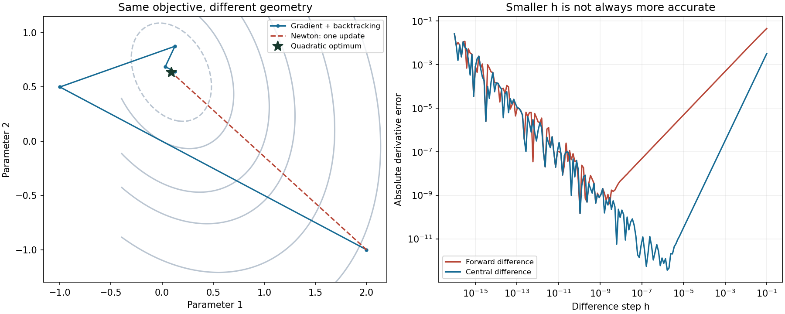

# 第一篇　数学、统计学与编程基础
# 第4章　微积分、最优化与数值计算

[返回总目录](./00_完整目录.md) · [上一章](./03_第3章_线性代数及其金融数据应用.md) · [实验代码](./code/ch04/optimization_lab.py) · [验证代码](./code/ch04/test_optimization_lab.py)

第三章回答了“数据沿哪些方向变化”。本章继续回答：参数变化一点，损失和风险怎样变化；怎样在约束下寻找最优值；计算机返回的解应该怎样验收。

贯穿案例仍使用EQ_DEMO、BOND_DEMO、GOLD_DEMO、FX_DEMO。本章协方差、参数目标和收益示例均为人工构造。风险预算用于解释风险贡献，不表示本教材已经开发了交易策略，更不提供真实市场绩效。

## 学习目标

先修要求：理解向量、内积、正定矩阵、线性方程组、最小二乘和条件数。需要会运行NumPy程序，不要求已有微积分课程基础。

完成本章后应能：

1. 从极限理解导数，从累积理解积分，并解释二者的联系。
2. 计算模型损失的梯度与Hessian，使用链式法则。
3. 说明Taylor近似的假设、误差及有效范围。
4. 判断基本凸优化问题，区分必要条件与充分条件。
5. 推导Lagrange乘子、KKT条件及简单最小方差问题。
6. 实现回溯梯度下降、阻尼Newton法和投影梯度法。
7. 推导风险贡献和风险预算，解释预算匹配的局限。
8. 检查梯度、约束残差、停止原因和计算过程的可复现性。

---

## 4.1　导数、积分、梯度、Hessian与Taylor展开

### 一、函数、极限与连续性

**函数，Function**，把输入映射为输出。例如模型参数\(\theta\)对应训练损失\(L(\theta)\)，利率\(y\)对应债券价格\(P(y)\)。

写作
\[
\lim_{x\to a}f(x)=\ell
\]
表示：输入足够接近\(a\)但不必等于\(a\)时，输出可以任意接近\(\ell\)。

精确定义是：对每个\(\varepsilon>0\)，存在\(\delta>0\)，使所有满足\(0<|x-a|<\delta\)且位于定义域内的\(x\)，都有\(|f(x)-\ell|<\varepsilon\)。

若极限等于\(f(a)\)，函数在\(a\)处**连续，Continuous**。连续不保证可导，例如\(|x|\)在0处没有唯一斜率。

多元函数把距离改为向量范数。理论上的无限接近与计算机有限精度是不同概念，不能用“令步长等于0”实现极限。

### 二、导数是局部变化率

**导数，Derivative**定义为：
\[
f'(a)=\lim_{h\to0}\frac{f(a+h)-f(a)}h.
\]

以\(f(x)=x^2\)为例：
\[
\frac{(a+h)^2-a^2}{h}=2a+h,
\]
所以\(f'(a)=2a\)。

存在导数等价于局部表示：
\[
f(a+h)=f(a)+f'(a)h+o(|h|),
\]
其中\(o(|h|)/|h|\to0\)。这意味着线性近似误差相对步长趋于0；不意味着较大变化仍可线性外推。[导数定义与例子](https://openstax.org/books/calculus-volume-1/pages/3-1-defining-the-derivative)

对正整数\(n\)，展开\((a+h)^n\)，除以\(h\)后只有一次项在极限中保留，得到：
\[
\frac{d}{dx}x^n=nx^{n-1}.
\]

设\(f,g\)可导，利用
\[
f(a+h)g(a+h)-f(a)g(a)
=[f(a+h)-f(a)]g(a+h)+f(a)[g(a+h)-g(a)]
\]
除以\(h\)取极限，得到**乘积法则**：
\[
(fg)'=f'g+fg'.
\]

若\(g\neq0\)，对\(g(x)\,[1/g(x)]=1\)求导，可得：
\[
(1/g)'=-g'/g^2,
\qquad
(f/g)'=\frac{f'g-fg'}{g^2}.
\]

对复合函数\(f(g(x))\)，令\(\Delta g=g(a+h)-g(a)\)。由可导表示：
\[
\Delta g=g'(a)h+o(|h|),
\]
\[
f(g(a)+\Delta g)-f(g(a))
=f'(g(a))\Delta g+o(|\Delta g|).
\]
因为\(\Delta g=O(|h|)\)，代入并除以\(h\)取极限，得到**链式法则，Chain Rule**：
\[
\frac{d}{dx}f(g(x))=f'(g(x))g'(x).
\]
这里\(O(|h|)\)表示其绝对值可被常数倍\(|h|\)控制。

对同一变量再次求导得到**二阶导数**\(f''\)，它描述斜率如何变化。例如价格的一阶敏感度与二阶曲率提供不同信息。

### 三、积分是带单位的累积

把区间\([a,b]\)分成小段，选取段内点\(\xi_i\)，计算：
\[
\sum_i f(\xi_i)\Delta x_i.
\]
当最大分段长度趋于0且和趋于同一有限值时，定义**定积分，Definite Integral**：
\[
\int_a^bf(x)\,dx.
\]
连续函数在有限闭区间上可积。

积分不是简单地“把所有数加起来”。若输入为每秒消息速率\(q(t)\)，则\(\int q(t)dt\)的单位是消息数；若输入为价格，则对时间积分的单位是价格乘时间，不是收益率。

令
\[
F(x)=\int_a^x f(t)\,dt,
\]
其中\(f\)连续。那么：
\[
\frac{F(x+h)-F(x)}h-f(x)
=\frac1h\int_x^{x+h}[f(t)-f(x)]dt.
\]
其绝对值不超过相应小区间内\(|f(t)-f(x)|\)的最大值，连续性使这个上界趋于0。因此：
\[
F'(x)=f(x).
\]

这里用到**微分中值定理，Mean Value Theorem，MVT**：函数在\([a,b]\)连续、在\((a,b)\)可导时，存在\(c\in(a,b)\)，使\(G(b)-G(a)=G'(c)(b-a)\)。其依据是从函数减去端点连线，得到端点等值的函数；若非常量，内部最大或最小处的导数为0，从而得到原函数导数等于连线斜率。

如果另一个函数\(G\)满足\(G'=f\)，则\((G-F)'=0\)。由中值定理，导数为0的函数在区间内为常数，于是：
\[
\int_a^bf(x)\,dx=G(b)-G(a).
\]
这就是**微积分基本定理，Fundamental Theorem of Calculus**的核心联系。[定理与教学证明](https://openstax.org/books/calculus-volume-1/pages/5-3-the-fundamental-theorem-of-calculus)

例如：
\[
\int_0^1x^2dx=[x^3/3]_0^1=1/3.
\]

由乘积求导再积分，得到**分部积分**：
\[
\int_a^b u(x)v'(x)dx
=[u(x)v(x)]_a^b-\int_a^bu'(x)v(x)dx.
\]
由链式法则同样可得到换元积分；核心是变换时必须同时变换微分因子和积分边界。

### 四、对数、指数与金融近似

可把自然对数定义为：
\[
\ln x=\int_1^x\frac1t\,dt,\quad x>0.
\]
由基本定理：
\[
(\ln x)'=1/x.
\]
指数函数\(e^x\)为其反函数。对\(\ln(e^x)=x\)使用链式法则，得到：
\[
(e^x)'=e^x.
\]

对正价格产生的简单收益\(r>-1\)，对数收益为：
\[
\ell=\ln(1+r).
\]
利用恒等式
\[
\frac1{1+t}=1-t+\frac{t^2}{1+t}
\]
从0积分到\(r\)：
\[
\ln(1+r)
=r-\frac{r^2}{2}
+\int_0^r\frac{t^2}{1+t}dt.
\]
所以当\(|r|<1\)：
\[
\left|\ln(1+r)-r+\frac{r^2}{2}\right|
\leq\frac{|r|^3}{3(1-|r|)}.
\]
这是带误差范围的近似，而不是无条件令\(\ln(1+r)=r\)。

代码计算小收益时用`np.log1p(r)`，它专门计算\(\ln(1+r)\)，可以减少先形成\(1+r\)导致的精度损失。[NumPy log1p](https://numpy.org/doc/2.1/reference/generated/numpy.log1p.html)

再看人工零息债券：假设连续复利利率为单一标量\(y\)，到期时间为\(T\)年，面值为\(F\)：
\[
P(y)=Fe^{-yT},
\quad P'(y)=-TP(y),
\quad P''(y)=T^2P(y).
\]
因此：
\[
\frac{\Delta P}{P}
\approx-T\Delta y+\frac12T^2(\Delta y)^2.
\]
若\(T=2\)、\(\Delta y=0.01\)，二阶近似为\(-0.0198\)，精确值为\(e^{-0.02}-1\)，约\(-0.0198013\)。利率输入是小数，不能把100个基点直接写成100。这里没有建模票息、信用风险或整条收益率曲线。

### 五、偏导数、全微分与梯度

对\(f:\mathbb R^p\to\mathbb R\)，固定其他变量，仅改变第\(j\)个坐标，得到**偏导数，Partial Derivative**：
\[
\frac{\partial f}{\partial x_j}
=\lim_{h\to0}\frac{f(x+he_j)-f(x)}h,
\]
其中\(e_j\)是第\(j\)个标准基向量。

若存在向量\(g\)，使
\[
f(x+h)=f(x)+g^\top h+o(\|h\|),
\]
则称函数在该点**可微，Differentiable**，且
\[
g=\nabla f(x)
=\begin{pmatrix}\partial f/\partial x_1\\\vdots\\\partial f/\partial x_p\end{pmatrix}
\]
为**梯度，Gradient**。所有偏导数存在并不足以保证可微；在邻域内偏导连续是常用充分条件。

沿单位方向\(v\)的变化率：
\[
D_vf(x)=\nabla f(x)^\top v.
\]
由Cauchy–Schwarz不等式，最小值为\(-\|\nabla f(x)\|\)，在
\(v=-\nabla f/\|\nabla f\|\)处达到。因此负梯度是欧氏单位步长意义下最陡下降方向。[方向导数与梯度](https://openstax.org/books/calculus-volume-3/pages/4-6-directional-derivatives-and-the-gradient)

若中间变量\(z=z(\theta)\)，其**雅可比矩阵，Jacobian Matrix**为
\(J_{ij}=\partial z_i/\partial\theta_j\)，则：
\[
\nabla_\theta f(z(\theta))=J^\top\nabla_zf.
\]
它来自把\(dz=Jd\theta\)代入\(df=(\nabla_zf)^\top dz\)。后续神经网络反向传播就是有组织地重复应用这个关系。

### 六、Hessian、Taylor公式与局部模型

**海森矩阵，Hessian Matrix**：
\[
H_{ij}(x)=\frac{\partial^2f}{\partial x_i\partial x_j}.
\]
二阶偏导在邻域内连续时，混合偏导相等，故Hessian对称。

对给定增量\(h\)，令\(\phi(t)=f(x+th)\)。链式法则给出：
\[
\phi'(t)=\nabla f(x+th)^\top h,
\quad
\phi''(t)=h^\top H(x+th)h.
\]
两次积分得到精确公式：
\[
f(x+h)=f(x)+\nabla f(x)^\top h
+\int_0^1(1-t)h^\top H(x+th)h\,dt.
\]
把\(H(x)\)加上再减去，得到二阶**泰勒展开，Taylor Expansion**：
\[
f(x+h)=f(x)+\nabla f(x)^\top h+\frac12h^\top H(x)h+\mathcal R.
\]
如果沿该线段满足
\[
\|H(x+th)-H(x)\|_2\leq M t\|h\|,
\]
则：
\[
|\mathcal R|
\leq M\|h\|^3\int_0^1t(1-t)dt
=\frac M6\|h\|^3.
\]
只知道二阶连续时，余项为\(o(\|h\|^2)\)；不能未经假设就声称统一三次误差界。有限阶Taylor公式也不等于无限Taylor级数处处收敛到原函数。[Taylor公式与余项](https://openstax.org/books/calculus-volume-2/pages/6-3-taylor-and-maclaurin-series)

无约束内部极小点满足\(\nabla f=0\)：否则沿负梯度的小步能下降。若此时Hessian正定，二次项压过高阶余项，得到严格局部极小；若有负曲率方向，则不是局部极小。半正定时可能无法判断：\(x^4\)与\(-x^4\)在0的二阶导数均为0，但一个极小、一个极大。

### 七、模型损失怎样求导

取带岭惩罚的平方损失：
\[
L(\beta)=\frac1{2T}\|X\beta-y\|^2+\frac\lambda2\|\beta\|^2.
\]
令残差\(u=X\beta-y\)。第\(j\)个系数的偏导为：
\[
\frac{\partial L}{\partial\beta_j}
=\frac1T\sum_tu_tX_{tj}+\lambda\beta_j.
\]
堆叠得到：
\[
\nabla L=\frac1TX^\top(X\beta-y)+\lambda\beta,
\]
\[
\nabla^2L=\frac1TX^\top X+\lambda I.
\]
与第三章相连：梯度为0就是正则化后的正规方程，但数值求解仍优先考虑稳定分解。这里所有系数都被惩罚；是否排除截距必须另行约定。

### 八、数值微分与数值积分

计算机可用有限差分检查解析梯度：
\[
f'(x)\approx\frac{f(x+h)-f(x)}h
\]
称为前向差分；中心差分为：
\[
f'(x)\approx\frac{f(x+h)-f(x-h)}{2h}.
\]
Taylor展开表明，足够光滑时前者截断误差为\(O(h)\)，后者为\(O(h^2)\)。但减去很接近的浮点数会放大舍入误差。典型绝对误差模型是
\[
E(h)\approx C_1h^2+C_2\varepsilon_{\rm mach}/h
\]
用于中心差分，常提示步长量级为\(\varepsilon_{\rm mach}^{1/3}\)再乘变量尺度；常数、函数尺度和噪声会改变最佳值，不能机械套用。

差分只能在定义域内进行，不能跨越\(\log x\)的边界或把不可导点伪装成可导。自动微分可以减少差分误差，但也不能修复错误的模型定义或时间泄漏。

对有序网格\(t_i\)，复合梯形积分为：
\[
\int_{t_0}^{t_n}q(t)dt
\approx\sum_{i=0}^{n-1}\frac{q(t_i)+q(t_{i+1})}{2}(t_{i+1}-t_i).
\]
这是把相邻点间的函数近似为直线。均匀步长\(h\)、二阶连续且\(|q''|\leq M\)时，误差绝对值不超过\((b-a)Mh^2/12\)；具体地，在小段\([a_i,b_i]\)上，令\(K(t)=(t-a_i)(b_i-t)/2\)。两次分部积分得到：
\[
\frac{b_i-a_i}{2}[q(a_i)+q(b_i)]-\int_{a_i}^{b_i}q(t)dt
=\int_{a_i}^{b_i}K(t)q''(t)dt.
\]
因为\(\int K=(b_i-a_i)^3/12\)，每段误差不超过\(Mh^3/12\)，总共\((b-a)/h\)段，得到上述界。

`np.trapezoid`按传入横坐标的顺序积分，不自动排序。[官方接口](https://numpy.org/doc/2.1/reference/generated/numpy.trapezoid.html)

工程上还要区分事后数值积分和实时累积：如果\(q(t_{i+1})\)当时尚不可用，就不能提前用它完成区间内的在线积分。选择左端保持或事后线性插值，要说明观测、到达和更新时间。

---

## 4.2　凸性、约束优化、Lagrange乘子与KKT条件

### 一、先定义优化问题

一般写成：
\[
\min_{x\in\mathcal D}f(x)
\quad\text{使}\quad
g_i(x)\leq0,\quad h_j(x)=0.
\]
\(f\)是**目标函数，Objective Function**，\(\mathcal D\)是定义域，满足全部约束的点组成**可行集，Feasible Set**。

局部最优只优于附近可行点；全局最优不劣于任何可行点。还有两类必须区分的失败：

- 约束互相矛盾，没有可行点。
- 可行但目标可无限下降，没有有限最优值。

优化器完成一次调用，不代表这两种问题已经排除。

### 二、凸集、凸函数和一阶条件

集合\(\mathcal C\)若对任意\(x,y\in\mathcal C\)、\(0\leq t\leq1\)，都有
\[
(1-t)x+ty\in\mathcal C,
\]
称为**凸集，Convex Set**。非负权重且总和为1的集合是凸集，虽然它不是线性子空间。

在凸定义域上，函数若满足：
\[
f((1-t)x+ty)\leq(1-t)f(x)+tf(y),
\]
称为**凸函数，Convex Function**。

对可微凸函数，把上式改写成：
\[
\frac{f(x+t(y-x))-f(x)}t\leq f(y)-f(x).
\]
令\(t\downarrow0\)，得到：
\[
f(y)\geq f(x)+\nabla f(x)^\top(y-x).
\]
切平面是全局下界。

反过来，如果这个下界对所有点都成立，令\(z=(1-t)x+ty\)，分别在\(z\)处对\(x,y\)使用下界，乘以\(1-t,t\)后相加，梯度项抵消，就得到凸函数定义。因此两者等价。

对二阶连续函数，若定义域是开凸集：
\[
f\text{凸}\quad\Longleftrightarrow\quad H(x)\succeq0\ \text{处处成立}.
\]
必要性可沿任意直线考察对称二阶差商；充分性来自4.1的积分余项非负，从而一阶下界成立。

因此平方损失、正半定二次型和\(-\log x\)都是基本凸目标。神经网络损失通常不能据此认定为凸。

若凸问题中某局部最优\(x\)不是全局最优，取更优可行点\(y\)，则凸性保证沿线段任意足够小步都有更低目标值，与局部最优矛盾。因此凸问题的局部最优也是全局最优。

这些判据与标准定义可对照Boyd、Vandenberghe的[官方教材及讲义](https://web.stanford.edu/~boyd/cvxbook/)第3章。

### 三、严格凸与强凸

若对不同点、\(0<t<1\)取严格不等号，称为**严格凸，Strictly Convex**；若最优解存在，它至多一个。严格凸不保证最优值一定能取到，例如\(e^x\)在整个实轴上没有最小点。

更强的条件是：存在\(m>0\)，使
\[
f(y)\geq f(x)+\nabla f(x)^\top(y-x)+\frac m2\|y-x\|^2.
\]
称为**强凸，Strongly Convex**。二阶连续时，对应\(H(x)\succeq mI\)。

若无约束最优点\(x^\star\)存在，对右侧关于\(y\)取最小值，可得：
\[
f(x)-f(x^\star)\leq\frac{\|\nabla f(x)\|^2}{2m}.
\]
因此在已知强凸常数时，小梯度可以给出目标差上界；一般非凸问题没有这个保证。

\(x^4\)严格凸，但在整个实轴上没有正的统一二阶下界，故不是强凸。不要把“严格”与“强”混为一谈。

### 四、等式约束和Lagrange乘子

考虑：
\[
\min_x f(x)\quad\text{使}\quad h(x)=0.
\]
在约束足够光滑、约束梯度线性无关的正则点，局部可行方向满足
\[
J_h(x)d=0.
\]
最优时目标梯度与所有可行切向方向正交：
\[
\nabla f(x)^\top d=0.
\]
第三章的零空间与行空间关系说明，梯度必须位于约束梯度张成的空间，因此存在拉格朗日乘子（Lagrange Multiplier）\(\nu\)，使：
\[
\nabla f(x)+J_h(x)^\top\nu=0.
\]

定义**拉格朗日函数，Lagrangian**：
\[
\mathcal L(x,\nu)=f(x)+\nu^\top h(x).
\]
于是候选解满足\(\nabla_x\mathcal L=0\)及\(h(x)=0\)。乘子\(\nu\)可以为正或负；非线性问题中这些条件通常还不是全局最优证明。

例如仅要求权重和为1：
\[
\min_w\frac12w^\top Sw
\quad\text{使}\quad\mathbf1^\top w=1,
\]
假设\(S\succ0\)。Lagrange函数给出：
\[
Sw+\nu\mathbf1=0.
\]
所以：
\[
w=-\nu S^{-1}\mathbf1.
\]
代入总和约束：
\[
-\nu=\frac1{\mathbf1^\top S^{-1}\mathbf1},
\]
得到：
\[
w^\star=\frac{S^{-1}\mathbf1}{\mathbf1^\top S^{-1}\mathbf1}.
\]
数值上应先解\(Sz=\mathbf1\)，再令\(w=z/(\mathbf1^\top z)\)。

该公式允许负权重。若要求不做空，必须加入\(w_i\geq0\)并重新求解；不能把负权重截成0后默认仍是原问题的最优解。

### 五、不等式约束、对偶与互补松弛

加入不等式后：
\[
\mathcal L(x,\lambda,\nu)
=f(x)+\sum_i\lambda_i g_i(x)+\sum_j\nu_jh_j(x),
\quad \lambda_i\geq0.
\]
非负乘子很关键：对任何可行\(x\)，有
\[
\mathcal L(x,\lambda,\nu)\leq f(x).
\]
定义**对偶函数，Dual Function**：
\[
d(\lambda,\nu)=\inf_{x\in\mathcal D}\mathcal L(x,\lambda,\nu).
\]
于是：
\[
d(\lambda,\nu)\leq f(x)\quad\text{对任何可行 }x.
\]
最大化这个下界就是**对偶问题，Dual Problem**，得到的最优值不超过原问题最优值，称为**弱对偶，Weak Duality**。

当两者最优值相等时称为**强对偶，Strong Duality**。若原、对偶最优解都达到且没有间隙，则
\[
d(\lambda^\star,\nu^\star)
\leq \mathcal L(x^\star,\lambda^\star,\nu^\star)
\leq f(x^\star)
\]
中全部取等号。由每项\(\lambda_i g_i(x^\star)\leq0\)，得到：
\[
\lambda_i^\star g_i(x^\star)=0.
\]
这称为**互补松弛，Complementary Slackness**。未碰到边界的约束，其乘子为0；乘子为正的约束必然取等号。边界约束也可能恰好具有0乘子。

### 六、KKT条件及其适用范围

**卡鲁什—库恩—塔克条件，Karush–Kuhn–Tucker Conditions，KKT**包括：

1. 原始可行：\(g_i(x)\leq0,\ h_j(x)=0\)。
2. 对偶可行：\(\lambda_i\geq0\)。
3. 互补松弛：\(\lambda_i g_i(x)=0\)。
4. 驻点：
\[
\nabla f(x)+\sum_i\lambda_i\nabla g_i(x)
+\sum_j\nu_j\nabla h_j(x)=0.
\]

为什么在凸问题中足够？假设目标和不等式函数凸，等式为仿射。固定满足KKT的乘子，\(\mathcal L\)是凸函数，驻点条件使\(x^\star\)为它的全局最小点。对任何可行\(y\)：
\[
f(y)\geq\mathcal L(y,\lambda^\star,\nu^\star)
\geq\mathcal L(x^\star,\lambda^\star,\nu^\star)
=f(x^\star).
\]
因此得到全局最优证书。

“最优就一定满足KKT”还需要约束资格条件。一个常用结论是**斯莱特条件，Slater's Condition**：对适当的可微凸问题，存在定义域内部的点，使所有不等式严格成立、仿射等式成立；在有限最优值等通常假设下，可得到强对偶和相应乘子存在。这是一个需要凸分析证明的定理，本章使用该定理，不把它当成由上述代数自动推出。相关条件、互补松弛和KKT可核对[官方讲义第5章](https://web.stanford.edu/~boyd/cvxbook/bv_cvxslides.pdf)。

反例说明条件不能省略：
\[
\min_x x\quad\text{使}\quad x^2\leq0.
\]
唯一可行点0当然最优，但驻点要求
\(1+\lambda(2x)=0\)，在0处不可能成立。约束没有严格可行点，梯度也退化。

再看正常边界例子：
\[
\min_x x^2\quad\text{使}\quad1-x\leq0.
\]
最优为\(x=1\)，驻点\(2x-\lambda=0\)给出\(\lambda=2\)。普通梯度不为0，约束的作用通过乘子体现。

### 七、乘子的经济含义与验收指标

若约束写成\(g_i(x)\leq c_i\)，Lagrange函数含\(\lambda_i(g_i(x)-c_i)\)。在最优值函数可微、乘子稳定等条件下：
\[
\frac{\partial v}{\partial c_i}=-\lambda_i^\star.
\]
它表示小幅放宽约束对最优目标值的边际影响，常称**影子价格，Shadow Price**。它不是资产未来价格预测；活跃集切换时最优值可能不可微，不能强行用唯一导数解释。

工程验收至少分别检查：
\[
r_{\rm eq}=\|h(x)\|,\quad
r_{\rm ineq}=\max_i\max(g_i(x),0),
\]
\[
r_{\rm dual}=\max_i\max(-\lambda_i,0),\quad
r_{\rm comp}=\max_i|\lambda_i g_i(x)|,
\]
\[
r_{\rm stat}=\left\|\nabla_x\mathcal L\right\|.
\]
不同残差单位可能不同，阈值需要结合缩放解释。仅检查目标函数下降，不能证明约束已经满足。

---

## 4.3　梯度算法、数值稳定性与风险预算

### 一、梯度下降为什么能下降

**梯度下降，Gradient Descent，GD**迭代：
\[
x_{k+1}=x_k-\eta_k\nabla f(x_k),
\]
其中\(\eta_k>0\)是步长，也称学习率。

若梯度满足**利普希茨连续，Lipschitz Continuity**：
\[
\|\nabla f(x)-\nabla f(y)\|\leq L\|x-y\|,
\]
沿线段积分：
\[
f(x+h)-f(x)=\int_0^1\nabla f(x+th)^\top h\,dt.
\]
减去\(\nabla f(x)^\top h\)，用范数界可得：
\[
f(x+h)\leq f(x)+\nabla f(x)^\top h+\frac L2\|h\|^2.
\]
令\(h=-\eta\nabla f(x)\)：
\[
f(x_{k+1})\leq f(x_k)
-\eta(1-L\eta/2)\|\nabla f(x_k)\|^2.
\]
因此\(0<\eta<2/L\)保证非驻点处下降。

若同时是\(m\)强凸，取\(\eta=1/L\)，再用上一节的梯度与目标差关系：
\[
f(x_{k+1})-f^\star
\leq(1-m/L)[f(x_k)-f^\star].
\]
这称为线性收敛：目标差按几何比例下降，不是说参数轨迹是一条直线。

对二次函数
\[
f(x)=\tfrac12x^\top Qx+c^\top x,\quad Q\succ0,
\]
有\(\nabla f=Qx+c\)、最优点\(x^\star=-Q^{-1}c\)。误差满足：
\[
e_{k+1}=(I-\eta Q)e_k.
\]
在特征方向上，每步乘以\(1-\eta\lambda_i\)。所有方向都收缩要求\(0<\eta<2/\lambda_{\max}\)。特征值跨度大时，不同方向收缩速度差异大，这与第三章条件数直接相连。

### 二、回溯线搜索和失败状态

不知道合适步长时，可以使用**回溯线搜索，Backtracking Line Search**。先选下降方向\(p\)，要求\(g^\top p<0\)，再从\(\eta=1\)开始，反复减半，直到：

1. 新点仍在定义域内；
2. 目标值有限；
3. 满足**阿米霍充分下降条件，Armijo Sufficient Decrease Condition**：
\[
f(x+\eta p)\leq f(x)+a\eta g^\top p,\quad0<a<1.
\]

对足够小步长，可微性使真实变化接近\(\eta g^\top p\)，因此在适当条件下能够接受。程序仍必须给出尝试次数上限，不能无限循环。

本章取\(a=10^{-4}\)、步长每次乘\(1/2\)。这只是算法配置，不是由金融数据校准的参数。

程序应区分梯度达到阈值、迭代预算耗尽、线搜索失败以及非法输入。后两类不能包装成“优化成功”。

### 三、Newton法与局部曲率

**牛顿法，Newton's Method**最小化局部二次模型：
\[
m(p)=f(x)+g^\top p+\tfrac12p^\top Hp.
\]
若\(H\succ0\)，驻点满足：
\[
Hp=-g.
\]
数值上解这个线性方程，而不是显式计算\(H^{-1}\)。

该方向是下降方向：
\[
g^\top p=-g^\top H^{-1}g<0\quad(g\neq0).
\]
配合回溯得到**阻尼牛顿法，Damped Newton Method**。

对正定二次函数，Hessian恒为\(Q\)，完整一步直接到最优点。非线性函数通常没有这个性质。

局部二次收敛也有条件：若邻域内\(H\succeq mI\)、Hessian为\(M\)-Lipschitz，且完整Newton步留在邻域，令\(e=x-x^\star\)，则：
\[
e_{\rm new}
=H(x)^{-1}\int_0^1[H(x)-H(x^\star+te)]e\,dt.
\]
所以：
\[
\|e_{\rm new}\|
\leq\frac M{2m}\|e\|^2.
\]
远离最优点、不定Hessian、噪声梯度或错误导数都会破坏这些保证。

梯度法每步通常较便宜；稠密Newton线性系统通常需要立方量级分解。大规模问题可考虑拟Newton、共轭梯度或Hessian向量积方法；本章不为了展示复杂度引入额外依赖。

### 四、投影梯度与非负权重

设可行集\(\mathcal C\)闭且凸，**欧氏投影，Euclidean Projection**：
\[
\Pi_{\mathcal C}(v)=\arg\min_{w\in\mathcal C}\tfrac12\|w-v\|^2.
\]
**投影梯度法，Projected Gradient Descent，PGD**：
\[
w_{k+1}=\Pi_{\mathcal C}(w_k-\eta\nabla f(w_k)).
\]

本章可行集是**概率单纯形，Probability Simplex**：
\[
\Delta=\{w:w_i\geq0,\ \mathbf1^\top w=1\}.
\]
投影子问题的KKT驻点为：
\[
w_i-v_i+\theta-\lambda_i=0.
\]
若\(w_i>0\)，互补松弛给出\(\lambda_i=0\)，故\(w_i=v_i-\theta\)；若\(w_i=0\)，则\(v_i\leq\theta\)。合并：
\[
w_i=\max(v_i-\theta,0),
\quad\sum_i\max(v_i-\theta,0)=1.
\]
将\(v\)降序排列为\(u\)，设正坐标数量为\(\rho\)，则
\[
\theta=\frac{\sum_{j=1}^\rho u_j-1}{\rho}.
\]
遍历前缀，找到满足\(u_\rho>\theta\)的最大索引，即得到投影。成本主要是排序，约\(O(d\log d)\)。它通常不同于“先截负值再除以总和”。

在边界最优点，\(\nabla f\)不必为0。定义**投影梯度映射，Projected Gradient Mapping**：
\[
G_\eta(w)=\frac{w-\Pi_\Delta(w-\eta\nabla f(w))}{\eta}.
\]
若它为0，投影最优条件给出
\(\nabla f(w)^\top(y-w)\geq0\)对所有可行\(y\)成立；对凸目标，这就是全局最优条件。

投影性质还保证\(g^\top p\leq-\|p\|^2/\eta\)，其中\(p=w_{k+1}-w_k\)。代入光滑上界，取\(\eta\leq1/L\)可得目标不增。因此本章最小方差程序用最大特征值确定步长，并检查映射范数，而非强求普通梯度为0。

### 五、风险贡献的微积分解释

给定协方差\(S\succ0\)，定义组合波动：
\[
\sigma(w)=\sqrt{w^\top Sw}.
\]
链式法则和对称性给出：
\[
\nabla\sigma(w)=\frac{Sw}{\sigma(w)}.
\]
第\(i\)个资产的**边际风险贡献，Marginal Risk Contribution，MRC**为偏导数；**风险贡献，Risk Contribution，RC**定义为：
\[
RC_i=w_i\frac{(Sw)_i}{\sigma(w)}.
\]
于是：
\[
\sum_iRC_i=\frac{w^\top Sw}{\sigma(w)}=\sigma(w).
\]
这也符合一次齐次函数的欧拉关系（Euler's Homogeneous Function Relation）：\(\sigma(cw)=c\sigma(w)\)，对\(c>0\)求导并在1处取值，得到上述加总。

**相对风险贡献，Relative Risk Contribution，RRC**：
\[
RRC_i=\frac{RC_i}{\sigma(w)}
=\frac{w_i(Sw)_i}{w^\top Sw},
\quad\sum_iRRC_i=1.
\]
相对贡献可能为负：某头寸在当前协方差和权重下具有对冲作用。不能因为它不符合“百分比必须非负”的直觉就改写数据。

即使全部权重相等，风险贡献通常不相等。两个不相关资产波动分别为2%、1%，等权时相对贡献为80%、20%；等风险贡献对应约1/3、2/3的资本权重。

### 六、风险预算如何转为凸优化

给定严格正预算\(b_i>0\)、\(\sum_ib_i=1\)，希望找到正权重，使\(RRC_i=b_i\)。可先解：
\[
\min_{x_i>0}
\Phi(x)=\frac12x^\top Sx-\sum_i b_i\log x_i.
\]
注意这里暂时没有\(\mathbf1^\top x=1\)约束。

梯度与Hessian：
\[
\nabla\Phi=Sx-b/x,
\quad
\nabla^2\Phi=S+\operatorname{diag}(b_i/x_i^2)\succ0.
\]
除法按坐标进行。正定二次项控制无穷远，正预算对数项使靠近任一边界时目标趋于正无穷，因此存在唯一内部最优点。

驻点给出：
\[
x_i(Sx)_i=b_i.
\]
加总：
\[
x^\top Sx=\sum_ib_i=1.
\]
所以该点相对贡献正好为\(b_i\)。再归一化：
\[
w=\frac{x}{\mathbf1^\top x}.
\]
相对贡献的分子、分母都按同一比例平方缩放，因此预算仍保持。这一构造可与[CVX研究组的风险预算教学题](https://www.cvxgrp.org/cvx_short_course/docs/exercises/notebooks/13.20.html)交叉核对。

对角协方差时可手算：
\[
x_i^2S_{ii}=b_i
\quad\Rightarrow\quad
w_i\propto\frac{\sqrt{b_i}}{\sqrt{S_{ii}}}.
\]
等预算时成为逆波动权重，但有相关性时通常不能继续套用该公式。

若把协方差整体乘正数\(c\)，最优\(x\)缩放为原来的\(1/\sqrt c\)，归一化权重不变。因此代码用平均方差做公共缩放改善数值尺度；这不同于随意改变某一个资产的单位。

零预算不能直接放入本章严格正域算法。额外权重上限、杠杆和换手约束也会改变问题，不能截断归一化后声称仍精确匹配预算。[受约束风险预算研究](https://arxiv.org/abs/1902.05710)

### 七、完整数值实验

本实验只需要已有NumPy。四资产协方差由指定的人工相关矩阵和单期波动构成，不是对官方赛题数据的估计。

程序完成三类检查：二次函数解析解对照；非负最小方差约束求解；指定预算的风险贡献匹配。主函数把任何未收敛状态作为失败处理，不发布貌似有效的结果。

```python
"""第4章数值优化实验；所有协方差与目标均为人工构造。"""
from __future__ import annotations
import argparse
import json
from datetime import datetime, timezone
from pathlib import Path
import numpy as np


def vector(value, name="vector"):
    x = np.array(value, dtype=float, copy=True)
    if x.ndim != 1 or x.size == 0 or not np.isfinite(x).all():
        raise ValueError(f"{name} must be a nonempty finite vector")
    return x


def spd(value):
    s = np.array(value, dtype=float, copy=True, order="C")
    if (s.ndim != 2 or s.shape[0] == 0 or s.shape[0] != s.shape[1]
            or not np.isfinite(s).all()):
        raise ValueError("a finite square matrix is required")
    scale = max(float(np.linalg.norm(s, 2)), np.finfo(float).tiny)
    if np.max(np.abs(s - s.T)) > 1e-12 * scale:
        raise ValueError("matrix must be symmetric")
    s = (s + s.T) / 2
    np.linalg.cholesky(s)  # 不静默修复奇异或不定矩阵。
    return s


def central_gradient(fun, point, relative_step=1e-5):
    x = vector(point)
    if not np.isfinite(relative_step) or relative_step <= 0:
        raise ValueError("positive finite difference step required")
    gradient = np.empty_like(x)
    for j in range(len(x)):
        step = relative_step * max(1.0, abs(x[j]))
        right, left = x.copy(), x.copy()
        right[j] += step
        left[j] -= step
        gradient[j] = (fun(right) - fun(left)) / (2 * step)
    if not np.isfinite(gradient).all():
        raise ValueError("difference crossed domain or produced non-finite values")
    return gradient


def minimize(fun, grad, initial, hess=None, positive=False, tol=1e-9, max_iter=5000):
    x = vector(initial)
    if not np.isfinite(tol) or tol <= 0 or max_iter < 0:
        raise ValueError("invalid tolerance or iteration limit")
    if positive and np.any(x <= 0):
        raise ValueError("strictly positive initial point required")
    history = []
    for iteration in range(max_iter + 1):
        value = float(fun(x))
        g = vector(grad(x), "gradient")
        if g.shape != x.shape or not np.isfinite(value):
            raise ValueError("invalid objective or gradient")
        norm = float(np.linalg.norm(g))
        history.append({"iteration": iteration, "objective": value, "gradient_norm": norm})
        if norm <= tol:
            return {"x": x, "converged": True, "reason": "gradient_tolerance", "history": history}
        if iteration == max_iter:
            break
        direction = -g if hess is None else np.linalg.solve(spd(hess(x)), -g)
        slope = float(g @ direction)
        if not np.isfinite(slope) or slope >= 0:
            raise ValueError("direction is not a finite descent direction")
        step = 1.0
        accepted = False
        for _ in range(60):
            candidate = x + step * direction
            if np.isfinite(candidate).all() and (not positive or np.all(candidate > 0)):
                new_value = float(fun(candidate))
                if np.isfinite(new_value) and new_value <= value + 1e-4 * step * slope:
                    accepted = True
                    break
            step *= 0.5
        if not accepted:
            return {"x": x, "converged": False, "reason": "line_search_failed", "history": history}
        history[-1]["step"] = step
        x = candidate
    return {"x": x, "converged": False, "reason": "iteration_limit", "history": history}


def project_simplex(value):
    v = vector(value)
    ordered = np.sort(v)[::-1]
    thresholds = (np.cumsum(ordered) - 1) / np.arange(1, len(v) + 1)
    active = np.flatnonzero(ordered > thresholds)
    theta = thresholds[active[-1]]
    return np.maximum(v - theta, 0.0)


def minimum_variance(covariance, tol=1e-9, max_iter=20000):
    s = spd(covariance)
    # 正的公共尺度不改变最优权重；使停止阈值对应无量纲问题。
    c = s / np.mean(np.diag(s))
    step = 1.0 / np.linalg.eigvalsh(c)[-1]
    w = np.full(len(c), 1 / len(c))
    history = []
    for iteration in range(max_iter + 1):
        candidate = project_simplex(w - step * (c @ w))
        mapping = float(np.linalg.norm((w - candidate) / step))
        history.append({"iteration": iteration, "objective": float(0.5 * w @ c @ w),
                        "mapping_norm": mapping})
        if mapping <= tol:
            return {"x": w, "converged": True, "reason": "projected_gradient_tolerance",
                    "history": history}
        if iteration == max_iter:
            break
        w = candidate
    return {"x": w, "converged": False, "reason": "iteration_limit", "history": history}


def risk_contributions(weights, covariance):
    w = vector(weights, "weights")
    s = spd(covariance)
    if len(w) != len(s):
        raise ValueError("weights and covariance axes differ")
    variance = float(w @ s @ w)
    if variance <= 0:
        raise ValueError("positive portfolio variance required")
    volatility = np.sqrt(variance)
    absolute = w * (s @ w) / volatility
    return absolute, absolute / volatility


def risk_budget(covariance, budget):
    s = spd(covariance)
    b = vector(budget, "budget")
    if len(b) != len(s) or np.any(b <= 0) or abs(float(b.sum()) - 1) > 1e-12:
        raise ValueError("strictly positive budgets summing to one required")
    c = s / np.mean(np.diag(s))
    fun = lambda x: float(0.5 * x @ c @ x - b @ np.log(x))
    grad = lambda x: c @ x - b / x
    hess = lambda x: c + np.diag(b / x ** 2)
    result = minimize(fun, grad, np.sqrt(b / np.diag(c)), hess=hess, positive=True)
    # 失败时不发布一个貌似有效的风险预算结果。
    if not result["converged"]:
        raise RuntimeError(result["reason"])
    result["weights"] = result["x"] / result["x"].sum()
    result["relative_contributions"] = risk_contributions(result["weights"], s)[1]
    return result


def synthetic_covariance():
    vol = np.array([0.020, 0.008, 0.015, 0.010])
    correlation = np.array([[1, -.15, .25, .10], [-.15, 1, -.10, .05],
                            [.25, -.10, 1, .20], [.10, .05, .20, 1]])
    return spd(correlation * np.outer(vol, vol))


def main():
    parser = argparse.ArgumentParser()
    parser.add_argument("--out", type=Path)
    args = parser.parse_args()
    output = args.out or Path(__file__).parent / "runs" / datetime.now(
        timezone.utc).strftime("run_%Y%m%dT%H%M%S_%fZ")
    output.mkdir(parents=True, exist_ok=False)
    q = np.array([[4., 1.], [1., 3.]])
    linear = np.array([-1., -2.])
    fun = lambda x: float(0.5 * x @ q @ x + linear @ x)
    grad = lambda x: q @ x + linear
    initial = np.array([2., -1.])
    gradient_error = float(np.max(np.abs(central_gradient(fun, initial) - grad(initial))))
    gd = minimize(fun, grad, initial)
    newton = minimize(fun, grad, initial, hess=lambda x: q)
    covariance = synthetic_covariance()
    mv = minimum_variance(covariance)
    if not gd["converged"] or not newton["converged"] or not mv["converged"]:
        raise RuntimeError("a numerical solve did not converge")
    budget = np.array([.4, .2, .2, .2])
    rb = risk_budget(covariance, budget)
    np.savetxt(output / "synthetic_covariance.csv", covariance, delimiter=",")
    np.savez(output / "solutions.npz", gradient_solution=gd["x"], newton_solution=newton["x"],
             minimum_variance=mv["x"], risk_budget=rb["weights"], budget=budget)
    for name, result in {"gradient": gd, "newton": newton, "minimum_variance": mv,
                         "risk_budget": rb}.items():
        (output / f"{name}_history.json").write_text(
            json.dumps(result["history"], indent=2, allow_nan=False), encoding="utf-8")
    grid = np.linspace(0, 1, 101)
    integral = float(np.trapezoid(grid ** 2, grid))
    report = {"data_kind": "synthetic", "numpy": np.__version__,
              "asset_order": ["EQ_DEMO", "BOND_DEMO", "GOLD_DEMO", "FX_DEMO"],
              "covariance_frequency": "one artificial observation period",
              "gradient_max_abs_error": gradient_error,
              "quadratic_reference": np.linalg.solve(q, -linear).tolist(),
              "gd_solution": gd["x"].tolist(), "newton_solution": newton["x"].tolist(),
              "gd_updates": len(gd["history"]) - 1, "newton_updates": len(newton["history"]) - 1,
              "minimum_variance_weights": mv["x"].tolist(),
              "minimum_variance_mapping": mv["history"][-1]["mapping_norm"],
              "risk_budget_target": budget.tolist(), "risk_budget_weights": rb["weights"].tolist(),
              "risk_budget_relative_contributions": rb["relative_contributions"].tolist(),
              "risk_budget_max_abs_error": float(np.max(np.abs(rb["relative_contributions"] - budget))),
              "trapezoid_x_squared": integral, "integration_absolute_error": abs(integral - 1 / 3),
              "interpretation": "numerical checks only; no market state accuracy or strategy performance"}
    (output / "manifest.json").write_text(json.dumps(report, indent=2, allow_nan=False),
                                         encoding="utf-8")
    print(json.dumps(report, indent=2, allow_nan=False))
    print(f"Artifacts: {output.resolve()}")


if __name__ == "__main__":
    main()

```

### 八、运行、输出与图形解释

在配套目录运行：

```powershell
Set-Location 'E:\AAAstudy\国元证券金融科技竞赛\教材\code\ch04'
& 'D:\Anaconda\python.exe' optimization_lab.py
& 'D:\Anaconda\python.exe' -m unittest -v test_optimization_lab.py
```

实际环境为已有Python 3.13.5、NumPy 2.1.3；没有下载解释器或安装库。默认新建时间戳输出目录，不覆盖已有实验。

人工二次目标使用：
\[
Q=\begin{pmatrix}4&1\\1&3\end{pmatrix},
\qquad c=(-1,-2)^\top.
\]
精确最优点为\((1/11,7/11)^\top\)。

本次实际结果：

|检查|实际值或数量级|
|---|---:|
|中心差分与解析梯度最大绝对差|约\(6.41\times10^{-11}\)|
|回溯梯度下降更新次数|28|
|Newton更新次数|1|
|非负最小方差投影梯度映射范数|约\(8.91\times10^{-10}\)|
|风险预算最大相对贡献误差|约\(3.89\times10^{-16}\)|
|\(\int_0^1x^2dx\)的100段梯形近似|0.33335|
|积分绝对误差|约\(1.67\times10^{-5}\)|

指定预算为\((0.4,0.2,0.2,0.2)\)。得到的资本权重约：
\[
(0.19503,\ 0.40619,\ 0.15778,\ 0.24100).
\]
非负最小方差权重约：
\[
(0.08084,\ 0.54892,\ 0.11416,\ 0.25608).
\]
两者目标不同，所以结果不同；不能把其中某一个称为普遍更好的金融组合。

12项验证通过，覆盖解析解、导数、回溯下降、迭代上限、单纯形投影、边界最优、风险预算的对角闭式解与尺度不变性、负贡献、数值积分及非法输入。



左图是本章人工二次目标：Newton一步到达最优；右图在\(\log(1+x)\)、\(x=0.02\)处比较差分误差，步长过小反而增加舍入影响。图是数值教学实验，不是金融回测。配图使用现有Matplotlib 3.10.0生成并检查。

### 九、从数值工具到监控任务

在平台中，这些工具可服务于模型训练、风险归因和敏感度分析：

- 用梯度更新模型参数，检查训练损失是否实现了所声称的目标。
- 把股债等资产的风险贡献分开，识别风险是否集中在少数资产。
- 在固定参考权重下监控RRC随协方差变化的情况。
- 比较不同状态窗口的风险结构，但必须标明样本量和估计方法。

“风险集中度变化”可以作为市场状态分析的一个特征；它本身不是牛熊标签。风险预算是给定协方差下的结构安排，不是收益预测。估计协方差变化后，现实风险贡献可能偏离模型预算。


---

## 工程实现与常见问题

1. **目标与单位先于算法。** 波动率、方差和负对数目标的单位不同；学习率、惩罚系数和停止阈值都受尺度影响。代码的公共协方差缩放有明确数学不变性，不是无记录更改资产单位。
2. **数据误差、估计误差、优化误差分开。** 更小梯度不代表协方差估计更准确。对错误样本精确求解，仍可能得到错误的金融解释。
3. **定义域必须检查。** 对数变量需严格正；不能把负变量偷偷夹成小正数后继续声称在解同一个问题。
4. **导数交叉验证。** 在多个内部点比较解析梯度和有限差分；有条件时再与自动微分比较。误差随步长变化而不是某一次凑巧相等，更有说服力。
5. **记录停止原因。** 无约束梯度、投影梯度或KKT残差应与问题匹配。目标值变化小可能只是步长过小、浮点平台或迭代停滞。
6. **拒绝未收敛结果。** 本章主程序检查成功标志；风险预算函数失败时抛出异常。生产系统可以按事先约定降级到旧版本，但须记录版本、陈旧度与原因。
7. **时间有效性延伸到模型发布。** 训练数据可用时间、训练截止、训练任务完成、模型发布时间是不同字段；模型完成后才能用于后续决策。数值计算正确不能替代PIT检查。
8. **替代算法按规模选择。** 小型正定二次问题优先解方程；大型模型可采用一阶方法；凸约束问题可使用专业求解器并检查状态。随机梯度只从已划定训练集取样，不允许以“随机”为由打乱时间划分。
9. **不要无记录修复。** 不定协方差、异常资产尺度和缺列都应追查；所用收缩、截断或数据隔离须保留输入与处理记录。
10. **复现模型与过程。** 保存数据或合成规则、资产顺序、目标定义、求解器参数、依赖版本、迭代历史、残差和失败状态。本章历史为小型实验全部保存，生产中还需考虑采样与存储成本。

## 本章总结

微分把参数变化转为局部敏感度，积分把局部量累积为整体量，Taylor公式把两者连接为可分析的局部模型。梯度和Hessian不是孤立符号，而是训练损失、风险贡献和数值算法的共同语言。

凸性帮助判断什么条件可以证明全局最优；约束决定该检查普通梯度、投影梯度还是KKT残差。风险预算展示了怎样把金融结构要求转为可验证的凸优化，同时保留对协方差估计、时间有效性和样本外变化的限制。

## 分层练习

### 基础理解题

**练习1：导数与近似边界。** 用定义计算\(x^2\)在2处的导数。解释\(|x|\)在0处为什么不可导。简单收益\(r=0.02\)时，对数收益的一阶、二阶近似分别是多少？给出本章公式允许的二阶误差上界。

**练习2：积分与实时性。** 人工消息速率\(q(t)=1000+200t\)，\(t\)以秒计。计算0至5秒的总消息数及端点梯形近似。在只知道0秒速率时，是否能把最终积分结果填入1秒时的在线输出？

### 数学推导题

**练习3：梯度和Hessian。** 对
\[
f(\theta)=\tfrac12(\theta_1+2\theta_2-3)^2
+\tfrac12(2\theta_1-\theta_2)^2
+\tfrac{0.1}{2}\|\theta\|^2,
\]
求梯度、Hessian和唯一最优点，说明凸性。

**练习4：严格凸不等于强凸。** 比较\(x^2,x^4,-x^2\)在整个实轴上的凸性、强凸性及0点性质。为什么仅知道0处一阶导数为0不能判定极小？

**练习5：等式最小方差。** 令\(S=\operatorname{diag}(1,4)\)，求只要求权重和为1的最小方差权重、Lagrange乘子、方差及目标\(\tfrac12w^\top Sw\)。

**练习6：边界KKT。** 令
\[
S=\begin{pmatrix}1&2\\2&9\end{pmatrix}.
\]
证明在\(w\geq0,\mathbf1^\top w=1\)下，\(\tfrac12w^\top Sw\)的最优点为\((1,0)^\top\)。给出等式乘子和两个不等式乘子，核对全部KKT条件。

**练习7：步长与曲率。** 对\(f(x)=\tfrac12x_1^2+50x_2^2\)，分析梯度下降步长0.1和0.01时的误差变化。给出稳定步长范围，并解释慢方向。

**练习8：单纯形投影。** 手算\(v=(0.8,-0.4,0.7)\)在概率单纯形上的投影。与“截负值后归一化”比较，哪一个真正最小化欧氏距离？

**练习9：风险贡献与预算。** 两个不相关资产的单期波动为2%、1%。计算等权时的相对风险贡献，再求等风险贡献权重。若目标预算改为80%、20%，权重是什么？

### 编程题

**练习10：独立检查风险预算梯度。** 使用本章协方差和正内部点，编写代码检查
\(\tfrac12x^\top Cx-\sum b_i\log x_i\)的解析梯度，其中\(C\)为公共缩放后的协方差。解释为何不能在0点做中心差分。

### 金融分析与开放工程题

**练习11：时间有效性审计。** 某模型按09:30:05的数据可用截止训练，09:30:10才完成并发布。一条事件时间09:29:00的数据在09:30:08才到达。它能否进入该训练版本？09:30:07能否使用这个新模型？如何记录迟到数据及后续重训练？

**练习12：优化服务验收。** 设计一个有权重上限的风险分析服务。说明为什么不能先求无约束风险预算，再截断超限权重并声称预算精确满足。给出输入、失败、降级、验证与展示方案。

## 详细参考答案

### 练习1参考答案

\[
\frac{(2+h)^2-4}{h}=4+h\to4.
\]
\(|x|\)在0的右差商为1，左差商为-1，无法形成同一个极限。

对\(r=0.02\)，一阶近似为0.02；二阶为
\[
0.02-\tfrac12(0.02)^2=0.0198.
\]
误差上界：
\[
\frac{0.02^3}{3(1-0.02)}
\approx2.7211\times10^{-6}.
\]
精确对数约0.0198026273，实际二阶误差约\(2.6273\times10^{-6}\)，没有超过该界。这里收益是无量纲小数，不能把0.02与2直接混用。

### 练习2参考答案

\[
\int_0^5(1000+200t)dt
=[1000t+100t^2]_0^5
=7500.
\]
端点速率为1000、2000，梯形近似：
\[
\frac{1000+2000}{2}\times5=7500.
\]
由于函数线性，本题梯形公式精确。

若这个线性函数是预先已知的确定性模拟规则，可以据它计算预设值；但若只是事后从端点数据推定，就不能把尚未获得的5秒观测用于1秒在线结果。必须区分预先给定的模型预测与已观测累计量，记录各自的证据来源。

### 练习3参考答案

令
\[
X=\begin{pmatrix}1&2\\2&-1\end{pmatrix},\quad y=(3,0)^\top.
\]
本题没有除以样本数的因子，故
\[
\nabla f=X^\top(X\theta-y)+0.1\theta.
\]
计算：
\[
X^\top X=5I,\qquad X^\top y=(3,6)^\top.
\]
所以
\[
\nabla f=5.1\theta-(3,6)^\top,\qquad H=5.1I.
\]
Hessian特征值全为5.1，函数为5.1强凸。令梯度为0：
\[
\theta^\star=(3/5.1,6/5.1)^\top=(10/17,20/17)^\top.
\]
因此最优点存在且唯一。与4.1的平均损失比较时，要先核对是否有\(1/T\)，不能把不同归一化下的正则系数当成相同参数。

### 练习4参考答案

\(x^2\)的二阶导数恒为2，因此凸、严格凸、2强凸，0是唯一全局极小。

\(x^4\)的二阶导数为\(12x^2\geq0\)，且一阶导数\(4x^3\)严格递增，所以严格凸；但不存在正的统一二阶下界，不是全实轴上的强凸。0仍是唯一全局极小。

\(-x^2\)二阶导数为-2，严格凹而非凸，0是全局极大。三者在0处一阶导数均为0，因此驻点条件本身不区分极小、极大，更不能证明一般非凸问题的全局最优。

### 练习5参考答案

先解
\[
Sz=\mathbf1
\quad\Rightarrow\quad z=(1,1/4)^\top.
\]
归一化：
\[
w=(4/5,1/5)^\top.
\]
由\(Sw+\nu\mathbf1=0\)：
\[
Sw=(4/5,4/5)^\top,\quad\nu=-4/5.
\]
方差为：
\[
w^\top Sw=(4/5)^2+4(1/5)^2=4/5.
\]
目标为其一半，即\(2/5\)。这道题的矩阵数值是抽象方差单位，没有自动附加真实日频收益含义。

### 练习6参考答案

\(S\)的首个主元为1、行列式为5，故正定。将非负约束写为\(g_i=-w_i\leq0\)，Lagrange函数为：
\[
\mathcal L=\tfrac12w^\top Sw+\nu(\mathbf1^\top w-1)-\lambda^\top w.
\]
在\(w=(1,0)^\top\)：
\[
Sw=(1,2)^\top.
\]
选择
\[
\nu=-1,\quad\lambda=(0,1)^\top,
\]
驻点为：
\[
(1,2)^\top-(1,1)^\top-(0,1)^\top=0.
\]
权重非负且总和为1，乘子非负，\(\lambda_iw_i=0\)，全部KKT满足。凸性保证全局最优，正定性保证唯一。

目标值为1/2，普通梯度为\((1,2)^\top\neq0\)。它的非零分量由约束的法向作用抵消，因此不能用无约束梯度范数否定这个解。

### 练习7参考答案

Hessian为\(\operatorname{diag}(1,100)\)，梯度为\((x_1,100x_2)\)，最优点为0。因此：
\[
x_{1,k+1}=(1-\eta)x_{1,k},
\quad
x_{2,k+1}=(1-100\eta)x_{2,k}.
\]
取0.1，第二方向乘以-9，一般初值下振荡发散。

取0.01，第二方向一步归零，第一方向每次乘0.99，虽然收敛但较慢。稳定范围是
\[
0<\eta<2/100=0.02.
\]
边界0.02时第二方向乘-1，不会一般性趋于0。条件数100提示曲率不均衡；改进尺度或使用曲率信息可以改善迭代，不能靠无限增加步长解决。

### 练习8参考答案

降序排序为\(u=(0.8,0.7,-0.4)\)。若正坐标为前两个：
\[
\theta=(0.8+0.7-1)/2=0.25.
\]
前两项均大于0.25，第三项不大于它，因此假设自洽。按原顺序：
\[
w=(0.55,0,0.45).
\]
平方距离：
\[
(0.25)^2+(-0.4)^2+(0.25)^2=0.285.
\]

截负值再归一化得到\((8/15,0,7/15)\)，平方距离约0.285556，更大。因此这种方便操作没有实现欧氏投影。

### 练习9参考答案

等权时两项方差贡献分子分别为：
\[
(1/2)^2(0.02)^2=0.0001,
\]
\[
(1/2)^2(0.01)^2=0.000025.
\]
除以总方差0.000125，得到80%、20%。

等预算使用\(w_i\propto1/\sigma_i\)，故
\[
w=(1/3,2/3).
\]
组合波动约0.00942809，每项绝对风险贡献约0.00471405，相对贡献各一半。

若预算为80%、20%，
\[
w_i\propto\sqrt{b_i}/\sigma_i.
\]
两项分别为\(\sqrt{0.8}/0.02\)与\(\sqrt{0.2}/0.01\)，恰好相等，因此资本权重为1/2、1/2。资本预算与风险预算回答不同问题。

### 练习10参考答案

在`code/ch04`运行：

```python
import numpy as np
from optimization_lab import synthetic_covariance, central_gradient

covariance = synthetic_covariance()
C = covariance / np.mean(np.diag(covariance))
budget = np.full(4, 0.25)
point = np.array([0.5, 0.7, 0.6, 0.8])

def objective(x):
    if np.any(x <= 0):
        raise ValueError("outside positive domain")
    return float(0.5 * x @ C @ x - budget @ np.log(x))

analytic = C @ point - budget / point
numeric = central_gradient(objective, point, relative_step=1e-5)
np.testing.assert_allclose(analytic, numeric, atol=1e-8, rtol=0)
print(np.max(np.abs(analytic - numeric)))
```

解析式由二次项和逐坐标对数项分别求导得到。选取严格正且远离边界的点，使左右差分点都在定义域内。在0点，不仅\(\log0\)没有有限值，中心差分还会访问负数；返回NaN后继续比较没有意义。

该测试验证局部数值导数，不证明预算模型适合真实市场。更完整检查应覆盖多个尺度和内部点，并与Hessian、最优残差及闭式特例交叉验证。

### 练习11参考答案

不能按原定09:30:05可用截止把09:30:08才获得的数据放进该版本，尽管其事件时间很早。若确实使用了它，实际数据可用截止已改变，必须作为不同版本重新记录，不能保留原截止标签。

09:30:07不能使用09:30:10才发布的新模型。可以按预先定义的政策使用旧模型，标明旧版本和陈旧度；不能在历史重放时把后来完成的模型回填到更早决策。

迟到数据应保留事件时间、来源发布时间、系统获取时间、接入审计及数据版本。后续重训练可以使用它，但需记录新的训练截止、完成与发布时刻，并只影响发布后的在线输出。必要时可另做修订后的离线分析，明确区分两种结果。

### 练习12参考方案与评价标准

权重上限会改变可行域。无约束预算解被截断后，\((Sw)_i\)会对所有资产一起变化，通常无法保持每项RRC等于原预算；再次归一化也只能保持截断后已经改变的相对贡献。

可接受的设计应明确选择：约束下尽量接近预算，还是采用具有明确理论定义的受约束风险预算。不同目标不能混用同一“精确风险平价”标签。

输入包括资产轴、币种与收益口径、估计窗口、PIT版本、协方差、预算、权重上下限和求解容差。先检查维数、正定性、预算总和及可行性，例如非负权重上限之和小于1时无法满仓。

输出包括状态、目标、权重、实际RRC、目标预算偏差、约束/KKT残差、迭代数、耗时、数据版本和模型发布时间。未收敛、输入不定或约束不可行分别返回清楚原因。

降级可采用经过验证的上一版本或暂不发布，必须标明陈旧度。不能静默返回全0权重、把NaN换成0或复用“成功”状态。

建议100分：问题定义与金融解释25分；输入和PIT20分；算法与约束验证25分；失败降级15分；复现和展示15分。展示应同时呈现预算与实际贡献，让读者看见约束和估计变化造成的偏离。

## 推荐教材与延伸阅读

查阅日期：2026年10月22日。仅在线阅读官方页面、公开讲义及必要内容，没有下载整本教材或安装依赖。以下阅读位置均可通过所列入口核对；代码和习题为本教材独立编写。

1. **Gilbert Strang、Edwin “Jed” Herman，`Calculus`，Volumes 1—3，2016，OpenStax。** 从Volume 1第3章导数、第5章积分，Volume 2第6.3节Taylor公式，过渡到Volume 3第4章多元微分，尤其4.6节梯度。可用[导数入口](https://openstax.org/books/calculus-volume-1/pages/3-1-defining-the-derivative)、[微积分基本定理](https://openstax.org/books/calculus-volume-1/pages/5-3-the-fundamental-theorem-of-calculus)、[多元梯度](https://openstax.org/books/calculus-volume-3/pages/4-6-directional-derivatives-and-the-gradient)。适合首次学习和逐步练习。网站提供合法免费阅读，当前授权条件见[官方前言](https://openstax.org/books/calculus-volume-1/pages/preface)；本章未复制其习题与长篇原文。

2. **David Jerison等，MIT `18.01SC Single Variable Calculus`，2010；Denis Auroux等，MIT `18.02SC Multivariable Calculus`，2010。** 前者重点阅读Differentiation、The Definite Integral及Exploring the Infinite；后者重点阅读Unit 2的Chain Rule, Gradient and Directional Derivatives及Lagrange Multipliers。[18.01SC](https://ocw.mit.edu/courses/18-01sc-single-variable-calculus-fall-2010/)、[18.02SC](https://ocw.mit.edu/courses/18-02sc-multivariable-calculus-fall-2010/)。适合配合视频、例题和公开习题建立直觉；课程年份不等于其中每段录像的录制年份。

3. **Stephen Boyd、Lieven Vandenberghe，`Convex Optimization`，2004，Cambridge University Press。** 推荐第2—3章的凸集与凸函数、第5章对偶及KKT、第9章无约束算法、第10章等式约束。作者网站说明出版社允许其保留在线版；本次另核对2023年更新讲义的相应主题。[作者官方入口](https://web.stanford.edu/~boyd/cvxbook/)、[官方讲义](https://web.stanford.edu/~boyd/cvxbook/bv_cvxslides.pdf)。适合已经掌握本章计算、进一步学习严谨条件和算法证明的阶段。在线可读不等于任意再分发。

4. **北京大学数学科学学院，《数学分析（I、II、III）》官方课程大纲，网页未标注固定出版年；查阅于2026年。** 核对一元微积分、Taylor公式、多元微分和条件极值主题，书目包括伍胜健等作者教材。[官方大纲](https://math.pku.edu.cn/bks/sykc/148728.htm)。适合制定中文补修阅读顺序。本项引用的是课程大纲，不猜测付费教材版次、出版年或页码，也不声称已阅读全文。

5. **CVX研究组，`CVX Short Course: Risk budget allocation`，在线教学材料，页面未标注固定年份；查阅于2026年。** 重点阅读风险贡献定义及凸目标提示。[官方教学题](https://www.cvxgrp.org/cvx_short_course/docs/exercises/notebooks/13.20.html)。适合完成风险贡献推导后交叉验证。本章使用NumPy实现，不要求安装CVXPY。

6. **Jean-Charles Richard、Thierry Roncalli，`Constrained Risk Budgeting Portfolios: Theory, Algorithms, Applications & Puzzles`，2019，研究预印本。** 阅读摘要和理论、算法部分，理解额外权重约束为何改变风险预算构造。[合法预印本入口](https://arxiv.org/abs/1902.05710)。适合进阶研究；特定论文的模型与算法不是所有金融场景的统一答案。

7. **NumPy开发团队，NumPy 2.1官方文档，持续维护。** 核对[`log1p`](https://numpy.org/doc/2.1/reference/generated/numpy.log1p.html)、[`trapezoid`](https://numpy.org/doc/2.1/reference/generated/numpy.trapezoid.html)及线性代数求解接口。适合代码实现阶段，重点注意数值稳定性、横坐标顺序和形状。本地实际版本为2.1.3。

**本次进度：第4章全部完成。下次从第5章“概率论、随机变量与概率分布”的学习目标和5.1“概率空间、条件概率与Bayes公式”开始，进入不确定性的数学建模。**

