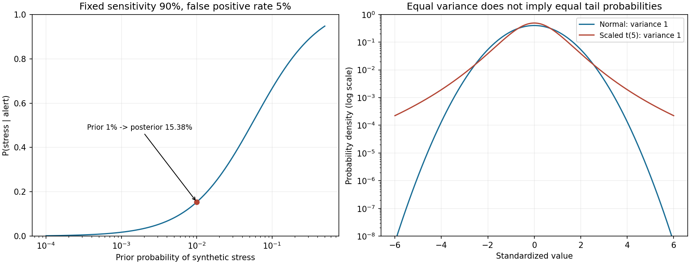

# 第一篇　数学、统计学与编程基础
# 第5章　概率论、随机变量与概率分布

[返回总目录](./00_完整目录.md) · [上一章](./04_第4章_微积分、最优化与数值计算.md) · [实验代码](./code/ch05/probability_lab.py) · [验证代码](./code/ch05/test_probability_lab.py)

前两章建立了数据表示，第三、四章建立了线性结构和优化工具。本章开始建立不确定性的语言：报警出现后，某种状态的可能性如何变化？多资产同时波动应该怎样描述？一次模拟得到的尾部比例有多可靠？

**本章概率、状态、收益和实验参数全部为人工教学设定，不是赛题官方数据，不是历史危机频率，也不是经过真实市场校准的概率。**

## 学习目标

先修要求：理解向量、协方差矩阵、定积分、变量变换和基本Python数组操作。

完成本章后应能：

1. 定义概率空间、随机变量、条件概率与独立性。
2. 推导全概率公式和Bayes公式，解释低基准率下的误报问题。
3. 区分概率质量、概率密度、分布函数和似然。
4. 使用常见离散、连续、联合及混合分布。
5. 推导期望、方差、条件期望与总方差分解。
6. 解释正态假设、厚尾、零相关与独立性的适用边界。
7. 实现稳定的多状态Bayes更新与多资产Monte Carlo模拟。
8. 区分模拟误差、参数误差、模型误差和时间泄漏。

---

## 5.1　概率空间、条件概率与Bayes公式

### 一、从事件到概率空间

**随机试验，Random Experiment**，是结果不预先确定、但能够描述可能结果的过程。一次结果称为**样本点，Outcome**，记为\(\omega\)；全部可能结果组成**样本空间，Sample Space** \(\Omega\)。

例如某教学监控窗口可能出现：
\[
\Omega=\{正常且未报警,\ 正常且报警,\ 压力且未报警,\ 压力且报警\}.
\]
这是对结果的人工分类，不是在宣称现实市场天然只有四种情形。

**事件，Event**是样本空间的子集。例如“报警”包含第二和第四种结果。并集\(A\cup B\)表示至少一个发生，交集\(A\cap B\)表示同时发生，补集\(A^c\)表示不发生。

严格地，允许讨论的事件组成**σ代数，Sigma-algebra** \(\mathcal F\)，满足：

1. \(\Omega\in\mathcal F\)。
2. 若\(A\in\mathcal F\)，则\(A^c\in\mathcal F\)。
3. 可数多个事件的并集仍属于\(\mathcal F\)。

有限样本空间上通常可以取全部子集。连续空间需要这一结构，使概率与积分定义保持一致；本章不展开不可测集合理论。

**概率测度，Probability Measure** \(P\)满足：
\[
P(A)\geq0,\quad P(\Omega)=1,
\]
以及对两两不相交的可数事件：
\[
P\left(\bigcup_iA_i\right)=\sum_iP(A_i).
\]
三元组\((\Omega,\mathcal F,P)\)称为**概率空间，Probability Space**。

由\(A\)与\(A^c\)分割全集：
\[
P(A^c)=1-P(A).
\]
把\(A\cup B\)拆成互不重叠部分：
\[
P(A\cup B)=P(A)+P(B)-P(A\cap B).
\]
进一步有**并集上界，Union Bound**：
\[
P\left(\bigcup_iA_i\right)\leq\sum_iP(A_i).
\]
可通过依次删除已经被前面事件覆盖的部分证明；不要求独立。它解释了为什么监控许多指标时，至少出现一次误报的概率可能明显增加。

等可能有限结果下才有\(P(A)=|A|/|\Omega|\)。不能把“只列了两种状态”当成两种状态概率相等的依据。

### 二、条件概率改变参考集合

对\(P(B)>0\)，定义**条件概率，Conditional Probability**：
\[
P(A\mid B)=\frac{P(A\cap B)}{P(B)}.
\]
它在已经知道\(B\)发生的条件下，重新衡量\(A\)。

改写得到**乘法公式**：
\[
P(A\cap B)=P(A\mid B)P(B)=P(B\mid A)P(A).
\]
重复应用：
\[
P(A,B,C)=P(A)P(B\mid A)P(C\mid A,B).
\]
最后一项不能未经假设简化为\(P(C)\)。

若事件\(H_1,\ldots,H_K\)互不重叠且覆盖全集，称为一个**划分，Partition**。因为\(A\cap H_k\)也分割\(A\)：
\[
P(A)=\sum_kP(A\cap H_k)=\sum_kP(A\mid H_k)P(H_k).
\]
这是**全概率公式，Law of Total Probability**；零概率划分项可以省去。[MIT条件概率与Bayes讲义](https://ocw.mit.edu/courses/18-05-introduction-to-probability-and-statistics-spring-2022/mit18_05_s22_class03-prep.pdf)

事件\(A,B\)**独立，Independent**的定义为：
\[
P(A\cap B)=P(A)P(B).
\]
当\(P(B)>0\)，等价于\(P(A\mid B)=P(A)\)。独立不等于互斥：两个正概率互斥事件的交集为0，反而不独立。

多个事件两两独立也不必相互独立。相互独立要求任意有限子组的交集概率均等于各概率乘积。

### 三、Bayes公式与状态识别

由两种方式表达联合概率：
\[
P(H_k\cap A)=P(A\mid H_k)P(H_k)=P(H_k\mid A)P(A),
\]
得到**贝叶斯公式，Bayes' Theorem**：
\[
P(H_k\mid A)=
\frac{P(A\mid H_k)P(H_k)}
{\sum_jP(A\mid H_j)P(H_j)}.
\]

其中：

- \(P(H_k)\)：**先验概率，Prior Probability**。
- \(P(A\mid H_k)\)：给定状态下证据的概率；把它看作状态的函数时称**似然，Likelihood**。
- \(P(A)\)：**证据概率，Evidence**，也是归一化常数。
- \(P(H_k\mid A)\)：**后验概率，Posterior Probability**。

似然不是关于状态自动归一化的概率分布；不能只把各状态似然相加归一化而忽略先验。

连续观测时以条件密度代替\(P(A\mid H_k)\)，后文给出公式。若所有状态都对观测赋予零证据，模型没有定义有效后验；不能偷偷加一个常数后称原模型仍然正确。

### 四、低基准率为何导致大量误报

设人工压力状态为\(S\)，报警为\(A\)：
\[
P(S)=0.01,\quad P(A\mid S)=0.90,\quad P(A\mid S^c)=0.05.
\]
第二项是**真正率，True Positive Rate，TPR**；第三项是**假正率，False Positive Rate，FPR**。

则：
\[
P(A)=0.90\times0.01+0.05\times0.99=0.0585,
\]
\[
P(S\mid A)=\frac{0.009}{0.0585}=\frac2{13}\approx15.38\%.
\]

用10000个教学窗口解释：

|人工情形|窗口数|
|---|---:|
|压力状态|100|
|其中被报警检出|90|
|正常状态|9900|
|其中误报警|495|
|全部报警|585|

报警中的压力比例为\(90/585\)。90%的检出率不是“每次报警有90%概率发生危机”。这类混淆称为**基准率忽视，Base Rate Neglect**。

现实中压力状态标签、采样窗口、重叠报警和漏标都会影响这些概率的估计。改变事件定义之后，旧的先验和似然不能直接沿用。

### 五、重复证据与条件独立

对二元状态，定义**赔率，Odds**：
\[
O(S)=\frac{P(S)}{1-P(S)}.
\]
Bayes公式改写为：
\[
O(S\mid A)=O(S)\frac{P(A\mid S)}{P(A\mid S^c)}.
\]
后面的比值为**似然比，Likelihood Ratio，LR**。

本例先验赔率为\(1/99\)，一次报警的LR为18。

若两项证据在给定每个状态后都条件独立，才能写：
\[
P(A_1,A_2\mid S)=P(A_1\mid S)P(A_2\mid S),
\]
并把两个LR相乘。若两者具有相同参数：
\[
O(S\mid A_1,A_2)=\frac1{99}18^2,
\]
后验为：
\[
\frac{324}{99+324}=\frac{36}{47}\approx76.60\%.
\]

但同一新闻被转载两次时，若\(A_2=A_1\)，则
\(A_1\cap A_2=A_1\)，正确后验仍是15.38%。把转载当独立证据会把置信程度夸大。

条件独立与无条件独立也不同：两个资产即使在给定状态后独立，混合不同状态后仍可能相关。

### 六、概率、决策与时间信息

后验概率不自动决定是否报警。假设误报成本为\(C_{\rm FP}\)，漏报成本为\(C_{\rm FN}\)，正确决策成本为0。给定压力后验\(p\)：

- 报警的条件期望成本：\(C_{\rm FP}(1-p)\)。
- 不报警的条件期望成本：\(C_{\rm FN}p\)。

比较可得：
\[
p>\frac{C_{\rm FP}}{C_{\rm FP}+C_{\rm FN}}
\]
时报警更优。这依赖所设成本、动作和模型概率，不意味着平台应采用某个未经校准的统一阈值。

用\(\mathcal F_t\)表示时刻\(t\)系统实际掌握的信息，随时间增加形成**信息流，Filtration**：
\[
\mathcal F_s\subseteq\mathcal F_t,\quad s\leq t.
\]
在线状态后验应基于\(\mathcal F_t\)。数据事件时间早于\(t\)，但获取时间晚于\(t\)，仍不属于当时系统信息。

\[
P(S_t\mid\mathcal F_t)
\]
是当前状态识别；
\[
P(R_{t+1}>0\mid\mathcal F_t)
\]
是未来收益事件预测。二者目标不同；由此制定交易行为还需要另一个决策问题。条件概率也不是因果效应，不能把“看到政策新闻后风险升高”直接解释成政策造成风险。

---

## 5.2　离散、连续和联合分布及变量变换

### 一、随机变量与分布函数

**随机变量，Random Variable，RV**是样本点到数值的可测函数：
\[
X:\Omega\to\mathbb R.
\]
可测性要求\(\{X\leq x\}\)属于事件集合，使它的概率有定义。大写\(X\)表示变量，小写\(x\)表示可能取值或已观测值。

**累积分布函数，Cumulative Distribution Function，CDF**：
\[
F_X(x)=P(X\leq x).
\]
它单调不减、右连续，并满足两端极限0、1。对\(a<b\)：
\[
P(a<X\leq b)=F_X(b)-F_X(a).
\]
CDF能描述离散、连续和混合情况，是比概率密度更一般的对象。

### 二、概率质量与概率密度

离散变量在有限或可数取值上分配概率，**概率质量函数，Probability Mass Function，PMF**：
\[
p_X(x)=P(X=x),\quad p_X(x)\geq0,\quad\sum_xp_X(x)=1.
\]

绝对连续变量存在**概率密度函数，Probability Density Function，PDF**：
\[
P(X\in A)=\int_Af_X(x)dx,\quad f_X(x)\geq0,\quad\int_\mathbb Rf_X(x)dx=1.
\]
在适当可导处\(F'_X=f_X\)。密度不是点概率；对绝对连续变量：
\[
P(X=x)=0.
\]
这不表示该数值不可能成为观测结果。均匀分布在\((0,1)\)上时，每个点概率都是0，但总概率是1；不能把不可数多个点的概率用可数可加性直接求和。

密度可以大于1。例如在\((0,0.01)\)上均匀分布，密度为100，宽度0.001的子区间概率为0.1。密度有“变量单位的倒数”这一量纲，改变收益单位会改变密度数值。

不是所有分布都有普通密度。例如“以一定概率收益为0，其余部分连续”的模型包含一个**原子，Atom**。实际交易价格有最小报价单位、停牌和零成交，不应把连续模型当成数据结构事实。

### 三、Bernoulli、二项与几何分布

若\(X\)表示一次事件是否发生：
\[
P(X=1)=p,\quad P(X=0)=1-p,
\]
称为**伯努利分布，Bernoulli Distribution**，记\(X\sim\operatorname{Bernoulli}(p)\)。

若\(X_1,\ldots,X_n\)相互独立、参数均为\(p\)，则成功次数
\(N=\sum_iX_i\)服从**二项分布，Binomial Distribution**：
\[
P(N=k)=\binom nkp^k(1-p)^{n-k}.
\]
推导分两步：指定成功位置的一种序列概率为\(p^k(1-p)^{n-k}\)；成功位置共有
\[
\binom nk=\frac{n!}{k!(n-k)!}
\]
种。组合数来自先排列选择\(k\)个位置，再除去选中位置的\(k!\)种内部次序。

若每次独立、成功率固定，首次成功所需次数\(G\)服从**几何分布，Geometric Distribution**：
\[
P(G=k)=(1-p)^{k-1}p,\quad k=1,2,\ldots.
\]
本章采用“包含成功试验的次数”口径；另有教材采用成功前失败次数，二者相差1。

金融窗口重叠、波动聚集或消息共同来源都可能破坏独立与固定概率假设。不能看见0—1标签就自动用二项分布估计误报数。

### 四、Poisson计数与指数等待

在二项分布中令每次概率为\(\lambda/n\)，固定\(k\)，则：
\[
\binom nk(\lambda/n)^k(1-\lambda/n)^{n-k}
\to e^{-\lambda}\frac{\lambda^k}{k!}.
\]
原因是
\[
\frac{n(n-1)\cdots(n-k+1)}{n^k}\to1,\quad
(1-\lambda/n)^n\to e^{-\lambda}.
\]
得到**泊松分布，Poisson Distribution**：
\[
P(N=k)=e^{-\lambda}\frac{\lambda^k}{k!},\quad k\geq0.
\]
归一化来自指数级数
\(\sum_{k\geq0}\lambda^k/k!=e^\lambda\)。

若单位时间到达率为\(\lambda\)，且采用独立平稳增量的Poisson过程假设，长度\(t\)的计数参数为\(\lambda t\)。等待首条消息超过\(t\)，等价于这段时间计数为0：
\[
P(T>t)=e^{-\lambda t}.
\]
因此等待时间服从**指数分布，Exponential Distribution**：
\[
F_T(t)=1-e^{-\lambda t},\quad
f_T(t)=\lambda e^{-\lambda t},\quad t\geq0.
\]
并有：
\[
P(T>s+t\mid T>s)=e^{-\lambda t},
\]
称为无记忆性。

这些是有明确到达机制假设的模型。真实行情和新闻常成簇到达，交易时段也会改变强度；指数等待不是所有金融消息的默认定律。

### 五、正态分布与标准化

**正态分布，Normal Distribution**，也称高斯分布，Gaussian Distribution：
\[
X\sim N(\mu,\sigma^2),\quad\sigma>0,
\]
密度：
\[
f_X(x)=\frac1{\sigma\sqrt{2\pi}}
\exp\left[-\frac{(x-\mu)^2}{2\sigma^2}\right].
\]

归一化常数可验证：令\(I=\int_\mathbb R e^{-z^2/2}dz\)，把\(I^2\)写成平面上的二重积分，再用极坐标\(x=r\cos\theta,y=r\sin\theta\)，面积因子为\(r\)：
\[
I^2=\int_0^{2\pi}\int_0^\infty e^{-r^2/2}r\,dr\,d\theta=2\pi.
\]
所以\(I=\sqrt{2\pi}\)。

标准正态\(Z\sim N(0,1)\)密度记为\(\phi\)，CDF记为\(\Phi\)。由变量变换：
\[
X=\mu+\sigma Z,\quad
P(X\leq x)=\Phi((x-\mu)/\sigma).
\]

正态是方便的参考模型，不是金融收益必须遵守的定律。普通简单收益有下界约束，正态却无界；严格价格模型可以考虑对数收益或其他支持域合适的分布。本章小幅高斯收益只是线性近似的教学设定，不据它保证价格始终为正。[MIT连续分布讲义](https://ocw.mit.edu/courses/18-05-introduction-to-probability-and-statistics-spring-2022/mit18_05_s22_class05-prep-c.pdf)

### 六、变量变换与Jacobian

若\(Y=g(X)\)，且\(g\)可微、严格单调、逆函数存在，对递增情形：
\[
F_Y(y)=F_X(g^{-1}(y)).
\]
求导得到：
\[
f_Y(y)=f_X(g^{-1}(y))
\left|\frac{d}{dy}g^{-1}(y)\right|.
\]
绝对值兼容递减情形。若映射有多个可逆分支，需要把各个原像的密度贡献相加。

例如\(X\sim U(-1,1)\)、\(Y=X^2\)。对\(0\leq y\leq1\)：
\[
P(Y\leq y)=P(-\sqrt y\leq X\leq\sqrt y)=\sqrt y,
\]
所以：
\[
f_Y(y)=\frac1{2\sqrt y},\quad0<y<1.
\]
只保留\(+\sqrt y\)会漏掉一半贡献。

若\(X\sim N(\mu,\sigma^2)\)，令\(Y=e^X\)，则为**对数正态分布，Lognormal Distribution**：
\[
f_Y(y)=
\frac1{y\sigma\sqrt{2\pi}}
\exp\left[-\frac{(\ln y-\mu)^2}{2\sigma^2}\right],\quad y>0.
\]
因子\(1/y\)来自逆变换的导数，不能漏掉。

多元可逆变换用逆映射Jacobian行列式绝对值替代上述导数。它修正局部体积，而不只是改变函数的输入。

### 七、联合、边缘和条件分布

随机向量\((X,Y)\)的**联合分布，Joint Distribution**描述同时取值。离散时：
\[
p_X(x)=\sum_y p_{X,Y}(x,y),
\]
连续时：
\[
f_X(x)=\int_\mathbb Rf_{X,Y}(x,y)dy.
\]
这是**边缘分布，Marginal Distribution**：把暂不关注的变量加总或积分掉。

当\(f_Y(y)>0\)：
\[
f_{X\mid Y}(x\mid y)=\frac{f_{X,Y}(x,y)}{f_Y(y)}.
\]
这里不是拿\(P(Y=y)=0\)做除法，而是通过联合密度定义条件分布；一般条件分布只要求在几乎处处的取值上确定。

随机变量独立要求所有可测集合上的联合概率分解；有联合密度时对应：
\[
f_{X,Y}(x,y)=f_X(x)f_Y(y)
\]
几乎处处成立。[MIT联合分布讲义](https://ocw.mit.edu/courses/18-05-introduction-to-probability-and-statistics-spring-2022/mit18_05_s22_class07-prep-a.pdf)

### 八、多元正态连接第三章

令\(Z\)的\(d\)个坐标为独立标准正态，\(L\)可逆，定义：
\[
R=\mu+LZ,\quad\Sigma=LL^\top\succ0.
\]
由多元变量变换：
\[
f_R(r)=\frac1{(2\pi)^{d/2}|\Sigma|^{1/2}}
\exp\left[-\frac12(r-\mu)^\top\Sigma^{-1}(r-\mu)\right].
\]
因为\(|\det L|=|\Sigma|^{1/2}\)，以及
\(\|L^{-1}(r-\mu)\|^2=(r-\mu)^\top\Sigma^{-1}(r-\mu)\)。

对数密度为：
\[
\log f_R(r)=-\frac12
\left[d\log(2\pi)+\log|\Sigma|
+(r-\mu)^\top\Sigma^{-1}(r-\mu)\right].
\]
程序使用Cholesky因子：
\[
\log|\Sigma|=2\sum_i\log L_{ii},
\]
并解三角系统计算平方距离，不显式求逆。

协方差半正定但奇异时仍可定义退化正态随机向量，但它没有上述关于整个\(\mathbb R^d\)体积的普通密度。本章密度函数要求正定，并拒绝奇异输入。

### 九、Student t分布与厚尾

**学生t分布，Student's t Distribution**提供一个厚尾例子。定义Gamma函数：
\[
\Gamma(a)=\int_0^\infty u^{a-1}e^{-u}du,\quad a>0.
\]
分部积分给出\(\Gamma(a+1)=a\Gamma(a)\)。

令\(Z\sim N(0,1)\)，与\(V\sim\chi^2_\nu\)独立，其中**卡方分布，Chi-squared Distribution**密度为：
\[
f_V(v)=\frac{v^{\nu/2-1}e^{-v/2}}{2^{\nu/2}\Gamma(\nu/2)},\quad v>0.
\]
整数\(\nu\)时，\(V\)可由\(\nu\)个独立标准正态平方相加得到。Gamma形式也允许正实数自由度。

定义：
\[
T=\frac Z{\sqrt{V/\nu}}.
\]
给定\(V=v\)，它为方差\(\nu/v\)的正态。把条件密度乘以\(f_V(v)\)积分：
\[
f_T(t)=\int_0^\infty
\sqrt{\frac v{2\pi\nu}}
e^{-t^2v/(2\nu)}f_V(v)dv.
\]
利用
\[
\int_0^\infty v^{a-1}e^{-bv}dv=\Gamma(a)/b^a
\]
得到：
\[
f_T(t)=
\frac{\Gamma((\nu+1)/2)}
{\sqrt{\nu\pi}\Gamma(\nu/2)}
(1+t^2/\nu)^{-(\nu+1)/2}.
\]
这同时给出了归一化来源。

尾部密度按\(|t|^{-(\nu+1)}\)衰减，慢于正态的指数平方衰减。均值在\(\nu>1\)时为0；\(\nu\leq1\)时不能把对称性误当成期望存在。

对\(\nu>2\)：
\[
E[T^2]=\nu E[1/V]=\frac{\nu}{\nu-2}.
\]
其中
\[
E[1/V]=\frac12\frac{\Gamma(\nu/2-1)}{\Gamma(\nu/2)}
=\frac1{\nu-2},
\]
要求\(\nu/2-1>0\)，来自上面的Gamma积分和递推公式。与标准正态公平比较时，应使用：
\[
Y=\sqrt{\frac{\nu-2}{\nu}}T,
\]
使方差为1。本章取\(\nu=5\)。若直接比较标准t和标准正态，会把方差差异与尾部形状差异混在一起。[NIST t分布条目](https://www.itl.nist.gov/div898/handbook/eda/section3/eda3664.htm)

厚尾模型也不是万能答案；自由度、非对称性和时变波动仍要用数据检验，不能只选一个“尾部更厚”的分布便宣称风险更准确。

### 十、混合分布与状态后验

设离散状态\(S\in\{1,\ldots,K\}\)，先验\(\pi_k\)，条件收益密度\(f_k(r)\)。边缘分布是**混合分布，Mixture Distribution**：
\[
f_R(r)=\sum_k\pi_kf_k(r).
\]
连续观测的Bayes后验为：
\[
P(S=k\mid R=r)=\frac{\pi_k f_k(r)}{\sum_j\pi_jf_j(r)}.
\]
本章用这个式子演示状态识别。状态含义、参数和概率均由人工生成机制给定；真实任务中需要自行定义经济含义、估计参数并检验稳定性。

数值上先计算：
\[
a_k=\log\pi_k+\log f_k(r),\quad m=\max_ka_k,
\]
再归一化：
\[
p_k=\frac{\exp(a_k-m)}{\sum_j\exp(a_j-m)}.
\]
减去最大值不改变比值，却可减少下溢。先验为0的状态保留0；不能在没有修改模型说明时擅自“平滑”复活它。

本章每次独立抽状态，不设状态转移，更不是隐马尔可夫模型（Hidden Markov Model，HMM）。把静态混合分布、当前后验和带持续性的状态过程区分开，后续才能正确学习马尔可夫模型。

---

## 5.3　期望、条件期望、尾部概率与模拟

### 一、期望是按分布加权

**数学期望，Expectation**，在离散情形为：
\[
E[X]=\sum_xx\,p_X(x),
\]
在绝对连续情形为：
\[
E[X]=\int_\mathbb R x f_X(x)dx.
\]
为避免正负无穷抵消，本章讨论普通有限期望时要求\(E|X|<\infty\)。

对函数\(g\)，不必先求\(g(X)\)的分布：
\[
E[g(X)]=\sum_xg(x)p_X(x)
\]
或相应积分。这通常称为**无意识统计学家定律，Law of the Unconscious Statistician，LOTUS**；其依据是把映射到同一结果的原始概率加总。

由求和或积分的线性性：
\[
E[aX+bY]=aE[X]+bE[Y].
\]
不要求\(X,Y\)独立。指标变量\(1_A\)在事件发生时为1，否则0，因此\(E[1_A]=P(A)\)。

Bernoulli变量满足\(E[X]=p\)、\(X^2=X\)。独立Bernoulli之和的均值为\(np\)。对Poisson变量：
\[
E[N]=\sum_{k\geq1}k e^{-\lambda}\lambda^k/k!
=\lambda e^{-\lambda}\sum_{j\geq0}\lambda^j/j!
=\lambda.
\]
同理\(E[N(N-1)]=\lambda^2\)，从而\(E[N^2]=\lambda^2+\lambda\)。

对非负整数变量：
\[
E[G]=\sum_{k\geq1}P(G\geq k).
\]
因为一个取值为\(m\)的样本，恰好被前\(m\)个指标计数。几何分布由此有
\(E[G]=\sum_{k\geq1}(1-p)^{k-1}=1/p\)。

### 二、方差、协方差与总体矩阵

若二阶矩有限，定义**方差，Variance**：
\[
\operatorname{Var}(X)=E[(X-E[X])^2]
=E[X^2]-(E[X])^2.
\]
开方得到标准差。Bernoulli方差为\(p(1-p)\)，Poisson方差为\(\lambda\)。

对标准正态，由对称性\(E[Z]=0\)。又因\(\phi'(z)=-z\phi(z)\)，分部积分得到：
\[
E[Z^2]=-\int z\phi'(z)dz
=[-z\phi(z)]_{-\infty}^\infty+\int\phi(z)dz=1.
\]
于是\(X=\mu+\sigma Z\)确实具有均值\(\mu\)、方差\(\sigma^2\)。

**协方差，Covariance**：
\[
\operatorname{Cov}(X,Y)
=E[(X-E[X])(Y-E[Y])].
\]
所以：
\[
\operatorname{Var}(X+Y)
=\operatorname{Var}(X)+\operatorname{Var}(Y)+2\operatorname{Cov}(X,Y).
\]
独立且二阶矩有限时，\(E[XY]=E[X]E[Y]\)，协方差为0，故独立二项试验之和方差为\(np(1-p)\)。

但零协方差不保证独立。令\(X\sim U(-1,1)\)、\(Y=X^2\)，有\(E[X]=E[X^3]=0\)，故协方差为0，而\(Y\)由\(X\)完全决定。

**相关系数，Correlation Coefficient**：
\[
\rho_{XY}
=\frac{\operatorname{Cov}(X,Y)}
{\sqrt{\operatorname{Var}(X)\operatorname{Var}(Y)}}.
\]
方差必须为正。对随机变量应用平方非负或Cauchy–Schwarz可证明\(|\rho|\leq1\)。联合正态中的零相关可以推出独立，一般分布不可以。

对随机向量\(R\)：
\[
\mu=E[R],\quad\Sigma=E[(R-\mu)(R-\mu)^\top].
\]
对任意\(w\)：
\[
w^\top\Sigma w=\operatorname{Var}(w^\top R)\geq0.
\]
这把总体风险结构与第三章样本协方差联系起来。样本矩阵是估计量；总体矩阵是概率模型的属性，二者不能无条件相等。[MIT协方差讲义](https://ocw.mit.edu/courses/18-05-introduction-to-probability-and-statistics-spring-2022/mit18_05_s22_class07-prep-b.pdf)

### 三、条件期望与最佳平方误差表示

若\(Y=y\)的条件分布存在，定义**条件期望，Conditional Expectation**：
\[
m(y)=E[X\mid Y=y].
\]
离散时按条件PMF求和，连续时按条件PDF积分。

把观测\(Y\)代入后，\(m(Y)\)本身是随机变量。由联合分布求和：
\[
E[m(Y)]
=\sum_y\sum_xx\,p_{X\mid Y}(x\mid y)p_Y(y)
=\sum_{x,y}x\,p_{X,Y}(x,y)
=E[X].
\]
连续情形在相应可积条件下类似。这是**迭代期望定律，Law of Iterated Expectations**：
\[
E[E[X\mid Y]]=E[X].
\]

若\(E[X^2]<\infty\)，对任何平方可积函数\(g(Y)\)：
\[
X-g(Y)=[X-m(Y)]+[m(Y)-g(Y)].
\]
条件于\(Y\)，第一项期望为0，因此交叉项平均为0：
\[
E[(X-g(Y))^2]
=E[(X-m(Y))^2]+E[(m(Y)-g(Y))^2].
\]
故条件期望是依赖\(Y\)的所有函数中，平方误差最小的表示。这是第三章投影思想在随机变量空间中的延伸；它仍不是因果效应或利润保证。

### 四、总方差与混合状态风险

令\(m(Y)=E[X\mid Y]\)。写成：
\[
X-E[X]=[X-m(Y)]+[m(Y)-E[X]].
\]
平方后取期望，交叉项为0，得到**全方差公式，Law of Total Variance**：
\[
\operatorname{Var}(X)
=E[\operatorname{Var}(X\mid Y)]
+\operatorname{Var}(E[X\mid Y]).
\]
它区分状态内部波动与状态均值之间的变化。

因此条件信息在平均意义下降低剩余方差，不代表每种条件情景的方差都比总体小。压力情景的条件方差完全可能更大。[条件期望与全方差推导](https://www.probabilitycourse.com/chapter5/5_1_5_conditional_expectation.php)

对向量和有限状态，记\(\mu_k=E[R\mid S=k]\)、\(\Sigma_k=\operatorname{Cov}(R\mid S=k)\)，则：
\[
\mu=\sum_k\pi_k\mu_k,
\]
\[
\Sigma=\sum_k\pi_k\left[\Sigma_k+(\mu_k-\mu)(\mu_k-\mu)^\top\right].
\]
推导与标量相同：令\(R-\mu=(R-\mu_S)+(\mu_S-\mu)\)，外积展开，条件均值为0使两个交叉项消失。只加权状态内协方差，会漏掉状态间均值变化带来的风险。

对状态指标\(1_{\{S=k\}}\)，迭代期望还说明：
\[
E[P(S=k\mid R)]=P(S=k).
\]
这可用于本章已知生成模型的模拟核对；在真实数据上得到相同均值，不足以单独证明概率校准正确。

### 五、概率上界、样本平均与极限定理

对非负变量\(X\)、\(a>0\)，有\(X\geq a1_{\{X\geq a\}}\)，取期望：
\[
P(X\geq a)\leq E[X]/a.
\]
这是**Markov不等式，Markov's Inequality**。

把它用于\((X-\mu)^2\)，得到**Chebyshev不等式，Chebyshev's Inequality**：
\[
P(|X-\mu|\geq a)\leq\sigma^2/a^2.
\]
它不要求正态，但上界可能很宽松。

对独立同分布、均值\(\mu\)、有限方差\(\sigma^2\)的样本：
\[
\bar X_N=\frac1N\sum_iX_i,\quad
E[\bar X_N]=\mu,\quad
\operatorname{Var}(\bar X_N)=\sigma^2/N.
\]
故：
\[
P(|\bar X_N-\mu|\geq\varepsilon)
\leq\frac{\sigma^2}{N\varepsilon^2}\to0.
\]
这是有限方差条件下**弱大数定律，Weak Law of Large Numbers，WLLN**的一个证明。

**中心极限定理，Central Limit Theorem，CLT**进一步说明，在独立同分布且\(0<\sigma^2<\infty\)等条件下：
\[
\frac{\sqrt N(\bar X_N-\mu)}{\sigma}
\ \xrightarrow{d}\ N(0,1).
\]
这里是依分布收敛，不是有限样本时精确正态。大数定律说明平均趋近哪里，CLT说明适当缩放后的波动形状；不能把两者混成“数据足够多就自动消除一切误差”。

金融序列通常不独立。若协方差平稳、滞后协方差为\(\gamma_h\)，展开双重协方差和得到：
\[
\operatorname{Var}(\bar X_N)
=\frac1{N^2}\left[N\gamma_0+
2\sum_{h=1}^{N-1}(N-h)\gamma_h\right].
\]
因为滞后\(h\)的样本对有\(N-h\)对。直接套用\(\sigma^2/N\)可能低估不确定性；相关样本推断将在后续章节展开。

### 六、尾部概率、分位数与损失口径

令固定权重组合的单期损失：
\[
L=-w^\top R.
\]
阈值\(\ell\)对应：
\[
P(L>\ell).
\]
需要同时说明周期、单位、币种、权重形成时间和是否包含成本。

**分位数，Quantile**：
\[
q_\alpha=\inf\{x:F_L(x)\geq\alpha\}.
\]
在金融风险语境中，损失分位数常称为**风险价值，Value at Risk，VaR**：
\[
\operatorname{VaR}_\alpha(L)=q_\alpha.
\]
它不是最坏损失，也不说明越过阈值以后会损失多少。

在适当可积条件下，**预期短缺，Expected Shortfall，ES**可定义为：
\[
ES_\alpha(L)=\frac1{1-\alpha}\int_\alpha^1q_u\,du.
\]
连续、没有相关边界原子时，可解释为最坏\(1-\alpha\)尾部的平均损失；有离散质量时须处理阈值处只取部分质量，不能直接套用\(E[L\mid L\geq q_\alpha]\)。由逆变换表示\(L=q_U\)、\(U\sim U(0,1)\)，最坏尾部可理解为\(U>\alpha\)，其条件均值就是上述积分；存在原子时，相同损失值可能跨越分位数边界，只应计入所需的部分质量。[一般损失分布的尾部风险定义](https://sites.math.washington.edu/~rtr/papers/rtr187-CVaR2.pdf)

本章主要计算阈值超越概率，不据模拟结果设置真实金融报警阈值。厚尾意味着充分远的尾部可能更重，不意味着每一个阈值处的尾概率都更大。

### 七、Monte Carlo模拟与误差

**蒙特卡罗方法，Monte Carlo Method，MC**用随机抽样近似期望。例如独立模拟\(L_1,\ldots,L_N\)，令：
\[
I_i=1_{\{L_i>\ell\}},\quad
\hat p=\frac1N\sum_iI_i.
\]
由Bernoulli矩：
\[
E[\hat p]=p,\quad
\operatorname{Var}(\hat p)=\frac{p(1-p)}N.
\]
用\(\hat p\)代替未知\(p\)，得到估计的**标准误，Standard Error，SE**：
\[
\widehat{SE}=\sqrt{\frac{\hat p(1-\hat p)}N}.
\]
这是MC误差，不包括模型结构错误和参数不确定性。

相对标准误约：
\[
\frac{SE}{p}\approx\frac1{\sqrt{Np}}\quad(p\text{较小}).
\]
把抽样量增加4倍通常只把标准误缩小一半。零次命中也不代表真实概率为0；独立伯努利条件下，零命中对应的95%单侧上界可由\((1-p)^N=0.05\)解得：
\[
p_{\rm upper}=1-0.05^{1/N}\approx3/N.
\]
这是重复抽样意义的上界构造，不应解释为参数有95%概率位于该区间；第6章再系统讨论。

产生目标分布的一种方法是**逆变换抽样，Inverse Transform Sampling**。取\(U\sim U(0,1)\)，令\(X=F^{-1}(U)\)，则
\[
P(X\leq x)=P(U\leq F(x))=F(x).
\]
指数分布的逆变换为\(-\log(1-U)/\lambda\)。

多元正态可先生成独立标准正态矩阵，再按\(R=\mu+LZ\)变换。NumPy按行保存样本时写作`z @ L.T + mean`；转置方向不能写错。

程序采用`Generator`、明确的`PCG64`和`SeedSequence.spawn`分配随机流。这样便于重放和并行扩展，但伪随机算法不是数学上独立性的证明，跨版本也不保证所有抽样接口逐位一致。[NumPy随机生成器](https://numpy.org/doc/2.1/reference/random/generator.html)、[随机流派生](https://numpy.org/doc/2.1/reference/random/parallel.html)

### 八、完整多资产概率实验

人工状态先验为正常95%、压力5%；每个状态有四资产条件均值与协方差。每次独立抽状态，再抽对应的条件高斯收益。本章不训练参数，不模拟历史状态持续性，也不使用未来数据给当前模型拟合。

程序验证Bayes更新、重复证据反例、混合矩、组合尾部概率，以及等方差正态与t分布的尾部差异。

```python
"""第5章概率实验：人工状态、Bayes更新、混合分布与尾部模拟。"""
from __future__ import annotations
import argparse
import json
import math
from datetime import datetime, timezone
from pathlib import Path
import numpy as np


def probability_vector(value):
    p = np.array(value, dtype=float, copy=True)
    if (p.ndim != 1 or len(p) == 0 or not np.isfinite(p).all()
            or np.any(p < 0) or abs(float(p.sum()) - 1) > 1e-12):
        raise ValueError("finite nonnegative probabilities summing to one required")
    return p


def posterior_from_loglikelihood(prior, log_likelihood):
    p = probability_vector(prior)
    ell = np.asarray(log_likelihood, dtype=float)
    if ell.ndim != 2 or ell.shape[1] != len(p) or len(ell) == 0:
        raise ValueError("rows are observations, columns are states")
    if np.isnan(ell).any() or np.isposinf(ell).any():
        raise ValueError("log likelihood may be finite or negative infinity")
    log_prior = np.full(len(p), -np.inf)
    np.log(p, out=log_prior, where=p > 0)
    joint = ell + log_prior
    shift = joint.max(axis=1, keepdims=True)
    if not np.isfinite(shift).all():
        raise ValueError("some observations have zero modeled evidence")
    mass = np.exp(joint - shift)
    return mass / mass.sum(axis=1, keepdims=True)


def gaussian_logpdf(observations, mean, covariance):
    x = np.array(observations, dtype=float, copy=True, order="C")
    mu = np.asarray(mean, dtype=float)
    s = np.asarray(covariance, dtype=float)
    if x.ndim != 2 or len(x) == 0 or mu.shape != (x.shape[1],):
        raise ValueError("observation and mean axes mismatch")
    if s.shape != (len(mu), len(mu)) or not all(np.isfinite(a).all() for a in [x, mu, s]):
        raise ValueError("finite matching covariance required")
    scale = max(float(np.linalg.norm(s, 2)), np.finfo(float).tiny)
    if np.max(np.abs(s - s.T)) > 1e-12 * scale:
        raise ValueError("covariance must be symmetric")
    s = (s + s.T) / 2
    lower = np.linalg.cholesky(s)
    whitened = np.linalg.solve(lower, (x - mu).T)
    squared = np.sum(whitened ** 2, axis=0)
    log_determinant = 2 * np.log(np.diag(lower)).sum()
    return -.5 * (len(mu) * np.log(2 * np.pi) + log_determinant + squared)


def synthetic_model():
    prior = np.array([.95, .05])
    means = np.array([[.0002, .0001, .0001, 0], [-.015, .003, .004, .002]])
    correlation = np.array([[1, -.20, .20, .10], [-.20, 1, -.10, .05],
                            [.20, -.10, 1, .15], [.10, .05, .15, 1]])
    vols = np.array([[.008, .003, .006, .004], [.025, .010, .018, .012]])
    covariances = np.array([correlation * np.outer(v, v) for v in vols])
    return prior, means, covariances


def simulate_mixture(rng, count, prior, means, covariances):
    p = probability_vector(prior)
    if isinstance(count, bool) or not isinstance(count, (int, np.integer)) or count <= 0:
        raise ValueError("positive integer sample count required")
    means, covariances = np.asarray(means), np.asarray(covariances)
    if means.ndim != 2 or means.shape[0] != len(p):
        raise ValueError("state and asset axes mismatch")
    d = means.shape[1]
    if covariances.shape != (len(p), d, d):
        raise ValueError("covariance axes mismatch")
    # 在抽样前验证所有状态，不能因某状态此次没抽中就跳过验证。
    factors = []
    for k in range(len(p)):
        gaussian_logpdf(np.zeros((1, d)), means[k], covariances[k])
        factors.append(np.linalg.cholesky((covariances[k] + covariances[k].T) / 2))
    states = rng.choice(len(p), size=count, p=p)
    returns = np.empty((count, d))
    for k in range(len(p)):
        selected = np.flatnonzero(states == k)
        z = rng.standard_normal((len(selected), d))
        returns[selected] = means[k] + z @ factors[k].T
    return states, returns


def mixture_moments(prior, means, covariances):
    p = probability_vector(prior)
    means, covariances = np.asarray(means, dtype=float), np.asarray(covariances, dtype=float)
    if (means.ndim != 2 or means.shape[0] != len(p)
            or covariances.shape != (len(p), means.shape[1], means.shape[1])):
        raise ValueError("mixture moment axes mismatch")
    if not np.isfinite(means).all() or not np.isfinite(covariances).all():
        raise ValueError("finite mixture parameters required")
    mean = p @ means
    centered = means - mean
    covariance = np.einsum("k,kij->ij", p, covariances)
    covariance += np.einsum("k,ki,kj->ij", p, centered, centered)
    return mean, covariance


def exact_loss_tail(prior, means, covariances, weights, loss_threshold):
    p = probability_vector(prior)
    w = np.asarray(weights, dtype=float)
    if (w.ndim != 1 or not np.isfinite(w).all() or not np.isfinite(loss_threshold)
            or np.asarray(means).shape != (len(p), len(w))
            or np.asarray(covariances).shape != (len(p), len(w), len(w))):
        raise ValueError("finite matching tail inputs required")
    total = 0.
    for k in range(len(p)):
        gaussian_logpdf(np.zeros((1, len(w))), means[k], covariances[k])
        mu = float(w @ means[k])
        variance = float(w @ covariances[k] @ w)
        if variance <= 0:
            raise ValueError("positive portfolio variance required")
        total += p[k] * .5 * math.erfc((mu + loss_threshold) / np.sqrt(2 * variance))
    return float(total)


def main():
    parser = argparse.ArgumentParser()
    parser.add_argument("--count", type=int, default=200000)
    parser.add_argument("--seed", type=int, default=20261022)
    parser.add_argument("--out", type=Path)
    args = parser.parse_args()
    if args.count < 1000 or args.seed < 0:
        raise ValueError("count >= 1000 and seed >= 0 required")
    seed_sequence = np.random.SeedSequence(args.seed)
    children = seed_sequence.spawn(3)
    streams = [np.random.Generator(np.random.PCG64(child)) for child in children]
    prior, means, covariances = synthetic_model()
    states, returns = simulate_mixture(streams[0], args.count, prior, means, covariances)
    log_likelihood = np.column_stack([gaussian_logpdf(returns, means[k], covariances[k])
                                     for k in range(len(prior))])
    posterior = posterior_from_loglikelihood(prior, log_likelihood)
    mean, covariance = mixture_moments(prior, means, covariances)
    weights, threshold = np.array([.4, .25, .2, .15]), .02
    losses = -(returns @ weights)
    hits = int(np.count_nonzero(losses > threshold))
    estimate = hits / args.count
    standard_error = math.sqrt(estimate * (1 - estimate) / args.count)
    exact = exact_loss_tail(prior, means, covariances, weights, threshold)
    normal = streams[1].standard_normal(args.count)
    standardized_t = streams[2].standard_t(5, args.count) * np.sqrt(3 / 5)
    one_alert = posterior_from_loglikelihood([.99, .01], np.log([[.05, .90]]))[0, 1]
    wrong_duplicate = posterior_from_loglikelihood([.99, .01], 2 * np.log([[.05, .90]]))[0, 1]
    output = args.out or Path(__file__).parent / "runs" / datetime.now(
        timezone.utc).strftime("run_%Y%m%dT%H%M%S_%fZ")
    output.mkdir(parents=True, exist_ok=False)
    preview = np.column_stack([states[:32], returns[:32], posterior[:32, 1]])
    np.savetxt(output / "synthetic_preview.csv", preview, delimiter=",",
               header="state,EQ_DEMO,BOND_DEMO,GOLD_DEMO,FX_DEMO,posterior_stress", comments="")
    np.savez(output / "model.npz", prior=prior, means=means, covariances=covariances, weights=weights)
    report = {"data_kind": "synthetic", "numpy": np.__version__, "seed": args.seed,
              "bit_generator": "PCG64", "spawn_keys": [list(c.spawn_key) for c in children],
              "draws": args.count, "asset_order": ["EQ_DEMO", "BOND_DEMO", "GOLD_DEMO", "FX_DEMO"],
              "state_order": ["NORMAL_DEMO", "STRESS_DEMO"],
              "sampling": "independent mixture draws, not a historical or Markov time series",
              "one_alert_posterior": float(one_alert),
              "incorrect_duplicate_posterior": float(wrong_duplicate),
              "correct_exact_duplicate_posterior": float(one_alert),
              "theoretical_mean": mean.tolist(), "theoretical_covariance": covariance.tolist(),
              "simulated_mean": returns.mean(axis=0).tolist(),
              "average_posterior_stress": float(posterior[:, 1].mean()),
              "loss_threshold": threshold, "tail_hits": hits, "tail_estimate": estimate,
              "tail_exact_under_model": exact, "tail_mc_standard_error": standard_error,
              "tail_error_in_estimated_se": (estimate - exact) / standard_error if standard_error else None,
              "normal_right_tail_3_exact": .5 * math.erfc(3 / math.sqrt(2)),
              "normal_right_tail_3_mc": float(np.mean(normal > 3)),
              "unit_variance_t5_right_tail_3_mc": float(np.mean(standardized_t > 3)),
              "interpretation": "model arithmetic and Monte Carlo error only; no empirical market calibration"}
    (output / "manifest.json").write_text(json.dumps(report, indent=2, allow_nan=False), encoding="utf-8")
    print(json.dumps(report, indent=2, allow_nan=False))
    print(f"Artifacts: {output.resolve()}")


if __name__ == "__main__":
    main()

```

### 九、运行与实际核验

```powershell
Set-Location 'E:\AAAstudy\国元证券金融科技竞赛\教材\code\ch05'
& 'D:\Anaconda\python.exe' probability_lab.py
& 'D:\Anaconda\python.exe' -m unittest -v test_probability_lab.py
```

使用现有Anaconda Python 3.13.5、NumPy 2.1.3，无需新增库。默认20万次独立抽样，只保存模型、32行预览和运行清单，不把全部样本长期落盘。

本次固定种子的实际结果：

|检查|结果|
|---|---:|
|一次人工报警后验|0.15384615|
|错误地把同一证据计算两次|0.76595745|
|正确处理完全重复证据|仍为0.15384615|
|平均压力后验|约0.050098|
|损失超过0.02的命中数|820 / 200000|
|模拟尾部概率|0.00410|
|模型下解析尾部概率|约0.00415448|
|估计MC标准误|约0.00014288|
|模拟与解析差 / 估计SE|约-0.381|
|标准正态右侧3单位尾概率，解析|约0.00134990|
|标准正态相应模拟比例|0.00132|
|方差为1的t(5)相应模拟比例|0.005925|

解析尾概率来自：给定状态时，\(w^\top R\)仍为正态，均值\(w^\top\mu_k\)、方差\(w^\top\Sigma_kw\)，再按状态先验加权。这个“解析”只对人工模型成立，不是现实市场概率真值。

12项验证通过，包括低基准率、对数域稳定性、零证据拒绝、状态重排、密度解析对照、矩分解、固定种子、无效协方差和MC健全性检查。固定种子的统计检查也不是所有随机抽样都必然落在误差界内的证明。



左图固定检出率和假正率，展示先验变化对后验的影响；右图用相同均值和方差比较密度，纵轴为对数尺度。配图由现有Matplotlib生成；不是市场数据或回测结果。


---

## 工程实现与常见问题

1. **先定义概率对象。** “压力状态”“未来下跌”“超过阈值损失”是不同事件；必须写明资产范围、时间窗、判定规则和证据可用时间。
2. **保留基准率。** 训练时人为平衡类别，会改变样本先验。输出到真实频率环境时，不能默认分类分数仍是正确后验。
3. **新闻去重影响概率。** 去重键、原始来源、转载链和事件标识应进入血缘；多个链接不等于多项独立证据。
4. **缺失不是负面证据。** 未收到宏观数据或新闻，不等于事件未发生。接入故障需要单独的缺失与可用性模型。
5. **使用对数域并检查失败。** 稳定归一化解决浮点问题，不解决模型对观测零证据的问题；零证据应返回诊断，不自动输出均匀概率。
6. **分清模型与数据验证。** 在生成参数已知的人工模型中恢复概率，是算术验证；真实概率还要做时间外校准、分组稳定性和漂移检验。
7. **不静默删除尾部观测。** 极端收益可能是错误，也可能是真实风险。隔离、修正或保留都需要审计记录。
8. **模拟要有随机流契约。** 记录根种子、生成器、派生键、分布参数、依赖版本和任务分区；多个工作进程不能反复使用相同种子生成重复路径。
9. **报告误差种类。** MC标准误只是给定模型下的抽样不确定性，不覆盖分布错设、非平稳性、数据修订或参数估计误差。
10. **限制输出规模。** 本章不长期保存20万行模拟，只保留必要预览与模型。新运行目录和缓存由忽略规则排除出后续Git新增内容；历史已跟踪文件不在本次移除。
11. **按章同步仓库。** 正文、代码、图、引用登记、目录与续写进度一起验收后提交，推送到用户指定仓库；记录提交结果，不把“尝试推送”称为同步成功。

## 本章总结

概率论把状态、证据与不确定性组织成一致的数学语言。Bayes公式连接先验和后验；联合分布连接多资产依赖；条件期望和总方差解释状态内部与状态之间的风险。

数值上，需要稳定的密度计算、正确的随机流和可解释的模拟误差。金融上，需要可检验的状态定义、时间有效性和模型校准。概率算得精确，与概率模型是否可信，是两项不同的验证工作。

## 分层练习

### 基础理解题

**练习1：事件运算。** 已知\(P(A)=0.1\)、\(P(B)=0.2\)、\(P(A\cap B)=0.03\)。计算并集、补集与\(P(A\mid B)\)。判断二者独立还是互斥，并说明“只有两个状态就各占一半”为什么不成立。

**练习2：报警精度与假正率。** 使用本章1%压力先验、90%检出率、5%假正率，计算报警后压力概率。若希望该后验至少50%，在其他条件固定时假正率最高可以是多少？

**练习3：两项证据。** 推导两项条件独立报警的后验。若第二项完全复制第一项，为什么不能重复乘LR？列出工程上判断证据是否可能重复的字段。

### 数学推导题

**练习4：独立试验与计数。** \(N\sim\operatorname{Binomial}(10,0.1)\)，求零次事件概率、均值和方差。若事件由一次新闻冲击同时触发，为什么原计算可能失效？

**练习5：从密度到抽样。** 令\(f(x)=2x\)，\(0<x<1\)，其他地方为0。验证归一化，求CDF、\(P(X>0.8)\)、均值、方差与逆变换抽样公式。

**练习6：协方差与独立性。** 对单位方差、相关系数\(\rho\)的两个资产，计算等权组合方差。若它们联合正态且\(\rho=0\)，有什么结论？再用\(X\sim U(-1,1)\)、\(Y=X^2\)说明一般零相关为何不能推出独立。

**练习7：t分布尺度。** 求标准t(5)的方差，以及将它缩放到方差1的系数。解释为什么t(2)不能通过“除以标准差”得到单位方差变量，以及有限样本算出方差为何不解决这一问题。

**练习8：状态间风险。** 两状态概率为0.98、0.02；条件均值为-0.001、-0.02；条件标准差为0.005、0.03。计算总体均值、状态内方差项、状态间方差项和总方差。压力条件方差能否大于总方差？

**练习9：尾部模拟预算。** 在IID模型下，若真实尾概率为0.001，模拟10万次，预期命中数和标准误是多少？若希望相对标准误不超过2%，需要多少次模拟？一万次零命中是否能证明尾概率为0？

### 编程题

**练习10：防止密度下溢。** 对先验\((0.8,0.2)\)及对数似然\((-1000,-1001)\)，编写可运行程序，展示直接指数计算的下溢，验证稳定后验及对共同平移的不变性。

### 金融分析与开放工程题

**练习11：信息与成本。** 新闻事件时间08:30、发布时间09:00、系统获取时间09:00:04，能否用于09:00:00在线识别？某宏观值后来被修订，怎样处理旧决策？若误报成本为1、漏报为9，教学模型中15.38%的后验是否触发成本最小的报警？

**练习12：概率服务契约。** 为行情、宏观、新闻融合服务设计请求和响应。说明重复新闻、零证据、缺失数据、未知状态、标签不确定及概念漂移如何处理。给出校准和验收方案，不能只用准确率。

## 详细参考答案

### 练习1参考答案

\[
P(A\cup B)=0.1+0.2-0.03=0.27,
\quad P(A^c)=0.9.
\]
\[
P(A\mid B)=0.03/0.2=0.15.
\]
独立时交集应为0.02，实际为0.03，故不独立；交集非零，故不互斥。

状态数量只说明划分的类别数，不规定概率。概率必须来自明确模型、采样机制或估计，不能由命名数量自动确定。

### 练习2参考答案

按全概率公式：
\[
P(S\mid A)=\frac{0.9\times0.01}{0.9\times0.01+0.05\times0.99}
=\frac2{13}\approx0.153846.
\]
令假正率为\(q\)，要求：
\[
\frac{0.009}{0.009+0.99q}\geq\frac12.
\]
分母为正，交叉相乘：
\[
0.018\geq0.009+0.99q,
\quad q\leq0.009/0.99\approx0.0090909.
\]
即假正率最多约0.9091%，不是5%。这个上限依赖固定先验与检出率；现实状态频率漂移后需要重新评价。

### 练习3参考答案

一次报警的LR为\(0.9/0.05=18\)，先验赔率为\(0.01/0.99=1/99\)。条件独立时两次更新：
\[
O_{\rm post}=\frac{18^2}{99},
\quad
p_{\rm post}=\frac{18^2}{99+18^2}=\frac{36}{47}.
\]

完全复制时，联合事件仍然只有一次报警事件，正确后验保持\(2/13\)。从链式公式看：
\[
P(A_2\mid A_1,S)=P(A_2\mid A_1,S^c)=1,
\]
第二次的条件LR是1，而不是18。

工程字段可包括原始来源ID、文章ID、内容哈希、转载父ID、事件ID、发布时间、获取时间和文本相似度。文本不同也可能来自同一事件；仅检查URL不同不足以证明条件独立。

### 练习4参考答案

\[
P(N=0)=0.9^{10}\approx0.34867844,
\]
\[
E[N]=10\times0.1=1,\quad
\operatorname{Var}(N)=10\times0.1\times0.9=0.9.
\]
均值的线性性本身不要求独立；但二项分布形式和方差公式使用了独立且成功率一致的假设。

若共同冲击使多次事件正相关，方差增加额外协方差项，零次事件概率也不再是简单的0.9连乘。需要明确共同因子、状态或簇集机制，不能只调整样本数便声称假设恢复。

### 练习5参考答案

归一化：
\[
\int_0^12x\,dx=[x^2]_0^1=1.
\]
CDF在\(x\leq0\)为0，在\(0<x<1\)为\(x^2\)，在\(x\geq1\)为1。因此：
\[
P(X>0.8)=1-0.8^2=0.36.
\]
\[
E[X]=\int_0^1x(2x)dx=2/3,
\quad
E[X^2]=\int_0^1x^2(2x)dx=1/2,
\]
\[
\operatorname{Var}(X)=1/2-(2/3)^2=1/18.
\]
令\(U\sim U(0,1)\)，反解\(u=x^2\)，得到\(X=\sqrt U\)。密度接近1时大于1并不违反概率公理，因为概率是密度的积分。

### 练习6参考答案

协方差矩阵为：
\[
\Sigma=\begin{pmatrix}1&\rho\\\rho&1\end{pmatrix}.
\]
等权方差：
\[
\frac14(1+1+2\rho)=\frac{1+\rho}{2}.
\]
联合正态且\(\rho=0\)时，密度可分解成两个边缘密度，因此独立；仅知道边缘分别正态还不够，必须有联合正态条件。

对反例：
\[
E[X]=E[X^3]=0,\quad E[X^2]=1/3.
\]
所以：
\[
\operatorname{Cov}(X,X^2)=E[X^3]-E[X]E[X^2]=0.
\]
但一旦知道\(X\)，就完全知道\(Y=X^2\)。二者不独立，说明零相关只排除了特定的线性共变。

### 练习7参考答案

\[
\operatorname{Var}(T_5)=\frac5{5-2}=\frac53.
\]
乘以\(a\)后方差为\(a^2(5/3)\)，令其等于1，得到：
\[
a=\sqrt{3/5}.
\]

t(2)没有有限二阶矩。乘以任何非零有限常数仍不能得到有限方差，因此不存在所要求的标准化系数。

有限抽样只包含有限个有限数，通常能够计算一个有限的样本方差；这并不证明总体二阶矩存在。继续增加样本时，极端值可能使该统计量显著跳动。

### 练习8参考答案

总体均值：
\[
\mu=0.98(-0.001)+0.02(-0.02)=-0.00138.
\]

状态内方差项：
\[
0.98(0.005)^2+0.02(0.03)^2
=0.0000425.
\]

两状态间方差可以化简为：
\[
\pi(1-\pi)(\mu_1-\mu_2)^2.
\]
代入：
\[
0.98\times0.02\times0.019^2=0.0000070756.
\]
总方差：
\[
0.0000425+0.0000070756=0.0000495756.
\]
压力条件方差为0.0009，大于总方差。全方差定律约束的是平均条件方差与总体方差的关系，不要求每种情景的风险都较小。

### 练习9参考答案

预期命中数：
\[
Np=100000\times0.001=100.
\]
标准误：
\[
\sqrt{\frac{0.001(1-0.001)}{100000}}
\approx0.00009995.
\]
相对标准误约9.995%。

要求相对标准误不超过0.02：
\[
\sqrt{\frac{1-p}{Np}}\leq0.02
\quad\Rightarrow\quad
N\geq\frac{1-p}{p(0.02)^2}.
\]
代入得到至少2497500次。它是给定真实\(p\)下的预算估算，不是未知真实概率时的无条件保证。

一万次零命中的95%单侧上界为：
\[
1-0.05^{1/10000}\approx0.00029953.
\]
零命中只说明有限抽样尚未看到事件，不证明概率为0，更不证明模型未覆盖的风险不存在。

### 练习10参考答案

在`code/ch05`目录运行：

```python
import math
import numpy as np
from probability_lab import posterior_from_loglikelihood

prior = np.array([0.8, 0.2])
log_likelihood = np.array([[-1000.0, -1001.0]])
direct_mass = prior * np.exp(log_likelihood[0])
print("Direct mass sum:", direct_mass.sum())

posterior = posterior_from_loglikelihood(prior, log_likelihood)
shifted = posterior_from_loglikelihood(prior, log_likelihood + 1000.0)
reference_first = 1.0 / (1.0 + 0.25 * math.exp(-1.0))

np.testing.assert_allclose(posterior.sum(axis=1), 1.0)
np.testing.assert_allclose(posterior, shifted)
np.testing.assert_allclose(posterior[0, 0], reference_first)
print(posterior)
```

float64下，直接计算的两项指数都下溢为0，无法再用它们正常归一化。稳定算法先减去最大对数权重，使至少一项指数为1，再计算相对质量。

第一状态后验为：
\[
\frac{0.8e^{-1000}}{0.8e^{-1000}+0.2e^{-1001}}
=\frac1{1+0.25e^{-1}},
\]
约0.915776；第二项为其补数。共同平移在分子、分母中产生相同因子，必然抵消。

稳定算法保留了同一数学模型，不是通过伪造小概率改变模型。

### 练习11参考答案

09:00:00时系统尚未获得该新闻，不能把它作为当时在线证据。若有其他已可用来源，应记录实际使用的来源与获取时间，不能借较早事件时间回填。

宏观数据首次发布与修订应保存不同版本及各自可用时间。历史在线重放读取当时可用版本；用修订值重新研究可以，但结果须标为事后修订分析。

成本阈值为：
\[
1/(1+9)=0.1.
\]
教学模型后验约0.153846，大于0.1，按所设两动作成本规则应报警。这个结论只适用于假设概率与成本；没有证明该成本适用于真实平台，也不包含交易动作。

### 练习12参考方案与评价标准

请求应包括当前决策时间、证据实际获取时间、事件与资产范围、原始来源和去重信息、宏观版本、特征版本、先验及模型版本。概率定义还必须注明当前状态还是未来某个期限事件。

响应应包含状态顺序、后验、证据摘要、缺失掩码、数据截至时间、模型发布时间、适用范围、质量状态和审计ID。

建议处理：

- 重复新闻归并同一证据；无法证明条件独立时使用联合模型或明确保守融合策略。
- 零证据返回模型不支持或计算失败，不返回伪造的均匀概率。
- 缺失数据与“没有风险”分开；可用降级模型须有版本与适用说明。
- 对训练范围外样本保留“未知/不适用”状态和诊断，不强行分到已知标签。
- 状态标签存在争议时保存标注规则、来源和不确定性，不把后验当成统一标准答案。
- 基准率和条件分布漂移时，分别检查先验变化与似然失效，采用时间顺序验证和发布流程更新。

验收包括概率和为1、数值稳定、状态轴一致、PIT重放、新闻去重反例、零证据测试及时间外校准。可采用可靠性分组图、概率评分和不同事件频率下的表现，不能只报告多数类占优下的准确率；这些指标的正式推导在模型评估章节展开。

建议100分：概率对象及标签定义20分；证据与PIT25分；计算和失败处理20分；校准与漂移20分；可复现与可观测性15分。

## 推荐教材与延伸阅读

查阅日期：2026年10月22日。使用官方课程、作者页面、官方技术文档及原始论文；没有下载整本教材。所有推导、示例和练习独立编写，不复制参考书习题。

1. **Joseph K. Blitzstein、Jessica Hwang，`Introduction to Probability`，第二版，2019，Chapman & Hall/CRC。** Harvard Stat110官方页面提供合法免费在线阅读入口；推荐条件概率、随机变量、常见分布、联合分布、条件期望及极限定理主题。[官方课程](https://stat110.hsites.harvard.edu/)、[作者提供的在线书入口](https://probabilitybook.net/)、[出版社书目](https://www.routledge.com/Introduction-to-Probability-Second-Edition/Blitzstein-Hwang/p/book/9781138369917/)。适合首次系统学习，尤其适合通过问题理解条件化。本次核对了书目和官方入口，在线书跳转到Drive，未声称已完整读取整本文件。

2. **MIT `18.05 Introduction to Probability and Statistics`，2022；课程教师Jeremy Orloff、Jennifer French Kamrin，所读讲义署名Jeremy Orloff、Jonathan Bloom。** 阅读Class 3条件概率与Bayes、Class 4离散变量与期望、Class 5连续变量、Class 6极限定理、Class 7联合分布与协方差。[官方阅读索引](https://ocw.mit.edu/courses/18-05-introduction-to-probability-and-statistics-spring-2022/pages/classes-reading-and-in-class-materials/)。适合本章练习与交叉验证；课程部分代码使用R，本章另写NumPy实现。

3. **Hossein Pishro-Nik，`Introduction to Probability, Statistics, and Random Processes`，2014，Kappa Research。** 重点阅读`1.4条件概率、`5.1.5条件期望与全方差、`5.2.3连续条件化。[作者主页确认的开放教材](https://websites.umass.edu/pishro/books/)、[教材入口](https://www.probabilitycourse.com/)。适合需要完整计算步骤及工程例子的阶段。网站许可含非商业和禁止演绎作品限制；这里提供链接、独立解释数学知识，不转载或改写整章。

4. **李贤平，《概率论基础》，第三版；北京大学官方课程大纲列示年份2010。** 可结合大纲中的事件与概率、条件概率、随机变量、条件数学期望和概率极限理论学习。[北京大学概率论课程大纲](https://math.pku.edu.cn/bks/sykc/148677.htm)。适合进一步补强中文理论基础。本次核对的是课程书目和范围，不提供未经授权副本，不猜测教材页码。

5. **NIST/SEMATECH，`e-Handbook of Statistical Methods`，持续维护，`1.3.6.6.4 “t Distribution”。** 核对t分布密度、自由度、矩存在条件及尾部差异。[官方条目](https://www.itl.nist.gov/div898/handbook/eda/section3/eda3664.htm)。适合比较正态与厚尾模型时查阅；参数尺度必须与NumPy抽样约定一起核对。

6. **NumPy开发团队，NumPy 2.1官方文档，持续维护。** 阅读`Generator`、`SeedSequence`派生、`standard_t`和多元正态相关接口。[生成器](https://numpy.org/doc/2.1/reference/random/generator.html)、[随机流派生](https://numpy.org/doc/2.1/reference/random/parallel.html)、[t分布抽样](https://numpy.org/doc/2.1/reference/random/generated/numpy.random.Generator.standard_t.html)。适合实验实现和后续分布式模拟。记录生成器与版本，不把种子相同理解为跨版本永久逐位一致。

7. **R. Tyrrell Rockafellar、Stanislav Uryasev，`Conditional Value-at-Risk for General Loss Distributions`，作者公开稿版本日期2001年11月28日。** 推荐一般损失分布、分位数与尾部风险定义部分，理解离散边界质量为何需要特别处理。[作者大学主页公开稿](https://sites.math.washington.edu/~rtr/papers/rtr187-CVaR2.pdf)。适合完成本章后进阶阅读。这里引用可核实的公开稿日期，不混用预印本日期与正式刊发日期。

**本次进度：第5章全部完成。下次从第6章“数理统计、参数估计与假设检验”的学习目标及6.1“抽样分布、点估计、似然与区间估计”开始。按用户新约定，每章验收完成后提交并推送到指定GitHub仓库。**
