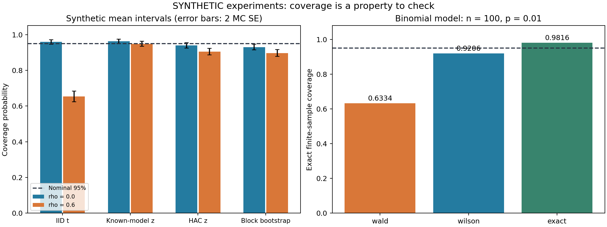

# 第一篇 数学、统计学与编程基础
# 第6章 数理统计、参数估计与假设检验

> 本章公式采用普通 Markdown 文本记法，无需数学插件；上下标、分式与矩阵的读法见[数学公式阅读约定](./数学公式阅读约定.md)。

## 学习目标与本章任务

**先修要求。** 能使用NumPy计算均值、协方差和矩阵乘积；理解导数与极值；掌握条件概率、正态分布、二项分布、期望、方差以及独立同分布的含义。需要回查时，分别阅读第2、3、4、5章。本章用到第3章的正交投影解释自由度，用第5章的协方差公式处理相关样本。

**完成后应具备的能力。**

1. 区分总体、样本、统计量、参数、估计量与估计值，说明“估计的不确定性”从何而来。
2. 推导均值与方差估计、Bernoulli和正态模型的极大似然估计，理解偏差、方差、均方误差与一致性。
3. 从枢轴量构造均值、方差和比例的区间，正确解释置信水平。
4. 定义原假设、备择假设、显著性水平、p值、两类错误和检验功效。
5. 解释多资产、多窗口、多指标同时监控引起的多重比较问题。
6. 实现独立样本区间、HAC标准误和分块Bootstrap，用覆盖率实验检查其局限。
7. 把推断结果、数据时间边界和方法假设一起保存，为后续状态识别与预警服务提供可审计证据。

**贯穿案例。** 平台已能读取人工行情，并算出EQ_DEMO、BOND_DEMO、GOLD_DEMO、FX_DEMO的收益。本章回答：“这些收益统计有多可靠？”例如，最近240个观测的平均收益为正，是否足以支持均值发生变化？100个经过核实的事件里没有漏报，是否能说明漏报率为零？20条监控规则各用5%的检验水平，整体误报概率还是5%吗？

本章所有数据均标记为**SYNTHETIC人工示例**，没有使用尚未提供的赛题官方数据。统计量显著不直接构成市场状态标签；状态标签需要经济含义、持续性及多维证据，也不能自动转化为未来收益预测或交易建议。

本章采用数学推断、可重复模拟和工程审计相结合的顺序。估计与检验的学习范围可与[北京大学数理统计课程大纲](https://math.pku.edu.cn/bks/sykc/148725.htm)对照；本科入门推断可参考[MIT 18.05官方课程资料](https://ocw.mit.edu/courses/18-05-introduction-to-probability-and-statistics-spring-2022/pages/classes-reading-and-in-class-materials/)。下面的推导、人工案例和程序均为本教材独立编写。

## 6.1 抽样分布、点估计、似然与区间估计

### 6.1.1 从概率模型走向统计推断

**总体（population）**是研究对象所对应的完整分布或对象集合；**样本（sample）**是获得的观测。金融问题中的总体通常不是“把全部历史行情放进一个文件”就能定义清楚：我们可能研究某个制度和时间范围下的收益分布，也可能研究在给定信息集条件下的分布。

设数据为随机变量

```text
X_1,…,X_n,
```

其一次实现为

```text
x_1,…,x_n.
```

**参数（parameter）**描述总体，例如均值`μ`、方差`σ^2`、漏报概率`p`。频率学派的基本设定是参数固定但未知，而样本随重复抽样变化。

**统计量（statistic）**是仅由样本和已知常数构成的函数，例如

```text
X̄ = ((1) / (n))∑_(i = 1)^n X_i.
```

其中不能包含未知参数。表达式`X̄-μ`一般不是统计量，因为含未知的`μ`。

**估计量（estimator）**是用来估计目标参数的统计量；将实际样本代入后得到**估计值（estimate）**。所以`X̄`是随机的估计量，`x̄ = 0.0008`是某次数据计算出的数值。

**抽样分布（sampling distribution）**是统计量在重复抽样下的分布。单日收益的分布与240日平均收益的抽样分布是不同对象。前者描述单个观测的变化，后者描述估计值在不同样本之间的变化。

在本节起步阶段，明确假设

```text
X_i ~[iid] F_θ,
```

即**独立同分布（independent and identically distributed，IID）**。这里同时包含独立性和分布相同两条条件。行情按时间排好序，并不能使这两条条件成立；6.3将有意撤去独立性。

### 6.1.2 偏差、方差、均方误差与一致性

估计量`θ̂`的**偏差（bias）**为

```text
b_θ = 𝔼_θ[θ̂]-θ.
```

下标`θ`说明期望在参数为`θ`的数据生成机制下计算。若对允许的每个`θ`都有`b_θ = 0`，称估计量**无偏（unbiased）**。

**均方误差（mean squared error，MSE）**为

```text
MSE_θ(θ̂) = 𝔼_θ[(θ̂-θ)^2].
```

加上再减去`𝔼θ̂`：

```text
θ̂-θ = (θ̂-𝔼θ̂)+b_θ.
```

平方并取期望：

```text
MSE = Var(θ̂) +2b_θ 𝔼[θ̂-𝔼θ̂] +b_θ^2 = Var(θ̂)+b_θ^2.
```

交叉项为零。无偏只控制第二项，不能保证总体误差最小。

例如目标为均值，考虑收缩估计量`μ̃ = aX̄`，其中`0<a<1`。若IID且方差有限：

```text
Bias(μ̃) = (a-1)μ, Var(μ̃) = a^2 σ^2/n,
```

因而

```text
MSE(μ̃) = a^2 σ^2/n+(1-a)^2 μ^2.
```

当真实均值足够接近零时，增加少量偏差可能降低MSE；若均值很大，这种收缩可能更差。实际并不知道`μ`，不能看见测试集结果以后再选择最有利的`a`。

**一致性，又称相合性（consistency）**表示随着样本量增大，估计量以概率收敛到目标：

```text
θ̂_n →[P] θ.
```

IID且有限方差时，

```text
𝔼X̄ = μ, Var(X̄) = σ^2/n.
```

利用Chebyshev不等式，

```text
P(|X̄-μ| ≥ ε) ≤ ((σ^2) / (nε^2))→0.
```

这证明样本均值的一致性。它依赖稳定的共同均值；当`μ`随时间改变时，长窗口可能精确地估计一个已经不适用的历史混合量。

### 6.1.3 样本方差为什么除以n−1

设IID样本的均值为`μ`、方差为`σ^2`，定义

```text
Q = ∑_(i = 1)^n(X_i-X̄)^2.
```

从

```text
X_i-X̄ = (X_i-μ)-(X̄-μ)
```

展开并求和：

```text
Q = ∑_i(X_i-μ)^2 -2(X̄-μ)∑_i(X_i-μ) +n(X̄-μ)^2.
```

因为`∑_i(X_i-μ) = n(X̄-μ)`，

```text
Q = ∑_i(X_i-μ)^2-n(X̄-μ)^2.
```

于是

```text
𝔼 Q = nσ^2-n((σ^2) / (n)) = (n-1)σ^2.
```

因此

```text
S^2 = ((Q) / (n-1))
```

无偏，而`Q/n`的期望为`(n-1)σ^2/n`。

“损失一个自由度”有具体含义：残差满足

```text
∑_i(X_i-X̄) = 0,
```

任取其中`n-1`个后，最后一个被约束确定。这与第3章中心化投影矩阵

```text
M = I-((1) / (n))𝟏𝟏^T
```

的秩为`n-1`一致。

这里没有证明`S = sqrt(S^2)`无偏。一般情况下开平方会改变偏差，不能把方差估计的性质直接搬给标准差估计。样本相关时，前面的`Var(X̄) = σ^2/n`也不成立，因此“除以n−1必然无偏”有适用边界。

### 6.1.4 矩估计与极大似然估计

**矩估计（method of moments，MoM）**把理论矩与样本矩相等后解参数。例如Bernoulli变量满足`𝔼 X = p`，便取

```text
p̂_MoM = X̄.
```

**似然（likelihood）**是固定观测后，把联合密度或质量函数看成参数的函数：

```text
L(θ;x) = f_θ(x_1,…,x_n).
```

IID时才可写成

```text
L(θ;x) = ∏_i f_θ(x_i).
```

相关时间序列一般应使用联合分布或条件分解

```text
f_θ(x_1)∏_(t = 2)^n f_θ(x_t | x_1,…,x_(t-1)).
```

**极大似然估计（maximum likelihood estimation，MLE）**选择

```text
θ̂ = argmax _(θ ∈ Θ) L(θ;x).
```

`Θ`是允许的参数集合。似然不是“参数的概率密度”，不要求对参数积分为1；连续数据的密度也不是观测点本身的概率。

实际优化通常使用**对数似然（log-likelihood）**

```text
ℓ(θ) = log L(θ) = ∑_i log f_θ(x_i).
```

对数严格递增，所以最大点不变，同时避免许多小概率相乘导致浮点下溢。

**例一：估计漏报概率。**

令`X_i = 1`表示第`i`个经过核实的目标事件被漏报。假设事件独立且具有共同漏报概率`p`，记`k = ∑_i x_i`。忽略不依赖`p`的计数系数，

```text
L(p) = p^k(1-p)^(n-k),
```

```text
ℓ(p) = klog p+(n-k)log(1-p).
```

当`0<k<n`时：

```text
ℓ'(p) = ((k) / (p))-((n-k) / (1-p)).
```

令导数为零：

```text
k(1-p) = (n-k)p ⇒ k = np ⇒ p̂ = k/n.
```

且

```text
ℓ''(p) = -k/p^2-(n-k)/(1-p)^2<0,
```

所以是唯一内部最大值。若`k = 0`，最大值在边界`p = 0`；若`k = n`，在`p = 1`。边界估计为零不代表已经证明总体风险为零。

**例二：正态模型的均值与方差。**

设`X_i ~[iid] N(μ,v)`，其中`v = σ^2>0`。对数似然为

```text
ℓ(μ,v) = -((n) / (2))log(2π)-((n) / (2))log v -((1) / (2v))∑_i(x_i-μ)^2.
```

先对`μ`求导：

```text
((∂ℓ) / (∂μ)) = ((1) / (v))∑_i(x_i-μ) = 0 ⇒ μ̂ = x̄.
```

令`Q = ∑_i(x_i-x̄)^2`，代入后对`v`求导：

```text
-((n) / (2v))+((Q) / (2v^2)) = 0 ⇒ v̂_MLE = Q/n.
```

当`Q>0`，导数在`v<Q/n`为正，在`v>Q/n`为负，且两端对数似然趋向负无穷，因此得到全局最大值。

MLE方差除以`n`，无偏样本方差除以`n-1`：两者优化标准不同。如果全部数据完全相同，`Q = 0`，令`v↓0`会使似然无限增大，在`v>0`内部没有有限最大点。代码必须报告退化样本，不能输出“标准误为零，所以确信无风险”。

### 6.1.5 信息量、充分统计量与精度下界

这一小节说明参数精度为何受到信息量限制。

对于可微且满足正则条件的单参数模型，定义单个样本的**得分函数（score function）**

```text
s_θ(X) = ((∂) / (∂θ))log f_θ(X).
```

需要支持集不随参数任意改变，且允许交换积分与求导。于是

```text
𝔼_θ[s_θ(X)] = ∫ ((∂_θ f_θ(x)) / (f_θ(x)))f_θ(x) dx = ∂_θ ∫ f_θ(x) dx = 0.
```

定义**Fisher信息（Fisher information）**

```text
I(θ) = 𝔼_θ[s_θ(X)^2].
```

IID样本的总得分`U = ∑_i s_θ(X_i)`，满足

```text
Var(U) = nI(θ).
```

设统计量`T`无偏估计`θ`。从`𝔼_θ T = θ`对参数求导：

```text
1 = ∂_θ ∫ T(x)L(θ;x) dx = ∫ T(x)U(x)L(θ;x) dx = 𝔼_θ[TU].
```

由于`𝔼 U = 0`，故`Cov(T,U) = 1`。Cauchy–Schwarz不等式给出

```text
1 ≤ Var(T)Var(U) = Var(T)nI(θ),
```

所以

```text
Var(T) ≥ ((1) / (nI(θ))).
```

这称为**Cramér–Rao下界（Cramér–Rao lower bound，CRLB）**。它约束满足条件的无偏估计量，不能用来否定有偏收缩估计，更不能脱离IID和正则条件直接用于行情。相关定理与条件可对照[Stanford STATS 200，Lecture 15，§15.2](https://web.stanford.edu/class/archive/stats/stats200/stats200.1172/Lecture15.pdf)。

Bernoulli内部参数`0<p<1`时，

```text
s_p(X) = ((X-p) / (p(1-p))), I(p) = ((1) / (p(1-p))).
```

因此无偏估计的方差至少为`p(1-p)/n`，而`p̂ = X̄`恰好达到这个下界。

再考虑**充分统计量（sufficient statistic）**：给定它以后，原始数据的条件分布不再依赖参数。Bernoulli样本中，给定总次数`K = k`，任何含`k`个1的序列条件概率均为

```text
1/C(n, k),
```

与`p`无关，因此`K`对`p`充分。这个结论只针对IID Bernoulli模型：若关注连续漏报或时间聚集，丢掉顺序就会丢掉研究目标需要的信息。

对任何无偏估计`T`，取条件期望`T^★ = 𝔼[T| K]`，仍有

```text
𝔼 T^★ = 𝔼 T = θ.
```

由全方差公式，

```text
Var(T) = 𝔼[Var(T| K)] +Var(𝔼[T| K]) ≥ Var(T^★).
```

充分性确保这里能得到不依赖未知参数的统计量。这就是**Rao–Blackwell改进（Rao–Blackwellization）**的核心机制：使用与参数有关的信息，平均掉不必要的随机波动。

### 6.1.6 标准差与标准误必须分开

**标准差（standard deviation，SD）**描述单个变量的离散程度；**标准误（standard error，SE）**描述估计量的抽样标准差。

IID样本均值有

```text
SE(X̄) = σ/sqrt(n), widehat(SE)(X̄) = S/sqrt(n).
```

若日收益标准差为1%，240个IID观测的均值标准误约为

```text
0.01/sqrt(240) ≈ 0.0006455,
```

即约6.455个**基点（basis points，bp）**，其中1 bp为`10^(-4)`。

均值估计较精确并不意味着明天的收益波动很小。一个是参数估计不确定性，一个是未来观测不确定性。

### 6.1.7 从枢轴量构造置信区间

**置信区间（confidence interval，CI）**是随样本变化的区间`C(X)`。若对模型内每个允许参数都有

```text
P_θ {θ ∈ C(X)} ≥ 1-α,
```

就具有至少`1-α`的覆盖保证；有些近似区间只有渐近保证。

参数固定，区间随机。95%的含义是重复使用该构造方法时的覆盖概率；观察到一个具体区间之后，不能在频率学派框架下直接说“这个固定参数有95%概率落在这两个固定端点之间”。[NIST均值置信区间说明](https://www.itl.nist.gov/div898/handbook/eda/section3/eda352.htm)也明确区分了这两种解释。

**枢轴量（pivotal quantity）**由数据与参数构成，但其分布不依赖未知参数。

若IID正态且`σ`已知，

```text
Z = ((X̄-μ) / (σ/sqrt(n)))~ N(0,1).
```

以`z_q`表示标准正态的`q`分位数，则

```text
P(-z_(1-α/2) ≤ Z ≤ z_(1-α/2)) = 1-α.
```

乘以正数`σ/sqrt(n)`，再移项：

```text
P( X̄-z_(1-α/2) ((σ) / (sqrt(n))) ≤ μ ≤ X̄+z_(1-α/2) ((σ) / (sqrt(n))) ) = 1-α.
```

这直接给出区间端点。

实际通常不知道`σ`。不能仅把`σ`换为`S`并继续声称有限样本下严格正态；需要进一步分析分母的随机性。

### 6.1.8 正态样本中的t分布与方差区间

设

```text
Z_i = (X_i-μ)/σ, Z~ N(0,I_n).
```

取正交矩阵，其第一行是`𝟏^T/sqrt(n)`，将`Z`旋转为`Y`。由标准正态密度只依赖`‖Z‖^2`，正交变换后的联合密度仍分解为独立标准正态密度，因此`Y_1,…,Y_n`彼此独立，并且

```text
Y_1 = sqrt(n)(X̄-μ)/σ.
```

残差平方和位于其余`n-1`个正交方向：

```text
(((n-1)S^2) / (σ^2)) = ∑_(j = 2)^n Y_j^2.
```

**卡方分布（chi-squared distribution）**`χ^2_ν`定义为`ν`个独立标准正态平方之和。故

```text
V = (n-1)S^2/σ^2 ~χ^2_(n-1),
```

且`V`与`Y_1`独立。根据第5章t分布的构造，

```text
T = ((Y_1) / (sqrt(V/(n-1)))) = ((X̄-μ) / (S/sqrt(n)))~ t_(n-1).
```

所以正态IID样本的精确均值区间为

```text
X̄ ± t_(n-1, 1-α/2) ((S) / (sqrt(n))).
```

这里第二个下标表示分位概率。

同理，

```text
P(χ^2_(ν,α/2) ≤ ν S^2/σ^2 ≤ χ^2_(ν,1-α/2)) = 1-α.
```

各量为正，取倒数会反转不等号，整理后得到

```text
((ν S^2) / (χ^2_(ν,1-α/2))) ≤ σ^2 ≤ ((ν S^2) / (χ^2_(ν,α/2))), ν = n-1.
```

这些是正态IID下的有限样本结果。一般IID有限方差数据的均值可使用渐近近似，但样本方差的卡方结论不随之成立；厚尾、极端偏斜和相关性均需要额外分析。[MIT Reading 22](https://ocw.mit.edu/courses/18-05-introduction-to-probability-and-statistics-spring-2022/mit18_05_s22_class22-prep.pdf)提供了正态数据区间的基础阅读。

### 6.1.9 比例区间：Wald、Wilson与精确二项区间

Bernoulli样本中`p̂ = K/n`。最直接的**Wald区间（Wald interval）**为

```text
p̂ ± zsqrt(p̂(1-p̂)/n), z = z_(1-α/2).
```

问题是当`K = 0`时，整个区间变成`[0,0]`；当`K`很小时，还可能越出`[0,1]`。把负端点裁剪成零不能修复覆盖率。

**Wilson得分区间（Wilson score interval）**保留待检验参数`p`在方差中的位置，从

```text
(((p̂-p)^2) / (p(1-p)/n)) ≤ z^2
```

开始。展开：

```text
n(p̂^2-2p̂p+p^2) ≤ z^2 p-z^2 p^2,
```

即

```text
(n+z^2)p^2-(2np̂+z^2)p+np̂^2 ≤ 0.
```

二次函数开口向上，允许的`p`在两根之间。应用求根公式并整理：

```text
((p̂+z^2/(2n) ± zsqrt(p̂(1-p̂)/n+z^2/(4n^2))) / (1+z^2/n)).
```

这里`K = 0`得到

```text
[0,z^2/(n+z^2)],
```

保留了有限样本的不确定性。Wilson通常比简单Wald表现稳定，但不是对所有`n,p`都至少达到名义覆盖率的精确区间。

**Clopper–Pearson精确区间（Clopper–Pearson exact interval，CP）**直接反演二项尾部。观察到`k`时，内部端点满足

```text
P_(p_L)(K ≥ k) = α/2, P_(p_U)(K ≤ k) = α/2.
```

利用二项尾概率与Beta积分的关系，可以写成

```text
p_L = Q_(Beta(k,n-k+1))(α/2), k>0,
```

```text
p_U = Q_(Beta(k+1,n-k))(1-α/2), k<n.
```

边界取`k = 0`时`p_L = 0`，`k = n`时`p_U = 1`。这里Beta分位数只是求二项尾部方程的计算工具，并不意味着已经引入贝叶斯先验。

离散性使这个等尾构造一般偏保守，覆盖率至少为名义水平而不总是恰好相等。Wilson公式和二项尾部反演可与[NIST比例区间](https://www.itl.nist.gov/div898/handbook/prc/section2/prc241.htm)交叉核对。

若100次独立试验零次失败，单侧95%上界满足

```text
P_(p_U)(K = 0) = (1-p_U)^100 = 0.05,
```

所以

```text
p_U = 1-0.05^(1/100) ≈ 0.02951.
```

双侧95%等尾CP上界则是

```text
1-0.025^(1/100) ≈ 0.03622.
```

单侧与双侧不能混用。第5章的“约`3/n`”正是单侧零命中上界的大样本近似，因为`-log 0.05 ≈ 2.996`。

### 6.1.10 与贝叶斯可信区间、预测区间的区别

**贝叶斯可信区间（Bayesian credible interval）**来自参数的后验分布。假设

```text
p~Beta(a,b), π(p) ∝ p^(a-1)(1-p)^(b-1).
```

观察到`k`次事件后：

```text
π(p| x) ∝ p^k(1-p)^(n-k) p^(a-1)(1-p)^(b-1) = p^(a+k-1)(1-p)^(b+n-k-1).
```

因此

```text
p| x~Beta(a+k,b+n-k).
```

在这个先验和模型下，后验区间内的概率可以说是95%。这不自动等于对所有固定`p`都有95%的频率覆盖。先验也必须记录，不能在看过测试集后悄悄调整。[MIT Reading 15](https://ocw.mit.edu/courses/18-05-introduction-to-probability-and-statistics-spring-2022/mit18_05_s22_class15-prep.pdf)可用于复习共轭更新。

**预测区间（prediction interval，PI）**针对未来观测。正态IID且新观测独立时，

```text
Var(X_(n+1)-X̄) = σ^2(1+1/n).
```

其标准化分子与`S`独立，因此

```text
((X_(n+1)-X̄) / (Ssqrt(1+1/n)))~ t_(n-1).
```

未来单个观测的预测区间为

```text
X̄ ± t_(n-1,1-α/2) Ssqrt(1+1/n).
```

它通常显著宽于均值区间。把“均值显著为正”解释成“下一期收益以95%概率为正”，混淆了推断对象。

## 6.2 假设检验、检验功效与多重比较

### 6.2.1 把监控问题写成可检验命题

**原假设（null hypothesis，`H_0`）**是要接受检验的参数限制；**备择假设（alternative hypothesis，`H_1`）**描述与之竞争的范围。例如：

```text
H_0:μ = 0, H_1:μ ≠ 0.
```

这是双侧检验。若事先只关注均值上升，可用

```text
H_0:μ ≤ μ_0, H_1:μ>μ_0.
```

方向必须事先确定。看到均值为正才选择右尾、为负才选择左尾，会改变整体错误概率。

**检验统计量（test statistic）**把样本压缩成与假设相关的量；**拒绝域（rejection region）**规定哪些取值导致拒绝`H_0`。

检验结论应是“在所列模型、样本和检验设计下，证据达到/未达到拒绝标准”。未拒绝不等于证明`H_0`正确，也不等于两个市场状态完全相同。检验均值为零，也没有检验“市场没有风险”：波动、尾部、流动性和相关结构都可能发生变化。

### 6.2.2 两类错误与p值

**第一类错误（Type I error）**是在`H_0`真实时拒绝它。**显著性水平（significance level）**`α`要求

```text
sup _(θ ∈ Θ_0) P_θ(拒绝H_0) ≤ α.
```

复合原假设包含多个参数值，所以需要控制其中最坏的拒绝概率。

**第二类错误（Type II error）**是在某个真实备择`θ`下未拒绝`H_0`，其概率为`β(θ)`。**检验功效（power）**是

```text
π(θ) = 1-β(θ).
```

它随备择值变化，并非一种方法只有一个固定“准确率”。

对于较大`|T|`更不利于`H_0`的双侧检验，**p值（p-value）**是原假设分布下得到至少同样极端统计量的概率。正态IID均值检验中，

```text
t_obs = ((x̄-μ_0) / (s/sqrt(n))), p = 2P(t_(n-1) ≥ |t_obs|).
```

计算时使用生存函数`1-F`的专门实现，即`stats.t.sf`，避免很小尾概率由两个接近1的数相减产生精度损失。

有效p值满足在原假设下

```text
P(p ≤ u) ≤ u, 0 ≤ u ≤ 1.
```

连续、正确校准的简单原假设常得到均匀分布；离散检验可能更保守。这个性质是后面多重比较的基础。

p值不是`P(H_0 | x)`，不是效应大小，也不是“这个报警有多大概率是真的”。后一个问题需要第5章所讨论的基准率、条件分布或明确的决策模型。[MIT Reading 17b](https://ocw.mit.edu/courses/18-05-introduction-to-probability-and-statistics-spring-2022/mit18_05_s22_class17-prep-b.pdf)提供原假设检验的基础说明。

### 6.2.3 置信区间与双侧检验的对偶

正态IID双侧均值检验拒绝条件为

```text
|((x̄-μ_0) / (s/sqrt(n)))| >t_(n-1,1-α/2).
```

两侧乘以正数`s/sqrt(n)`，等价于

```text
|x̄-μ_0|> t_(n-1,1-α/2) s/sqrt(n).
```

也就是说，`μ_0`落在相应的`1-α`均值区间之外。

因此，一个区间可以同时展示估计方向、效应量和与零值的关系，比只展示“p<0.05”更有用。不过对偶要求区间与检验来自同一种反演构造。某些离散双侧p值采用“概率质量不大于观测结果”的排序，而CP区间是等尾反演，不能假设任意软件默认的双侧二项检验都与CP逐点完全一致。

### 6.2.4 为什么似然比会产生合理的拒绝域

以两个完全指定的模型`f_0(x)`、`f_1(x)`为例。**似然比（likelihood ratio）**为

```text
Λ(x) = f_1(x)/f_0(x).
```

大比值说明当前数据相对于`H_0`更支持`H_1`。

取检验函数`φ^★(x)`，在`f_1(x)>cf_0(x)`时取1，在小于时取0，必要时在等号处随机化，使`𝔼_0 φ^★ = α`。任意另一个检验`φ`满足`𝔼_0 φ ≤ α`。

由构造，对每个`x`都有

```text
(φ^★-φ)(f_1-cf_0) ≥ 0.
```

积分后：

```text
𝔼_1(φ^★-φ) -c𝔼_0(φ^★-φ) ≥ 0.
```

又因为`𝔼_0(φ^★-φ) ≥ 0`，故

```text
𝔼_1 φ^★ ≥ 𝔼_1 φ.
```

这证明在给定第一类错误约束下，该似然比检验对这个指定备择具有最大功效，即**Neyman–Pearson引理（Neyman–Pearson lemma）**的核心结论。

例如IID `N(μ,σ^2)`，已知`σ`，比较`μ_1>μ_0`：

```text
log Λ = ((μ_1-μ_0) / (σ^2))∑_i x_i -((n(μ_1^2-μ_0^2)) / (2σ^2)).
```

它随`x̄`单调上升，所以拒绝域为“样本均值足够大”。

这个证明针对简单原假设与简单备择。多个未知参数、模型边界、混合模型或状态数选择，需要进一步理论；不能只把两个最优似然相除就自动声称具有已知的精确错误率。

### 6.2.5 功效与样本量的逐步计算

假设已知`σ`，用右尾z检验

```text
H_0:μ ≤ μ_0, H_1:μ>μ_0.
```

当

```text
X̄>μ_0+z_(1-α) σ/sqrt(n)
```

时拒绝。

若真实均值为`μ_1 = μ_0+δ`，其中`δ>0`，则

```text
((X̄-μ_1) / (σ/sqrt(n)))~ N(0,1).
```

所以

```text
π(μ_1) = 1-Φ(z_(1-α)-((δsqrt(n)) / (σ))).
```

要求功效至少`1-β`，等价于

```text
Φ(z_(1-α)-((δsqrt(n)) / (σ))) ≤ β.
```

由`z_β = -z_(1-β)`，得到

```text
((δsqrt(n)) / (σ)) ≥ z_(1-α)+z_(1-β),
```

因此

```text
n ≥ [((σ(z_(1-α)+z_(1-β))) / (δ))]^2.
```

最后向上取整。这个是已知方差、正态IID、单侧设计的公式。未知方差时可用非中心t分布计算功效，相关样本则必须重新处理均值方差。[NIST样本量说明](https://www.itl.nist.gov/div898/handbook/prc/section2/prc222.htm)可作为设计阶段的参考。

人工示例取`σ = 0.01`、`δ = 0.001`、`α = 0.05`、目标功效0.8，需要约619个独立观测。提高采样频率不一定能快速获得619份独立信息。

若用双侧z检验，设`c = z_(1-α/2)`、`d = δsqrt(n)/σ`，准确功效为

```text
π(μ_1) = 1-Φ(c-d)+Φ(-c-d).
```

常见的双侧样本量公式忽略第二个很小的尾部项，属于近似设计，应说明这一点。

**统计显著性与实际意义。** 极大样本可能使微小偏移显著，但偏移可能低于数据修订误差、报价刻度或业务关注阈值。应同时报告估计值、区间、单位和事前规定的最小重要效应`δ_min`。未拒绝`μ = 0`也不能证明“足够接近零”；若要论证等效，应检验效应是否位于事前定义的容忍区间内。

### 6.2.6 多资产平台为什么天然存在多重比较

设同时做`m`个检验，且所有原假设都真实。如果检验相互独立，每个以`α`拒绝，则至少一次误拒绝的概率为

```text
1-(1-α)^m.
```

取`m = 20,α = 0.05`：

```text
1-0.95^20 ≈ 0.6415.
```

因此20条规则各自“95%置信”，不能推出整个页面“95%可靠”。

真实平台的检验家族可能是：

```text
资产 × 特征 × 窗口 × 模型版本.
```

必须在查看结果前定义家族。只把显示在页面上的显著结果算入`m`，会漏掉筛选过程；临时试过的阈值、资产池和窗口也属于研究自由度。

**族错误率（family-wise error rate，FWER）**定义为

```text
P(V ≥ 1),
```

其中`V`是误拒绝数量。

**Bonferroni校正**令每项在`α/m`水平拒绝。对真实原假设集合`ℋ_0`，利用并集上界：

```text
P(V ≥ 1) ≤ ∑_(i ∈ ℋ_0) P(p_i ≤ α/m) ≤ m_0 α/m ≤ α.
```

其中`m_0 ≤ m`。这个证明不要求检验之间独立，但要求每个原始p值有效；错误使用IID标准误产生的失准p值，不能靠乘以`m`自动修好。

### 6.2.7 FDR、BH与相关检验的边界

如果平台同时筛选大量候选异常，也可能关注**错误发现率（false discovery rate，FDR）**：

```text
FDR = 𝔼[((V) / (max(R,1)))],
```

其中`R`是总拒绝数量。当`R = 0`时比值取零。

FDR=5%的保证针对随机比例的期望，不表示某一次页面中错误报警一定不超过5%，也不等于每个报警有95%的真实概率。

**Benjamini–Hochberg程序（BH）**的步骤是：

1. 将`m`个p值排序为`p_((1)) ≤ ⋯ ≤ p_((m))`。
2. 找最大`k`，使`p_((k)) ≤ kq/m`。
3. 若存在该`k`，拒绝排序前`k`项；若不存在，不拒绝任何项。

`q`是目标FDR水平。对应排序后的调整p值为

```text
p̃_((i)) = min(1,min _(j ≥ i) ((m) / (j)) p_((j)) ).
```

必须从右向左取累积最小值，再恢复原资产顺序，不能简单逐点计算`mp_((i))/i`。

原始BH论文在独立情形证明控制；部分特定正依赖结构也有扩展保证。不能仅凭“资产大多正相关”就证明双侧检验满足所需的正回归依赖条件。一般依赖下可用更保守的**Benjamini–Yekutieli程序（BY）**：把BH阈值中的`q`替换为`q/H_m`，其中

```text
H_m = ∑_(j = 1)^m 1/j.
```

这些保证仍然要求原始p值有效。原始书目信息可查[Benjamini与Hochberg，1995](https://cris.tau.ac.il/en/publications/controlling-the-false-discovery-rate-a-practical-and-powerful-app-2/)；BH/BY假设与实现可核对[SciPy 1.15.3官方文档](https://docs.scipy.org/doc/scipy-1.15.3/reference/generated/scipy.stats.false_discovery_control.html)。

本章程序在四资产横截面同时保存Bonferroni、BH和BY结果，展示其差别；对一般资产依赖，不能默认将BH结果解释为已经证明的FDR控制。

### 6.2.8 持续查看与预警不是一次固定检验

固定窗口检验的5%错误率不适用于“每秒重新计算，第一次p<0.05就报警”的任意停止规则。重复观察同一数据流会改变越界概率；滚动窗口又彼此重叠。

一种简单、保守且容易证明的设计是预先分配各时点错误预算：

```text
α_t = ((α) / (t(t+1))), t = 1,2,…
```

因为

```text
((1) / (t(t+1))) = ((1) / (t))-((1) / (t+1)),
```

故

```text
∑_(t = 1)^∞ α_t = α.
```

只要每个时间点预定检验的p值在相应原假设下有效，便由并集上界得到总体误拒绝概率不超过`α`。该方法可能过于保守；自适应改变检验时还需条件有效性或专门的序贯推断工具。

后续预警章节将区分固定家族检验、序贯检验、控制图和报警冷却机制。冷却时间能减少重复通知，但不会自行恢复统计错误率保证。

## 6.3 Bootstrap、相关样本与金融统计误用

### 6.3.1 非参数Bootstrap在近似什么

**自助法（bootstrap）**用原始样本估计的数据生成分布，近似统计量的抽样分布。IID非参数Bootstrap使用**经验分布（empirical distribution）**

```text
F̂_n = ((1) / (n))∑_(i = 1)^n δ_(x_i),
```

其中`δ_(x_i)`表示集中在观测点`x_i`上的单位概率质量。

对于`b = 1,…,B`，从`n`个观测中有放回抽取`n`次，得到样本`X^(*(b))`，计算

```text
T^(*(b)) = T(X^(*(b))).
```

星号表示在给定原数据条件下的重抽样随机量。

Bootstrap均值的机制可直接推导：

```text
𝔼_*(X_i^*) = x̄, Var_*(X_i^*) = ((1) / (n))∑_j(x_j-x̄)^2.
```

重抽样点条件独立，故

```text
Var_*(X̄^*) = ((1) / (n))[((1) / (n))∑_j(x_j-x̄)^2 ] = ((n-1) / (n^2))S^2.
```

当`n`较大，这接近`S^2/n`。Bootstrap不是从无信息中创造新样本，而是借助经验分布近似原来的抽样过程。

**百分位区间（percentile interval）**取

```text
[Q^*_(α/2),Q^*_(1-α/2)],
```

即重抽样估计值的相应分位数。

**基本区间（basic interval）**从误差`T^*-θ̂`近似`θ̂-θ`出发。若

```text
Q^*_(α/2)-θ̂ ≲ θ̂-θ ≲ Q^*_(1-α/2)-θ̂,
```

移项得到

```text
[2θ̂-Q^*_(1-α/2), 2θ̂-Q^*_(α/2)].
```

还有学生化和偏差校正方法；它们需要额外估计或正则条件，不是免费提高可靠性。

以上Bootstrap在适当光滑统计量与分布条件下可近似抽样不确定性。极值、稀有尾事件、参数边界、极小样本和模型选择后统计量可能失败。若100个0被反复抽样，得到的仍全部为0，无法生成未观测过的失败事件。[MIT Reading 24](https://ocw.mit.edu/courses/18-05-introduction-to-probability-and-statistics-spring-2022/mit18_05_s22_class24-prep.pdf)可用于理解重抽样区间；本章用独立人工实验检查其覆盖。

### 6.3.2 相关性怎样改变均值方差

设序列具有共同均值`μ`，且协方差只取决于时距：

```text
γ_h = Cov(X_t,X_(t-h)).
```

这种均值和二阶矩不随时间平移改变的性质称为**弱平稳（weak stationarity）**，下一章将系统定义。

从方差展开：

```text
Var(X̄) = ((1) / (n^2))∑_(i = 1)^n ∑_(j = 1)^n Cov(X_i,X_j).
```

对角项共`n`项，各为`γ_0`；相距`h`的上下三角项各有`n-h`项，因此

```text
Var(X̄) = ((1) / (n))[ γ_0+2∑_(h = 1)^(n-1)(1-h/n)γ_h ].
```

这解释了为什么不能只把观测数量代入`S/sqrt(n)`。

本章用一阶**自回归模型（autoregressive model of order one，AR(1)）**构造可控制的反例：

```text
X_t-μ = ρ(X_(t-1)-μ)+ε_t, |ρ|<1,
```

其中创新`ε_t`彼此独立，且与过去独立，均值零、方差`σ_ε^2`。

在平稳初始化下，

```text
γ_0 = ρ^2 γ_0+σ_ε^2 ⇒ γ_0 = ((σ_ε^2) / (1-ρ^2)).
```

又有

```text
γ_h = Cov(ρ(X_t-μ)+ε_(t+1),X_(t+1-h)) = ργ_(h-1),
```

故

```text
γ_h = γ_0 ρ^h.
```

记边际标准差为`σ = sqrt(γ_0)`，得到

```text
Var(X̄) = ((σ^2) / (n))[ 1+2∑_(h = 1)^(n-1)(1-h/n)ρ^h ].
```

大样本下，几何级数给出

```text
1+2∑_(h = 1)^∞ ρ^h = 1+((2ρ) / (1-ρ)) = ((1+ρ) / (1-ρ)).
```

与IID情形相比，均值方差约放大`(1+ρ)/(1-ρ)`。当`ρ = 0.6`，放大约4倍，标准误约2倍。

把这一方差关系写成

```text
Var(X̄) ≈ σ^2/n_eff,
```

得到均值估计意义下的**有效样本量（effective sample size，ESS）**

```text
n_eff ≈ n((1-ρ) / (1+ρ)).
```

这是针对该模型和统计量的近似，不是删除数据的建议，也不能作为所有特征统一的“真实样本数”。

### 6.3.3 HAC标准误的构造与限制

若自协方差绝对可和，定义**长期方差（long-run variance）**

```text
Ω = γ_0+2∑_(h = 1)^∞ γ_h.
```

在合适的弱依赖和矩条件下，

```text
sqrt(n)(X̄-μ) ⇒ N(0,Ω).
```

只假设弱平稳或只知道协方差可和，并不足以自动保证所有中心极限定理条件。

令残差`e_t = x_t-x̄`，估计

```text
γ̂_h = ((1) / (n))∑_(t = h+1)^n e_t e_(t-h).
```

注意分母统一为`n`，不换成`n-h`。采用截断阶数`L`及Bartlett权重：

```text
Ω̂ = γ̂_0+ 2∑_(h = 1)^L (1-((h) / (L+1)))γ̂_h.
```

于是

```text
widehat(SE)_HAC = sqrt(Ω̂/n).
```

**异方差与自相关稳健（heteroskedasticity and autocorrelation consistent，HAC）**估计允许适当条件下的方差变化和序列依赖；上述是样本均值的标量实现。

为什么Bartlett形式具有非负结构？令

```text
W_ij = max(1-|i-j|/(L+1),0).
```

构造向量`v_i`，在长度为`L+1`的连续位置上取`1/sqrt(L+1)`，其余为0。相邻向量按索引平移，则`v_i^T v_j = W_ij`。所以`W`是Gram矩阵，半正定，并且

```text
Ω̂ = e^T We/n ≥ 0.
```

程序用等价的逐滞后求和降低计算成本，不需要构造整个`n × n`矩阵。零或非有限估计报告错误，不偷偷加一个正数再声称估计有效。

Newey与West提出了具有半正定结构的HAC协方差估计；[NBER官方书目](https://www.nber.org/papers/t0055)列出1986年工作论文及1987年正式发表信息。这里给出的是样本均值特例，并非完整回归协方差实现。

HAC区间为渐近形式

```text
x̄ ± z_(1-α/2) sqrt(Ω̂/n).
```

`L`太小会漏掉长依赖，太大又会引入大量估计噪声。理论一致性通常要求随样本量增长的带宽及额外条件；固定`L = 12`是本章演示设置，不能宣称对所有样本量和市场都一致或最佳。带宽选择必须在训练/校准阶段完成。

### 6.3.4 分块Bootstrap保留哪些结构

逐点IID重抽样打乱时间邻近关系。**分块自助法（block bootstrap）**改为抽取连续块，在块内部保留局部依赖。

**移动块（moving block）**方案从原序列的重叠连续块中抽样；**循环块（circular block）**方案把序列视作首尾连接，允许块跨越末尾再回到开头。本章实现循环块：

1. 固定块长`ℓ`，均匀抽取起点`s ∈ {0,…,n-1}`。
2. 形成索引`(s,s+1,…,s+ℓ-1)bmod n`。
3. 独立抽取`⌈ n/ℓ⌉`个块并连接。
4. 取前`n`个位置，计算均值。
5. 重复`B`次，以均值分位数构造区间。

截断最后一个块只是使人工重抽样长度恰好为`n`，并未删除原始观测。算法及配置会记录在实验清单中。时间序列重抽样的基础思路可参考[CMU Shalizi，2020，Lecture 16](https://stat.cmu.edu/~cshalizi/dst/20/lectures/16/lecture-16.html)。

`ℓ = 1`退化为IID重抽样；若`ℓ = n`，每个重抽样只是整条序列的循环旋转，均值完全不变，区间退化。因此块长越大并非越好。

在适当平稳、弱依赖和统计量正则条件下，常研究`ℓ→∞`、`ℓ/n→0`的渐近情形。有限样本仍需块长敏感性分析。循环块引入的首尾连接是人工边界，不能解读为真实市场相邻事件。

多资产数据应按同一组时间索引重抽整行。分别抽股票列和债券列会破坏横截面依赖，影响相关性和组合风险。具有趋势、制度突变、长记忆或稀有危机的数据，未必能用一个固定平稳块模型近似。

### 6.3.5 三类误差及时间有效性

推断至少涉及三类误差：

|类别|本章例子|增加模拟次数能否解决|
|---|---|---|
|抽样误差|240条数据估计均值存在波动|不能替代增加有效数据|
|近似或模型误差|用IID区间处理自相关序列|不能，需改变方法或模型|
|数值与Monte Carlo误差|399次Bootstrap估计分位数不稳定|可以减少其中的模拟误差|

还有平台特有的数据与时间误差：把修订值当成首次发布值、在历史决策时点使用后来获取的行情、把重复新闻当成独立事件、把数据中断填为零收益。这些改变了被分析的数据，统计公式本身不会修复它们。

在决策时刻`d`，输入必须满足`available_time <= d`，并使用当时可见的版本。训练均值、标准化参数、HAC带宽、Bootstrap块长、检验方向和检验家族都要有确定的形成时间；模型发布后才能用于线上决策。

滚动估计的区间表示给定窗口与假设下的不确定性。若窗口跨越了结构变化，窄区间可能围绕一个经济解释薄弱的历史平均值。后续状态模型应识别这种变化，而不是只要求区间更窄。

### 6.3.6 完整实验：区间覆盖、罕见事件与多资产检验

**输入。** 程序内构造正态IID序列和`ρ = 0.6`的平稳高斯AR(1)序列；它们具有相同的边际均值0.0002、边际标准差0.01，每条240个观测。初值直接从平稳边际分布抽取，创新标准差设为`σsqrt(1-ρ^2)`，避免初值固定为零带来的过渡阶段。

**比较。** 同一条序列分别计算IID t区间、知道真实相关模型的z区间、HAC z区间和循环块百分位区间。第二项是检验模拟程序的“已知生成机制基准”，现实中不能假装知道真实`ρ,σ`。

**重复。** 每个情景1000条独立序列；每条执行399次Bootstrap；带宽、块长均预先设12。使用相同样本比较方法，避免样本不同造成不公平。不同实验使用PCG64派生随机流，复现需同时保存种子、派生键和依赖版本。

**另外两项实验。** 对`K~Binomial(100,0.01)`枚举全部101种计数，计算三种区间的精确覆盖率；构造独立日期、同日资产相关的四资产面板，比较原始与调整p值。最后用10000组、每组20个独立均匀p值，检查全原假设下的族错误率。

**依赖与运行。** 已使用电脑现有的Anaconda验证：Python 3.13.5、NumPy 2.1.3、SciPy 1.15.3；配图使用已有Matplotlib 3.10.0。没有下载解释器或安装库。程序见[inference_lab.py](./code/ch06/inference_lab.py)。

在`教材/code/ch06`目录执行：

```powershell
& 'D:\Anaconda\python.exe' inference_lab.py
& 'D:\Anaconda\python.exe' -m unittest -v test_inference_lab.py
```

默认新建`runs`下带UTC时间戳的目录；也可指定`--out`，已有目标目录会被拒绝覆盖。以下是完整主程序：

```python
"""Chapter 6: SYNTHETIC inference lab; existing NumPy/SciPy only."""
from __future__ import annotations
import argparse
import hashlib
import json
import platform
from datetime import datetime, timezone
from pathlib import Path
import numpy as np
import scipy
from scipy import stats

ASSETS = ("EQ_DEMO", "BOND_DEMO", "GOLD_DEMO", "FX_DEMO")


def integer(value, low, high=None):
    if isinstance(value, (bool, np.bool_)) or not isinstance(value, (int, np.integer)):
        raise ValueError("integer required")
    if value < low or (high is not None and value > high):
        raise ValueError("integer outside allowed range")
    return int(value)


def level(alpha):
    if not np.isfinite(alpha) or not 0 < alpha < 1:
        raise ValueError("alpha must be in (0, 1)")
    return float(alpha)


def sample(values):
    x = np.asarray(values, dtype=float)
    if x.ndim != 1 or len(x) < 2 or not np.isfinite(x).all():
        raise ValueError("need at least two finite observations; no silent deletion")
    return x


def mean_t(values, mu0=0.0, alpha=0.05):
    x = sample(values)
    level(alpha)
    if not np.isfinite(mu0):
        raise ValueError("mu0 must be finite")
    n = len(x)
    mean = float(x.mean())
    se = float(x.std(ddof=1) / np.sqrt(n))
    if not np.isfinite(se) or se <= 0:
        raise ValueError("nonpositive or nonfinite standard error")
    statistic = (mean - mu0) / se
    radius = stats.t.ppf(1 - alpha / 2, n - 1) * se
    return {"mean": mean, "se": se, "t": float(statistic),
            "p_two_sided": float(2 * stats.t.sf(abs(statistic), n - 1)),
            "ci": [float(mean - radius), float(mean + radius)]}


def proportion_ci(k, n, alpha=0.05, method="wilson"):
    n = integer(n, 1)
    k = integer(k, 0, n)
    level(alpha)
    p = k / n
    z = stats.norm.ppf(1 - alpha / 2)
    if method == "wald":
        radius = z * np.sqrt(p * (1 - p) / n)
        return float(p - radius), float(p + radius)
    if method == "wilson":
        den = 1 + z * z / n
        center = (p + z * z / (2 * n)) / den
        radius = z / den * np.sqrt(p * (1 - p) / n + z * z / (4 * n * n))
        lo = 0.0 if k == 0 else max(0.0, float(center - radius))
        hi = 1.0 if k == n else min(1.0, float(center + radius))
        return lo, hi
    if method == "exact":
        lo = 0.0 if k == 0 else stats.beta.ppf(alpha / 2, k, n - k + 1)
        hi = 1.0 if k == n else stats.beta.ppf(1 - alpha / 2, k + 1, n - k)
        return float(lo), float(hi)
    raise ValueError("method must be wald, wilson or exact")


def adjust_p(values, method="bh"):
    p = np.asarray(values, dtype=float)
    if p.ndim != 1 or p.size == 0 or not np.isfinite(p).all():
        raise ValueError("need a nonempty finite p-value vector")
    if np.any((p < 0) | (p > 1)):
        raise ValueError("p-values outside [0, 1]")
    m = len(p)
    if method == "bonferroni":
        return np.minimum(1.0, m * p)
    if method not in ("bh", "by"):
        raise ValueError("unknown adjustment")
    order = np.argsort(p, kind="stable")
    multiplier = 1.0 if method == "bh" else np.sum(1.0 / np.arange(1, m + 1))
    scaled = p[order] * m * multiplier / np.arange(1, m + 1)
    adjusted = np.minimum.accumulate(scaled[::-1])[::-1]
    out = np.empty(m)
    out[order] = np.minimum(1.0, adjusted)
    return out


def hac_se(values, lag):
    x = sample(values)
    n = len(x)
    lag = integer(lag, 0, n - 1)
    residual = x - x.mean()
    omega = float(residual @ residual / n)
    for h in range(1, lag + 1):
        gamma = float(residual[h:] @ residual[:-h] / n)
        omega += 2 * (1 - h / (lag + 1)) * gamma
    if not np.isfinite(omega) or omega <= 0:
        raise ValueError("nonpositive long-run variance; inspect data/configuration")
    return float(np.sqrt(omega / n))


def circular_bootstrap_ci(values, rng, block=12, draws=399, alpha=0.05):
    x = sample(values)
    n = len(x)
    block = integer(block, 1, n)
    draws = integer(draws, 2)
    level(alpha)
    count = (n + block - 1) // block
    starts = rng.integers(0, n, size=(draws, count))
    indices = (starts[..., None] + np.arange(block)) % n
    resampled = x[indices.reshape(draws, -1)[:, :n]]
    means = resampled.mean(axis=1)
    return np.quantile(means, [alpha / 2, 1 - alpha / 2], method="linear")


def ar1_paths(rng, repetitions, n, rho, sigma=0.01, mu=0.0002):
    repetitions = integer(repetitions, 1)
    n = integer(n, 2)
    if not np.isfinite([rho, sigma, mu]).all() or abs(rho) >= 1 or sigma <= 0:
        raise ValueError("stationary rho, positive marginal sigma and finite mu required")
    x = np.empty((repetitions, n))
    x[:, 0] = mu + sigma * rng.standard_normal(repetitions)
    innovation_sd = sigma * np.sqrt(1 - rho * rho)
    for t in range(1, n):
        x[:, t] = mu + rho * (x[:, t - 1] - mu) + innovation_sd * rng.standard_normal(repetitions)
    return x


def ar1_mean_variance(n, rho, sigma=0.01):
    n = integer(n, 2)
    if not np.isfinite([rho, sigma]).all() or abs(rho) >= 1 or sigma <= 0:
        raise ValueError("invalid AR(1) parameters")
    h = np.arange(1, n)
    return float(sigma * sigma / n * (1 + 2 * np.sum((1 - h / n) * rho ** h)))


def coverage_record(intervals, truth):
    intervals = np.asarray(intervals)
    covered = (intervals[:, 0] <= truth) & (truth <= intervals[:, 1])
    rate = float(covered.mean())
    return {"covered": int(covered.sum()), "repetitions": len(covered),
            "coverage": rate, "mc_se": float(np.sqrt(rate * (1 - rate) / len(covered))),
            "mean_width": float(np.mean(intervals[:, 1] - intervals[:, 0]))}


def experiment(seed=20261022, repetitions=1000):
    integer(repetitions, 2)
    integer(seed, 0)
    children = np.random.SeedSequence(seed).spawn(6)
    rngs = [np.random.Generator(np.random.PCG64(s)) for s in children]
    n, mu, sigma, alpha, lag, block, draws = 240, 0.0002, 0.01, 0.05, 12, 12, 399
    z = stats.norm.ppf(1 - alpha / 2)
    results, first_paths = {}, []
    for j, rho in enumerate((0.0, 0.6)):
        paths = ar1_paths(rngs[2 * j], repetitions, n, rho, sigma, mu)
        first_paths.append(paths[0])
        oracle_se = np.sqrt(ar1_mean_variance(n, rho, sigma))
        intervals = {name: [] for name in ("iid_t", "oracle_z", "hac_z", "block_percentile")}
        for x in paths:
            center = float(x.mean())
            intervals["iid_t"].append(mean_t(x, alpha=alpha)["ci"])
            intervals["oracle_z"].append([center - z * oracle_se, center + z * oracle_se])
            se = hac_se(x, lag)
            intervals["hac_z"].append([center - z * se, center + z * se])
            intervals["block_percentile"].append(circular_bootstrap_ci(x, rngs[2 * j + 1], block, draws, alpha))
        results[str(rho)] = {key: coverage_record(value, mu) for key, value in intervals.items()}
    rare = {}
    for method in ("wald", "wilson", "exact"):
        bounds = np.array([proportion_ci(k, 100, method=method) for k in range(101)])
        mass = stats.binom.pmf(np.arange(101), 100, 0.01)
        contains = (bounds[:, 0] <= 0.01) & (0.01 <= bounds[:, 1])
        rare[method] = float(np.sum(mass[contains]))
    # Separate artificial panel: same dates across columns; never shuffle columns separately.
    corr = np.full((4, 4), 0.3)
    np.fill_diagonal(corr, 1.0)
    panel = rngs[4].standard_normal((n, 4)) @ np.linalg.cholesky(corr).T
    panel = panel * np.array([0.01, 0.003, 0.008, 0.005])
    panel += np.array([0.0002, 0.0, -0.0001, 0.0])
    tests = [mean_t(panel[:, j]) for j in range(4)]
    raw = np.array([t["p_two_sided"] for t in tests])
    panel_report = {a: {**t, "p_bonferroni": float(b), "p_bh": float(h), "p_by": float(y)}
                    for a, t, b, h, y in zip(ASSETS, tests, adjust_p(raw, "bonferroni"),
                                            adjust_p(raw, "bh"), adjust_p(raw, "by"))}
    null_p = rngs[5].random((10000, 20))
    multiplicity = {}
    for name, rejection in (("unadjusted", np.any(null_p <= .05, axis=1)),
                            ("bonferroni", np.any(null_p <= .05 / 20, axis=1))):
        rate = float(rejection.mean())
        multiplicity[name] = {"fwer": rate, "mc_se": float(np.sqrt(rate * (1-rate) / 10000))}
    report = {"source": "SYNTHETIC", "seed": seed, "spawn_keys": [list(s.spawn_key) for s in children],
              "config": {"n": n, "mu": mu, "marginal_sigma": sigma, "alpha": alpha,
                         "lag": lag, "block": block, "bootstrap_draws": draws,
                         "repetitions": repetitions},
              "coverage": results, "binomial_exact_coverage_n100_p001": rare,
              "panel_tests": panel_report, "all_null_fwer": multiplicity,
              "limitations": "Artificial fixed-window experiments; not PIT ingestion, market validation or online alerts."}
    return report, panel, np.array(first_paths)


def main():
    parser = argparse.ArgumentParser()
    parser.add_argument("--seed", type=int, default=20261022)
    parser.add_argument("--repetitions", type=int, default=1000)
    parser.add_argument("--out", type=Path)
    args = parser.parse_args()
    report, panel, first_paths = experiment(args.seed, args.repetitions)
    out = args.out or Path(__file__).parent / "runs" / datetime.now(timezone.utc).strftime("run_%Y%m%dT%H%M%S_%fZ")
    out.mkdir(parents=True, exist_ok=False)
    np.savez(out / "samples.npz", panel=panel, first_paths=first_paths, assets=np.array(ASSETS))
    report["environment"] = {"python": platform.python_version(), "numpy": np.__version__, "scipy": scipy.__version__}
    report["source_sha256"] = hashlib.sha256(Path(__file__).read_bytes()).hexdigest()
    report["samples_sha256"] = hashlib.sha256((out / "samples.npz").read_bytes()).hexdigest()
    (out / "manifest.json").write_text(json.dumps(report, ensure_ascii=False, indent=2, allow_nan=False) + "\n", encoding="utf-8")
    print(json.dumps({"output": str(out), "coverage": report["coverage"], "rare": report["binomial_exact_coverage_n100_p001"],
                      "fwer": report["all_null_fwer"]}, indent=2))


if __name__ == "__main__":
    main()
```

### 6.3.7 如何阅读程序与实际结果

`sample`拒绝缺失、无穷值、错误维度及不足两个观测的输入，不会静默删行。`mean_t`再拒绝零标准误；这是推断前置检查，不能代替完整数据质量系统。

`proportion_ci`在Wilson分支只约束浮点舍入造成的边界越界，Wald分支特意保留原始公式，以展示缺陷；CP通过Beta分位数求解。已与[SciPy二项推断接口](https://docs.scipy.org/doc/scipy-1.15.3/reference/generated/scipy.stats.binomtest.html)的区间结果交叉验证。

`adjust_p`先排序、再从右向左取累积最小值，最后恢复资产位置。`hac_se`按标量Bartlett公式计算；`circular_bootstrap_ci`一次生成一条原始序列的重抽样索引，均值轴明确为每个重抽样的时间轴。

`manifest.json`保存配置、种子与派生键、结果、依赖版本、程序SHA-256以及保存样本文件的SHA-256。`samples.npz`只保存四资产面板和两个情景各第一条序列；全量模拟可由配置重现，不把所有中间重抽样写盘。哈希用于检查文件一致性，不等于数据来源真实性证明。

一次完整运行得到：

|人工序列|区间方法|覆盖次数/1000|覆盖率|覆盖率Monte Carlo标准误|
|---|---|---:|---:|---:|
|`ρ = 0`|IID t|959|0.959|0.00627|
|`ρ = 0`|已知模型z|962|0.962|0.00605|
|`ρ = 0`|HAC z|940|0.940|0.00751|
|`ρ = 0`|循环块百分位|930|0.930|0.00807|
|`ρ = 0.6`|IID t|654|0.654|0.01504|
|`ρ = 0.6`|已知模型z|948|0.948|0.00702|
|`ρ = 0.6`|HAC z|905|0.905|0.00927|
|`ρ = 0.6`|循环块百分位|897|0.897|0.00961|

覆盖率的模拟标准误按

```text
widehat(SE)(ĉ) = sqrt(ĉ(1-ĉ)/M)
```

计算，`M = 1000`为独立序列数。这是“估计覆盖率”的误差，不是“估计收益均值”的误差。不同方法使用同一组序列，比较覆盖率差异时应利用配对覆盖指示量，不能默认它们的估计误差独立。

正相关情景中，IID区间平均宽度约0.002519，已知模型区间约0.005041。普通公式确实把区间算窄了。HAC和分块Bootstrap改善覆盖，但仍低于95%；固定带宽、有限样本、分位数近似及有限重抽样次数都可能参与其中，本次实验没有分离各自贡献，也没有证明某一种方法普遍最佳。

比例实验用枚举而非Monte Carlo，结果为：

|方法|`n = 100,p = 0.01`时的覆盖率|
|---|---:|
|Wald|0.633433|
|Wilson|0.920627|
|CP精确区间|0.981626|

这些数来自

```text
∑_(k = 0)^100 𝟏{p ∈ C(k)} C(100, k)p^k(1-p)^(100-k).
```

它们展示Wilson不是严格保守保证、CP会因离散性超过名义水平。它们不意味着在所有`p,n`组合下都具有这个排序或相同差距。

四资产面板中的FX_DEMO单项p值约0.045438；考虑四资产检验后，Bonferroni与BH调整值均约0.181753，BY约0.378652。这条人工序列的生成均值为零，单项显著只是一次可能的第一类错误。不能据此赋予“外汇熊市”标签，也不能事后删除这条不方便的结果。

20项全原假设模拟得到：未校正FWER=0.6424，Monte Carlo标准误约0.00479；Bonferroni后为0.0491，标准误约0.00216。分别与理论`1-0.95^20`和`1-(1-0.05/20)^20`相符到本次模拟精度。



图左误差线为覆盖率估计的正负2个Monte Carlo标准误，仅作模拟精度展示；右图为二项分布枚举结果，没有模拟误差线。图由[plot_inference.py](./code/ch06/plot_inference.py)读取已保存清单生成，不重新选择有利随机种子。

### 6.3.8 工程实现、替代方案与常见问题

|问题|实现原则|替代方案与代价|
|---|---|---|
|样本相关|说明依赖结构，比较HAC或分块重抽样|显式时间序列模型能利用结构，但增加模型设定风险|
|小样本罕见事件|保存事件分母，考虑精确二项区间|Wilson计算方便但无统一精确覆盖保证；贝叶斯需记录先验|
|数据异常|保留原值、质量标记、处理理由与版本|稳健估计可降低极端值影响，但可能改变估计目标|
|多资产与多窗口|事先定义家族，保存全部p值|FWER更严格；FDR适合筛选，但解释不同|
|高频重复查看|明确监控时点与停止规则|序贯推断可提高效率，但理论和实现更复杂|
|推断成本|HAC约`O(nL)`，Bootstrap约`O(Bn)`|大量资产时需分批、预算计算量并复用索引|
|金融厚尾|先检查矩存在与目标定义|中位数、分位数或截尾均值需相应推断方法|
|非平稳|保存窗口、制度背景与参数版本|缩短窗口更适应变化，但增加估计误差|

Bootstrap的本实现还要保存`O(Bn)`索引及样本临时数组，适合本章规模；服务化应分批生成，只累计所需统计量，不能直接把`draws`设成上亿。并行执行时为任务派生随机流，避免每个工作进程使用相同种子生成重复“独立”实验。

不要为了得到显著结论而不断更改窗口、删除极端收益、选择更有利的区间或更换随机种子。探索可以进行，但应记录为探索；确认性结论应在冻结流程后使用新的时间区间验证。

本章的13项测试覆盖SciPy结果对照、比例边界、调整p值顺序、HAC矩阵等价性、AR(1)精确协方差和重抽样结构。它们验证公式实现与输入契约，不证明真实金融分布假设成立。人工覆盖实验也不等于线上运行效果。

本实验没有接入真实事件时间、发布时间、获取时间或模型发布服务；PIT要求在理论中明确，完整流水线在后续篇实现。数组里能算出区间，距离生产预警还有输入审计、时序契约、版本治理与运行监控。

## 本章总结

本章把“得到一个统计数值”推进为“说明数值的目标、误差和适用条件”。

- 抽样分布描述估计量在重复样本中的变化；标准差与标准误回答不同问题。
- 无偏、一致与MSE是不同评价标准；MLE不保证有限样本无偏或始终存在。
- 正态IID下的正交分解给出t分布和卡方区间；比例接近边界时简单Wald区间可能严重失准。
- 置信区间、可信区间和预测区间的随机对象与解释不同。
- p值不是原假设的后验概率；检验应同时考虑效应量、功效和事前设计。
- 同时监控多个资产或反复查看同一序列，需要处理多重比较与停止规则。
- 自相关会改变均值方差；HAC和分块Bootstrap具有适用条件和有限样本误差。
- 可复现实验应保存配置、版本和数据边界，实际覆盖需要检查，不能由方法名称推断。

平台最终应把“数值、区间、样本范围、数据版本、方法假设和质量状态”一起服务化。下一章建立随机过程框架，正式研究时间上的依赖与状态转移。

## 分层练习题

### 基础理解题

**第1题：推断对象。** 分别解释单日收益标准差、240日均值标准误、均值95%置信区间、下一日收益95%预测区间。评论：“p=0.03表示原假设为真的概率只有3%。”

**第2题：无偏与收缩。** IID样本满足`n = 100,σ^2 = 1`。比较`X̄`和`0.8X̄`的MSE：先令`μ = 0`，再令`μ = 1`。固定收缩因子0.8是否一致？

### 数学推导题

**第3题：方差与依赖。** 在共同均值和共同边际方差条件下，推导

```text
𝔼 S^2 = ((nσ^2-nVar(X̄)) / (n-1)).
```

说明正自相关为什么使通常的样本方差无偏结论不再直接成立。

**第4题：Bernoulli信息。** 推导Bernoulli样本的MLE、单个观测Fisher信息及`p̂`的方差。为什么当`p̂ = 0`时不能用插入式CRLB宣称“估计无误差”？

**第5题：手算与程序核对。** 人工收益为

```text
0.01,-0.02,0.03,0,0.015.
```

在正态IID假设下计算均值、样本方差、均值标准误、对`μ = 0`的双侧t检验及95%均值区间；写出95%总体方差区间。说明本题不能证明真实金融收益服从正态。

**第6题：零漏报。** 100个独立且已经完成核实的事件中零次漏报。求Wald、Wilson、双侧CP区间以及单侧95%上界。再取`Beta(1,1)`先验，写后验与后验均值，说明它与CP解释的区别。

**第7题：功效。** 正态IID、已知`σ = 0.01`，要以单侧5%水平识别均值增加0.001，要求80%功效，求样本量。若真实序列近似`ρ = 0.6`的AR(1)，用大样本方差膨胀关系估算数量，并说明为何不能把它当作精确设计。

**第8题：多重比较。** 四个事先定义的检验得到

```text
p = (0.001,0.018,0.032,0.21).
```

计算Bonferroni、BH、BY调整p值，在0.05水平各拒绝哪些假设？写出Bonferroni不依赖检验间独立性的证明要点。

### 编程题

**第9题：覆盖率与边界。** 编写函数，通过枚举`K = 0,…,n`求二项区间覆盖率。核验`n = 100,p = 0.01`的三种结果，并确认Wilson和CP在`p = 0`、`p = 1`时覆盖率均为1。为什么程序不能只测试`p = 0.5`？

**第10题：联合重抽样。** 输入一个无缺失的`n × d`多资产矩阵，实现返回`B × d`均值的循环块Bootstrap。对两列满足`X_( · ,2) = 2X_( · ,1)+3`的数据验证：所有重抽样均值都保持相同关系。解释分别抽取两列的问题。

### 金融分析与开放工程题

**第11题：审查报告。** 某团队使用后续修订的GDP、随机打乱的收益训练/测试集，以及全样本确定的异常值删除阈值；从200组资产与窗口组合中选最小p值0.01，宣称“已经证明市场进入高收益牛市”。逐项指出问题，提出可执行修正方案。

**第12题：推断结果服务。** 为监控平台设计`inference_result`记录，包含统计目标、数据时间、版本、方法、区间、p值、家族、质量状态和失败处理。说明计算服务超时、输入不足和原始数据修订后的行为，并给出验收标准。

## 详细参考答案

### 第1题参考答案

单日标准差描述观测的波动；均值标准误描述均值估计在重复240日样本中的波动。IID下前者是`σ`，后者是`σ/sqrt(240)`，存在相关性时后一公式需要修改。

均值置信区间针对固定总体均值，覆盖率属于构造方法。下一日预测区间针对尚未观测的随机收益，包含未来收益自身的随机变化；正态IID时其尺度为`Ssqrt(1+1/n)`，显著大于`S/sqrt(n)`。

p=0.03表示在原假设和检验模型下，至少同样极端的统计量出现概率为3%。若想求原假设的后验概率，需要明确先验以及备择分布，再应用Bayes公式，不能把条件方向倒置。

### 第2题参考答案

样本均值无偏，MSE为

```text
1/100 = 0.01.
```

收缩估计的MSE为

```text
0.8^2/100+(0.8-1)^2 μ^2 = 0.0064+0.04μ^2.
```

当`μ = 0`时为0.0064，小于0.01；当`μ = 1`时为0.0464，大于0.01。收缩是否有利取决于目标和真实参数区域。

由`X̄→μ`，固定0.8收缩后趋向`0.8μ`，除非`μ = 0`，否则不一致。若使用随样本量趋于1的`a_n`，在适当条件下可以恢复一致性。

### 第3题参考答案

不要求独立，恒等式仍为

```text
Q = ∑_i(X_i-μ)^2-n(X̄-μ)^2.
```

共同均值意味着`𝔼X̄ = μ`，共同边际方差意味着第一项期望为`nσ^2`，因此

```text
𝔼 Q = nσ^2-nVar(X̄).
```

除以`n-1`即得结论。

若相关性使`Var(X̄)>σ^2/n`，则

```text
𝔼 S^2<σ^2.
```

这是有限窗口内的样本方差偏差；在适当短记忆条件和样本增大时，样本方差仍可能一致估计边际方差。但就算准确估计了边际方差，仍不能忽略长期协方差来计算均值标准误。

### 第4题参考答案

由对数似然求导，

```text
p̂ = K/n.
```

单个得分为

```text
s_p(X) = X/p-(1-X)/(1-p) = (X-p)/[p(1-p)].
```

内部参数满足

```text
I(p) = ((Var(X)) / (p^2(1-p)^2)) = ((1) / (p(1-p))).
```

由独立性，

```text
Var(p̂) = ((1) / (n^2))n p(1-p) = ((p(1-p)) / (n)).
```

与CRLB一致。

这里右侧使用真实`p`，不是某次样本的`p̂`。看到零次成功并不使真实`p`等于零；正则内部参数推导也不能无条件套用到边界。需要使用保留有限样本不确定性的区间。

### 第5题参考答案

总和为0.035，故

```text
x̄ = 0.007.
```

与均值之差为

```text
(0.003,-0.027,0.023,-0.007,0.008).
```

平方和为

```text
0.000009+0.000729+0.000529+0.000049+0.000064 = 0.00138.
```

所以

```text
S^2 = 0.00138/4 = 0.000345, S/sqrt(5) ≈ 0.008306624.
```

检验统计量为

```text
t = 0.007/0.008306624 ≈ 0.842701,
```

自由度4，双侧p值约0.446836。因为`t_(4,0.975) ≈ 2.776445`，均值区间为

```text
0.007 ± 2.776445(0.008306624) = [-0.016062885, 0.030062885].
```

在本题假设下没有达到拒绝零均值的5%标准，但这并不证明均值为零。

方差区间为

```text
[ ((4(0.000345)) / (χ^2_(4,0.975))), ((4(0.000345)) / (χ^2_(4,0.025))) ] ≈ [0.00012384, 0.00284878].
```

样本很小，区间很宽。该计算只说明在所给模型下如何推断，五个人工数字无法确立真实市场分布。

### 第6题参考答案

Wald给出`[0,0]`，丢失了应有的不确定性。

令`z = z_(0.975)`，Wilson为

```text
[0,z^2/(100+z^2)] ≈ [0,0.03699350].
```

双侧95% CP为

```text
[0,1-0.025^(1/100)] ≈ [0,0.03621669].
```

单侧95%上界为

```text
1-0.05^(1/100) ≈ 0.02951305.
```

CP与Wilson的上界大小不决定其在所有参数处的覆盖排序；覆盖是重复样本下的方法性质。

均匀先验更新得到

```text
p| x~Beta(1,101), 𝔼[p| x] = 1/102 ≈ 0.00980392.
```

该后验的等尾95%上端点约0.03586462，但其下端点大于零。它是给定先验和观测的参数后验区间；CP通过二项尾部反演保证频率覆盖，两者不能只看端点相近就解释成同一对象。

还须检查“100个事件”的核实过程：若某些事件尚未成熟、尚未获得最终标签，不能把它们算作确定的未漏报。

### 第7题参考答案

代入单侧公式：

```text
n ≥ [((0.01(1.644854+0.841621)) / (0.001))]^2 ≈ 618.2557.
```

向上取整为619。

`ρ = 0.6`的长期方差膨胀因子约为

```text
(1+0.6)/(1-0.6) = 4.
```

直接把未取整的IID设计值乘4，再取整约得2474个观测；若保守地将619乘4，则得到2476。两个整数的区别来自取整顺序。

这只是大样本估算：有限样本有`(1-h/n)`修正，`ρ,σ`通常需要估计，可能还有非正态、参数漂移与多重比较。正式设计应使用冻结的候选机制模拟功效曲线，并报告对假设变化的敏感性。

### 第8题参考答案

Bonferroni调整值为

```text
(0.004,0.072,0.128,0.84),
```

只拒绝第1项。

BH先算

```text
(4(0.001),((4) / (2))(0.018), ((4) / (3))(0.032),((4) / (4))(0.21)) = (0.004,0.036,0.0426667,0.21).
```

本例已经单调，反向累积最小值不改变结果，在0.05水平拒绝前3项。

```text
H_4 = 1+1/2+1/3+1/4 = 25/12.
```

BY调整后为

```text
(0.0083333,0.075,0.0888889,0.4375),
```

只拒绝第1项。

Bonferroni证明使用

```text
P(⋃_(i ∈ ℋ_0) {p_i ≤ α/m}) ≤ ∑_(i ∈ ℋ_0) P(p_i ≤ α/m).
```

并集上界对依赖事件也成立，所以不需要独立性，但仍需要每项的有效p值和完整、事前确定的检验家族。

### 第9题参考答案

在配套代码目录运行：

```python
import numpy as np
from scipy import stats
from inference_lab import proportion_ci

def exact_coverage(n, p, method):
    if not isinstance(n, int) or isinstance(n, bool) or n < 1:
        raise ValueError("positive integer n required")
    if not np.isfinite(p) or not 0 <= p <= 1:
        raise ValueError("p outside [0, 1]")
    counts = np.arange(n + 1)
    bounds = np.array([proportion_ci(int(k), n, method=method)
                       for k in counts])
    included = (bounds[:, 0] <= p) & (p <= bounds[:, 1])
    return float(np.sum(stats.binom.pmf(counts, n, p)[included]))

for method in ("wald", "wilson", "exact"):
    print(method, exact_coverage(100, .01, method))
for p in (0.0, 1.0):
    for method in ("wilson", "exact"):
        assert np.isclose(exact_coverage(100, p, method), 1.0)
```

输出约为0.633433、0.920627、0.981626。程序对所有可能计数按其概率加权，因此没有Monte Carlo误差，只有数值计算误差。

如果Wilson在`k = 0`时由于浮点舍入算出很小的正下界，严格判断`p = 0`是否包含时会失败。主程序显式设置该端点为零，`k = n`的上界为1。只测中间概率无法发现这个边界错误。

### 第10题参考答案

下面的函数只用于已审计、按时间排列、无缺失的人工矩阵。原始数据有缺失时，应在前级记录处理方案，不能在重抽样里静默删除。

```python
import numpy as np

def joint_block_means(panel, rng, block=4, draws=200):
    x = np.asarray(panel, dtype=float)
    if x.ndim != 2 or x.shape[0] < 2 or x.shape[1] < 1:
        raise ValueError("need a nonempty time-by-asset matrix")
    if not np.isfinite(x).all():
        raise ValueError("missing or nonfinite inputs require an explicit policy")
    n = x.shape[0]
    for value, low, high in ((block, 1, n), (draws, 2, None)):
        if isinstance(value, (bool, np.bool_)) or not isinstance(value, (int, np.integer)):
            raise ValueError("integer configuration required")
        if value < low or (high is not None and value > high):
            raise ValueError("configuration outside range")
    count = (n + block - 1) // block
    starts = rng.integers(0, n, size=(draws, count))
    indices = (starts[..., None] + np.arange(block)) % n
    indices = indices.reshape(draws, -1)[:, :n]
    return x[indices].mean(axis=1)

base = np.arange(12, dtype=float)
panel = np.column_stack([base, 2 * base + 3])
means = joint_block_means(panel, np.random.default_rng(20261022))
assert means.shape == (200, 2)
np.testing.assert_allclose(means[:, 1], 2 * means[:, 0] + 3)
print("joint resampling preserves the affine relation")
```

索引形状为`B × n`，通过`x[indices]`同时抽取整行，得到`B × n × d`数组，再沿时间轴求均值。

分别抽取两列会让同一个重抽样位置对应不同原日期。即使原始两列具有严格线性关系，这个结构也通常被破坏，估计的相关性和组合分布随之改变。

### 第11题参考答案

第一，GDP修订值在最初决策时刻不可知，造成前视偏差。应保存观测期、发布时间、获取时间、版本和修订链，并按历史决策时点查询可见值。

第二，随机打乱训练测试使时间相邻样本及重叠标签可能相互泄漏。应按时间划分，在训练期拟合，使用后续验证期调参，再使用更晚且冻结的测试期评估；标签跨期时需要隔离重叠影响。

第三，全样本确定异常值阈值使用了测试信息。阈值应在训练阶段确定；所有异常保留原值和标记，处理理由、变换参数与版本可审计。危机样本不能因为影响正态性就被当作数据错误删除。

第四，只报告200次中的最小p值忽略选择。应保存完整检验家族，使用与依赖结构相匹配的校正，并对探索后形成的结论做新的时间外确认。一个有效单项p值0.01经过简单Bonferroni调整也可能变成1。

第五，检验对象即使是历史均值，也不能直接推出未来高收益；“牛市”标签还需要经济定义、趋势持续性、波动、广度、风险偏好等维度。应将报告改写为明确的历史窗口估计与不确定性说明，分开记录状态识别、预测任务和交易评价。

参考评价：时间有效性25分；切分和训练隔离20分；清洗审计15分；多重比较20分；金融语义与结论边界20分。只列术语而没有数据字段或实施措施，应扣除对应实施部分分数。

### 第12题参考答案

一个可行记录至少包含：

|字段组|字段示例|目的|
|---|---|---|
|身份|result_id、asset_ids、feature_id、estimand|明确估计的是均值、概率还是其他对象|
|时序|window_start、window_end、decision_time、max_available_time、computed_at、published_at|区分样本事件时间、可用时间和结果发布时间|
|数据|data_snapshot_id、source_versions、n_raw、n_used、quality_policy_id|可重现输入与处理数量|
|方法|method、assumptions、alpha、lag、block_length、bootstrap_draws、seed、code_version|复现统计构造|
|结果|estimate、standard_error、ci_lower、ci_upper、effect_unit|避免只展示显著性|
|检验|null_value、alternative、p_raw、p_adjusted、family_id、family_size、adjustment|还原多重比较与方向|
|状态|status、reason、supersedes_result_id、input_hash|表示失败、修订和替代关系|

`estimand`是**估计目标（estimand）**，例如“固定240个观测窗口内、假定平稳的EQ_DEMO收益均值”。不能只写“风险”。

实现过程应先验证输入快照和可用时间，再按固定配置计算；不满足最小样本量时返回`insufficient_data`，相关性估计退化时返回`invalid_inference`，计算超时时返回`timeout`。失败结果的区间与p值为空，不填零。

计算完成但尚未发布的记录不能当作历史已知结果。晚到数据与修订产生新的结果版本，保留旧结果及其当时的输入快照；可在事后修订视图展示新值，但不能改写“历史在线页面当时看到了什么”。

比较两个模型时，用相同可用信息、相同时间切分和相同目标。对每个事件形成配对损失差`d_t = L_(A,t)-L_(B,t)`，推断其均值时考虑`d_t`的序列相关性；分别比较两组不配对平均值会浪费共同样本信息。即使差异显著，也要报告实际损失变化和线上成本。

验收可包括：输入和配置相同得到相同结果；未来可用数据被拒绝；失败状态不产生成功报警；修订不覆盖历史版本；资产顺序不被打乱；所有被比较方法共用数据切分；数值结果与参考实现对照；人工相关序列下的覆盖率和成本有实测记录。性能阈值按机器和需求制定，本题不虚构吞吐量。

参考评价：目标与统计方法25分；时间与版本25分；失败及修订语义20分；复现与校验20分；可维护性和性能预算10分。

## 推荐教材与延伸阅读

以下资料在2026年10月22日核对。只在线读取相关页面与必要讲义，没有把整本教材下载到本地；没有安装依赖或删除用户资料。公开阅读不代表允许任意再分发；本章仅链接来源，独立表述数学与代码。

1. **陈家鼎等，《数理统计学讲义》，第二版，2006；陈希孺，《数理统计引论》，1981。** 年份与版次按[北京大学数理统计大纲](https://math.pku.edu.cn/bks/sykc/148725.htm)所列书目核对。对应大纲“估计理论”“假设检验”“序贯分析”部分；未核对具体印次页码，不提供猜测页码。适合希望系统学习充分性、估计优良性和检验理论的高年级学生。教材通过图书馆或正规出版渠道访问，大纲免费公开。

2. **Jeremy Orloff、Jonathan Bloom署名讲义，MIT 18.05，2022年课程版本。** 阅读[Reading 15：共轭先验](https://ocw.mit.edu/courses/18-05-introduction-to-probability-and-statistics-spring-2022/mit18_05_s22_class15-prep.pdf)、[Reading 17b：原假设检验](https://ocw.mit.edu/courses/18-05-introduction-to-probability-and-statistics-spring-2022/mit18_05_s22_class17-prep-b.pdf)、[Reading 22：正态区间](https://ocw.mit.edu/courses/18-05-introduction-to-probability-and-statistics-spring-2022/mit18_05_s22_class22-prep.pdf)、[Reading 24：Bootstrap](https://ocw.mit.edu/courses/18-05-introduction-to-probability-and-statistics-spring-2022/mit18_05_s22_class24-prep.pdf)。适合第一次接触推断的读者，讲义配合课程例题理解参数、数据和概率的条件关系。课程网页列授课教师与具体讲义署名可能不同，应分别记录。

3. **Stanford STATS 200课程组，2016，Lecture 15：Fisher information and the Cramer–Rao bound。** [官方讲义](https://web.stanford.edu/class/archive/stats/stats200/stats200.1172/Lecture15.pdf)，`15.1信息、`15.2下界。适合掌握微积分与概率后的进阶阅读，重点核对正则条件、总信息与单样本信息的区别；不把渐近性质误写为任意有限样本保证。

4. **Larry Wasserman，All of Statistics: A Concise Course in Statistical Inference，2004，Springer。** [出版社书目与目录](https://link.springer.com/book/10.1007/978-0-387-21736-9)、[作者配套页面](https://stat.cmu.edu/~larry/all-of-statistics/index.html)。可按目录定位“The Bootstrap”“Parametric Inference”“Hypothesis Testing and p-values”“Bayesian Inference”。适合研究生阶段连接本章与机器学习。已核对书目及目录，没有声称已免费通读整书；正文访问通常需图书馆订阅或购买。

5. **NIST/SEMATECH，e-Handbook of Statistical Methods，持续维护，相关网页未标固定出版年。** 阅读[`1.3.5.2均值区间](https://www.itl.nist.gov/div898/handbook/eda/section3/eda352.htm)、[`7.2.4.1比例区间](https://www.itl.nist.gov/div898/handbook/prc/section2/prc241.htm)、[`7.2.2.2样本量](https://www.itl.nist.gov/div898/handbook/prc/section2/prc222.htm)。适合基础到工程实践阶段，便于核对公式与端点定义。公式仍需结合金融样本的相关性重新判断适用条件。

6. **Cosma Rohilla Shalizi，CMU 36-467/667，2020，Lecture 16：Simulation for Inference I—The Bootstrap。** [官方讲义](https://stat.cmu.edu/~cshalizi/dst/20/lectures/16/lecture-16.html)，定位“Resampling”“The Resampling Bootstrap”与块重抽样代码。适合已理解IID推断后的时间序列进阶，帮助把保留依赖结构变成具体算法。

7. **Yoav Benjamini、Yosef Hochberg，1995，Controlling the False Discovery Rate: A Practical and Powerful Approach to Multiple Testing；Whitney K. Newey、Kenneth D. West，1987，A Simple, Positive Semi-Definite, Heteroskedasticity and Autocorrelation Consistent Covariance Matrix。** 前者的[作者所在大学书目](https://cris.tau.ac.il/en/publications/controlling-the-false-discovery-rate-a-practical-and-powerful-app-2/)确认期刊卷57、期1、289—300页；后者的[NBER记录](https://www.nber.org/papers/t0055)区分1986年工作论文与1987年Econometrica正式版本，55卷3期703—708页。适合研究生研究FDR与稳健标准误。NBER直接正文抓取受限，本章核对其官方检索信息，未声称通读该论文；不使用来源不明的教材或论文镜像。

8. **SciPy开发团队，SciPy 1.15.3官方文档，版本对应本机环境。** 阅读[false_discovery_control](https://docs.scipy.org/doc/scipy-1.15.3/reference/generated/scipy.stats.false_discovery_control.html)与[binomtest](https://docs.scipy.org/doc/scipy-1.15.3/reference/generated/scipy.stats.binomtest.html)的参数、Notes和区间接口。适合实现与校验阶段，尤其注意BH/BY的依赖条件、双侧p值定义和区间方法选择。

**本次进度：第6章全部完成，包括6.1—6.3、完整程序、人工实验、12题及详解。下次从第一篇第7章“随机过程、马尔可夫链与布朗运动”的学习目标和7.1“随机过程、平稳性与信息集”开始。**
