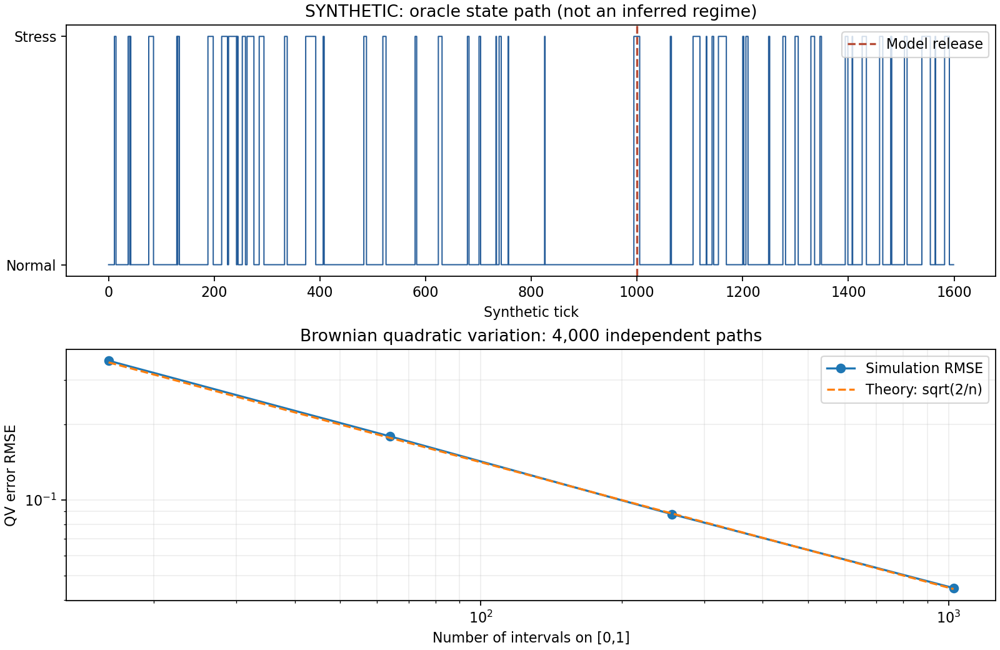

# 第7章 随机过程、马尔可夫链与布朗运动

> 第一篇：数学、统计学与编程基础。公式沿用[数学公式阅读约定](./数学公式阅读约定.md)。本章所有资产、状态、新闻计数和实验结果均来自人工模型，数据来源标记为 SYNTHETIC，不是赛题官方数据。

## 学习目标

先修知识是第3章的矩阵乘法与特征值、第4章的Taylor展开、第5章的条件期望与常用分布，以及第6章的似然估计与相关样本。读者不必事先学过测度论；本章会说明信息集的数学含义，但不会把有限例子误当作一般测度论证明。

完成本章后，应能：

1. 区分一个随机变量、一条样本路径和随机过程的概率规律；判断“平稳”“马尔可夫”“鞅”分别约束什么。
2. 使用系统实际可获取的信息构造特征、标签与报警，识别事后标注造成的前视偏差。
3. 推导有限状态链的多步转移、两状态稳态、停留时间和转移概率估计，解释它们的金融含义。
4. 推导泊松计数与指数等待时间，理解新闻突发为何可能不符合恒定强度假设。
5. 理解布朗运动增量的平方根时间缩放、二次变差、伊藤积分和伊藤公式，正确模拟几何布朗运动。
6. 实现并验证可复现的人工多资产实验，清楚区分模型内部真值、离线诊断和在线可实现功能。

本章解决的是平台的时间结构：状态如何持续和转换，事件怎样到达，噪声如何累积。它还不是完整状态识别器，也不是交易策略。

## 7.1 随机过程、平稳性与信息集

### 7.1.1 从一次抽样到整条路径

**随机过程，Stochastic Process**，是在同一概率空间上、由时间指标索引的一族随机变量：

```math
X=\lbrace X_t:t\in\mathcal T\rbrace.
```

若时间集合为非负整数，称离散时间过程；若为非负实数，称连续时间过程。状态空间可以是有限集合、整数或实向量空间，不能把“时间连续”和“取值连续”混为一谈。

固定时点 t 后， $X_t$ 是随机变量；固定随机结果 $\omega$ 后， $t\mapsto X_t(\omega)$ 是**样本路径，Sample Path**。一段历史行情是一条已实现路径，不是所有可能市场历史的集合。

|过程|时间指标|状态空间|平台中的对应对象|
|---|---|---|---|
|逐日多资产收益|离散|实向量|对齐后的收益面板|
|逐分钟状态标签|离散|有限集合|常态、压力态等标签流|
|累计新闻条数|连续|非负整数|随事件到达跳增的计数器|
|布朗运动|连续|实数|连续噪声基准模型|

仅知道每个时刻的边缘分布不够。例如独立序列 $X_t\sim N(0,1)$ 与过程 $Y_t=Z$ 、 $Z\sim N(0,1)$ ，每个时点分布相同；前者不断产生新噪声，后者整条路径保持同一个随机值。监控平台必须研究联合分布、条件分布和时间依赖。

**有限维分布，Finite-dimensional Distributions**，指任意有限时刻的随机向量 $(X_{t_1},\ldots,X_{t_m})$ 的分布。写模型时不仅要给“每日波动率”，还要明确跨日、跨资产如何相关。

### 7.1.2 信息集是防止前视的数学语言

第5章的事件集合通常记为 $\mathcal F$ 。其中的**σ代数，Sigma-algebra**，是一组对补集和可数并封闭的事件；直观上，它列出了给定信息足以判断真假的事件。σ不是标准差符号在这里的用法。

随时间增长的信息族 $\lbrace\mathcal F_t\rbrace$ 满足：

```math
\mathcal F_s\subseteq\mathcal F_t,\qquad s\leq t.
```

它称为**滤过，Filtration**。条件期望 $E[X\mid\mathcal F_t]$ 表示只依据这些信息得到的条件平均；它本身仍是随机变量。

若 $X_t$ 在时刻 t 已由 $\mathcal F_t$ 决定，称过程对该滤过**适应，Adapted**。离散时间中，用于区间 $(t-1,t]$ 的系数若在 $t-1$ 已知，则称该系数序列**可预测，Predictable**。这比“计算时没有访问未来文件”更严格：所有上游参数、标签和数据修订都须遵守时间边界。

设记录 k 的实际事件时刻、发布时间和系统获取时刻分别为 $e_k,p_k,a_k$ 。线上决策时刻 d 的信息应按获取时刻限制：

```math
\mathcal F_d^{\mathrm{sys}}
=\sigma\bigl(\text{记录 }k:a_k\leq d;\ \text{截至 }d\text{ 已发布的模型与配置}\bigr).
```

σ括号表示“由这些信息生成的σ代数”。这里是假设性的形式定义；生产系统还要记录访问权限、版本和数据血缘。

例如，09:30发生的成交在09:30:03才到达，09:30:01的判断不能使用它；季度GDP的2026年修订值不能放回2024年的信息集。历史记录即使按事件时间排序，也未必构成当时可用的信息。

**停止时刻，Stopping Time**，也称停时，是满足以下条件的随机时刻 $\tau$ ：

```math
\lbrace\tau\leq t\rbrace\in\mathcal F_t\quad\text{对每个 }t.
```

也就是到 t 时，能够判断触发是否已经发生。根据已到达行情计算的波动率首次超过阈值，是停时；“这轮熊市最低价所在日期”通常不是，因为识别它需要未来行情。提前规定观察截止日，并不自动使“截止前的全局最低点”变成停时。

### 7.1.3 严平稳、弱平稳与平稳增量

**严平稳，Strict Stationarity**，要求所有有限维分布对共同时间平移不变：

```math
(X_{t_1},\ldots,X_{t_m})\overset{d}{=}(X_{t_1+h},\ldots,X_{t_m+h}).
```

这不要求相邻观测值相等。**弱平稳，Weak Stationarity**，也称二阶平稳，要求二阶矩有限，且：

```math
E[X_t]=\mu,\qquad
\mathrm{Cov}(X_t,X_s)=\gamma(t-s).
```

严平稳加有限二阶矩可推出弱平稳；弱平稳一般不能推出严平稳。反例是相互独立的序列：偶数时刻取标准正态，奇数时刻等概率取±1。均值全为0、方差全为1、不同时间协方差全为0，但边缘分布随奇偶改变。对联合高斯过程，均值和协方差决定有限维分布，因此弱平稳可推出严平稳。

再看随机游动：

```math
X_t=X_{t-1}+\varepsilon_t,\quad X_0=0,
```

其中增量独立同分布，均值0、方差 $\sigma^2$ 。逐次展开得到：

```math
X_t=\sum_{j=1}^{t}\varepsilon_j,
\qquad E[X_t]=0,
\qquad \mathrm{Var}(X_t)=t\sigma^2.
```

对 $s\leq t$ ，把 $X_t$ 分解为 $X_s$ 与未来独立增量之和：

```math
\mathrm{Cov}(X_s,X_t)
=\mathrm{Var}(X_s)+\mathrm{Cov}\left(X_s,\sum_{j=s+1}^{t}\varepsilon_j\right)
=s\sigma^2.
```

方差随 t 增长，水平序列不弱平稳；差分 $X_t-X_{t-1}$ 却平稳。**平稳增量，Stationary Increments**，指增量分布只依赖区间长度，不代表水平过程平稳。金融对数价格与收益率常需要分别建模，但不能因此断言真实收益必定平稳。

### 7.1.4 平稳不等于遍历

**遍历性，Ergodicity**，在本章关心的是时间平均能否代表总体平均。对适当可积函数 g，希望：

```math
\frac1T\sum_{t=1}^{T}g(X_t)\longrightarrow E[g(X_0)]
```

以规定的收敛方式成立。前述 $X_t=Z$ 是严平稳的，但时间平均始终是 Z，不会通常收敛到 $E[Z]$ 。因此“一条历史很长”仍不足以保证它代表整个概率分布。

市场制度、交易规则与政策环境变化还会破坏平稳假设。第8章将讨论诊断方法；本章先强调：平稳性是待检验、待讨论的建模条件，不是读入CSV之后自动拥有的属性。

## 7.2 马尔可夫链、转移矩阵与稳态

### 7.2.1 条件独立的含义

**马尔可夫链，Markov Chain**，是一类随机过程，给定当前状态后，下一步的条件分布不再依赖更早的状态。离散状态的一阶表达为：

```math
P(S_{t+1}=j\mid S_0,\ldots,S_t)
=P(S_{t+1}=j\mid S_t).
```

这不是说 $S_{t+1}$ 与 $S_t$ 独立，也不是说未来能够确定。若右端不依赖 t，则称**时间齐次，Time-homogeneous**。

定义行随机转移矩阵：

```math
P_{ij}=P(S_{t+1}=j\mid S_t=i),\qquad
P_{ij}\geq0,\quad\sum_jP_{ij}=1.
```

本书状态概率采用行向量 $q_t$ 。因此 $q_{t+1}=q_tP$ 。使用列向量约定时须改用转置，不能混写。

贯穿例子只有两个**人工状态**：0表示常态，1表示压力态。

```math
P=\begin{pmatrix}0.96&0.04\\0.20&0.80\end{pmatrix}.
```

每步暂解释为一个合成交易日。常态下一步转压力态的概率是0.04；压力态下一步仍处于压力态的概率是0.80。标签由模拟器生成；它们不是仅凭单日涨跌定义的牛熊标签。

金融上的限制很关键：单一“压力”标签可能不足以压缩历史信息。若持续时间越长退出概率越大，一阶齐次链的恒定退出概率就不合适。可采用高阶链、把持续时间加入状态，或使用显式停留时间的半马尔可夫模型；代价是参数更多、样本需求更高。

### 7.2.2 多步概率为什么是矩阵幂

对中间状态 k 使用全概率公式：

```math
P(S_{t+2}=j\mid S_t=i)
=\sum_kP(S_{t+1}=k\mid S_t=i)
P(S_{t+2}=j\mid S_{t+1}=k,S_t=i).
```

马尔可夫性消去最后条件中的 $S_t$ ，齐次性使两项使用同一个 P，得到：

```math
P(S_{t+2}=j\mid S_t=i)=\sum_kP_{ik}P_{kj}=(P^2)_{ij}.
```

重复分解即得 **Chapman–Kolmogorov方程** $P^{m+n}=P^mP^n$ ，从而 $q_{t+h}=q_tP^h$ 。非齐次模型应使用按时间顺序的矩阵乘积，不能任意交换顺序。

例子中，从常态两步后处于压力态的概率为：

```math
0.96\times0.04+0.04\times0.80=0.0704.
```

它与“两步内至少进入过一次压力态”的概率不同。后者为：

```math
1-0.96^2=0.0784.
```

差异来自先进入压力态、再退出的路径；这种路径计入第二个问题，却不计入第一个。预警服务必须明确展示的是终点状态概率还是区间内触发概率。

### 7.2.3 平稳分布、收敛与周期性

若概率向量 $\pi$ 满足：

```math
\pi P=\pi,\qquad\sum_i\pi_i=1,
```

称其为**平稳分布，Stationary Distribution**，也称不变分布。它表示在该分布开始时，每一步的边缘分布不变；并不表示状态不会切换。

对一般两状态矩阵：

```math
P=\begin{pmatrix}1-a&a\\b&1-b\end{pmatrix},
```

平衡方程第一行给出 $\pi_0=\pi_0(1-a)+\pi_1b$ ，整理得到 $\pi_0a=\pi_1b$ 。再结合 $\pi_0+\pi_1=1$ ，当 $a+b\gt 0$ 时：

```math
\pi_0=\frac{b}{a+b},\qquad\pi_1=\frac{a}{a+b}.
```

本例为 $(5/6,1/6)$ 。它是模型长期占比，不是今天压力态概率，更不是现实市场未来永远有六分之一时间处于危机的结论。

为了看清收敛条件，令 $u_t=P(S_t=1)$ 。递推式为：

```math
u_{t+1}=a(1-u_t)+(1-b)u_t=a+(1-a-b)u_t.
```

减去不动点 $\pi_1$ ，再迭代：

```math
u_{t+1}-\pi_1=(1-a-b)(u_t-\pi_1),
\qquad
u_t=\pi_1+(u_0-\pi_1)(1-a-b)^t.
```

本例衰减系数是0.76。从常态开始，五步后压力概率为 $(1-0.76^5)/6$ ，约0.1244。这个闭式表达也给出了矩阵幂程序的独立核验方式。

一般有限链中，**不可约，Irreducible**，表示任意状态之间都可经过若干步相互到达；**非周期，Aperiodic**，表示返回时刻集合的最大公约数为1。有限不可约链有唯一平稳分布；再加非周期性，从任意初始分布出发的时点分布收敛到它。对有限不可约链，长期时间占比收敛到平稳分布并不要求非周期性。不要把这两条结论合并成一个条件模糊的“稳态定理”。[Norris教材章节索引：§1.7—1.10](https://www.statslab.cam.ac.uk/~jrn10//Markov/)

考虑反例：

```math
P=\begin{pmatrix}0&1\\1&0\end{pmatrix}
```

它有平稳分布 $(1/2,1/2)$ ，但从状态0开始时，时点分布不断交替，不收敛；长期时间占比仍趋于各一半。另一个反例 $P=I$ 中每个状态都吸收，任意概率向量都平稳，平稳分布不唯一。

无限状态链还须区分正常返、零常返和暂留，有限链的结论不能直接搬过去。本章程序只为两状态链提供闭式平稳分布函数，避免用一个黑箱特征向量掩盖这些条件。

### 7.2.4 停留时间与首达时间

从进入状态 i 的当步开始计数，设 D 为离开前连续处于该状态的观测次数。D至少为1；令 $p=P_{ii}\lt 1$ ，则：

```math
P(D=d)=p^{d-1}(1-p),\qquad d=1,2,\ldots.
```

这是支撑从1开始的几何分布。利用正整数变量的尾和公式：

```math
E[D]=\sum_{d=1}^{\infty}P(D\geq d)
=\sum_{d=1}^{\infty}p^{d-1}
=\frac1{1-p}.
```

本例常态平均连续25步，压力态平均连续5步。已经停留10步并不意味着“还差15步必定结束”，因为几何分布无记忆：

```math
P(D>m+n\mid D>m)=\frac{p^{m+n}}{p^m}=p^n.
```

若目标集合为 A，首次进入时间记为 $\tau_A$ ，令 $h_i=E_i[\tau_A]$ 。在期望有限的条件下，对第一步分类可得：

```math
h_i=0\ (i\in A),\qquad
h_i=1+\sum_{j\notin A}P_{ij}h_j\ (i\notin A).
```

因此可在非目标状态上解线性方程 $(I-Q)h=\mathbf1$ 。但若存在永远到不了目标的闭类，期望可能无穷，不能盲目求逆。本例从常态首次进入压力态的期望是25步；从压力态首次恢复常态的期望是5步。

数据中的最后一段状态可能尚未结束，这称**右删失，Right Censoring**。只平均已结束的短片段会低估持续时间，尤其在样本很短或状态很持久时。

### 7.2.5 转移矩阵的似然估计与零计数

假设状态标签全部可观察，给定起点 $s_0$ ，一条长度 $T+1$ 的状态路径的条件似然为：

```math
L(P\mid s_0,\ldots,s_T)=\prod_{t=0}^{T-1}P_{s_t,s_{t+1}}
=\prod_{i,j}P_{ij}^{N_{ij}},
```

其中 $N_{ij}$ 是从 i 到 j 的转移次数。取对数得 $\ell(P)=\sum_{i,j}N_{ij}\log P_{ij}$ 。注意这里利用的是条件分解，没有假设所有相邻转移对彼此独立。

固定第 i 行，加入约束 $\sum_jP_{ij}=1$ 。内点导数条件为：

```math
\frac{N_{ij}}{P_{ij}}-\lambda_i=0
\quad\Rightarrow\quad P_{ij}=N_{ij}/\lambda_i.
```

对 j 求和得 $\lambda_i=N_i=\sum_jN_{ij}$ ，因此 $\hat P_{ij}=N_{ij}/N_i$ 。零计数格子的最优值在边界上；若整个离开行 $N_i=0$ ，该行没有被似然识别，不能把它填成“永远不变”。

本章使用对称Dirichlet先验，每格浓度为 $\alpha\gt 0$ 。Dirichlet密度与 $\prod_jP_{ij}^{\alpha-1}$ 成正比，乘上似然后指数变为 $N_{ij}+\alpha-1$ ，所以后验仍为Dirichlet。其后验均值为：

```math
\tilde P_{ij}=\frac{N_{ij}+\alpha}{N_i+K\alpha}.
```

K为状态数。它是后验均值，不是原始最大似然估计，也通常不是后验众数。先验避免零预测概率，但会引入收缩；应记录α，并用验证期比较，而不是看到测试结果后调到最优。

给定冻结矩阵，测试期平均负对数概率为：

```math
\mathrm{NLL}=-\frac1m\sum_{t\in\mathrm{test}}\log P_{s_{t-1},s_t}.
```

值越小表示给真实后继状态分配的概率整体更高；预测概率为0且事件发生时，得分为正无穷，不能静默用一个小常数把错误藏起来。

训练只计入两个端点都已在训练截止时可用的转移。若前1000个状态用于训练，则只有999个训练转移；第1000个状态到第1001个状态的转移属于测试。测试计分可以条件于训练期最后一个已知状态，这本身不是泄漏。

### 7.2.6 从可见链到隐藏状态

真实市场一般不能直接读出“真正压力态”。如果先用全样本聚类产生标签，再估计转移矩阵，标签本身已经使用未来信息。即使后续矩阵估计按时间切分，泄漏依然存在。

**隐马尔可夫模型，Hidden Markov Model，HMM**，把状态作为不可直接观测的变量，行情作为条件观测。后续章节将学习过滤概率 $P(S_t=i\mid Y_{1:t})$ ；使用全区间观测的平滑概率 $P(S_t=i\mid Y_{1:T})$ 在 $T\gt t$ 时不能冒充实时输出。

本章只使用模拟器的oracle状态，即实验者知道的真值，验证转移数学。其测试NLL属于“状态已知条件下的离线诊断”，不代表从行情识别状态的准确率。

## 7.3 Poisson过程、布朗运动、鞅与随机微分入门

### 7.3.1 泊松过程：事件计数、到达强度与时间单位

**泊松过程，Poisson Process**，记作 $N_t$ ，用于描述截至 t 的累计事件数。齐次泊松过程满足：初值0、独立增量、增量分布只依赖区间长度，且对小正数 h：

```math
P(N_{t+h}-N_t=1)=\lambda h+o(h),\qquad
P(N_{t+h}-N_t\geq2)=o(h).
```

其中 $\lambda\gt 0$ 是单位时间平均到达次数。 $o(h)$ 表示除以 h 后趋于0的余项。独立增量是“不重叠时间区间内的新增数量独立”，不是累计计数 $N_t$ 与 $N_{t+h}$ 独立。

令 $p_k(t)=P(N_t=k)$ 。没有新事件的概率为 $1-\lambda h+o(h)$ ，故：

```math
p_0(t+h)=p_0(t)(1-\lambda h)+o(h).
```

移项除以 h 并取极限，得到 $p_0'(t)=-\lambda p_0(t)$ ；由 $p_0(0)=1$ ，得 $p_0(t)=e^{-\lambda t}$ 。

对 $k\geq1$ ，在小区间结束时累计为 k，主要来自“原来k个且未新增”或“原来k−1个且新增1个”：

```math
p_k'(t)=-\lambda p_k(t)+\lambda p_{k-1}(t).
```

乘积分因子 $e^{\lambda t}$ 。若已知 $p_{k-1}(t)=e^{-\lambda t}(\lambda t)^{k-1}/(k-1)!$ ，则：

```math
\frac{d}{dt}\left(e^{\lambda t}p_k(t)\right)
=\frac{\lambda^kt^{k-1}}{(k-1)!}.
```

由 $p_k(0)=0$ 积分，得到 $e^{\lambda t}p_k(t)=\lambda^kt^k/k!$ 。归纳完成：

```math
N_t\sim\mathrm{Poisson}(\lambda t),\qquad
E[N_t]=\mathrm{Var}(N_t)=\lambda t.
```

第一事件等待时间 W 满足 $\lbrace W\gt t\rbrace=\lbrace N_t=0\rbrace$ ，所以：

```math
P(W>t)=e^{-\lambda t},\quad
f_W(t)=\lambda e^{-\lambda t},\quad E[W]=1/\lambda.
```

等待时间服从**指数分布，Exponential Distribution**，无记忆性由 $e^{-\lambda(t+s)}/e^{-\lambda t}=e^{-\lambda s}$ 直接得到。反过来，把独立同分布的指数等待时间累加，可构造泊松到达时刻。[MIT 6.262课程与公开教材入口](https://ocw.mit.edu/courses/6-262-discrete-stochastic-processes-spring-2011/)

若新闻平均每分钟2条，半分钟计数的泊松参数是1，而不是2；等待时间均值是0.5分钟。NumPy的 `poisson(lam=...)` 接收的是对应观察区间的期望计数，`exponential(scale=...)` 的尺度是平均等待时间，不是强度本身。

### 7.3.2 金融事件中的替代模型

如果强度是已知确定函数 $\lambda(t)$ ，可采用**非齐次泊松过程，Nonhomogeneous Poisson Process，NHPP**。区间新增数的参数变成 $\int_s^t\lambda(u)\thinspace du$ ，可以描述开盘与午间不同的事件率。

若强度随潜在市场状态变化，未给定状态时，不同时间的计数可能相关；若新闻会引起后续转载、讨论或交易，则可能存在自激效应。此时恒定强度泊松过程只是基准，不能因为容易实现就把所有突发当成脏数据删除。

本章使用 $C_t\mid S_t\sim\mathrm{Poisson}(\lambda_{S_t})$ ，其中常态强度2、压力态强度8。它是离散时间状态调制的区间计数模型，不是已经实现了连续时间状态跳变的点过程。

利用全方差公式可见其过度离散：

```math
\mathrm{Var}(C_t)=E[\lambda_{S_t}]+\mathrm{Var}(\lambda_{S_t}).
```

状态不确定性使计数方差大于均值。过度离散既可能来自强度变化，也可能来自自激、重复数据或其他机制，仅看方差与均值无法确定因果。

### 7.3.3 布朗运动与平方根时间缩放

**标准布朗运动，Standard Brownian Motion**，也称Wiener过程，记为 $W_t$ ，满足： $W_0=0$ ，路径几乎必然连续，不重叠区间增量独立，且：

```math
W_t-W_s\sim N(0,t-s),\qquad 0\leq s<t.
```

“几乎必然，Almost Surely，a.s.”表示性质不成立的样本集合概率为0，不表示每一条想象得到的函数都满足它。

可在网格上模拟：

```math
\Delta W_i=\sqrt{\Delta t_i}\,Z_i,\qquad Z_i\sim N(0,1)\text{ 独立}.
```

因为 $\mathrm{Var}(cZ)=c^2$ ，要使增量方差等于 $\Delta t$ ，系数必须是平方根。误写成 $\Delta t Z$ 会令总方差随网格加密而趋近0。程序生成的是正确网格有限维分布；把点用直线连接，不会自动得到具有真实布朗微观结构的连续路径。

从定义直接得到 $E[W_t]=0$ 、 $\mathrm{Var}(W_t)=t$ 。对 $s\leq t$ ，写 $W_t=W_s+(W_t-W_s)$ ，由独立性：

```math
\mathrm{Cov}(W_s,W_t)=s=\min(s,t).
```

布朗运动具有平稳增量，但自身不平稳。它的路径连续，却几乎必然处处不可微。差商的方差为 $1/h$ ，可以帮助理解普通导数不合适，但仅凭这个方差发散并不能证明“处处不可微”的完整路径结论；后者需要随机过程理论的额外论证。

### 7.3.4 二次变差的可验证推导

把 $[0,T]$ 划分成n个等长区间，定义**二次变差和，Quadratic Variation Sum**：

```math
Q_n=\sum_{i=0}^{n-1}(W_{t_{i+1}}-W_{t_i})^2.
```

每项的均值为 $\Delta t=T/n$ 。标准正态的四阶矩是3，所以：

```math
\mathrm{Var}((\Delta W_i)^2)
=E[(\Delta W_i)^4]-(E[(\Delta W_i)^2])^2
=3(\Delta t)^2-(\Delta t)^2=2(\Delta t)^2.
```

独立增量的平方仍独立，因此：

```math
E[Q_n]=T,\qquad
E[(Q_n-T)^2]=\mathrm{Var}(Q_n)=\frac{2T^2}{n}\longrightarrow0.
```

这证明沿这些确定网格 $Q_n$ 在均方意义下趋于 T，也就依概率趋于 T。一般确定分割的方差为 $2\sum_i(\Delta t_i)^2\leq2T\max_i\Delta t_i$ ，同样趋于0。

对普通连续可微函数 g，若导数有界M，则 $|\Delta g_i|\leq M\Delta t_i$ ，因而 $\sum_i(\Delta g_i)^2\leq M^2T\max_i\Delta t_i\to0$ 。布朗运动的非零二次变差，是普通一阶链式法则不能直接套用的关键。

金融上的实现方差来自高频收益平方和，但真实报价包含买卖价跳动、异步交易和微观结构噪声。布朗模型中的“越密越准”不能无条件外推到真实逐笔行情。

### 7.3.5 鞅是条件均值约束

**鞅，Martingale**，是相对于给定信息集和概率测度定义的过程 $M_t$ ，要求适应、 $E|M_t|\lt \infty$ ，并且：

```math
E[M_t\mid\mathcal F_s]=M_s,\qquad s\leq t.
```

如果把等号改成大于等于，称次鞅；小于等于称上鞅。核心是给定已有信息后的均值，不是路径平直、方差为0或绝不会出现巨额亏损。

对布朗运动的自然信息集，未来增量独立且均值0，所以 $E[W_t\mid\mathcal F_s]=W_s$ 。再展开平方：

```math
E[W_t^2\mid\mathcal F_s]
=W_s^2+2W_sE[W_t-W_s\mid\mathcal F_s]
+E[(W_t-W_s)^2\mid\mathcal F_s]
=W_s^2+t-s.
```

因此 $W_t^2-t$ 是鞅， $W_t^2$ 是次鞅。同理，齐次泊松过程的 $N_t-\lambda t$ 是鞅。

鞅依赖信息集。若在时刻0就把未来终值 $W_T$ 告诉观察者，那么通常不能再说 $W_t$ 对这个扩大的信息集是鞅。它也依赖概率测度：金融定价中的风险中性测度与用于实际频率建模的真实世界测度不是同一对象；本章没有构造风险中性定价系统。

对离散鞅和有界停时 $\tau\leq n$ ，有：

```math
M_\tau=M_0+\sum_{k=1}^{n}\mathbf1_{\lbrace\tau\geq k\rbrace}(M_k-M_{k-1}).
```

指示变量在 $k-1$ 时可知；对每项先条件于 $\mathcal F_{k-1}$ 再取期望，每项均值为0，于是 $E[M_\tau]=E[M_0]$ 。这是有界情形的**可选停止，Optional Stopping**结论。无界停时不能直接沿用：对称随机游动首次达到+1虽几乎必然发生，但期望到达时间无穷，停止后的值恒为1，不能用未经满足条件的定理宣称其期望仍为0。

### 7.3.6 伊藤积分为什么取左端点

普通积分累加“函数值×时间增量”。对布朗运动，考虑：

```math
I_n=\sum_{i=0}^{n-1}H_i\Delta W_i,
```

其中 $H_i$ 在 $t_i$ 已知，即 $\mathcal F_{t_i}$ 可测；未来增量不能反过来决定当前系数。先假定这些系数有足够的二阶可积性。

由条件期望： $E[H_i\Delta W_i]=E[H_iE(\Delta W_i\mid\mathcal F_{t_i})]=0$ 。对于 $i\lt j$ ， $H_i\Delta W_iH_j$ 在 $t_j$ 已知，再条件于 $\mathcal F_{t_j}$ ，交叉项期望也为0。所以：

```math
E[I_n^2]=\sum_iE[H_i^2(\Delta W_i)^2]
=\sum_iE[H_i^2]\Delta t_i.
```

这就是阶梯过程的**伊藤等距，Itô Isometry**。它使我们能把简单可预测过程的积分按均方极限扩展到满足 $E\int_0^T H_t^2dt\lt \infty$ 的适当可预测过程，记为 $\int_0^T H_t\thinspace dW_t$ 。本章使用平方可积情形；更一般的局部积分需要额外技术条件。[北大李东风讲义，第8章随机积分](https://math.pku.edu.cn/teachers/lidf/course/stochproc/stochprocnotes/html/_book/stocint.html)

取 $H_i=W_{t_i}$ 。由有限项代数恒等式：

```math
W_{t_{i+1}}^2-W_{t_i}^2=2W_{t_i}\Delta W_i+(\Delta W_i)^2.
```

逐项求和，左端望远镜消去中间项：

```math
\sum_iW_{t_i}\Delta W_i=\frac12(W_T^2-Q_n).
```

令网格加密，利用 $Q_n\to T$ ，得到：

```math
\int_0^T W_t\,dW_t=\frac12(W_T^2-T).
```

如果取右端点，则 $W_{t_{i+1}}=W_{t_i}+\Delta W_i$ ，从而右端和比左端和多出 $Q_n$ ，极限为 $(W_T^2+T)/2$ 。这说明使用刚结束区间的价格决定该区间系数，会改变计算对象；“下标挪一格”可能改变理论结论，而不只是程序排版。

### 7.3.7 伊藤公式：保留二阶项的理由

先对仅依赖空间的函数 f 说明完整推导。暂设 f 三阶连续可微，相关导数有界；对每个增量做Taylor展开：

```math
f(W_{t_{i+1}})-f(W_{t_i})
=f'(W_{t_i})\Delta W_i
+\frac12f''(W_{t_i})(\Delta W_i)^2+R_i.
```

三阶导有界给出 $|R_i|\leq C|\Delta W_i|^3$ 。等距分割时， $E|\Delta W_i|^3=(T/n)^{3/2}E|Z|^3$ ，所以 $E\sum_i|R_i|\leq C'T^{3/2}/\sqrt n\to0$ 。

第一项的和按定义趋于伊藤积分。第二项不能直接删除。把平方增量写成 $\Delta t_i+[(\Delta W_i)^2-\Delta t_i]$ ，后者条件均值为0；不同区间的加权误差正交。若 $|f''|\leq M$ ，其和的二阶矩至多为 $2M^2\sum_i(\Delta t_i)^2\to0$ 。剩下的普通黎曼和趋于 $\int_0^T f''(W_t)dt$ 。于是：

```math
f(W_T)-f(W_0)
=\int_0^T f'(W_t)\,dW_t
+\frac12\int_0^T f''(W_t)\,dt.
```

这些强一些的光滑、有界条件让余项证明透明；标准伊藤公式可在局部化与逼近下放宽至二阶连续可微等条件。本章不把形式的 $(dW)^2=dt$ 当作普通无穷小数的精确代数等式。

进一步令 **随机微分方程，Stochastic Differential Equation，SDE** 写为：

```math
dX_t=a_tdt+b_tdW_t.
```

它的含义是积分等式 $X_t=X_0+\int_0^ta_sds+\int_0^tb_sdW_s$ ，不是要求布朗路径存在普通导数。对时间一次、空间二次连续可微的 $f(t,x)$ ，在积分存在的适当条件下：

```math
df(t,X_t)=\left(f_t+a_tf_x+\frac12b_t^2f_{xx}\right)dt+b_tf_xdW_t.
```

其中偏导在 $(t,X_t)$ 取值。二阶系数来自 $(a\Delta t+b\Delta W)^2$ 的主导项 $b^2(\Delta W)^2$ ；漂移平方项与交叉项的累积在合适条件下消失。一般适应系数的完整存在唯一性与局部化理论属于后续随机分析课程，这里给出应用公式与上述布朗特例的可检查推导。[Tehranchi，Advanced Financial Models，第2章§1—4](https://www.statslab.cam.ac.uk/~mike/AFM/notes.pdf)

### 7.3.8 几何布朗运动与模拟方法的选择

**几何布朗运动，Geometric Brownian Motion，GBM**，是正值过程模型：

```math
dS_t=\mu S_tdt+\sigma S_tdW_t,\qquad S_0>0.
```

μ和σ在这里为常数；时间以年计时，μ是每年漂移参数，σ是按平方根年缩放的波动系数。令 $f(S)=\log S$ ，有 $f'=1/S$ 、 $f''=-1/S^2$ 。代入伊藤公式：

```math
d\log S_t=\left(\mu-\frac12\sigma^2\right)dt+\sigma dW_t.
```

积分后指数化：

```math
S_T=S_0\exp\left[(\mu-\sigma^2/2)T+\sigma W_T\right].
```

由正态矩母函数 $E[e^{cW_T}]=e^{c^2T/2}$ ：

```math
E[S_T]=S_0e^{\mu T},\qquad
\mathrm{Var}(S_T)=S_0^2e^{2\mu T}(e^{\sigma^2T}-1).
```

省略 $-\sigma^2/2$ 会把均值错误地抬高到 $S_0e^{(\mu+\sigma^2/2)T}$ 。对于常参数GBM，优先使用精确网格更新：

```math
S_{t+\Delta}=S_t\exp\left[(\mu-\sigma^2/2)\Delta+\sigma\sqrt\Delta Z\right].
```

**Euler–Maruyama方法**则把SDE离散为 $S_{t+\Delta}=S_t(1+\mu\Delta+\sigma\sqrt\Delta Z)$ 。它容易推广到无闭式解的方程，但存在离散误差，且可能产生负值；不能用在负值后截断的办法假装仍在精确模拟原模型。

GBM的恒定波动、连续路径与对数正态分布都可能不符合真实市场。它适合检验数据流、单位换算和随机积分实现，不足以覆盖跳跃、厚尾、波动聚集、流动性枯竭或危机相关性上升。多资产情形可用Cholesky因子生成相关增量：若 $CC^\top=R$ ，则 $\Delta W=\sqrt\Delta CZ$ 的协方差为 $\Delta R$ ；R必须半正定，普通Cholesky还要求正定。

## 7.4 贯穿实验：状态持续、新闻计数与布朗基准

### 7.4.1 实验设计与输入输出

完整程序见下文及[独立源文件](./code/ch07/process_lab.py)。主程序只依赖现有Python标准库与NumPy；本次实际环境为Python 3.13.5、NumPy 2.1.3。配图使用已有Matplotlib，没有安装依赖。

实验分为三个相互说明而不混淆单位的部分：

1. 生成1600个合成日的两状态链，从常态开始；前1000个标签用于训练，后600个转移用于冻结模型计分。训练期起点不是平稳抽样，所以不声称整条样本一开始就严格平稳。
2. 条件于状态，为EQ_DEMO、BOND_DEMO、GOLD_DEMO、FX_DEMO生成相关对数收益和新闻计数。四资产条件相关系数均人为设为0.25；压力态仅改变示例均值、波动和新闻率，未模拟危机中的动态相关性。
3. 另生成4000条一年期标准布朗路径，每条1024个细分区间，用同一细网格增量合并出16、64、256、1024四种网格，检验二次变差；同时比较左右端点积分与GBM终值均值。

随机数根种子为20261023，PCG64的五个派生流分别负责状态、收益、状态新闻计数、布朗实验、恒定泊松与指数抽样。这里最后两组独立分布抽样并不是同一条事件轨迹的计数和等待时间；它们只检查各自边缘分布。

为了表达训练发布时间，合成记录的 `available_tick=event_tick+0.001`。最后训练标签在999.001可用，模型于999.5发布，第一条测试转移在1000.001计分。单位是合成时钟，不是真实交易日历；主程序先生成完整实验数据再离线评估，不是生产PIT查询引擎。

输出新建目录含 `synthetic_market.csv` 和 `manifest.json`。CSV明确标记oracle状态，资产列为对数收益而非价格；清单保存参数、随机流、训练计数、评估结果、版本及程序和CSV的SHA-256摘要。已有输出目录会拒绝覆盖。

在仓库根目录执行：

```powershell
& 'D:\Anaconda\python.exe' '教材\code\ch07\process_lab.py'
& 'D:\Anaconda\python.exe' -m unittest discover -s '教材\code\ch07' -p 'test_process_lab.py' -v
```

### 7.4.2 完整程序

保存为 `process_lab.py` 后可以独立运行。`transition_matrix` 拒绝非法概率而不静默修正；`fit_transitions` 对未见离开状态要求显式先验；`brownian_checks` 分批处理128条路径，避免保存全部网格的多个大数组。

```python
"""Synthetic stochastic-process laboratory; no real market data or trading."""
from __future__ import annotations
import argparse
import csv
import hashlib
import json
import platform
from datetime import datetime, timezone
from pathlib import Path
import numpy as np


def transition_matrix(value):
    p = np.asarray(value, dtype=float)
    if p.ndim != 2 or p.shape[0] != p.shape[1] or not len(p):
        raise ValueError("P must be nonempty and square")
    if not np.isfinite(p).all() or (p < 0).any() or (p > 1).any():
        raise ValueError("probabilities must be finite and in [0, 1]")
    if not np.allclose(p.sum(axis=1), 1, rtol=0, atol=1e-12):
        raise ValueError("rows must sum to one; no silent normalization")
    return p.copy()


def stationary_two(value):
    p = transition_matrix(value)
    if p.shape != (2, 2):
        raise ValueError("this closed-form helper requires two states")
    a, b = p[0, 1], p[1, 0]
    if a + b == 0:
        raise ValueError("stationary distribution is not unique")
    return np.array([b, a]) / (a + b)


def simulate_chain(value, n, initial, rng):
    p = transition_matrix(value)
    if not isinstance(n, int) or n < 1:
        raise ValueError("n must be a positive integer")
    if not isinstance(initial, int) or not 0 <= initial < len(p):
        raise ValueError("invalid initial state")
    states = np.empty(n, dtype=np.int64)
    states[0] = initial
    for t in range(1, n):
        states[t] = rng.choice(len(p), p=p[states[t-1]])
    return states


def fit_transitions(states, k=2, alpha=0.5):
    x = np.asarray(states)
    if x.ndim != 1 or len(x) < 2 or x.dtype.kind not in 'iu':
        raise ValueError("need at least two integer state labels")
    if not isinstance(k, int) or k < 1 or (x < 0).any() or (x >= k).any():
        raise ValueError("invalid state labels")
    if not np.isfinite(alpha) or alpha < 0:
        raise ValueError("alpha must be finite and nonnegative")
    counts = np.zeros((k, k), dtype=np.int64)
    np.add.at(counts, (x[:-1], x[1:]), 1)
    denominator = counts.sum(axis=1, keepdims=True) + k*alpha
    if (denominator == 0).any():
        raise ValueError("unobserved departure row; choose an explicit prior")
    return (counts + alpha) / denominator, counts


def conditional_nll(states, value):
    p = transition_matrix(value)
    x = np.asarray(states)
    if x.ndim != 1 or len(x) < 2 or x.dtype.kind not in 'iu':
        raise ValueError("need a sequence of integer labels")
    if (x < 0).any() or (x >= len(p)).any():
        raise ValueError("state index outside P")
    q = p[x[:-1], x[1:]]
    return float('inf') if (q == 0).any() else float(-np.log(q).mean())


def brownian_checks(rng, paths=4000, steps=1024):
    grids = (16, 64, 256, 1024)
    if not isinstance(paths, int) or paths < 2 or steps != 1024:
        raise ValueError("paths >= 2; this nested-grid experiment uses 1024 steps")
    totals = {n: [0.0, 0.0] for n in grids}
    w_end, left_values, right_values, gbm = [], [], [], []
    identity_error = 0.0
    for start in range(0, paths, 128):
        m = min(128, paths-start)
        dw = rng.normal(size=(m, steps)) / np.sqrt(steps)
        w = np.cumsum(dw, axis=1)
        left = np.sum((w-dw)*dw, axis=1)
        right = np.sum(w*dw, axis=1)
        end = w[:, -1]
        qv = np.sum(dw*dw, axis=1)
        identity_error = max(identity_error,
                             float(np.max(np.abs(2*left-(end*end-qv)))))
        w_end.extend(end.tolist())
        left_values.extend(left.tolist())
        right_values.extend(right.tolist())
        gbm.extend((100*np.exp((0.06-0.2**2/2)+0.2*end)).tolist())
        for n in grids:
            coarse = dw.reshape(m, n, steps//n).sum(axis=2)
            v = np.sum(coarse*coarse, axis=1)
            totals[n][0] += float(v.sum())
            totals[n][1] += float(np.sum((v-1)**2))
    return {
        'paths': paths, 'T_years': 1.0, 'nested_grids': grids,
        'qv': {str(n): {'mean': s/paths, 'rmse': np.sqrt(e/paths),
                        'theory_rmse': np.sqrt(2/n)}
               for n, (s, e) in totals.items()},
        'W_mean': float(np.mean(w_end)), 'W_variance': float(np.var(w_end, ddof=1)),
        'left_integral_mean': float(np.mean(left_values)),
        'right_sum_mean': float(np.mean(right_values)),
        'discrete_identity_max_error': identity_error,
        'gbm_terminal_mean': float(np.mean(gbm)),
        'gbm_theory_mean': float(100*np.exp(0.06)),
        'gbm_mean_mc_se': float(np.std(gbm, ddof=1)/np.sqrt(paths))}


def main(out=None):
    seed = 20261023
    children = np.random.SeedSequence(seed).spawn(5)
    rng = [np.random.Generator(np.random.PCG64(s)) for s in children]
    p = np.array([[0.96, 0.04], [0.20, 0.80]])
    n, split = 1600, 1000
    state = simulate_chain(p, n, 0, rng[0])
    fitted, counts = fit_transitions(state[:split], alpha=0.5)
    iid = (np.bincount(state[:split], minlength=2)+0.5)/(split+1)
    # In synthetic time, a label is available at tick+0.001.
    # Training ends at tick 999.001; model is released at tick 999.5.
    test = state[split-1:]  # include only the known boundary state
    means = np.array([[.0003,.0001,.0001,0],[-.001,.0002,.0004,.0001]])
    vols = np.array([[.008,.003,.006,.004],[.025,.007,.018,.012]])
    corr = np.full((4,4), .25)
    np.fill_diagonal(corr, 1)
    shocks = rng[1].normal(size=(n,4)) @ np.linalg.cholesky(corr).T
    log_returns = means[state] + vols[state]*shocks
    news = rng[2].poisson(np.array([2.,8.])[state])
    fixed_counts = rng[4].poisson(2.0, size=20000)
    waits = rng[4].exponential(scale=0.5, size=20000)
    summary = {
        'source': 'SYNTHETIC', 'seed': seed, 'bit_generator': 'PCG64',
        'spawn_keys': [list(s.spawn_key) for s in children],
        'n': n, 'split': split, 'train_last_tick': split-1,
        'label_delay_ticks': .001, 'model_release_tick': 999.5,
        'P_true': p.tolist(), 'pi_true': stationary_two(p).tolist(),
        'start_state': 0, 'alpha': .5, 'counts_train': counts.tolist(),
        'P_fit': fitted.tolist(), 'pi_fit': stationary_two(fitted).tolist(),
        'state_counts_all': np.bincount(state, minlength=2).tolist(),
        'five_step_from_train_last': np.linalg.matrix_power(fitted, 5)[state[split-1]].tolist(),
        'test_nll_true': conditional_nll(test,p),
        'test_nll_fit': conditional_nll(test,fitted),
        'test_nll_iid': conditional_nll(test,np.tile(iid,(2,1))),
        'means_daily_log_return': means.tolist(), 'vols_daily': vols.tolist(),
        'correlation': corr.tolist(), 'news_rate_per_tick': [2.,8.],
        'constant_poisson_count_mean': float(fixed_counts.mean()),
        'constant_poisson_count_variance': float(fixed_counts.var(ddof=1)),
        'exponential_wait_mean': float(waits.mean()),
        'brownian': brownian_checks(rng[3]),
        'python': platform.python_version(), 'numpy': np.__version__}
    dest = Path(out) if out else Path(__file__).parent/'runs'/datetime.now(timezone.utc).strftime('run_%Y%m%dT%H%M%S_%fZ')
    dest.mkdir(parents=True, exist_ok=False)
    csv_path = dest/'synthetic_market.csv'
    with csv_path.open('w',encoding='utf-8',newline='') as stream:
        writer = csv.writer(stream)
        writer.writerow(['source','event_tick','available_tick','oracle_state','news_count',
                         'EQ_DEMO','BOND_DEMO','GOLD_DEMO','FX_DEMO'])
        for t in range(n):
            writer.writerow(['SYNTHETIC',t,t+.001,int(state[t]),int(news[t]),*log_returns[t]])
    summary['csv_sha256'] = hashlib.sha256(csv_path.read_bytes()).hexdigest()
    summary['program_sha256'] = hashlib.sha256(Path(__file__).read_bytes()).hexdigest()
    (dest/'manifest.json').write_text(json.dumps(summary,ensure_ascii=False,indent=2,allow_nan=False)+'\n',encoding='utf-8')
    print(json.dumps({'output':str(dest),**summary},ensure_ascii=False,indent=2,allow_nan=False))
    return dest


if __name__ == '__main__':
    parser = argparse.ArgumentParser(description=__doc__)
    parser.add_argument('--out',type=Path)
    main(parser.parse_args().out)
```

### 7.4.3 实际运行结果与解释

本次运行的训练转移计数为：

```math
N=\begin{pmatrix}821&27\\26&125\end{pmatrix},\qquad\sum_{i,j}N_{ij}=999.
```

使用 $\alpha=0.5$ 得：

```math
\tilde P\approx\begin{pmatrix}0.967609&0.032391\\0.174342&0.825658\end{pmatrix}.
```

估计稳态压力占比约0.156680，设定值是1/6；全1600个状态中压力态出现273次，占比0.170625。三者不必相等：一个是训练估计隐含的长期占比，一个是人工模型参数，一个是整条有限路径的实现频率。也不能把0.170625当作训练时已知输入。

|诊断量|本次实际结果|正确解释|
|---|---|---|
|真实P的测试NLL|0.239957|知道人工生成参数的基准|
|冻结估计P的测试NLL|0.241101|已知oracle状态条件下的概率评估|
|独立状态基准的测试NLL|0.511406|相同行情区间、相同标签，忽略状态持续性|
|训练末状态出发的五步压力概率|0.421585|依赖当时状态和估计矩阵，不是稳态占比|
|恒定泊松计数样本均值／方差|1.992600／1.945042|20000次参数2抽样的随机误差|
|指数等待时间样本均值|0.498480|理论0.5，单位与强度互为倒数|
|布朗离散恒等式最大误差|约 $3.91\times10^{-14}$ |有限项代数与浮点计算核验|
|GBM终值样本均值|106.636827|理论均值106.183655|
|GBM均值Monte Carlo标准误|0.347017|上述差异约1.31个标准误|

**蒙特卡洛，Monte Carlo，MC**，指通过随机模拟估计概率或期望的方法。其标准误只描述这次人工模型下的模拟误差，不包含真实市场的模型偏差。

二次变差的**均方根误差，Root Mean Squared Error，RMSE**，按4000条独立路径相对理论T=1计算：

|网格区间数|实际RMSE|理论RMSE|
|---|---|---|
|16|0.359020|0.353553|
|64|0.179218|0.176777|
|256|0.087834|0.088388|
|1024|0.044582|0.044194|

相邻分辨率使用相同细网格增量合并，便于比较同一随机路径；不同分辨率的误差因此相关，不能当作互相独立的四组实验。单条路径的误差也不保证随n单调下降。

左端积分和均值约0.015242，右端和均值约1.015840；差约1.000598，正是细网格二次变差的样本均值。左端和理论均值为0，样本不会严格为0；关键核验是路径级代数恒等式与总体误差尺度。



图上半部是模拟器给定的真状态，不是从行情识别的结果；虚线表示模型发布时间。下半部是独立布朗实验。配图由[绘图程序](./code/ch07/plot_process.py)读取本次清单生成，不重新抽样。

### 7.4.4 测试、性能与可靠性边界

[配套测试](./code/ch07/test_process_lab.py)包含8项：非法矩阵拒绝；两状态平衡与多步闭式核验；周期链和非唯一稳态；训练边界计数；未见状态与先验；零概率事件；随机复现；二次变差与左右端和的代数关系。它们不只检查“函数能运行”，而是检查独立数学关系与时间切分。

状态模拟逐步采样，K个状态用朴素分类采样约为 $O(TK)$ ；K=2时为 $O(T)$ 。转移计数为 $O(T+K^2)$ ；矩阵幂通常可用平方求幂减少乘法次数。布朗实验时间约为 $O(Mn)$ ，批量128条使主要网格数组内存约为 $O(128n)$ ，而不是 $O(Mn)$ ；仍保留M个终值用于统计。

输入中的NaN、非法概率、非整数状态直接报错，没有被静默删除。实际行情的离群值可能是危机，不应为了让正态模型拟合更好而直接剔除；若隔离，须记录原值、原因、规则版本和隔离时间。

本章模型发布时刻是人工设定。生产系统至少要持久化以下字段：

|对象|必要字段|用途|
|---|---|---|
|输入记录|source、event_time、published_time、available_time、revision_id|恢复决策时信息|
|状态标签|label、label_available_time、label_rule_version、is_oracle|防止事后标签与模拟真值混入线上|
|模型版本|train_cutoff、fit_completed_at、released_at、参数摘要|禁止使用尚未完成的模型|
|推理记录|decision_time、model_version、输入版本、概率向量|重现当时判断|
|报警记录|触发规则、阈值版本、首次触发与恢复时间|区分状态变化和通知去重|

严格记录这些字段仍只是必要条件；本章CSV并未实现宏观修订数据库、分布式Exactly-once、流式状态恢复或在线过滤。后续数据工程与系统篇将把这些约束落实为服务行为。

## 本章总结

随机过程把单期概率推广为随时间演化的联合规律；滤过明确“现在到底知道什么”。平稳描述时间平移下的统计规律，遍历性讨论一条长路径能否代表总体，二者不可混同。

马尔可夫链用转移矩阵描述持续与切换。多步终点概率、区间首达概率、平稳占比和平均停留时间回答不同问题。估计时须明确状态是否可观测、训练转移的边界以及零计数的处理。

泊松过程适合事件计数基准，布朗运动适合连续噪声基准。二次变差解释了伊藤公式的二阶修正；可预测性解释了为什么不能用右端信息冒充左端决策。任何模拟验证都必须保留“给定模型成立”的前提。

## 分层练习

1. **基础理解：平稳与路径。** 令 $X_t=Z$ ，Z等概率取±1。判断严平稳、弱平稳、时间平均是否收敛到总体均值，并说明为什么“状态从不改变”不等于“没有随机性”。
2. **信息集与金融分析。** 成交09:30:00发生、09:30:03获取；09:30:02报警能否用它？“截至今天的首次跌破阈值”与“未来一个月最低价出现时刻”，哪个通常是停时？
3. **数学推导：两状态链。** 对本章P，求平稳分布、从常态两步后压力概率、两步内曾进入压力概率、两种状态的平均停留时间。必须说明四个量为何不同。
4. **反例与证明。** 对以下交替链：

   ```math
   P=\begin{pmatrix}0&1\\1&0\end{pmatrix}
   ```

   说明平稳分布存在而单时点分布不收敛。若初始分布取平稳分布，联合过程是否平稳？
5. **估计与编程。** 给定训练转移计数：

   ```math
   N=\begin{pmatrix}18&2\\3&7\end{pmatrix}
   ```

   计算MLE及α=0.5的后验均值；再用代码核验。若第二行计数全为0，应如何报告？
6. **泊松推导。** 新闻率为每分钟3条，求20秒内无新闻概率、等待时间均值、两分钟计数的均值和方差。解释为什么“各日均值不同但混在一起估计”可能产生方差大于均值。
7. **布朗计算。** 求 $\mathrm{Cov}(W_2,W_5)$ 、 $\mathrm{Var}(W_5-W_2)$ ；在T=2、n=800的等距网格上，求二次变差和的均值与RMSE。
8. **推导与金融误用。** 推导 $\int_0^TW_t\thinspace dW_t$ ，再求右端点和的极限。解释在金融回放中这一区别对应哪类前视错误。
9. **编程：多步概率。** 以递推和矩阵幂两种方法计算常态出发第1至20步的压力概率，并与闭式结果比较。再用周期链说明“计算50步”不等于“已经进入稳态”。
10. **GBM推导。** 若初价100、μ=0.06、σ=0.2、T=1，求 $E[S_T]$ 与 $E[\log(S_T/S_0)]$ 。漏掉伊藤修正会导致怎样的均值偏差？为什么不能直接把μ当作确定收益率？
11. **金融建模开放题。** 实际估计发现压力持续越久，退出概率越低；新闻还存在密集转载。提出至少两项相对本章模型的改进，并说明如何公平比较。
12. **工程设计开放题。** 设计一条可审计状态监控流水线：训练标签在两天后才能确认，行情存在重复和迟到，模型每周更新。给出在线信息边界、模型发布、报警与恢复策略，以及验收标准。

## 详细参考答案

### 第1题

任意时点组合都是 $(Z,\ldots,Z)$ ，平移后联合分布相同，因此严平稳。均值0、方差1，任意两时点协方差为1，仅依赖时差的常数函数，因此也弱平稳。

但 $T^{-1}\sum_{t=1}^T X_t=Z$ ，总是±1，不趋于0。它不是时间平均意义下的遍历过程。随机性来自开始时抽到哪一个Z；一旦抽到，整条路径不再变化。这说明一条路径中没有变化也可能来自随机模型。

### 第2题

不能使用。09:30:02时记录尚未进入系统信息集，即使event_time早于决策也不够。“首次跌破”若只依据当时已获取数据及事前固定阈值，则是否已触发能在当前判断，是相应信息集下的停时。未来一个月最低价所在时刻一般需要未来比较，不是停时。

若后来因迟到行情重算出更早的跌破，应同时保存当时发布记录与修订后的事后分析；不能把后者覆盖前者后声称“系统当时已预警”。

### 第3题

令a=0.04、b=0.20。由 $\pi_0a=\pi_1b$ 及归一化得 $(5/6,1/6)$ 。两步终点概率为 $0.96\times0.04+0.04\times0.80=0.0704$ ；两步内首达概率为 $1-0.96^2=0.0784$ 。

平均停留为 $1/0.04=25$ 步和 $1/0.20=5$ 步。平稳分布是长期占比，终点概率只看最后时刻，首达概率关心区间中是否出现过，停留时间则条件于一次状态进入；四者样本空间与条件均不同。

### 第4题

平衡方程要求 $\pi_0=\pi_1$ ，所以唯一平稳分布为各一半。由于 $P^2=I$ ，从状态0开始时，偶数步分布为 $(1,0)$ 、奇数步为 $(0,1)$ ，不收敛。相邻两个周期内恰好各访问一次，长期时间占比仍为各一半。

若初始分布为π，任意连续状态序列的概率为 $\pi_{i_0}\prod_kP_{i_k,i_{k+1}}$ ，与起始时刻无关；非连续时点用相应矩阵幂表达也一样，所以联合过程严平稳。平稳并没有消除路径的周期结构。

### 第5题

MLE逐行除以20和10，得到：

```math
\begin{pmatrix}.9&.1\\.3&.7\end{pmatrix}
```

后验均值各格加0.5、行分母加1：

```math
\tilde P=\begin{pmatrix}18.5/21&2.5/21\\3.5/11&7.5/11\end{pmatrix}
\approx\begin{pmatrix}.880952&.119048\\.318182&.681818\end{pmatrix}.
```

可独立运行：

```python
import numpy as np
counts = np.array([[18, 2], [3, 7]], dtype=float)
mle = counts / counts.sum(axis=1, keepdims=True)
posterior_mean = (counts + 0.5) / (counts.sum(axis=1, keepdims=True) + 1)
assert np.allclose(mle, [[0.9, 0.1], [0.3, 0.7]])
assert np.allclose(posterior_mean.sum(axis=1), 1)
print(mle, posterior_mean, sep="\n")
```

若第二行全为0，MLE不能识别这一行，应报告样本不足；显式采用对称先验时后验均值为 $(.5,.5)$ ，但必须注明它完全来自先验，而不是“数据证明两种转移同样可能”。

### 第6题

20秒为1/3分钟，泊松参数为 $3\times1/3=1$ ，无新闻概率 $e^{-1}\approx0.367879$ 。等待时间均值 $1/3$ 分钟，即20秒。两分钟计数参数6，所以均值和方差均为6。

若每天强度随机变化，设Λ表示该日的区间期望计数，则由全方差公式 $\mathrm{Var}(C)=E[\Lambda]+\mathrm{Var}(\Lambda)$ 。第二项非负，混合数据可能过度离散。应先控制时段、日期与状态，再判断是否还需要自激等机制。

### 第7题

协方差是 $\min(2,5)=2$ ；增量方差是 $5-2=3$ 。T=2时， $E[Q_n]=2$ ，均方误差为 $2T^2/n=8/800=0.01$ ，RMSE为0.1。这里0.1是不同独立路径上误差的理论尺度，不保证任一条路径恰好偏离0.1。

### 第8题

把每步平方差展开并求和： $W_T^2=2\sum_iW_{t_i}\Delta W_i+Q_n$ 。均方极限中 $Q_n\to T$ ，因此左端积分为 $(W_T^2-T)/2$ 。

右端和减左端和为 $\sum_i(W_{t_{i+1}}-W_{t_i})\Delta W_i=Q_n$ ，故极限为 $(W_T^2+T)/2$ 。其均值分别为0和T。金融回放中，利用区间结束后才知道的价格或信号决定区间内敞口，就可能造成这种未来信息污染；该数学例子说明机制，不是在提出交易策略。

### 第9题

递推从u=0开始，每步计算 $u\leftarrow0.04+0.76u$ 。矩阵法取 $P^h$ 第一行第二列；闭式为 $(1-0.76^h)/6$ 。

```python
import numpy as np
p = np.array([[0.96, 0.04], [0.20, 0.80]])
u = 0.0
for h in range(1, 21):
    u = 0.04 + 0.76*u
    by_matrix = np.linalg.matrix_power(p, h)[0, 1]
    closed = (1 - 0.76**h)/6
    assert np.allclose([u, by_matrix], closed, atol=1e-12)
periodic = np.array([[0, 1], [1, 0]])
assert np.array_equal(np.linalg.matrix_power(periodic, 50), np.eye(2))
print("Three calculations agree; the periodic chain still alternates.")
```

周期链50步回到起点分布，第51步又改变。判断收敛需要结构条件或明确误差界，不能只给迭代次数。

### 第10题

精确解给出 $E[S_T]=100e^{.06}\approx106.183655$ 。对数收益均值为 $\mu-\sigma^2/2=.06-.02=.04$ 。

漏掉修正后，模拟变成 $100e^{.06+.2W_1}$ ，均值是 $100e^{.08}\approx108.328707$ ，比正确均值高约2.145052。μ是模型中条件期望漂移的参数，路径还包含随机冲击；即使模型正确，单条收益也不会被固定为μ。参数估计误差、交易成本和模型偏差更未在此包含。

### 第11题

参考方案：用显式持续时间模型或在状态中加入已停留时长，允许退出风险随持续时间变化；对新闻先按事件与转载关系去重，再用时段变化强度、状态调制或自激模型比较。去重前后都保留审计信息，不能把真实密集到达直接删除。

公平比较应固定训练、验证、测试时间段和信息边界，超参数只用验证期；比较相同测试目标的概率评分、持续时间分布拟合、事件计数校准、报警误报及延迟。更多参数须付出更高样本与计算成本，不能只展示训练似然提高。

评价标准：识别恒定退出概率和独立到达假设各占20%；提出可运行替代方案20%；避免未来标签和测试调参20%；给出校准、成本与失败案例20%。具体模型没有唯一标准答案。

### 第12题

参考流水线：原始消息持久化后按来源事件ID和版本去重，按available_time构造可回放视图；event_time用于业务窗口，迟到记录进入修订流。训练时只读取在训练截止前已经确认的标签，标签本身两天后才确认则不得提前使用。

每周训练保存输入快照、标签规则、参数和检验结果；训练完成后通过校验才发布新版本，released_at之前的推理只能用旧版本。报警使用当前可用的过滤概率或明确规则，设置持续确认、恢复阈值和通知去重，同时保留原始概率，避免仅靠界面平滑掩盖状态抖动。

验收至少包括：任意决策记录的输入available_time不晚于decision_time；模型released_at不晚于使用时间；重放同一版本得到同一结果或约定数值容差内结果；重复消息不重复累计；迟到修订不覆盖原报警历史；断点恢复后无已确认事件丢失；并报告P95延迟、吞吐、误报、漏报及成本。指标目标根据赛题数据规模确定，不能编造已达到的性能。

评价标准：时间有效性30%，版本与审计20%，迟到和重复处理20%，故障恢复15%，金融报警评价与资源权衡15%。

## 推荐教材与延伸阅读

以下资料于2026-10-23在线核对。大学官网公开讲义允许合法阅读，不等于授权任意转载；本章采用独立推导与人工实验，不复制教材正文。

|资料、作者与年份|可核实阅读位置与知识点|阶段与推荐理由|
|---|---|---|
|李东风，《应用随机过程》课程讲义，页面版本2026-01-05|[官方入口](https://math.pku.edu.cn/teachers/lidf/course/stochproc/stochprocnotes/html/_book/)；[第8章](https://math.pku.edu.cn/teachers/lidf/course/stochproc/stochprocnotes/html/_book/stocint.html)§8.2、§8.4，伊藤积分与公式|进阶；中文解释可预测性与随机积分，适合对照本章左端和推导|
|James R. Norris，Markov Chains，1997|[作者授权预览与目录](https://www.statslab.cam.ac.uk/~jrn10//Markov/)；§1.7不变分布、§1.8收敛、§1.10遍历定理、§2.4泊松过程|高年级至研究生；系统补足状态分类和定理条件；预览明确限个人使用|
|Robert G. Gallager，MIT 6.262 Discrete Stochastic Processes，2011课程|[课程入口](https://ocw.mit.edu/courses/6-262-discrete-stochastic-processes-spring-2011/)及[官方公开教材入口](https://ocw.mit.edu/courses/6-262-discrete-stochastic-processes-spring-2011/resources/6_262_s_11_coursetextbookpdf_pdf/)；Poisson、Markov、随机游动与鞅主题|研究生；结合排队和工程系统理解过程模型；2011指课程年份，不猜测网站教材文件的出版版本|
|Michael R. Tehranchi，Advanced Financial Models，当前文件未标年份，访问于2026年|[作者课程讲义](https://www.statslab.cam.ac.uk/~mike/AFM/notes.pdf)；第2章§1—4，印刷页57—64附近：布朗运动、积分、二次变差与伊藤公式|研究生；连接随机分析与金融模型，并明确现实市场假设的局限|
|Steven E. Shreve，Stochastic Calculus for Finance II: Continuous-Time Models，2004|书目信息见[北大讲义参考文献](https://math.pku.edu.cn/teachers/lidf/course/stochproc/stochprocnotes/html/_book/)；第3章布朗运动、第4章随机微积分|研究生；适合系统学习金融随机分析；应经图书馆或合法购买获取，本次未下载或声称通读全书|
|NumPy开发团队，NumPy 2.1官方文档，2024系列|[Generator.poisson](https://numpy.org/doc/2.1/reference/random/generated/numpy.random.Generator.poisson.html)，并通过同页索引阅读exponential、normal与随机数并行应用|实现阶段；核对参数代表区间计数还是等待尺度，避免把强度与尺度混用|

下一章进入时间序列分析：把本章的过程语言用于自相关、平稳性诊断、ARMA与ARIMA，并继续区分离线统计拟合和在线可用结果。
