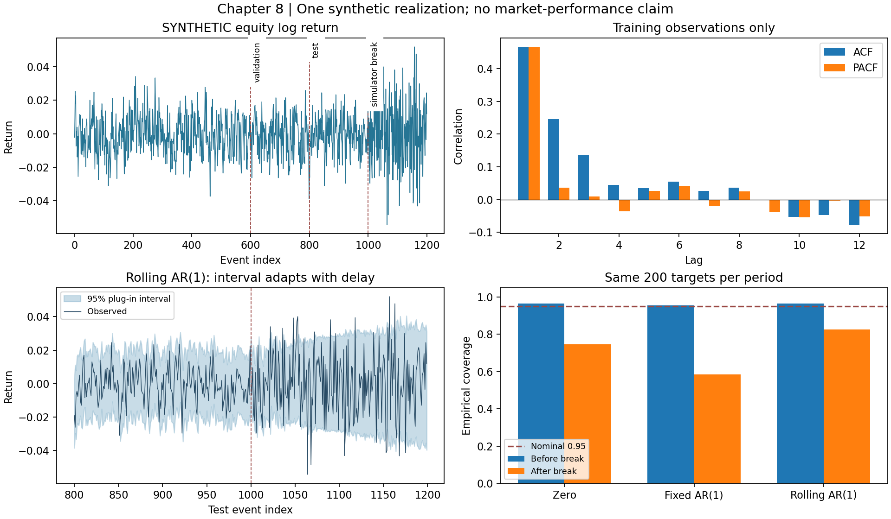

# 第8章 时间序列分析与金融统计基础

> 第一篇：数学、统计学与编程基础。沿用[数学公式阅读约定](./数学公式阅读约定.md)。本章实验的股票、债券、黄金和外汇收益全部由人工模型生成，标记为 SYNTHETIC，不是赛题官方数据，也不是实盘或历史回测绩效。

## 学习目标

先修知识包括第3章的投影与最小二乘、第5章的条件期望、第6章的估计与检验，以及第7章的平稳过程与信息集。完成本章后，应能：

1. 从价格、收益和平方收益中分辨不同的时间依赖，解释自相关与偏自相关。
2. 区分趋势平稳、单位根和结构变化，正确解释 ADF、KPSS 检验。
3. 推导 AR、MA、ARMA、ARIMA 的基本性质、估计方法和预测误差。
4. 实现按时间推进的模型比较，避免未来数据、参数选择和数据发布时间造成的泄漏。
5. 使用残差、区间覆盖率和稳定性指标监控模型，说明它们与市场状态识别的关系。

平台不仅需要知道“今天波动大”，还需要知道这种偏离是否超过历史可预期范围。时间序列模型提供一个条件基准：先用当时的信息预测，再用实际观测与基准的差异构造监控特征。**预测模型失配是调查线索，不自动等于市场危机。**

## 8.1 自相关、偏自相关、平稳性与单位根

### 8.1.1 时间索引先于算法

**时间序列，Time Series**，是一组按时间排列的观测。写作 $x_1,\ldots,x_n$ 时，小写表示已经观测到的数据，大写 $X_t$ 表示产生数据的随机变量。

本章默认相邻索引对应相同的建模步长。它可以是相邻交易日，却不一定是相邻自然日；一分钟收益也不等于相邻两笔成交收益。不同索引规则会改变自相关的金融含义。

假设一个资产的周五、周一收盘价分别为100和102。交易日序列的一阶对数收益是 $\log(102/100)$ 。如果先填充周末价格，再把每天当作同样的市场观察，就人为插入了两个零收益。由此得到的相关性、波动率和样本量都发生变化。

真实平台应同时记录事件时间、发布时间、系统获取时间与修订版本。统计程序中的“第 t 行”不能代替这些字段。本章使用规则到达的人工时间轴，是为了把统计推导与真实数据接入的复杂性分开；遇到缺失、迟到或修订时，示例程序拒绝不符合其假设的输入，不暗中删行。

### 8.1.2 自协方差与自相关

对二阶弱平稳过程，均值 $\mu=E[X_t]$ 不随时间变化，且协方差只依赖滞后。**自协方差函数，Autocovariance Function**，定义为：

```math
\gamma(k)=E[(X_t-\mu)(X_{t-k}-\mu)].
```

当 $\gamma(0)\gt0$ 时，**自相关函数，Autocorrelation Function，ACF** 为：

```math
\rho(k)=\frac{\gamma(k)}{\gamma(0)}.
```

因此 $\rho(0)=1$ 。交换两个变量不改变协方差，所以 $\gamma(-k)=\gamma(k)$ 。由 Cauchy–Schwarz 不等式：

```math
|\gamma(k)|\leq
\sqrt{\mathrm{Var}(X_t)\mathrm{Var}(X_{t-k})}
=\gamma(0),
```

故 $|\rho(k)|\leq1$ 。这一界限依赖两个时点具有相同方差；对非平稳序列不能随意把某一个时点的方差作为公共分母。

样本中先计算 $\bar x=n^{-1}\sum_{t=1}^n x_t$ ，再采用同一个分母 n：

```math
\widehat\gamma(k)=\frac1n\sum_{t=k+1}^n
(x_t-\bar x)(x_{t-k}-\bar x),\qquad
\widehat\rho(k)=\frac{\widehat\gamma(k)}{\widehat\gamma(0)}.
```

这里称为有偏自协方差估计，是相对于某些理想条件下的期望性质而言；它的好处是形成的自协方差序列具有良好的半正定结构。改成分母 $n-k$ 会得到另一种估计，大滞后处噪声更明显。软件默认选项必须记录，不可把不同定义的输出当成完全相同。

一个可手算的例子是 $x=(-1,0,1,0)$ 。样本均值为0，平方和为2，一阶交叉乘积和为0，二阶交叉乘积和为−1，因此：

```math
\widehat\rho(1)=0,\qquad \widehat\rho(2)=-\frac12.
```

一阶样本相关为零，并不表示所有时间关系消失，更不能据此证明独立。

在独立、同方差且满足适当矩条件的白噪声原假设下，固定非零滞后的样本 ACF 常用近似参考带 $\pm1.96/\sqrt n$ 。它是逐个滞后的近似界限；同时观察20根柱子，出现一根越界并不罕见。对非白噪声、条件异方差、厚尾或已估计模型的残差，这个参考带未必正确，需要相应渐近方差、模拟或稳健诊断。

### 8.1.3 白噪声不等于独立，更不等于没有风险结构

**弱白噪声，Weak White Noise，WN**，要求均值为零、方差有限且恒定、不同时间不相关。**独立同分布白噪声，IID White Noise**，进一步要求各期独立且具有相同分布。若所有有限维分布联合正态，不相关才足以推出独立；仅仅每一期边缘正态仍不够。

令 $Z_t$ 独立且服从标准正态分布，定义 $X_t=Z_tZ_{t-1}$ 。则：

```math
E[X_t]=0,\qquad E[X_t^2]=E[Z_t^2]E[Z_{t-1}^2]=1.
```

一阶交叉矩为：

```math
E[X_tX_{t-1}]
=E[Z_tZ_{t-1}^2Z_{t-2}]
=E[Z_t]E[Z_{t-1}^2]E[Z_{t-2}]=0.
```

更远的滞后也为零，因此它是弱白噪声。但平方项满足：

```math
E[X_t^2X_{t-1}^2]
=E[Z_t^2]E[Z_{t-1}^4]E[Z_{t-2}^2]=3,
\qquad
\mathrm{Cov}(X_t^2,X_{t-1}^2)=3-1=2.
```

所以相邻项不独立。这个反例解释了为什么平台要分别检查收益、绝对收益和平方收益：均值方向可能难以预测，而风险幅度仍有可识别的持续性。本例只是概率构造，不是对真实收益分布的断言；后续 GARCH 章节会建立条件方差模型。

### 8.1.4 偏自相关：剔除中间滞后的线性作用

直接相关可能由中间变量传递。**偏自相关函数，Partial Autocorrelation Function，PACF**，衡量在分别剔除中间滞后的最佳线性投影后，两个端点剩余部分的相关性。

“线性投影后的相关”比笼统的“给定中间变量后的相关”更准确：对一般非高斯过程，条件关系可以是非线性的，不能仅靠线性回归表示。

将过程中心化，令 $Y_t=X_t-\mu$ 。滞后2时分别构造：

```math
U_t=Y_t-\rho(1)Y_{t-1},\qquad
V_t=Y_{t-2}-\rho(1)Y_{t-1}.
```

系数为 $\gamma(1)/\gamma(0)=\rho(1)$ ，来自一元最小二乘的总体正规方程。展开协方差：

```math
\begin{aligned}
\mathrm{Cov}(U_t,V_t)
&=\gamma(2)-2\rho(1)\gamma(1)+\rho(1)^2\gamma(0)\\[0pt]
&=\gamma(0)[\rho(2)-\rho(1)^2].
\end{aligned}
```

两边残差方差均为 $\gamma(0)[1-\rho(1)^2]$ ，因而在分母非零时：

```math
\alpha(2)=\frac{\rho(2)-\rho(1)^2}{1-\rho(1)^2}.
```

一般滞后 k 的做法是求最优线性预测：

```math
\min_{a_1,\ldots,a_k}
E\left[\left(Y_t-\sum_{j=1}^k a_jY_{t-j}\right)^2\right].
```

对每个系数求导并令其为零：

```math
\sum_{j=1}^k a_j\gamma(i-j)=\gamma(i),\qquad i=1,\ldots,k.
```

在协方差矩阵非奇异的平稳情形下，最后一个系数 $a_k$ 就是滞后 k 的 PACF。以 k=2 为例：

```math
\begin{pmatrix}1&\rho(1)\\[0pt]
\rho(1)&1\end{pmatrix}
\begin{pmatrix}a_1\\[0pt]a_2\end{pmatrix}
=\begin{pmatrix}\rho(1)\\[0pt]\rho(2)\end{pmatrix}.
```

第二行减去第一行的 $\rho(1)$ 倍即可得到上面的 $\alpha(2)$ 。这也把本章和第3章的投影联系起来。PACF 的“截尾”是总体模型性质，有限样本中的小柱子通常不会恰好为零。可对照 [Penn State STAT 510 第2课](https://online.stat.psu.edu/stat510/Lesson02) 的 ACF/PACF 图形辨识教学。

### 8.1.5 趋势平稳、差分平稳与过度差分

**趋势平稳，Trend Stationary**，指减去确定性趋势后平稳。例如：

```math
X_t=a+bt+U_t,
```

其中 $U_t$ 平稳。趋势项可事先指定形式，但其参数若使用全样本估计，再回填历史特征，仍会泄漏未来信息。

**随机游走，Random Walk**，可写成：

```math
X_t=X_{t-1}+\varepsilon_t
=X_0+\sum_{j=1}^t\varepsilon_j.
```

若初值固定，创新独立、均值0、方差 $\sigma^2$ ，则：

```math
E[X_t]=X_0,\qquad \mathrm{Var}(X_t)=t\sigma^2.
```

方差随时间增长，故不弱平稳。减去一条确定直线不会消除这种随机累积。令 **差分，Difference** 为 $\Delta X_t=X_t-X_{t-1}$ ，则 $\Delta X_t=\varepsilon_t$ 平稳。需要一阶差分才能平稳的过程通常称一阶单整，**Integrated of Order One，I(1)**；平稳短记忆过程通常记作 I(0)，这里不讨论分数单整的完整定义。

两个模型中一次扰动的含义不同。趋势平稳模型中，若扰动属于均值回复的 $U_t$ ，影响会衰减；随机游走中的一次创新永久进入以后所有水平值。

也不能看到任何序列就不断差分。若 $X_t=\varepsilon_t$ 已经是方差 $\sigma^2$ 的白噪声，再差分得到：

```math
Y_t=\varepsilon_t-\varepsilon_{t-1},\qquad
\gamma_Y(0)=2\sigma^2,\qquad
\gamma_Y(1)=-\sigma^2,
```

故一阶相关为−1/2。这是人为制造的 MA(1) 结构，且处于不可逆边界。过度差分可能放大噪声并损失长期信息。

对正价格 $P_t$ ，对数差分为 $\log P_t-\log P_{t-1}$ ，即对数收益。债券价格、收益率水平、信用利差、波动率指数和利率变动不是同一变量，不能机械沿用相同变换；收益率可能为负时尤其不能直接取对数。图形、经济含义和统计检验应共同决定处理方式。差分与 ARIMA 的教学入口见 [FPP3 第9章](https://otexts.com/fpp3/arima.html#stationarity-and-differencing)。

### 8.1.6 ADF：检验单位根，而不是“证明平稳”

从 $X_t=c+\phi X_{t-1}+\varepsilon_t$ 两边减去 $X_{t-1}$ ：

```math
\Delta X_t=c+(\phi-1)X_{t-1}+\varepsilon_t.
```

令 $\gamma=\phi-1$ ，单位根 $\phi=1$ 对应 $\gamma=0$ 。**增广 Dickey–Fuller 检验，Augmented Dickey–Fuller，ADF**，加入滞后差分，以吸收更一般的短期相关：

```math
\Delta X_t=a+bt+\gamma X_{t-1}
+\sum_{j=1}^m\delta_j\Delta X_{t-j}+u_t.
```

在通常的非爆炸性备择设定下，原假设为单位根，备择为与所选确定项相容的平稳性。检验量形式为 $\widehat\gamma/\mathrm{SE}(\widehat\gamma)$ ，但不能查普通 Student t 分布：原假设下的水平变量是随机游走，通常的固定平稳回归渐近理论不成立。

确定项必须先说明：不含常数、含常数、含常数和趋势，代表不同的假设空间；不能不断切换到显著为止。m 太小可能留下残差相关，太大会消耗自由度并降低功效。程序固定最大滞后8，再在训练区间按 AIC 选择。

ADF 拒绝单位根不保证同方差、正态、无结构断点，也不证明今后参数不变；不拒绝也不证明单位根确实存在。短样本与接近1的平稳自回归系数尤其难区分。接口、确定项选项和近似 p 值说明见 [statsmodels 0.14.4 ADF 文档](https://www.statsmodels.org/v0.14.4/generated/statsmodels.tsa.stattools.adfuller.html)。

### 8.1.7 KPSS：从相反方向提出问题

**Kwiatkowski–Phillips–Schmidt–Shin 检验，KPSS**，以水平平稳或趋势平稳为原假设。先从样本中回归掉常数或常数加趋势，得到残差 $e_t$ ，再累加：

```math
S_t=\sum_{j=1}^t e_j.
```

若短记忆平稳假设成立，部分和的典型数量级为 $\sqrt n$ 。因此 $\sum_{t=1}^n S_t^2$ 的数量级为 $n^2$ 。若存在随机趋势，部分和通常更大，这就是检验统计量放大的直观原因。

残差可能短期相关，不能只用样本方差归一化。取截断滞后 L，用 Bartlett 权重构造长期方差估计：

```math
\widehat\omega^2=\widehat\gamma_e(0)
+2\sum_{j=1}^L\left(1-\frac{j}{L+1}\right)\widehat\gamma_e(j),
\qquad
\mathrm{KPSS}=\frac{\sum_{t=1}^nS_t^2}{n^2\widehat\omega^2}.
```

它与第6章 HAC 的思想一致。大的统计量反对原假设；其临界值也不是普通正态临界值。本节给出构造和尺度解释，不声称由此完成了涉及函数型中心极限定理的全部极限分布证明。

在相容的确定项和检验设定下，可把两项结果整理为调查表：

|ADF 是否拒绝单位根|KPSS 是否拒绝平稳|合理解释|
|---|---|---|
|是|否|与所设平稳模型相容，继续检查方差和断点|
|否|是|与单位根情形相容，考虑差分及经济解释|
|否|否|证据不足，可能功效低，不能宣布两种假设都真|
|是|是|可能存在断点、异方差、确定项失配或其他模型问题|

软件用有限临界值表插值时，返回边界 p 值不代表精确概率。例如本章训练样本返回0.1，并同时警告真实 p 值大于表中上界。必须保留警告，报告“高于表上界”，不能写成“精确等于0.1”。见 [statsmodels 0.14.4 KPSS 文档](https://www.statsmodels.org/v0.14.4/generated/statsmodels.tsa.stattools.kpss.html)。

## 8.2 AR、MA、ARMA、ARIMA及估计诊断

### 8.2.1 AR(1)：均值、因果解与自相关的推导

**自回归，Autoregression，AR**，使用变量自身的滞后值解释当前值。考虑：

```math
X_t=c+\phi X_{t-1}+\varepsilon_t.
```

为推导二阶性质，先假设创新是方差 $\sigma^2\gt0$ 的白噪声，并采用只依赖当前及过去创新的因果解。要把线性预测解释为条件均值，还需创新相对过去的信息集具有零条件均值；要得到正态预测区间，则进一步使用独立高斯创新。

若平稳均值存在，两边取期望：

```math
\mu=c+\phi\mu,\qquad \mu=\frac{c}{1-\phi}.
```

令 $Y_t=X_t-\mu$ ，得到 $Y_t=\phi Y_{t-1}+\varepsilon_t$ 。反复代入 m 次：

```math
Y_t=\phi^mY_{t-m}+\sum_{j=0}^{m-1}\phi^j\varepsilon_{t-j}.
```

若 $|\phi|\lt1$ 且 $Y_t$ 二阶平稳，第一项的均方为 $\phi^{2m}E[Y_{t-m}^2]$ ，趋向0；后面级数的尾部均方是等比级数。因此有均方收敛的表示：

```math
Y_t=\sum_{j=0}^{\infty}\phi^j\varepsilon_{t-j}.
```

“因果，Causal”在这里表示仅依赖当前和过去创新，不是宏观政策因果推断的含义。

利用不同期创新不相关：

```math
\gamma(0)=\sigma^2\sum_{j=0}^{\infty}\phi^{2j}
=\frac{\sigma^2}{1-\phi^2}.
```

对 k≥1，把递推式与 $Y_{t-k}$ 相乘取期望，当前创新与过去不相关：

```math
\gamma(k)=\phi\gamma(k-1)=\phi^k\gamma(0),
\qquad \rho(k)=\phi^k.
```

正系数产生同号衰减，负系数产生交替衰减。代入 PACF 二阶公式，分子是 $\phi^2-\phi^2=0$ 。更高阶也为零，因为第一阶已包含最佳线性预测所需的全部滞后信息。

若在有限时点从固定初值启动，过程起初一般并非严格平稳；平稳解要求合适的初始分布或无限过去。模拟先运行一段并丢弃，称预热，**Burn-in**，只能使初值影响足够小，不是数学上变成精确平稳。AR 根条件与记号差异可对照 [李东风《金融时间序列分析讲义》第4章](https://math.pku.edu.cn/teachers/lidf/course/fts/ftsnotes/html/_ftsnotes/fts-armod.html)。

### 8.2.2 AR(p)、根条件与 Yule–Walker 方程

中心化后的 p 阶模型为：

```math
Y_t=\phi_1Y_{t-1}+\cdots+\phi_pY_{t-p}+\varepsilon_t.
```

定义**滞后算子，Backshift Operator** $B$ ，使 $BY_t=Y_{t-1}$ 。则模型写成 $\Phi(B)Y_t=\varepsilon_t$ ，其中：

```math
\Phi(z)=1-\phi_1z-\cdots-\phi_pz^p.
```

存在稳定因果解的条件是 $\Phi(z)$ 的所有零点位于单位圆外。AR(1) 的根是 $1/\phi$ ，故等价于 $|\phi|\lt1$ 。有些软件报告的是倒数根，应该在单位圆内；必须先确认多项式定义。

这一条件比“各系数绝对值小于1”严格得多。例如 $\phi_1=0.8,\phi_2=0.8$ 虽各自小于1，正实根 $(-0.8+\sqrt{3.84})/1.6\approx0.725$ 位于单位圆内，因果稳定条件不成立。

与 $Y_{t-k}$ 相乘取期望，得到 **Yule–Walker 方程**：

```math
\gamma(k)=\sum_{j=1}^p\phi_j\gamma(k-j),\quad k\geq1;
\qquad
\gamma(0)=\sum_{j=1}^p\phi_j\gamma(j)+\sigma^2.
```

第一组可用样本自协方差代入并解线性方程，第二式再估计创新方差。代价低且结构明确；短样本、接近单位根及不合适的自协方差估计会影响数值性质。

需要限定“因果”：若允许用未来创新构造非因果解，某些单位圆内的根仍可对应平稳过程；本平台的在线预测不采用这种表示。相应数学背景见 [李东风备课笔记第8章](https://math.pku.edu.cn/teachers/lidf/course/atsa/atsanotes/html/_atsanotes/atsa-arstation.html)。

### 8.2.3 MA(q)：过去冲击的有限累积

**移动平均，Moving Average，MA**，写成：

```math
Y_t=\varepsilon_t+\theta_1\varepsilon_{t-1}+\cdots+\theta_q\varepsilon_{t-q}.
```

它使用过去的不可直接观测冲击，不是把最近 q 个价格算术平均的技术指标。本文使用加号约定；另一些教材用减号，参数符号必须连同模型方程一起比较。

令 $\theta_0=1$ 。展开两个有限和，只有相同时间的创新乘积保留，因而：

```math
\gamma(k)=\sigma^2\sum_{j=0}^{q-k}\theta_j\theta_{j+k},
\quad 0\leq k\leq q;
\qquad \gamma(k)=0,\quad k>q.
```

所以 MA(q) 的总体 ACF 在 q 阶后截尾。有限线性组合保证二阶平稳，不要求 MA 系数小于1。

但为了从历史观测稳定地恢复创新，需要**可逆性，Invertibility**。MA(1) 满足 $Y_t=\varepsilon_t+\theta\varepsilon_{t-1}$ ，反复求解：

```math
\varepsilon_t=Y_t-\theta Y_{t-1}+\theta^2Y_{t-2}-\cdots.
```

当 $|\theta|\lt1$ 时，上式稳定；一般 MA(q) 要求 $\Theta(z)=1+\theta_1z+\cdots+\theta_qz^q$ 的根在单位圆外。

为什么需要这一限制？MA(1) 的方差和相关为：

```math
\gamma(0)=\sigma^2(1+\theta^2),\qquad
\rho(1)=\frac{\theta}{1+\theta^2}.
```

将非零参数换成 $\theta'=1/\theta$ ，并设 $\sigma'^2=\theta^2\sigma^2$ ，上述方差与所有自协方差都不变。高斯情形下，两套参数甚至给出相同的有限维分布。选取可逆表示可以消除这种重复识别；仅有相同二阶结构时，不能对非高斯模型额外声称全部分布相同。

### 8.2.4 ARMA、ARIMA与可识别性

**自回归移动平均，Autoregressive Moving Average，ARMA**，将两种结构组合：

```math
\Phi(B)Y_t=\Theta(B)\varepsilon_t.
```

ARMA(1,1) 在 $|\phi|\lt1$ 时可展开为：

```math
Y_t=\frac{1+\theta B}{1-\phi B}\varepsilon_t
=\varepsilon_t+(\phi+\theta)\varepsilon_{t-1}
+\phi(\phi+\theta)\varepsilon_{t-2}+\cdots.
```

其中 $\psi_0=1$ ， $\psi_j=(\phi+\theta)\phi^{j-1}$ ，j≥1。于是：

```math
\gamma(0)=\sigma^2\left[1+\frac{(\phi+\theta)^2}{1-\phi^2}\right]
=\sigma^2\frac{1+2\phi\theta+\theta^2}{1-\phi^2}.
```

一阶协方差同样从共同创新系数相乘得到：

```math
\begin{aligned}
\gamma(1)
&=\sigma^2\left[(\phi+\theta)
+\frac{\phi(\phi+\theta)^2}{1-\phi^2}\right]\\[0pt]
&=\sigma^2\frac{(\phi+\theta)(1+\phi\theta)}{1-\phi^2}.
\end{aligned}
```

其后 $\gamma(k)=\phi^{k-1}\gamma(1)$ 。若 $\theta=-\phi$ ，AR 与 MA 多项式约掉，模型退化为白噪声。一般应避免公共因子；参数几乎约消时，即使优化器成功，也可能严重不稳定。

**差分整合自回归移动平均，Autoregressive Integrated Moving Average，ARIMA(p,d,q)**，先做 d 阶差分，再对差分序列建模：

```math
\Phi(B)(1-B)^dX_t=c+\Theta(B)\varepsilon_t.
```

p、q 是滞后阶数，d 是差分阶数。若 d=1，且差分后的稳定均值为 $\mu_\Delta$ ，则长期水平预测包含每步 $\mu_\Delta$ 的漂移。这里 $\mu_\Delta=c/(1-\sum_j\phi_j)$ ，不能把方程截距 c 直接当成漂移。

季节性差分为 $(1-B^s)X_t=X_t-X_{t-s}$ ，s 是明确的季节步长。金融交易日不是等长月份，日内波动的开盘和收盘效应也不一定适合简单季节 ARIMA。季节虚拟变量、条件方差模型和交易时段特征都是替代方案。

库之间参数化可能不同。statsmodels `ARIMA(..., trend="c")` 在 d=0 时把常数作为回归均值处理；它通常对应 $\mu$ ，而不是上述 AR 方程中的 c。官方定义见 [ARIMA 0.14.4 文档](https://www.statsmodels.org/v0.14.4/generated/statsmodels.tsa.arima.model.ARIMA.html)。

### 8.2.5 条件最小二乘与条件高斯似然

对观测 $x_0,\ldots,x_{n-1}$ ，条件于初值，构造 n−1 个回归对 $z_t=x_{t-1},y_t=x_t$ 。目标为：

```math
Q(c,\phi)=\sum_{t=1}^{n-1}(y_t-c-\phi z_t)^2.
```

分别对 c 和 $\phi$ 求导：

```math
\sum_t(y_t-c-\phi z_t)=0,\qquad
\sum_tz_t(y_t-c-\phi z_t)=0.
```

第一式给出 $c=\bar y-\phi\bar z$ 。代入第二式并中心化：

```math
\widehat\phi=\frac{\sum_t(z_t-\bar z)(y_t-\bar y)}
{\sum_t(z_t-\bar z)^2},\qquad
\widehat c=\bar y-\widehat\phi\bar z.
```

若滞后值恒定，分母为零，无法识别两个参数。不能把缺失估计设为零后继续发布。

若创新独立正态，条件对数似然为：

```math
\ell(c,\phi,\sigma^2)
=-\frac m2\log(2\pi)-\frac m2\log\sigma^2
-\frac{Q(c,\phi)}{2\sigma^2},\qquad m=n-1.
```

固定方差时最大化似然等价于最小化 Q；对方差求导：

```math
-\frac m{2\sigma^2}+\frac{Q}{2\sigma^4}=0
\quad\Longrightarrow\quad
\widehat\sigma^2_{\mathrm{ML}}=\frac{Q(\widehat c,\widehat\phi)}m.
```

程序使用这个分母。用 m−2 是常见自由度修正，但自回归设计矩阵本身含有随机滞后，不能不加条件照搬固定设计回归的有限样本精确无偏结论。小样本 AR 系数也可能有偏。

**精确高斯似然**还处理初始观测的分布；一般 ARMA 可用状态空间表示和 Kalman 滤波计算创新似然。因此手写条件 OLS 与软件精确估计可能略有差异，不应强行要求逐位一致。参数估计的进一步理论入口见 [李东风备课笔记第19章](https://math.pku.edu.cn/teachers/lidf/course/atsa/atsanotes/html/_atsanotes/atsa-estar.html)。

### 8.2.6 模型选择与残差诊断

阶数增加通常降低训练误差，却可能增加估计噪声。**赤池信息准则，Akaike Information Criterion，AIC**，和**贝叶斯信息准则，Bayesian Information Criterion，BIC**，分别写作：

```math
\mathrm{AIC}=-2\widehat\ell+2K,
\qquad
\mathrm{BIC}=-2\widehat\ell+K\log m.
```

K 是参与估计的参数数目，通常包括创新方差；m 是有效似然观测数。它们越小越好，但不能把不同数据尺度、不同目标、不同样本起止、不同初始化约定的似然直接比较。差分阶数改变数据对象及似然处理，不能简单拿所有 d 的软件 AIC 排名代替平稳性判断。小样本修正 AICc 也须匹配模型和参数计数约定。

实际选型采用三步：用训练数据提出少量候选；用相同预测目标的验证区间选择；冻结评估规则后在测试区间报告。AIC 可以协助训练期缩小候选范围，不能代替样本外检查。

残差 $\widehat\varepsilon_t=x_t-\widehat x_{t|t-1}$ 应检查均值、ACF、平方残差 ACF、极端值与参数稳定性。**Ljung–Box 检验**汇总前 h 阶相关：

```math
Q_h=m(m+2)\sum_{k=1}^h\frac{\widehat\rho_e(k)^2}{m-k}.
```

每项平方衡量离零的偏离，分母修正不同滞后使用的配对数量。在经典正确指定 ARMA、适当创新条件和大样本近似下，拟合残差常用 $\chi^2_{h-p-q}$ 校正；要求 h>p+q。该近似并不自动适用于厚尾、条件异方差、滚动重估残差或所有复杂模型。

不拒绝残差不相关，只能说这个检验没有发现相应线性依赖，不能宣布残差独立、正态，或模型已经适合危机预警。平方残差的检验是另一个诊断视角，其自由度与稳健性需另行考虑，不能机械复制均值模型参数扣除。接口中 `model_df` 的定义见 [Ljung–Box 官方文档](https://www.statsmodels.org/v0.14.4/generated/statsmodels.stats.diagnostic.acorr_ljungbox.html)。

## 8.3 滚动估计、预测区间与金融统计边界

### 8.3.1 最佳预测与 AR(1) 多步误差

设 $\mathcal F_t$ 是预测时实际可用信息。平方损失下，最佳预测是条件期望 $m_t=E[X_{t+h}\mid\mathcal F_t]$ 。对任意基于相同信息的预测 a，展开：

```math
E[(X_{t+h}-a)^2\mid\mathcal F_t]
=\mathrm{Var}(X_{t+h}\mid\mathcal F_t)+(m_t-a)^2.
```

交叉项消失，因为 $E[X_{t+h}-m_t\mid\mathcal F_t]=0$ 。第二项最小值为0，故 a=m_t 最优。这是模型内部、信息集给定时的结论，不意味着估计出来的模型等于真实条件期望。

AR(1) 向前递推 h 次：

```math
X_{t+h}=\mu+\phi^h(X_t-\mu)
+\sum_{j=0}^{h-1}\phi^j\varepsilon_{t+h-j}.
```

未来创新独立于当前信息且均值为零时：

```math
\widehat X_{t+h|t}=\mu+\phi^h(X_t-\mu),
\qquad
e_{t+h|t}=\sum_{j=0}^{h-1}\phi^j\varepsilon_{t+h-j}.
```

创新互不相关，所以：

```math
v_h=\mathrm{Var}(e_{t+h|t})
=\sigma^2\sum_{j=0}^{h-1}\phi^{2j}
=\sigma^2\frac{1-\phi^{2h}}{1-\phi^2}.
```

随着 h 增大，点预测回到均值，误差方差趋于无条件方差。对随机游走，点预测为当前水平，误差是 h 个未来创新的和，方差为 $h\sigma^2$ ，不会收敛到有限上界。

例如 $\mu=0.001,\phi=0.6,\sigma=0.01,X_t=0.02$ ，两步预测为 $0.001+0.36(0.019)=0.00784$ ，预测误差标准差为 $0.01\sqrt{1.36}\approx0.011662$ 。注意后者不是点预测本身的标准误。

### 8.3.2 预测区间、覆盖与参数不确定性

已知参数且创新高斯时，条件分布为正态，95% **预测区间，Prediction Interval，PI** 是：

```math
\widehat X_{t+h|t}\pm z_{0.975}\sqrt{v_h},
\qquad z_{0.975}\approx1.959964.
```

把未知参数替换为估计值，得到**代入式区间，Plug-in Interval**。它忽略参数估计、模型选择和结构变化的不确定性。本章保留这一简单区间，目的就是用实测覆盖展示其局限。

可选改进包括参数模拟、适合相关数据的 Bootstrap、厚尾创新分布和条件波动率模型。重抽样必须在当时的训练窗口内进行；用完整未来测试残差校准历史区间仍然是泄漏。

对资产对数价格 L 的高斯预测 $L\sim N(m,v)$ ，不能把 $e^m$ 当作价格均值。由正态矩母函数：

```math
E[e^L]=e^{m+v/2},\qquad \mathrm{Median}(e^L)=e^m.
```

指数函数单调，因此可以把对数价格区间端点直接指数化，得到对应价格分位数区间；“均值反变换”与“分位数反变换”不同。

区间评估应同时报告覆盖率和宽度。把区间无限放宽能提高覆盖，却没有实用价值。对尾部概率 $\alpha$ 、下界 l、上界 u、观测 y，采用**区间评分，Interval Score**：

```math
\mathrm{IS}_\alpha(l,u;y)
=(u-l)+\frac2\alpha(l-y)\mathbf1_{\lbrace y<l\rbrace}
+\frac2\alpha(y-u)\mathbf1_{\lbrace y>u\rbrace}.
```

第一项惩罚过宽，后两项惩罚漏覆盖。其形式也可理解为上下两个分位数损失的组合：在连续分布下，对期望评分分别求导，最优端点满足 $F(l)=\alpha/2$ 与 $F(u)=1-\alpha/2$ 。因此它鼓励正确覆盖位置而非无限放大区间。本章 $\alpha=0.05$ ，越界距离乘数为40。预测评估与滚动起点评估可参阅 [FPP3 第5章](https://otexts.com/fpp3/toolbox.html)。

### 8.3.3 固定、扩展与滚动窗口

|方法|每次估计使用的数据|优点|主要代价|
|---|---|---|---|
|固定参数|固定训练段，参数不再更新|解释与追溯容易|结构变化后可能失效|
|扩展窗口|从固定起点到当前可用时点|有效样本增加，估计较稳|旧机制的影响难消失|
|滚动窗口|最近 W 个可用观测|可以逐步适应变化|W 小则估计噪声大，W 大则反应慢|
|指数加权|越近权重越大|平滑遗忘旧数据|遗忘因子仍需校准，异常冲击可能被过度吸收|

固定参数模型仍可使用最新已发布的滞后观测，不能将“参数固定”和“输入也停在训练末尾”混淆。

滚动评估中的 W 是超参数。先用验证期选择 W，再在测试期遵循固定更新规则，属于允许在线学习的**逐次预测评估，Prequential Evaluation**：先预测、后获得真实值、再更新。它不是完全不接触测试期观测的静态批量预测；报告必须写明这一点。

用测试结果挑最优 W，再把同一测试区间作为最终成绩，会产生选择偏差。多步预测还应检查训练标签的可用时间：若标签覆盖未来 h 期，训练样本的起始时间早于分割点仍可能把测试收益包含进去；应按标签结束及发布时间设置隔离区间。

### 8.3.4 从预测误差到监控特征

收到观测后计算**创新，Innovation**或预测误差：

```math
e_t=x_t-\widehat x_{t|t-1},\qquad
z_t=\frac{e_t}{\widehat\sigma_{t|t-1}}.
```

在正确的条件均值和方差模型下，它衡量观测相对于可预期范围的偏离。但一次大的 z 值有多种解释：真实冲击、波动率上升、价格错录、时间错位、模型参数失效。监控平台应保存原始数据质量标志、模型版本和预测形成时间，以支持区分。

如果均值残差持续同号，可能存在均值变化；如果平方残差持续偏大，可能存在方差失配；如果多个资产同向异常，可能存在共同冲击。它们是可解释特征，而“流动性危机”“增长衰退”“通胀冲击”等状态仍需资产联动、宏观和事件证据。

逐期95%区间在模型成立时也会出现越界。高频、多资产、连续看盘会产生大量正常越界；不能把每次越界都升级为危机告警。报警去重、持续性规则、联合阈值和误报预算会在后续章节建立。

## 8.4 完整实验：可追溯的多资产滚动预测

### 8.4.1 数据生成与比较协议

实验生成1200期四资产对数收益，先额外预热500期。各资产创新由共同标准正态冲击 $F_t$ 和独立标准正态冲击 $U_{i,t}$ 组成：

```math
\varepsilon_{i,t}=\sigma_i
\left(\sqrt{0.35}F_t+\sqrt{0.65}U_{i,t}\right),
\qquad r_{i,t}=\phi_i r_{i,t-1}+\varepsilon_{i,t}.
```

共同项占创新方差的35%；这不是收益相关系数一定等于0.35，因为各资产的自回归系数不同。初始参数为：

|资产|自回归系数|每期创新标准差|
|---|---:|---:|
|EQ_DEMO|0.45|0.010|
|BOND_DEMO|0.20|0.003|
|GOLD_DEMO|−0.15|0.008|
|FX_DEMO|0.05|0.005|

从事件1000开始，仅 EQ_DEMO 的系数改为−0.25，创新标准差改为0.020。这个断点是模拟器真值，不供预测算法选择窗口或重置模型；只用于事后的分段解释。前半段的平稳检验无法提前保证此断点不存在。

区间采用左闭右开索引：训练 [0,600)，验证 [600,800)，测试 [800,1200)。每个资产仅用200个验证目标，在120和240两个滚动窗口中按 RMSE 选一个。测试时比较零收益预测、冻结训练参数的 AR(1)、按所选窗口更新的 AR(1)。三者面对相同400个目标和可用行情，差别在于预先规定的更新策略。

每个训练窗口 W 个观测产生 W−1 个回归对；冻结模型使用600个观测产生599对。零预测基准的方差也使用训练段的后599个目标平方均值，保持目标口径明确。

教学时间以抽象单位表示：事件 t 在 t+0.1 可被系统获取；预测 t 的决策时间为 t−0.2。滚动训练截止为 t−0.5，假设模型在 t−0.25 发布，因此：

```math
t-1+0.1\leq t-0.5\leq t-0.25\leq t-0.2<t<t+0.1.
```

这些是模拟协议，不是实测计算耗时。生产环境必须用实际训练完成、模型发布和输入获取时间替换。窗口选择在799.75发布，首个测试决策为799.8；选择阶段最后一个验证目标在799.1已经可用。

### 8.4.2 完整程序与运行方法

主程序保存在 [timeseries_lab.py](./code/ch08/timeseries_lab.py)，使用现有 Python 3.13.5、NumPy 2.1.3、pandas 2.2.3、SciPy 1.15.3、statsmodels 0.14.4。配图另用 Matplotlib 3.10.0；没有安装新依赖。在 `教材/code/ch08` 目录运行：

```powershell
& 'D:\Anaconda\python.exe' -X utf8 timeseries_lab.py
& 'D:\Anaconda\python.exe' -X utf8 -m unittest -v test_timeseries_lab.py
```

输入由 `simulate` 生成，不需要外部文件；输出到新的 `runs/run_...` 目录，包括原始人工收益 CSV、4800条测试预测记录 CSV、参数及诊断清单 JSON。已有目录不覆盖，运行产物按仓库规则忽略。

以下为完整主程序。`forecast_record` 只读取当前目标之前的数据；真实目标由 `evaluate` 在预测形成之后附加，用于离线评分。每条预测保留训练边界、获取截止、发布时间、决策时间、模型版本及参数。

```python
"""SYNTHETIC time-series lab; run with the existing Anaconda Python."""
from pathlib import Path
from datetime import datetime, timezone
import hashlib
import json
import platform
import warnings

import numpy as np
import pandas as pd
import scipy
from scipy.stats import norm
import statsmodels
from statsmodels.tsa.stattools import adfuller, kpss, acf, pacf
from statsmodels.stats.diagnostic import acorr_ljungbox
from statsmodels.tsa.arima.model import ARIMA

ASSETS = ("EQ_DEMO", "BOND_DEMO", "GOLD_DEMO", "FX_DEMO")
SEED, TRAIN_END, VALID_END, N = 20261024, 600, 800, 1200
WINDOWS = (120, 240)


def vector(x, minimum=4):
    x = np.asarray(x, dtype=float)
    if x.ndim != 1 or len(x) < minimum or not np.isfinite(x).all():
        raise ValueError("Require a finite 1-D series of sufficient length")
    return x


def fit_ar1(x):
    x = vector(x)
    lag, target = x[:-1], x[1:]
    z, y = lag - lag.mean(), target - target.mean()
    denominator = float(z @ z)
    if denominator <= 0:
        raise ValueError("Constant lag: AR coefficient is unidentified")
    phi = float(z @ y / denominator)
    c = float(target.mean() - phi * lag.mean())
    residual = target - c - phi * lag
    variance = float(residual @ residual / len(residual))
    if abs(phi) >= 1 or variance <= 0:
        raise ValueError("Stationary AR(1) baseline invalid; do not clip silently")
    return {"c": c, "phi": phi, "variance": variance, "pairs": len(residual)}


def predict_ar1(model, last, horizon=1):
    if not isinstance(horizon, int) or horizon < 1:
        raise ValueError("horizon must be a positive integer")
    phi, c, variance = model["phi"], model["c"], model["variance"]
    if not np.isfinite([phi, c, variance, last]).all() or abs(phi) >= 1 or variance <= 0:
        raise ValueError("Invalid stationary AR(1) forecast inputs")
    mu = c / (1 - phi)
    mean = mu + phi ** horizon * (last - mu)
    # A finite sum also works accurately near a unit root.
    error_variance = variance * sum(phi ** (2 * j) for j in range(horizon))
    return float(mean), float(error_variance)


def simulate():
    rng = np.random.Generator(np.random.PCG64(SEED))
    burn = 500
    phi = np.array([.45, .20, -.15, .05])
    sigma = np.array([.01, .003, .008, .005])
    state = np.zeros(4)
    rows = []
    for t in range(-burn, N):
        p, s = phi.copy(), sigma.copy()
        if t >= 1000:
            p[0], s[0] = -.25, .02
        noise = np.sqrt(.35) * rng.normal() + np.sqrt(.65) * rng.normal(size=4)
        state = p * state + s * noise
        if t >= 0:
            rows.append(state.copy())
    frame = pd.DataFrame(rows, columns=ASSETS)
    frame.insert(0, "available_time", np.arange(N) + .1)
    frame.insert(0, "event_time", np.arange(N))
    frame.insert(0, "source", "SYNTHETIC")
    return frame


def forecast_record(x, available, t, model_name, window=None):
    """Read only x[:t]; target value is attached by the evaluator later."""
    if t < TRAIN_END or t > len(x) or len(x) != len(available):
        raise ValueError("Invalid forecast origin")
    decision = t - .2
    end = TRAIN_END if model_name in ("zero", "fixed_ar1") else t
    if model_name == "rolling_ar1":
        if window is None or window < 4 or window > t:
            raise ValueError("Invalid rolling window")
        start = t - window
    elif model_name in ("zero", "fixed_ar1"):
        start = 0
    else:
        raise ValueError("Unknown model")
    past = vector(x[start:end])
    times = vector(available[start:end])
    if np.any(np.diff(times) <= 0):
        raise ValueError("This lab requires ordered, non-revised availability")
    cutoff, ready = end - .5, end - .25
    if times.max() > cutoff or ready > decision or available[t - 1] > decision:
        raise ValueError("PIT violation: model or lag not available")
    if model_name == "zero":
        model = {"c": 0., "phi": 0., "variance": float(np.mean(past[1:] ** 2)),
                 "pairs": len(past) - 1}
        mean, variance = predict_ar1(model, 0.)
    else:
        model = fit_ar1(past)
        mean, variance = predict_ar1(model, float(x[t - 1]))
    width = float(norm.ppf(.975) * np.sqrt(variance))
    return {"t": t, "model": model_name, "window": window or 0,
            "train_start": start, "train_end_exclusive": end,
            "train_max_available": float(times.max()), "fit_cutoff": cutoff,
            "model_ready": ready, "decision_time": decision,
            "lag_available": float(available[t - 1]),
            "model_version": f"{model_name}:{start}:{end}",
            **model, "mean": mean, "forecast_variance": variance,
            "lower": mean - width, "upper": mean + width}


def evaluate(x, available, start, stop, model_name, window=None):
    rows = []
    for t in range(start, stop):
        row = forecast_record(x, available, t, model_name, window)
        row.update(actual=float(x[t]), target_available=float(available[t]))
        rows.append(row)
    return pd.DataFrame(rows)


def metrics(frame):
    e = frame["actual"] - frame["mean"]
    lo, hi, y = frame["lower"], frame["upper"], frame["actual"]
    score = hi - lo + 40 * (lo - y).clip(lower=0) + 40 * (y - hi).clip(lower=0)
    return {"n": len(frame), "rmse": float(np.sqrt(np.mean(e ** 2))),
            "coverage95": float(((y >= lo) & (y <= hi)).mean()),
            "mean_width": float((hi - lo).mean()), "interval_score95": float(score.mean())}


def diagnostics(x):
    x = vector(x, 40)
    with warnings.catch_warnings(record=True) as caught:
        warnings.simplefilter("always")
        a = adfuller(x, maxlag=8, regression="c", autolag="AIC")
        k = kpss(x, regression="c", nlags=8)
        fit = fit_ar1(x)
        e = x[1:] - fit["c"] - fit["phi"] * x[:-1]
        lb = acorr_ljungbox(e, lags=[10], model_df=1, return_df=True)
        lb2 = acorr_ljungbox(e ** 2, lags=[10], model_df=0, return_df=True)
    return {"adf_stat": float(a[0]), "adf_p": float(a[1]), "adf_lags": int(a[2]),
            "kpss_stat": float(k[0]), "kpss_table_p": float(k[1]), "kpss_lags": int(k[2]),
            "lb_residual_p": float(lb.lb_pvalue.iloc[0]),
            "lb_squared_residual_p": float(lb2.lb_pvalue.iloc[0]),
            "acf": acf(x, nlags=12, fft=False).tolist(),
            "pacf": pacf(x, nlags=12, method="ywm").tolist(),
            "warnings": [str(w.message) for w in caught]}


def main():
    frame = simulate()
    available = frame.available_time.to_numpy()
    all_predictions, selection, summary, diag = [], {}, {}, {}
    for asset in ASSETS:
        x = frame[asset].to_numpy()
        scores = {w: metrics(evaluate(x, available, TRAIN_END, VALID_END,
                                      "rolling_ar1", w))["rmse"] for w in WINDOWS}
        chosen = min(WINDOWS, key=lambda w: (scores[w], w))
        selection[asset] = {"validation_rmse": scores, "chosen_window": chosen,
                            "selection_ready": VALID_END - .25}
        diag[asset] = diagnostics(x[:TRAIN_END])
        summary[asset] = {}
        for name in ("zero", "fixed_ar1", "rolling_ar1"):
            pred = evaluate(x, available, VALID_END, N, name,
                            chosen if name == "rolling_ar1" else None)
            pred.insert(0, "asset", asset)
            pred["selection_ready"] = VALID_END - .25
            if not (pred.selection_ready <= pred.decision_time).all():
                raise ValueError("Selection not ready before decision")
            summary[asset][name] = {"all_test": metrics(pred),
                                   "first_200": metrics(pred[pred.t < 1000]),
                                   "last_200": metrics(pred[pred.t >= 1000])}
            all_predictions.append(pred)
    # Independent package demonstration, in percentage points for numerical scaling.
    with warnings.catch_warnings(record=True) as caught:
        warnings.simplefilter("always")
        arima = ARIMA(100 * frame.EQ_DEMO.iloc[:TRAIN_END].to_numpy(),
                      order=(1, 0, 0), trend="c", missing="raise").fit()
    package_fit = {"parameter_names": arima.param_names, "parameters": arima.params.tolist(),
                   "converged": bool(arima.mle_retvals.get("converged", False)),
                   "warnings": [str(w.message) for w in caught]}
    out = Path(__file__).parent / "runs" / datetime.now(timezone.utc).strftime("run_%Y%m%dT%H%M%S_%fZ")
    out.mkdir(parents=True, exist_ok=False)
    frame.to_csv(out / "synthetic.csv", index=False, float_format="%.17g")
    pd.concat(all_predictions).to_csv(out / "predictions.csv", index=False, float_format="%.17g")
    manifest = {"source": "SYNTHETIC", "seed": SEED, "rng": "PCG64", "burn_in": 500,
                "split": [TRAIN_END, VALID_END, N], "candidate_windows": WINDOWS,
                "known_simulator_break": 1000, "common_noise_variance_share": .35,
                "selection": selection, "diagnostics_training_only": diag,
                "test_metrics": summary, "package_arima_training_only": package_fit,
                "versions": {"python": platform.python_version(), "numpy": np.__version__,
                             "pandas": pd.__version__, "scipy": scipy.__version__,
                             "statsmodels": statsmodels.__version__},
                "sha256": {p.name: hashlib.sha256(p.read_bytes()).hexdigest()
                           for p in [Path(__file__), out / "synthetic.csv", out / "predictions.csv"]}}
    (out / "manifest.json").write_text(json.dumps(manifest, ensure_ascii=False, indent=2,
                                                 allow_nan=False), encoding="utf-8")
    print(out.resolve())
    print(json.dumps({"selection": selection, "EQ_DEMO": summary["EQ_DEMO"],
                      "package_fit": package_fit}, ensure_ascii=False, indent=2))


if __name__ == "__main__":
    main()
```

### 8.4.3 实际运行结果与解释

本次在上述环境实际执行。验证期选择的窗口依次为240、120、120、120；EQ_DEMO 的两个验证 RMSE 分别为0.0107634012与0.0107190321。两者差距很小，不能据此宣布240是一般最优窗口。

以下为 EQ_DEMO 的400个测试目标，单位为对数收益：

|模型|RMSE|95%区间覆盖率|平均宽度|平均区间评分|
|---|---:|---:|---:|---:|
|零收益基准|0.015691|0.855|0.045270|0.094367|
|冻结 AR(1)|0.017651|0.770|0.039958|0.141362|
|滚动 AR(1)|0.015747|0.895|0.048701|0.082591|

全测试期零预测的 RMSE 略低于滚动模型；滚动模型的区间评分更低。评价指标对应不同目标，不能用某个指标代替所有模型优劣。

已知模拟断点前后各200个目标的覆盖率为：

|模型|断点前|断点后|
|---|---:|---:|
|零收益基准|0.965|0.745|
|冻结 AR(1)|0.955|0.585|
|滚动 AR(1)|0.965|0.825|

冻结模型保留了原来的正自相关和低创新方差，断点后两者都失配。滚动模型逐步吸收新数据，但窗口中仍有旧机制，因此反应滞后，覆盖率仍不足。这里没有根据测试结果重新调 W，也没有挑选随机种子让复杂模型必胜。

训练期 EQ_DEMO 的 ADF 统计量约−14.7185，近似 p 值约 $2.78\times10^{-27}$ ，所选增广滞后为0。KPSS 统计量约0.109582，返回表上界0.1，并记录“实际 p 值更大”的警告。AR(1) 训练残差的 Ljung–Box p 值约0.7235，平方残差诊断约0.2582。这些结果没有发现相应的训练期失配，却没有阻止测试期模型失效。

独立软件演示用百分数单位的训练收益拟合 ARIMA(1,0,0)，优化报告收敛；输出 `const≈−0.073006`、`ar.L1≈0.466227`、`sigma2≈1.037364`。常数是百分数单位均值，方差是百分数单位的平方。换回小数收益时，均值除100，方差除10000；不能直接与手写 AR 方程的截距比较。



图中红线1000是模拟器预设断点，仅为事后解释；模型没有事先获知。训练 ACF 与 PACF 只使用前600个观测。区间适应滞后的现象来自这一次人工样本，不构成真实金融结论或多次模拟的平均效果。

### 8.4.4 验证、工程问题与替代方案

[12项测试](./code/ch08/test_timeseries_lab.py)覆盖：条件 OLS 与独立矩阵最小二乘一致、多步预测误差展开、白噪声特例、缺失及不可识别输入拒绝、不稳定估计不静默裁剪、未来数据修改不影响当前预测、迟到训练数据拒绝、冻结模型对最新滞后数据的时间检查、训练发布时序、区间评分、可复现资产面板和诊断警告保留。

这些测试验证数值和时间语义，不证明真实市场模型正确。示例还没有消息队列、修订数据仓库、真实交易日历、模型注册中心或并发发布协议；后续篇章逐步补齐。

实际部署应注意：

1. **缺失不能随意压缩时间。** 删除某日后，把后天当成次日会改变滞后定义。可采用显式缺失的状态空间处理，或隔离不完整窗口并记录原因。
2. **异常不能无记录地清除。** 极端收益可能是危机信号。先核验复权、币种、单位和重复消息，再按已批准的数据规则处理并保留原值。
3. **尺度与单位必须持久化。** 价格、对数收益、百分比收益的模型参数不能混用；股票分红复权与债券总回报口径也需明确。
4. **AR 不稳定估计不能悄悄裁剪。** 示例报错停止；生产服务应记录失效原因并切换到预先定义的基准。若采用约束估计，要报告约束、边界命中及偏差。
5. **窗口更新需有序。** 多线程若在同一模型版本上同时加入两个观测，可能重复更新。生产系统需要版本号、事件去重、原子发布和可重放日志。
6. **计算成本应与规模匹配。** 本例每个滚动窗口重新 O(W) 拟合，适合教学；大规模可维护和、平方和与交叉和，按进出窗口更新，再定期重新计算防止数值漂移。必须保留中心化及稳定求解，不能为快而放弃数值检查。
7. **多资产误差不是独立证据。** 本例具有共同冲击，将四个单资产异常概率相乘会低估联合风险。向量自回归、动态因子及协方差模型将在后文展开。
8. **宏观变量必须按发布时间连接。** ARIMAX 的外生变量若使用尚未发布的 GDP 修订值，模型再规范也不具备在线可实现性。

## 本章总结

ACF 描述线性时间相关，PACF 排除中间滞后的线性作用。平稳性、单位根、创新独立性与条件方差稳定性是不同假设，不能靠一个检验统一认证。

AR 用历史观测，MA 用历史创新，ARMA 组合两者，ARIMA 增加差分。根条件、可逆性和参数化决定模型是否可稳定解释与估计。预测区间必须说明创新、参数与结构假设，实际覆盖率才是对部署有效性的直接检查之一。

本章把第一篇的编程、线性代数、概率、统计和随机过程连接成一个可运行实验。它产生的是可追溯的预测误差与模型诊断；完整市场状态还需要第二篇的金融经济学含义，以及后续的数据工程和状态标签设计。

## 分层练习题

### 练习1：基础理解——相关与独立

收益 ACF 在前20阶都没有显著柱子，能否宣布收益独立且不存在可预测风险？指出至少三个仍需检查的问题。

### 练习2：手算 ACF 与 PACF

对序列 (−1,0,1,0)，按本章统一分母定义计算前两阶样本 ACF。另一个平稳过程的总体相关为 $\rho(1)=0.5,\rho(2)=0.2$ ，求二阶 PACF，并解释符号。

### 练习3：AR(1) 参数与多步预测

给定 $\mu=0.001,\phi=0.6,\sigma=0.01,X_t=0.02$ ，求 c、无条件方差、一阶和二阶相关、两步预测及已知高斯参数下95%预测区间。

### 练习4：MA 可识别性

模型 A 的 MA(1) 系数为0.5、创新方差为4。构造具有相同自协方差的不可逆模型 B，计算共同方差与一阶相关；说明何时可以进一步说分布相同。

### 练习5：单位根与过度差分

分别分析 $X_t=2+0.1t+U_t$ 与 $Y_t=Y_{t-1}+\varepsilon_t$ 的趋势来源，其中 U 平稳，创新独立且方差为1。解释为什么不能用同一种去趋势方法解决；推导白噪声再差分的一阶相关。

### 练习6：估计与参数化

观测为 (0,1,0,−1,0)。手算条件 OLS 的 c、 $\phi$ 和创新方差 MLE。如果软件输出 AR(1) 的均值参数0.01、系数0.8，方程截距应是多少？

### 练习7：检验结果的解释

某收益序列 ADF 的 p 值为0.01，KPSS 返回0.1并提示实际 p 值更大；残差 Ljung–Box p 值为0.5。研究者据此宣布“已证明独立同分布，而且模型能应对下一次危机”。逐句修正。

### 练习8：编程——未来不可见性

使用配套程序预测事件850，随后把850及其后的收益全部改成 NaN。预测是否应相同？再把849的获取时间改成850.1，程序应如何处理？给出可运行验证。

### 练习9：编程——区间评分

两个预测区间均为 [−1,1]，实际值依次为0和2，点预测均为0。计算覆盖率、平均宽度、95%平均区间评分和 RMSE，并用程序验证。

### 练习10：金融分析——共同冲击

本章四资产创新共享方差比例0.35的因子。为什么四资产同日越界不能视为四份独立证据？能否将 EQ_DEMO 的断点直接命名为“流动性危机”？给出所需的补充信息。

### 练习11：开放工程——日内残差监控

设计一个每分钟对1000个资产更新的残差监控服务。必须包括交易日历、迟到和修订、模型发布时间、失败回退、报警聚合、性能与可追溯性，不要求实现完整服务。

### 练习12：开放研究——公平比较更新策略

设计实验比较固定、扩展、滚动三种 AR(1) 策略。如何选择窗口、设置多个独立模拟重复、比较多步预测、报告不确定性，并避免利用模拟真值作弊？

## 详细参考答案

### 答案1

不能。检验功效可能不足，20阶以外可能存在相关；线性不相关不排除非线性依赖；条件方差可能随历史变化；多重观察下显著性需要校准。还应检查平方及绝对收益的相关、尾部行为、时间错位与参数断点。本章 $X_t=Z_tZ_{t-1}$ 已给出收益不相关而平方相关的明确反例。单条有限序列不可能通过“没有发现”证明所有独立性命题。

### 答案2

均值为0，分母平方和为2。一阶交叉乘积为0；二阶交叉乘积为−1，因此样本 ACF 依次为0和−0.5。总体二阶 PACF 为：

```math
\alpha(2)=\frac{0.2-0.5^2}{1-0.5^2}
=\frac{-0.05}{0.75}=-\frac1{15}\approx-0.066667.
```

原二阶相关为正，但剔除中间一阶传递后的线性关联为负。不能把这个负系数解释为某资产对另一资产的因果作用。

### 答案3

截距 $c=\mu(1-\phi)=0.0004$ 。无条件方差为 $0.0001/(1-0.36)=0.00015625$ ，标准差0.0125。前两阶相关分别为0.6与0.36。两步预测为0.00784，误差方差为0.000136，标准差约0.011661904。

```math
0.00784\pm1.959964\sqrt{0.000136}
\approx[-0.015017,\ 0.030697].
```

这是未来单个观测的预测区间，不是长期均值的置信区间；本题把参数视为已知，实际估计时需额外考虑不确定性。

### 答案4

取 B 的系数为2、创新方差为1。A 的方差 $4(1+0.25)=5$ ，B 的方差 $1(1+4)=5$ ；一阶协方差分别为 $4\times0.5=2$ 与 $1\times2=2$ ，因此相关均为0.4，二阶以后均为0。A 可逆，B 不可逆。若两者均为高斯创新生成的零均值高斯过程，均值和全部协方差确定有限维分布，可以说过程分布相同；非高斯情形只能由上述推导确认二阶性质相同。

### 答案5

第一个模型减去确定的 $2+0.1t$ 后剩下平稳 U；第二个模型的方差从固定初值出发随 t 增长，去除直线不能消除随机创新累积，差分才回到创新。对已经平稳的白噪声，差分后方差为2、一阶协方差为−1，因此相关为−1/2。工程上去趋势参数只能从当时训练数据估计，不能用全样本趋势回填早期特征。

### 答案6

四个回归对的滞后向量为 (0,1,0,−1)，目标为 (1,0,−1,0)，两者均值均为0；交叉乘积和0，滞后平方和2。因此 $\widehat\phi=0,\widehat c=0$ 。残差平方和2，条件方差 MLE 为2/4=0.5。若采用 m−2 的自由度修正则为1，但那不是本题的 MLE。

软件均值0.01与 AR 系数0.8对应方程截距 $c=(1-0.8)0.01=0.002$ 。必须先检查软件是均值参数化还是截距参数化。

### 答案7

在所选确定项和滞后方案下，ADF 提供反对单位根的证据；KPSS 没有提供反对所设平稳原假设的证据，且 p 值高于表上界，不能说精确为0.1。Ljung–Box 没有发现被检验滞后范围内的显著残差线性相关。三者都没有证明独立同分布，也没有验证未来结构稳定。应追加平方残差、尾部、子时期和样本外覆盖诊断，同时承认历史诊断不保证下次危机表现。

### 答案8

预测850只能读取850以前的收益，因此改写未来不应影响预测。849的获取时间若变成850.1，则早于850发生的这条观测在849.8决策时仍不可用，必须拒绝，或由明确的替代策略产生不同预测；不能继续使用原值。以下代码在 `code/ch08` 中运行：

```python
import numpy as np
from timeseries_lab import simulate, forecast_record

df = simulate()
x = df.EQ_DEMO.to_numpy()
a = df.available_time.to_numpy()
before = forecast_record(x, a, 850, "rolling_ar1", 120)
x[850:] = np.nan
assert before == forecast_record(x, a, 850, "rolling_ar1", 120)
a[849] = 850.1
try:
    forecast_record(x, a, 850, "rolling_ar1", 120)
except ValueError as error:
    print("按预期拒绝：", error)
else:
    raise AssertionError("迟到输入未被拒绝")
```

### 答案9

第一个观测被覆盖，第二个超出上界1，因此覆盖率1/2。两个区间宽度均为2。评分分别为2和 $2+40\times1=42$ ，平均22。平方误差分别0、4，RMSE 为 $\sqrt2$ 。

```python
import math
import pandas as pd
from timeseries_lab import metrics

frame = pd.DataFrame({"actual": [0., 2.], "mean": [0., 0.],
                      "lower": [-1., -1.], "upper": [1., 1.]})
result = metrics(frame)
assert result["coverage95"] == 0.5
assert result["mean_width"] == 2.
assert result["interval_score95"] == 22.
assert math.isclose(result["rmse"], math.sqrt(2))
print(result)
```

### 答案10

两资产创新协方差为 $0.35\sigma_i\sigma_j$ ，不为零；它们的越界事件因共享冲击而相关。简单相乘边缘概率相当于添加了未满足的独立假设。可采用联合协方差、共同因子条件化或联合模拟校准，但仍需检查尾部相关与非线性。

不能仅凭收益相关和波动变化命名“流动性危机”。至少需要成交深度、买卖价差、交易量、融资成本、信用利差、赎回压力及事件资料，并审查这些指标在当时是否可见。模拟器只改变两个统计参数，没有生成流动性机制，所以该标签超出了数据提供的证据。

### 答案11

参考方案是按资产与交易时段建立一分钟网格；原始事件持久化，保留事件、发布、获取和修订时间；按可用时间形成特征快照，区分历史修订与当时已发布决策。预测记录绑定输入快照哈希、模型版本、训练截止与实际发布时间。迟到超出容忍范围时隔离并记审计事件，不改写已经发出的报警。

每个资产维护有序窗口和模型状态，使用版本比较或单分区处理保证一次更新的顺序；模型估计失败、窗口不足或数据质量异常时切换到预设基准并标记降级。按共同事件、资产组和持续时间合并报警，设置冷却、恢复与误报预算。指标同时覆盖接入延迟、模型就绪延迟、积压、缺失率和预测区间表现。

性能先测量而非猜测：固定窗口的充分统计量可增量更新，但应定期重算核对漂移；大量独立资产适合分区并行，模型发布保持原子性。恢复时从快照与事件日志重放，验证重复输入不会重复报警。

评价标准可分配为：时间与修订语义30分、失败恢复20分、报警质量20分、性能与监控15分、可追溯及测试15分。只有前端曲线，没有状态持久化与发布时序，不能算完整方案。

### 答案12

先固定训练、验证、测试长度、候选窗口集合和模型失败策略。固定模型只拟合训练段；扩展模型逐步加入已发布的过去观测；滚动模型在验证期选 W，进入测试后只遵循已选规则更新。所有模型预测相同目标，若某模型失败，保留失败率并按预先约定的回退策略评分，不能只删除它失败的困难样本。

使用事前确定的一组独立随机流重复实验，所有模型共享同一条重复内样本，形成配对比较；不要把重叠多步预测误差当作独立样本。可先对每次重复计算整段损失差，再跨独立重复报告均值与 Monte Carlo 标准误。真实历史只有一条路径时，需要适合时间依赖的区间估计，且仍无法覆盖所有未来机制。

多步预测应分别比较各 h 的相同目标，隔离跨分割点的未来标签。模拟断点只在结果解释阶段使用，不能提前重置窗口、选择模型或提供真实状态给某一个方法。除 RMSE 外报告区间评分、覆盖、宽度、计算成本和失败率。

评价标准：公平时间切分与信息集30分、配对重复及不确定性25分、指标与失败处理20分、无真值泄漏15分、可复现配置10分。优秀方案还应考察无断点、均值变化、方差变化、厚尾和迟到数据等不同情景，明确这些是预先设计的压力测试。

## 推荐教材与延伸阅读

本章资料核对日期为2026年10月24日。在线免费阅读不等于可以任意转载；本章采用独立推导和原创人工实验，没有复制教材段落、下载整本教材或安装新库。

|资料、作者与年份|可核实阅读位置与合法入口|用途与适合阶段|
|---|---|---|
|Rob J. Hyndman、George Athanasopoulos，2021，《Forecasting: Principles and Practice》，第3版，在线持续更新|[作者官方教材](https://otexts.com/fpp3/)，第5章预测评估，第9章 ARIMA|建立完整建模流程；本科高年级入门。其代码使用 R，本章为独立 Python 实验|
|李东风，《金融时间序列分析讲义》，在线讲义，页面未统一注明出版年，2026年访问|[第4章自回归](https://math.pku.edu.cn/teachers/lidf/course/fts/ftsnotes/html/_ftsnotes/fts-armod.html)，[课程主页](https://math.pku.edu.cn/teachers/lidf/course/index.htm)|中文金融场景及根记号辨析；先读本章再对照|
|李东风，《金融时间序列分析备课笔记》，在线讲义，出版年未标注|[第8章平稳性](https://math.pku.edu.cn/teachers/lidf/course/atsa/atsanotes/html/_atsanotes/atsa-arstation.html)、[第19章估计](https://math.pku.edu.cn/teachers/lidf/course/atsa/atsanotes/html/_atsanotes/atsa-estar.html)|补充稳定解及估计渐近理论；研究生阶段|
|何书元，2023，《应用时间序列分析》第2版，北京大学出版社|[北大教师课程主页的2025年秋季教材条目](https://math.pku.edu.cn/teachers/lidf/course/index.htm)|中文系统教材；书目由官方课程核实，未声称免费全文或核对未访问页码，适合配合图书馆阅读|
|Penn State，Megan Romer 等，STAT 510 Applied Time Series Analysis，持续维护，2026年访问|[课程介绍与作者](https://online.stat.psu.edu/statprogram/stat510)、[第2课](https://online.stat.psu.edu/stat510/Lesson02)|ACF/PACF 与 MA 的可视化练习；本科高年级至研究生。第2课内容已检索核对，直接页面访问曾返回502，保留访问限制记录|
|statsmodels 开发团队，2024，0.14.4版文档|[ADF](https://www.statsmodels.org/v0.14.4/generated/statsmodels.tsa.stattools.adfuller.html)、[KPSS](https://www.statsmodels.org/v0.14.4/generated/statsmodels.tsa.stattools.kpss.html)、[Ljung–Box](https://www.statsmodels.org/v0.14.4/generated/statsmodels.stats.diagnostic.acorr_ljungbox.html)、[ARIMA](https://www.statsmodels.org/v0.14.4/generated/statsmodels.tsa.arima.model.ARIMA.html)|与本机版本对应的参数定义、边界警告和模型参数化；实现与排错阶段|

**续写位置：第一篇至第8章全部完成。下一章进入第二篇，第9章《金融市场结构、参与者与交易机制》，从9.1“一级市场、二级市场与金融中介”开始。**
