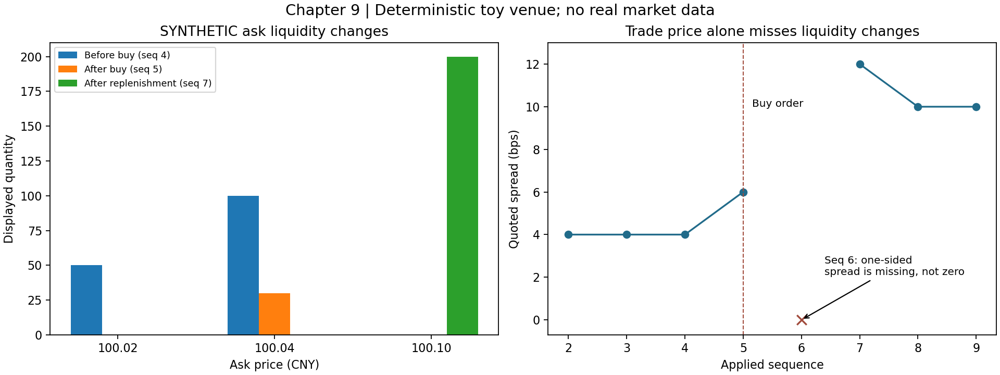

# 第二篇　金融市场与多资产建模

# 第9章　金融市场结构、参与者与交易机制

第一篇建立了处理数据、估计参数和分析时间序列的工具。本篇开始追问：数据中的价格究竟代表什么，价格由什么机制产生，不同资产的价格能否直接比较？

先考虑一种容易误判的情形：某资产最新成交价持续不变，但卖盘正在撤出。仅看收益率，市场似乎很平静；真正准备买入时，却可能已经没有报价。本章从交易制度和订单簿解释这种差异，为后续“价格状态、流动性状态、数据健康状态”分开建模提供基础。

本章全部数值实验均为 **SYNTHETIC人工教学数据**。EQ_DEMO、BOND_DEMO、GOLD_DEMO、FX_DEMO沿用全书命名，不代表真实证券、官方赛题数据或真实交易结果。统一撮合规则只是实验便利，不能说明股票、债券、黄金、外汇的实际交易制度相同。

## 学习目标与先修要求

先修内容包括字典与排序、异常处理、条件概率、期望与协方差，以及第8章的时间序列自相关。不了解真实交易操作的读者可以直接从本章开始。

完成本章后，应能：

1. 区分发行融资与已发行证券的转手，解释主要市场参与者承担的职能。
2. 按明确的价格和时间优先规则，手工与程序化处理限价单、市价单、部分成交和撤单。
3. 推导价差、成交均价、盘口不平衡及买卖价跳动对收益统计的影响。
4. 区分成交、清算和结算，并解释中央对手方与券款对付解决什么问题。
5. 在重复、乱序、序号缺口存在时重建教学订单簿，保留可审计的时间记录。
6. 说明本章实验距离生产级行情重建器还有哪些差距。

## 9.1 一级市场、二级市场与金融中介

### 9.1.1 金融市场交易的是什么

金融市场（Financial Market）是转移金融权利、配置资金和分担风险的一组制度与设施。一个金融资产通常对应某种现金流权利或条件性请求权：股票对应剩余索取权，债券通常对应约定的本金和利息支付请求权；衍生品的支付则取决于约定的标的变量。

“有价格”不等于“有固定现金流”。普通股分红不一定发生，债券可能违约，期货合约的价值和保证金也不能简单当作发行企业获得的融资。后续各章将逐一建立相应现金流模型。

金融市场至少提供四类功能：资金在不同时间之间配置，风险在参与者之间转移，分散信息通过交易进入价格，持有人在需要时转让资产。最后一种功能与**流动性（Liquidity）**有关。本章所说市场流动性，是在合理时间内，以较小价格让步完成一定规模交易的能力；它与机构能否及时筹到现金的**融资流动性（Funding Liquidity）**相关，但不是同一概念。

同一资产可以“每天有交易”，却无法承受大额卖出。因而流动性必须同时说明规模、时间和价格条件，不能仅用“是否成交”定义。

### 9.1.2 一级市场与二级市场的资金流

一级市场（Primary Market）涉及新证券的发行；二级市场（Secondary Market）涉及已发行证券的交易。决定分类的是**交易对象是否为新发行证券**，不是交易地点是否叫交易所。

假设一家教学公司新发100股，每股10元，发行费用20元。发行所得净额为：

```math
F_{mathrm{net}}=100\times10-20=980\quad\text{元}.
```

投资者甲取得20股，后来在二级市场以12元卖给乙，交易金额为240元。忽略费用，240元由乙支付给甲，公司在这次转手中没有直接收到现金，已发行股数也没有因此增加。

二级市场仍会间接影响融资：转手更便利可能降低投资者要求的流动性补偿；公开价格也会影响后续发行条件。但“股价上涨产生的市值增加”不等于公司银行账户收到等额现金。

另外，已上市企业增发新股仍属于发行融资。不能仅凭“不是首次上市”就把交易归为二级市场。[MIT金融理论课程的股票讲义](https://ocw.mit.edu/courses/15-401-finance-theory-i-fall-2008/1aea40b063cad5a335e980ecf30d84b7_MIT15_401F08_lec07.pdf)可用于建立这一基本区分；其中历史市场组织示例不应直接视为当前制度。

平台据此需要把发行、增发、回购、普通成交等事件分别建模。把发行数量增加当成普通成交量，会同时污染流动性特征和公司事件特征。

### 9.1.3 参与者按职能区分

|职能|英文名称|典型作用|监控平台关心的问题|
|---|---|---|---|
|发行人|Issuer|发行金融权利、履行相应义务|发行、分红、违约与信息披露|
|投资者|Investor|承担资产价格与现金流风险|持仓、风险暴露、赎回或资金需求|
|经纪商|Broker|代理客户提交或执行交易|订单路由、执行质量、客户隔离|
|交易商|Dealer|以自身账户作为交易对手|库存风险、资本约束、报价能力|
|做市商|Market Maker|按相应制度提供买卖报价|价差、深度、报价连续性|
|交易场所|Trading Venue|提供订单交互与成交规则|交易阶段、撮合规则、行情完整性|
|中央对手方|Central Counterparty，CCP|按制度介入交易对手关系并集中管理风险|保证金、违约管理、流动性需求|
|中央证券存管机构|Central Securities Depository，CSD|证券集中记录及相关结算服务|证券记录、交收与操作可靠性|
|托管机构|Custodian|保管资产并提供相关账户服务|资产记录、权益处理与对账|

这些是职能，不一定与法人一一对应。一个金融集团可能同时提供经纪、交易和托管服务，具体业务仍须分清代理关系、账户归属和风险承担者。

经纪商代理买入并不自动承担标的库存风险；交易商卖出自有库存则承担不同风险。把两者统一标成“交易机构”，会丢失解释流动性收缩所需的信息。

### 9.1.4 场内、场外与不同交易组织方式

场外市场（Over-the-Counter，OTC）通常通过交易商网络、双边协商或专门平台组织交易。场外不等于没有监管，也不等于一定没有电子系统或集中清算。

常见交易机制包括：

|机制|基本组织方式|优点与局限|数据后果|
|---|---|---|---|
|订单驱动|买卖订单按规则交互|可观察队列与竞争报价；大单可能暴露意图|需要订单、盘口和逐笔成交|
|报价驱动|客户与提供报价的交易商交易|可针对客户和规模报价；报价条件可能不同|指示性报价与可成交报价需区分|
|询价|Request for Quote，RFQ，向若干交易商询问指定交易条件|适合特定规模或不连续交易；可见范围有限|报价有对象、有效期与规模条件|
|集合竞价|在规定时点集中确定价格与成交量|汇集订单；结果对规则和阶段敏感|申报、指示价格、最终成交不可混为一类|

真实市场可能混合使用这些机制。不能把没有公开逐笔委托的债券询价市场，强行处理成股票全量订单簿；也不能把不同交易商针对不同规模的报价当成同质观测。

### 9.1.5 信息不对称为什么会产生价差

**市场微观结构（Market Microstructure）**研究交易规则、信息和参与者行为如何影响价格形成。下面建立一个可完全推导的两状态教学模型，用来解释买卖价差不只是“平台收费”。它体现Glosten与Milgrom研究中的逆向选择思想，但不是其完整模型的复现。[原始研究的作者机构页面](https://business.columbia.edu/faculty/research/bid-ask-and-transaction-prices-specialist-market-heterogeneously-informed-traders)提供了可核对的书目信息与摘要。

设资产最终价值为高值或低值：

```math
V=\begin{cases}
v_0+\Delta,&H,\\[0pt]
v_0-\Delta,&L,
\end{cases}
\qquad P(H)=P(L)=\frac12,\quad\Delta>0.
```

每次来单者以概率 $\mu$ 知道真实状态，以概率 $1-\mu$ 不知道。知情者在高值时买入、低值时卖出；不知情者买卖概率各为二分之一。暂不考虑不交易这一选项。

记买单事件为 $B$ 。高值状态下，知情者必买，不知情者一半买，因此：

```math
P(B\mid H)=\mu+(1-\mu)\frac12=\frac{1+\mu}{2}.
```

低值状态下知情者不买：

```math
P(B\mid L)=(1-\mu)\frac12=\frac{1-\mu}{2}.
```

全概率公式给出：

```math
P(B)=\frac{1+\mu}{2}\frac12+\frac{1-\mu}{2}\frac12=\frac12.
```

于是根据Bayes公式：

```math
P(H\mid B)=\frac{P(B\mid H)P(H)}{P(B)}=\frac{1+\mu}{2}.
```

假设竞争性交易商风险中性，没有库存成本、处理成本和最小报价单位约束，并要求每笔交易条件期望利润为零。交易商向买方出售时收取卖价 $a$ ，因此：

```math
0=E[a-V\mid B]\quad\Longrightarrow\quad a=E[V\mid B].
```

将后验概率代入：

```math
\begin{aligned}
a&=(v_0+\Delta)\frac{1+\mu}{2}+(v_0-\Delta)\frac{1-\mu}{2}\\[0pt]
 &=v_0+\mu\Delta.
\end{aligned}
```

对称地，交易商向卖方买入时支付买价 $b=v_0-\mu\Delta$ 。所以价差为：

```math
a-b=2\mu\Delta.
```

当中间价值100元、价值不确定幅度1元、知情者概率0.2时，模型给出买价99.8元、卖价100.2元，价差0.4元。

核心含义是：收到买单本身会改变交易商对资产价值的判断。在本模型中，信息风险更高会导致更宽价差。但真实价差还受库存、费用、最小报价单位、竞争和交易规模等影响。平台不能从一次价差扩大直接推断“发生内幕交易”，也不能把不可观测的知情者概率当成已经测量的事实。

## 9.2 订单簿、报价、成交、清算与结算

### 9.2.1 五种不同对象

**订单（Order）**是交易请求；**报价（Quote）**是特定条件下的买卖价格与数量信息；**成交（Trade/Execution）**是按规则达成的交易；**清算（Clearing）**包括确定和计算履约义务等环节；**结算或交收（Settlement）**是资金与证券等实际转移并完成相应义务的过程。

收到“订单已受理”不表示已经成交；成交回报不表示证券和现金已经最终交收。监控平台应使用明确事件类型，而不是一个含混的“成功”状态。

### 9.2.2 价格单位、数量单位与订单属性

最小报价变动单位称为 **Tick Size**。若教学股票每个价格刻度为0.01元，99.98元保存为整数9998。整数价格避免二进制浮点数让本应相同的价格进入不同队列。

价格刻度、最小申报数量、合约乘数和币种是不同字段。例如衍生品的名义金额可能还需要乘以合约乘数；债券报价还可能采用每百元面值等口径。缺少这些元数据，跨资产深度相加没有经济意义。

限价单（Limit Order，LMT）规定价格边界：买单只接受不高于限价的成交价，卖单只接受不低于限价的成交价。它保护价格条件，但不保证成交。

市价单（Market Order，MKT）优先寻求成交，不能保证最终成交价格等于最新价或提交时的最优报价。实际场所可能设置价格保护、档位范围等限制。美国SEC投资者教育材料也明确区分了市价单的价格不确定性与限价单的成交不确定性。[SEC订单基础说明](https://www.investor.gov/sites/default/files/trading101basics.pdf)

订单类型与有效期不能混为一谈。立即成交否则撤销（Immediate-or-Cancel，IOC）允许先成交一部分，再取消剩余部分；全部成交否则撤销（Fill-or-Kill，FOK）要求满足完整成交条件，否则不成交。本章程序只把教学市价单设计为扫过可见对手盘后取消余额，不实现FOK。

### 9.2.3 连续竞价的价格与时间优先

限价订单簿（Limit Order Book，LOB）记录尚未完成的订单。连续竞价在订单到达时尝试撮合。教学规则如下：更优价格优先；同价订单按场所接受的序号先后成交。

买单面对卖盘时，排序键为“价格升序、序号升序”；卖单面对买盘时，排序键为“价格降序、序号升序”。网络接收时间不能替代场所优先级，因为早进入交易所的订单可能晚到监控系统。

下表是本章股票示例在序号4之后的盘口；买方有80股挂在99.98元。

|卖单ID|进入序号|卖价/元|剩余数量|
|---|---:|---:|---:|
|A1|2|100.02|30|
|A2|3|100.02|20|
|A3|4|100.04|100|

到达一个120股市价买单。先与A1成交30，再与A2成交20，剩余70与A3成交。成交均价不是最后一笔100.04元，而是成交量加权平均价格（Volume-Weighted Average Price，VWAP）：

```math
\bar p=\frac{\sum_j p_jq_j}{\sum_jq_j}
=\frac{100.02\times30+100.02\times20+100.04\times70}{120}
=100.031666\ldots.
```

这里是同一个母订单各笔成交的加权均价，不应与整日市场VWAP混淆。A3还剩30股，并继续保留其原始队列位置。

如果这笔订单改成100.02元限价买单，在本例会成交50股，余下70股挂为买单。主动穿过盘口的限价单也会消耗流动性；“限价单永远提供流动性、市价单永远代表知情交易”都是错误概括。

教学程序的部分撤单保留原优先级；修改价格或增加数量如何影响优先级则依赖真实规则。本章不实现订单修改。

### 9.2.4 集合竞价：价格由一组订单共同决定

对候选价格 $p$ ，定义能够接受该价格的累计买量与卖量：

```math
D(p)=\sum_{i\in\mathcal B}q_i\mathbf 1\lbrace l_i\ge p\rbrace,
\qquad
S(p)=\sum_{j\in\mathcal S}q_j\mathbf 1\lbrace l_j\le p\rbrace.
```

其中限价为 $l$ ，数量为 $q$ 。可匹配成交量为：

```math
Q(p)=\min\lbrace D(p),S(p)\rbrace.
```

它不是买量与卖量之和：买卖双方各100股对应成交100股，而非200股。

本章自定义规则DEMO_CALL_V1：在订单价格和参考价格组成的候选集合中，先最大化成交量，再最小化买卖剩余不平衡，再选择离参考价最近者，仍相同时取较低价格。此规则用于演示确定性选择，**不是某家交易所规则的完整实现**，也未实现最终订单间的数量分配。

买单为100.02元80股、100元70股；卖单为99.98元60股、100元90股，参考价100元。计算如下：

|候选价格/元|累计买量|累计卖量|可成交量|数量不平衡绝对值|
|---:|---:|---:|---:|---:|
|99.98|150|60|60|90|
|100.00|150|150|150|0|
|100.02|80|150|80|70|

因此教学出清价格为100元，成交量150股。连续竞价的“当前最优报价”与集合竞价阶段的“指示性出清价格”含义不同，不能直接拼接成同一观测字段。

### 9.2.5 清算、净额与交收

对价格为 $p$ 、数量为 $q$ 的交易，买方证券义务变化为正，现金义务变化为负。以方向 $s=1$ 表示买入、 $s=-1$ 表示卖出：

```math
\Delta H=sq,\qquad\Delta C=-spq.
```

同一交易双方在忽略费用的封闭系统内满足证券和现金守恒。这里的变化先表示待履行义务，不能在尚未交收时冒充已到账资产。

考虑三笔同一证券、同一币种、同一交收日、价格均为10元的交易：A向B买100股，B向C买80股，C向A买50股。

|参与者|净证券义务/股|净现金义务/元|
|---|---:|---:|
|A|100−50＝50|−1000＋500＝−500|
|B|80−100＝−20|−800＋1000＝200|
|C|50−80＝−30|−500＋800＝300|

逐笔付款金额合计2300元；在适用的多边净额安排下，净付款方A合计支付500元，分别对应净收款义务。减少交收金额不等于消灭风险，也不能任意跨币种、跨日期或跨法律主体抵销。净额安排需要相应法律与业务基础。

中央对手方可通过相应法律机制介入交易双方关系并集中管理风险。保证金、违约基金、头寸处置等机制需要资源，压力期保证金需求增加本身可能加重融资流动性压力。CCP不是“让违约不再可能”的装置。

券款对付（Delivery versus Payment，DvP）将证券最终交付与资金最终支付相联系，以控制本金风险。它不自动消除所有市场、流动性和操作风险。BIS与IOSCO的金融市场基础设施原则，尤其原则12，是理解这一点的权威入口。[金融市场基础设施原则概览](https://www.bis.org/committees/cpmi/pfmi/overview)

结算周期中的“T加若干工作日”还依赖业务日历，不等于固定若干秒；可交易、可交收、可提取资金也可能对应不同限制。监控模型要分别记录交易日、预计交收日、实际完成时间和失败状态。

## 9.3 交易机制对监控指标的影响

### 9.3.1 价差、深度与盘口不平衡

设同一有效订单簿的最优买价为 $b_t$ ，最优卖价为 $a_t$ ，且两侧均存在。中间价与报价价差定义为：

```math
m_t=\frac{a_t+b_t}{2},\qquad S_t=a_t-b_t.
```

中间价不是保证可成交的价格。跨资产比较时可使用相对价差，以基点（Basis Point，bp）表示，一个基点等于万分之一：

```math
S_t^{\mathrm{bps}}=10^4\frac{a_t-b_t}{m_t}.
```

99.98元与100.02元的盘口，中间价100元，价差0.04元，即4基点。

盘口深度（Depth）衡量指定价格范围内可见数量。前若干档名义深度可以计算为各档价格乘数量之和；但跨资产比较还必须统一币种、乘数和报价单位。可见深度也不包括所有隐藏订单与潜在交易意愿。

设买一数量为 $Q_b$ 、卖一数量为 $Q_a$ ，顶部盘口不平衡定义为：

```math
I=\frac{Q_b-Q_a}{Q_b+Q_a}.
```

当分母为正且数量非负时，绝对值不超过1。因为买卖数量差的绝对值不超过两者之和，直接相除即得。买一80、卖一合计50时，不平衡为30/130，约0.2308。

这不是“上涨概率23.08%”。撤单、隐藏量、订单规模和交易阶段都会影响其解释。卖盘全部消失时，本章将中间价、价差和双边不平衡标为缺失，并输出ONE_SIDED；不把它填成零价差。

### 9.3.2 执行成本、有效价差与事后分解

给定下单决策时的有效中间价 $m_0$ ，买入均价为 $\bar p$ ，已成交数量为 $Q$ ，忽略费用时，已成交部分相对基准的成本为：

```math
C=Q(\bar p-m_0),\qquad
C^{\mathrm{bps}}=10^4\frac{\bar p-m_0}{m_0}.
```

本例成本为3.8元，即约3.1667基点。若有未成交量，其机会成本还需另行定义；上述公式不是完整的执行落差评估体系，也未包含税费。

单笔成交方向用 $s_t=1$ 表示主动买入， $s_t=-1$ 表示主动卖出。以成交前中间价为基准，价格单位的有效价差（Effective Spread）定义为：

```math
ES_t=2s_t(p_t-m_t).
```

乘以2，是把单边相对中间价的让步换算成双边价差尺度。若恰好在最优买卖价成交且盘口对称，这个数与报价价差一致。

若进一步选定事后时间间隔 $h$ ，可以分解为已实现价差与中间价变化项：

```math
\begin{aligned}
RS_{t,h}&=2s_t(p_t-m_{t+h}),\\[0pt]
PI_{t,h}&=2s_t(m_{t+h}-m_t),\\[0pt]
ES_t&=RS_{t,h}+PI_{t,h}.
\end{aligned}
```

最后一个等式只需将右侧展开，中间价的未来项相消即可。它是记账式分解，不证明中间价变化由该交易因果导致。

未来中间价在交易当时尚不可得，所以事后已实现价差不能直接作为当时在线识别的输入。若成交方向是算法推断而不是场所提供，必须记录推断方法和不确定性。使用过期盘口作基准也会歪曲结果。

### 9.3.3 买卖价跳动为什么会制造负自相关

第8章提醒我们：统计现象需要结合数据生成机制解释。现在给出一个完整例子。

设潜在中间价值是随机游走：

```math
M_t=M_{t-1}+u_t,
```

其中创新零均值、方差为 $\sigma_u^2$ ，不同期不相关。观察到的成交价为：

```math
P_t=M_t+cq_t,
```

常数 $c$ 为半价差；方向变量 $q_t$ 独立同分布，取正负1的概率各半，并与所有创新独立。因此方向变量均值0、方差1。

价格变化为：

```math
\Delta P_t=u_t+c(q_t-q_{t-1}).
```

计算相邻价格变化的协方差。创新相关项及创新与方向交叉项均为零，剩下：

```math
\begin{aligned}
\mathrm{Cov}(\Delta P_t,\Delta P_{t-1})
&=c^2E[(q_t-q_{t-1})(q_{t-1}-q_{t-2})]\\[0pt]
&=c^2\big(E[q_tq_{t-1}]-E[q_tq_{t-2}]
-E[q_{t-1}^2]+E[q_{t-1}q_{t-2}]\big)\\[0pt]
&=c^2(0-0-1+0)=-c^2.
\end{aligned}
```

同时，两个相邻方向变量独立，所以：

```math
\mathrm{Var}(\Delta P_t)=\sigma_u^2+2c^2,
\qquad
\rho_1=\frac{-c^2}{\sigma_u^2+2c^2}.
```

即使潜在价值没有可预测的反转，成交价变化也能产生负的一阶自相关。这种买卖价跳动称为 **Bid-Ask Bounce**。

在上述强假设下，双边价差可以由负协方差反推：

```math
S=2c=2\sqrt{-\mathrm{Cov}(\Delta P_t,\Delta P_{t-1})}.
```

这是理解Roll隐含价差估计思想的简化推导。[Roll原始论文](https://onlinelibrary.wiley.com/doi/10.1111/j.1540-6261.1984.tb03897.x)是进一步阅读入口。若样本协方差非负，本式不能产生实数估计，应报告假设不适配或估计不可用，不能不加说明地截成零并声称市场无交易成本。

实际方向有持续性、价差时变、价格有信息冲击，都会破坏上述等式。这里使用的是价格差，不是对数收益；迁移公式时还必须检查量纲。

### 9.3.4 交易阶段与数据质量是状态解释的一部分

连续竞价、集合竞价、临时停牌、收盘后时段等阶段的指标可比性不同。没有成交可能表示正常非交易时段，也可能表示流动性不足或数据断流。

规则应记录适用资产、场所、版本、公布时间、生效时间和具体条款状态。上交所2026年修订通知注明整体施行日期，也列出继续暂缓实施的条款；因此不能只保存一个“2026版”标签就假设所有条款同时启用。[上交所2026年交易规则修订通知](https://www.sse.com.cn/lawandrules/sselawsrules2025/trade/universal/c/c_20260424_10816492.shtml)

本章只核对了该通知，不把未逐条核验的附件实现成真实撮合规则。涨跌幅、申报类型、价格保护、停牌和交易日历应在后续接入具体数据源时逐项核验。

如果上一笔成交发生于一小时前，今天这一小时的末值填充会制造大量零收益。对估值展示可以显示“最近成交价及其年龄”，但训练波动率模型前必须区分真实观测、填充值和非交易时间。

### 9.3.5 时间字段与重建有效性

|字段|含义|用途|
|---|---|---|
|event_at|源端事件发生时间|分析经济事件顺序|
|published_at|源端对外发布时间|区分发生与公开|
|received_at|本系统第一次收到该消息的时间|判断信息何时进入本系统|
|computed_at|依赖满足后完成应用的时间|判断派生指标何时可用|
|channel/session/seq|通道、会话、序号|重建源端规定的事件顺序|
|source/rules/schema版本|来源、制度和字段约定|支持重放与变更审计|

生产系统还需要记录持久化与服务发布时间，时钟精度和同步误差也不能忽略。本章用同一人工时钟，规定发生不晚于发布、发布不晚于接收；真实跨机器时间戳不一致时应记录质量问题，不能随意改时间让顺序“看起来正确”。

假设序号4先到，序号3尚未到。即使4的内容合法，也不能把它直接应用为已经连续重建的完整盘口：3可能是一笔撤单或成交，改变4的解释。

实验采用“缓存乱序消息，缺口期间不发布可用盘口，补齐后按序应用”。3在4.2时刻补到时，4虽然在4.1时刻已被接收，其正确应用结果也只能在4.2之后使用。离线将结果回填到4.1会造成时间泄漏。

相同序号与相同内容的重复消息可以幂等忽略；相同序号而内容不同不能当成普通重复，必须触发错误和恢复流程。仅按时间戳排序既不能解决这个冲突，也不能代替通道序号。

### 9.3.6 从指标到市场状态

建议在状态体系中至少保留三个独立维度：

|维度|可用证据|不能直接推出的结论|
|---|---|---|
|价格状态|经质量控制的收益、波动、跨资产共变|收益为零不等于市场安全|
|流动性状态|价差、深度、成交规模、撤单与恢复|深度大不保证大单执行成本低|
|数据健康状态|缺口、陈旧、重复、时钟异常、重连状态|数据失真不能直接当经济危机|

本章没有训练“市场危机识别器”。它建立的是金融含义正确的观测层，供后续统计模型使用。把ONE_SIDED显示为“卖侧报价不可用”有直接证据；把它自动解释成“即将暴涨”则需要另一个可验证的预测模型。

## 9.4 完整实验：订单簿撮合、行情重放与流动性监控

### 9.4.1 实验边界与输入输出

本实验先实现一个教学撮合场所，再重放它接收的人工订单命令。它不是把真实交易所订单增量格式直接接入现成交易系统。

输入包括四项资产的15条命令，其中一条负数量命令应被拒绝；乱序与重复使接收记录达到16条。输出包括到达日志、应用日志、审计日志、盘口快照和带哈希的运行清单。

核心分为两层：Book处理金融状态转移；Receiver处理序号、重复、缺口和时间可用性。这样可以分别测试“撮合错了”还是“消息处理错了”。

依赖只有Python标准库，可直接使用已安装的Anaconda。在教材code/ch09目录运行：

```powershell
& 'D:\Anaconda\python.exe' -X utf8 market_lab.py
& 'D:\Anaconda\python.exe' -X utf8 -m unittest -v test_market_lab.py
```

主程序如下，与[独立源文件](./code/ch09/market_lab.py)保持一致。

```python
"""SYNTHETIC continuous order book and sequenced feed, standard library only."""
from copy import deepcopy
from datetime import datetime, timezone
from pathlib import Path
import hashlib
import json
import math
import platform

ASSETS = ("EQ_DEMO", "BOND_DEMO", "GOLD_DEMO", "FX_DEMO")


def positive_int(value):
    return type(value) is int and value > 0


def canonical(value):
    return json.dumps(value, sort_keys=True, separators=(",", ":"), allow_nan=False)


class Book:
    def __init__(self):
        self.orders = {}
        self.used_ids = set()
        self.trades = []

    def levels(self, side):
        totals = {}
        for order in self.orders.values():
            if order["side"] == side:
                price = order["price"]
                totals[price] = totals.get(price, 0) + order["qty"]
        return sorted(totals.items(), reverse=(side == "B"))

    def quote(self):
        bids, asks = self.levels("B"), self.levels("S")
        if not bids or not asks:
            return {"status": "EMPTY" if not bids and not asks else "ONE_SIDED", "bid": bids[0][0] if bids else None,
                    "ask": asks[0][0] if asks else None, "mid": None,
                    "spread_bps": None, "imbalance": None}
        bid, qb = bids[0]
        ask, qa = asks[0]
        assert bid < ask
        mid = (bid + ask) / 2
        return {"status": "TWO_SIDED", "bid": bid, "ask": ask, "mid": mid,
                "spread_bps": (ask - bid) / mid * 10000,
                "imbalance": (qb - qa) / (qb + qa)}

    def apply(self, event):
        action, oid, qty = event.get("action"), event.get("order_id"), event.get("qty")
        if not isinstance(oid, str) or not oid or not positive_int(qty):
            raise ValueError("Invalid order ID or positive integer quantity")
        if action == "CANCEL":
            if oid not in self.orders or qty > self.orders[oid]["qty"]:
                raise ValueError("Unknown order or cancellation exceeds remaining quantity")
            self.orders[oid]["qty"] -= qty
            if self.orders[oid]["qty"] == 0:
                del self.orders[oid]
            return {"action": action, "cancelled": qty, "trades": []}
        side, kind, price = event.get("side"), event.get("kind"), event.get("price")
        if action != "NEW" or side not in ("B", "S") or kind not in ("LMT", "MKT"):
            raise ValueError("Unsupported order type")
        if oid in self.used_ids:
            raise ValueError("Order ID cannot be reused")
        if (kind == "LMT" and not positive_int(price)) or (kind == "MKT" and price is not None):
            raise ValueError("Limit price must be integer ticks; market price must be null")
        # Validate before mutating the book.
        self.used_ids.add(oid)
        opposite = [o for o in self.orders.values() if o["side"] != side]
        opposite.sort(key=lambda o: (o["price"] if side == "B" else -o["price"], o["seq"]))
        remaining, fills = qty, []
        for maker in opposite:
            if not remaining:
                break
            crosses = kind == "MKT" or (price >= maker["price"] if side == "B" else price <= maker["price"])
            if not crosses:
                break
            amount = min(remaining, maker["qty"])
            fill = {"seq": event["seq"], "maker": maker["order_id"], "taker": oid,
                    "side": side, "price": maker["price"], "qty": amount}
            fills.append(fill)
            maker["qty"] -= amount
            remaining -= amount
            if maker["qty"] == 0:
                del self.orders[maker["order_id"]]
        self.trades.extend(fills)
        resting = remaining if kind == "LMT" else 0
        if resting:
            self.orders[oid] = {"order_id": oid, "side": side, "price": price,
                                "qty": resting, "seq": event["seq"]}
        assert qty == sum(f["qty"] for f in fills) + resting + (remaining - resting)
        return {"action": action, "filled": qty - remaining,
                "resting": resting, "expired": remaining - resting, "trades": fills}


class Receiver:
    """One global demo sequence. Real feeds usually require channel/session keys."""
    def __init__(self):
        self.books = {s: Book() for s in ASSETS}
        self.expected, self.last_receive = 1, -1.
        self.seen, self.pending, self.applied, self.audit = {}, {}, [], []

    def receive(self, event, received_at):
        times = (event["event_at"], event["published_at"], received_at)
        if any(type(t) not in (int, float) or not math.isfinite(t) for t in times):
            raise ValueError("Times must be finite numbers")
        if received_at < self.last_receive or received_at < event["published_at"]:
            raise ValueError("Arrival precedes previous arrival or publication")
        seq = event["seq"]
        if not positive_int(seq) or event["event_at"] > event["published_at"]:
            raise ValueError("Invalid sequence or event/publication order")
        fingerprint = canonical(event)
        if seq in self.seen:
            if self.seen[seq] != fingerprint:
                raise ValueError("Conflicting payload for an existing sequence")
            self.last_receive = received_at
            self.audit.append({"seq": seq, "received_at": received_at, "status": "DUPLICATE"})
            return
        if seq < self.expected or seq - self.expected > 50:
            raise ValueError("Sequence outside the bounded recovery window")
        self.last_receive = received_at
        self.seen[seq] = fingerprint
        self.pending[seq] = (deepcopy(event), received_at)
        self.audit.append({"seq": seq, "received_at": received_at, "status": "RECEIVED"})
        while self.expected in self.pending:
            item, first_received = self.pending.pop(self.expected)
            symbol = item["symbol"]
            try:
                if symbol not in self.books:
                    raise ValueError("Unknown asset")
                outcome = self.books[symbol].apply(item)
                status, reason = "APPLIED", None
            except ValueError as error:
                outcome, status, reason = {}, "REJECTED", str(error)
            self.applied.append({"seq": self.expected, "symbol": symbol,
                                 "event_at": item["event_at"], "published_at": item["published_at"],
                                 "received_at": first_received, "computed_at": received_at,
                                 "status": status, "reason": reason, **outcome,
                                 "quote": self.books[symbol].quote() if symbol in self.books else None})
            self.expected += 1

    def snapshot(self):
        # Any pending event implies a gap in this single global feed.
        gap = bool(self.pending)
        return {"as_of_receive": self.last_receive, "last_contiguous_seq": self.expected - 1,
                "feed_status": "GAP" if gap else "CONTIGUOUS",
                "quotes": None if gap else {s: b.quote() for s, b in self.books.items()}}


def call_auction(buys, sells, reference):
    """Toy rule: max volume, min imbalance, nearest reference, then lower tick."""
    if not positive_int(reference) or any(not positive_int(p) or not positive_int(q)
                                          for p, q in buys + sells):
        raise ValueError("Auction prices and quantities must be positive integers")
    candidates = sorted({reference} | {p for p, _ in buys + sells})
    rows = []
    for p in candidates:
        demand = sum(q for price, q in buys if price >= p)
        supply = sum(q for price, q in sells if price <= p)
        rows.append({"price": p, "demand": demand, "supply": supply,
                     "volume": min(demand, supply), "imbalance": abs(demand - supply)})
    best = min(rows, key=lambda r: (-r["volume"], r["imbalance"], abs(r["price"] - reference), r["price"]))
    return {"rule": "DEMO_CALL_V1", "price": best["price"] if best["volume"] else None,
            "volume": best["volume"], "candidates": rows}


def demo_events():
    events = []
    def add(symbol, action, oid, qty, side=None, price=None, kind="LMT"):
        seq = len(events) + 1
        events.append({"source": "SYNTHETIC", "symbol": symbol, "seq": seq,
                       "event_at": float(seq), "published_at": seq + .01,
                       "action": action, "order_id": oid, "qty": qty,
                       "side": side, "price": price, "kind": kind})
    add("EQ_DEMO", "NEW", "B1", 80, "B", 9998)
    add("EQ_DEMO", "NEW", "A1", 30, "S", 10002)
    add("EQ_DEMO", "NEW", "A2", 20, "S", 10002)
    add("EQ_DEMO", "NEW", "A3", 100, "S", 10004)
    add("EQ_DEMO", "NEW", "M1", 120, "B", kind="MKT")
    add("EQ_DEMO", "CANCEL", "A3", 30)
    add("EQ_DEMO", "NEW", "A4", 200, "S", 10010)
    add("EQ_DEMO", "NEW", "B2", 100, "B", 10000)
    add("EQ_DEMO", "NEW", "BAD", -5, "S", 10012)
    for symbol, bid, ask in [("BOND_DEMO", 9999, 10001),
                              ("GOLD_DEMO", 19995, 20005), ("FX_DEMO", 69999, 70001)]:
        add(symbol, "NEW", symbol + "B", 100, "B", bid)
        add(symbol, "NEW", symbol + "S", 100, "S", ask)
    return events


def main():
    events = demo_events()
    receiver, snapshots, arrivals = Receiver(), [], []
    # Sequence 4 arrives before 3; the first copy of 3 arrives at 4.2.
    schedule = [(1, 1.1), (2, 2.1), (4, 4.1), (3, 4.2), (3, 4.3)]
    schedule += [(i, i + .1) for i in range(5, len(events) + 1)]
    for seq, arrival in schedule:
        event = events[seq - 1]
        arrivals.append({"received_at": arrival, "event": event})
        receiver.receive(event, arrival)
        snapshots.append(receiver.snapshot())
    fills = receiver.books["EQ_DEMO"].trades
    total = sum(f["qty"] for f in fills)
    vwap = sum(f["price"] * f["qty"] for f in fills) / total
    summary = {"source": "SYNTHETIC", "events": len(events), "arrivals": len(arrivals),
               "applied": sum(r["status"] == "APPLIED" for r in receiver.applied),
               "rejected": sum(r["status"] == "REJECTED" for r in receiver.applied),
               "duplicates": sum(r["status"] == "DUPLICATE" for r in receiver.audit),
               "fills": fills, "vwap_ticks": vwap, "buy_cost_bps": (vwap / 10000 - 1) * 10000,
               "auction": call_auction([(10002, 80), (10000, 70)],
                                        [(9998, 60), (10000, 90)], 10000),
               "final_snapshot": receiver.snapshot()}
    out = Path(__file__).parent / "runs" / datetime.now(timezone.utc).strftime("run_%Y%m%dT%H%M%S_%fZ")
    out.mkdir(parents=True, exist_ok=False)
    for name, rows in [("arrivals", arrivals), ("applied", receiver.applied),
                       ("audit", receiver.audit), ("snapshots", snapshots)]:
        (out / (name + ".jsonl")).write_text("".join(canonical(r) + "\n" for r in rows), encoding="utf-8")
    manifest = {"python": platform.python_version(), "rules": "DEMO_CONTINUOUS_V1",
                "price_unit": "integer tick; EQ_DEMO tick=0.01 CNY, other assets illustrative",
                "summary": summary, "sha256": {p.name: hashlib.sha256(p.read_bytes()).hexdigest()
                     for p in [Path(__file__), *sorted(out.glob("*.jsonl"))]}}
    (out / "manifest.json").write_text(json.dumps(manifest, ensure_ascii=False, indent=2,
                                                 allow_nan=False), encoding="utf-8")
    print(out.resolve())
    print(json.dumps(summary, ensure_ascii=False, indent=2))


if __name__ == "__main__":
    main()
```

### 9.4.2 核心实现机制

Book先验证订单字段再改变状态。价格保存为整数刻度；成交数量与剩余数量都是整数。新单的原始数量必须等于已成交数量、挂单数量和取消余额之和。部分成交只减少剩余量，同价队列仍按原序号排列。

每个订单ID在本次进程生命周期中只能使用一次，避免已完成订单与新订单混淆。真实系统通常使用账户、场所、交易日、会话等复合键，不能把这个简化规则机械移植。

Receiver保存消息内容的规范化序列化结果，用来区分相同消息重发与序号冲突。本例没有用哈希代替完整比较，因此没有在去重逻辑中引入哈希碰撞假设。文件哈希则用于产物完整性核对。

乱序容忍窗口限定为向前50个序号；缺口未补齐时snapshot的quotes为null。这个缓冲界限不能代替超时：如果缺失消息永远不来，生产系统必须超时告警、请求补包或重新获取有序号基准的快照。

CONTIGUOUS只表示当前收到的消息没有已知序号缺口，不证明行情仍然新鲜。系统刚启动但没收到消息，或者源端已经停止发送，也可能没有“已知缺口”；还需心跳、源端时间、最后更新时间和订阅状态。

此教学接收器收到非法订单命令时记录REJECTED并消耗序号，因为源端可以对一个合法编号的非法请求给出拒绝结果。若处理的是真实交易所已经成交的行情增量，遇到无法解析的有效增量通常必须判重建失效并重新同步，不能照搬“拒绝后继续”的政策。

### 9.4.3 实际运行结果与解释

本章在既有Anaconda Python 3.13.5中实际运行，未安装库。确定性实验得到：

|项目|结果|
|---|---:|
|不同序号命令|15|
|到达次数|16|
|成功应用|14|
|拒绝命令|1|
|识别出的完全重复|1|
|股票成交笔数|3|
|股票成交数量|120|
|股票成交均价/元|100.0316666667|
|相对100元中间价的买入成本/基点|3.1666666667|
|集合竞价示例价格/元|100.00|
|集合竞价示例数量|150|

序号4先到达时输出GAP；序号3在4.2时刻到达后，按3、4顺序恢复。4的接收时间保留为4.1，计算应用时间为4.2。随后重复的3不再次增加卖单数量。

序号5的120股买单消耗卖盘，报价价差从4基点扩大到约5.9994基点。序号6撤销A3剩余30股后，卖侧为空。最后成交价仍是100.04元，但平台已不能计算双边价差。

序号7在100.10元补入200股卖单，序号8在100元增加100股买单。最终股票买卖价为100和100.10元，中间价100.05元，价差约9.9950基点，顶部不平衡为负三分之一。



图左按教学订单逐项计算三个时点的卖侧深度；图右读取实际应用日志中的价差。红叉画在零刻度处只用于定位序号6的缺失事件，旁边明确标注“缺失，不是零”，折线在这里断开。图不是实时行情，也不是模型性能图。

其他三项资产只建立双边报价，最终相对价差分别为2、5、约0.2857基点。由于数量单位、资产风险和真实场所机制没有校准，不能由这些人工数值评价哪类真实资产流动性最好。

### 9.4.4 工程复杂度、测试与替代方案

当前每次撮合重新扫描并排序对手订单。若订单数为 $n$ ，候选排序需要约 $O(n\log n)$ ，盘口聚合还需要遍历订单。它便于理解，不适合直接承载高频生产流量。

可替代为“有序价格层＋每价FIFO队列＋订单ID索引”。找到最佳价格后沿队列消费，撤单通过索引定位。具体复杂度还取决于有序映射实现、删除方式和缓存布局；不能仅把列表换成字典便宣称所有操作都为常数时间。

状态内存也有限制：订单ID集合、去重表、成交记录在本例中随历史增长。生产系统需要基于会话边界、安全重放范围和持久化策略设计保留与清理，不能删除仍可能参与去重的记录。

配套[12项测试](./code/ch09/test_market_lab.py)覆盖价格优先、同价时间优先、不交叉限价挂单、市价余额取消、部分撤单、非法字段不改变订单簿、ID重用、缺口与时间可用性、重复冲突、非法时间、确定性重放、数量守恒、单边盘口和集合竞价边界。这些检查已执行通过；它们不是吞吐性能测试。

生产扩展还需解决：

|问题|本章做法|后续需要|
|---|---|---|
|持久化与恢复|结束时写JSONL|日志、状态与消费位点的一致恢复|
|快照与增量|从空簿顺序构造|快照基准序号、增量桥接、补包|
|多通道|一个全局教学序号|按场所、会话、通道管理序列|
|异常恢复|冲突抛错，调用方停止|显式不健康状态、隔离、重新同步|
|权限与风控|不连接真实账户|认证授权、额度、审计与密钥隔离|
|时间与新鲜度|人工单时钟|时钟误差、心跳、延迟分布、陈旧阈值|
|金融完整性|撮合与指标|真实制度、费用、权益、清算交收|

特别地，程序未实现事务式Checkpoint、进程崩溃恢复或端到端Exactly-once。一次无重复的实验输出不能证明分布式系统具有精确一次语义。后续分布式篇将把这些要求落实为架构与故障测试。

## 本章总结

市场数据是制度运行的结果。发行融资与证券转手、订单与成交、成交与交收，分别回答不同问题。价格和时间优先、集合竞价及交易商报价，会产生不同的数据结构和观测限制。

价差可反映信息风险，也受库存、规则、费用和竞争影响；价格变化的负自相关也可能来自买卖价跳动。指标必须结合生成机制解释，不能把统计模式直接命名为可交易规律。

对竞赛平台，本章最关键的产出是可审计的观测层：保留价格与数量单位、交易阶段、序号、时间可用性和数据健康状态，再把有效指标交给后续市场状态模型。

## 分层练习题

### 题1　基础理解：融资与转手

公司新发200股，每股8元，发行费用40元。投资者后来转手其中50股，每股9元。求公司发行净融资额、转手金额，并判断转手是否增加公司现金和股数。

### 题2　基础理解：职能与风险

比较经纪商、交易商、CCP和CSD的作用。说明为什么“存在CCP”不能推出没有流动性风险。

### 题3　数学推导：信息价差

沿用9.1.5的假设，设中间价值50元、价值不确定幅度2元、知情者概率0.1。逐步求买单后的高值后验概率、卖价、买价与价差。指出两个会改变结果的现实因素。

### 题4　手工撮合与编程

卖盘依次为A1：100.02元30股，A2：100.02元20股，A3：100.04元100股。分别处理120股市价买单与120股、限价100.02元的买单，求成交顺序、均价、剩余订单。用Book复核。

### 题5　集合竞价

重算9.2.4的候选价格表，并解释为什么成交量不应双计。若最高可成交量为零，程序为何不返回一个看似有效的成交价格？

### 题6　清算与守恒

重算9.2.5三方证券及现金净义务，验证总和为零。说明为什么不能直接把不同交收日的义务合并净额。

### 题7　指标计算与量纲

某时点买价99.98元、卖价100.02元，买一80股、卖一50股。求中间价、绝对价差、基点价差、顶部不平衡。买入120股均价100.0316666667元，相对该中间价的已成交成本是多少？

### 题8　数学推导：买卖价跳动

在9.3.3模型中设半价差0.02元、潜在价值创新标准差0.01元。计算相邻价格变化协方差、价格变化方差及一阶自相关。如果样本协方差为正，应该如何报告隐含价差？

### 题9　时间安全与重放

序号4在4.1时刻先到，序号3在4.2时刻后到。为什么序号4应用结果的可用时间不能写成4.1？分别写出4.1时刻与4.2时刻的对外盘口政策。

### 题10　编程：幂等与冲突

写程序验证三件事：重复同一消息不改变挂单数量；同序号不同内容触发错误；负数量订单不改变Book。解释为什么捕获错误后继续发布旧盘口可能危险。

### 题11　金融分析：平静还是异常

过去十分钟成交价未变，买盘深度下降80%，卖盘间歇性缺失，同时行情通道有序号缺口。请设计调查顺序，区分价格状态、流动性状态与数据健康状态，不直接给出涨跌预测。

### 题12　开放工程设计

将本章系统扩展为两个交易场所、四项资产、多个行情通道的监控服务。给出主键、快照恢复、时钟处理、指标可用性和告警方案，并说明如何验收。

## 详细参考答案

### 题1答案

发行总收入为1600元，减去40元费用，净融资1560元。转手金额为450元，由买方向原持有人支付，忽略其他事件，公司现金不增加，已发行股数也不增加。解释资金流向比只算乘法更重要。

### 题2答案

经纪商主要代理交易；交易商以自身账户交易并承担相关库存风险；CCP按制度介入交易对手关系、集中管理信用等风险；CSD承担证券集中记录及相关结算服务。CCP要求追加保证金或处置头寸时，参与者仍需要现金和可变现资产，所以集中清算不消除融资需求。

### 题3答案

高值时买单概率0.55，低值时买单概率0.45。高低先验各半，因此买单总概率0.5；Bayes公式给出高值后验0.55。卖价是52乘0.55加48乘0.45，等于50.2元；对称买价为49.8元，价差0.4元。

库存风险与订单处理成本都会改变报价；最小价格刻度可能使最优理论报价无法直接报出。若知情者交易方向不再确定、投资者允许不交易，后验也必须重算。

### 题4答案

市价单成交顺序为A1的30股、A2的20股、A3的70股；总金额12003.8元，除以120得到100.0316666667元。A3剩30股。限价100.02元的买单只成交50股，均价100.02元，余70股挂在买侧100.02元，A3不动。

可执行复核如下。在code/ch09目录运行，输入采用整数价格刻度：

```python
from market_lab import Book, demo_events

for kind, price in [("MKT", None), ("LMT", 10002)]:
    book = Book()
    for event in demo_events()[:4]:
        book.apply(event)
    result = book.apply({"seq": 5, "action": "NEW", "order_id": "CHECK",
                         "qty": 120, "side": "B", "kind": kind, "price": price})
    quantity = sum(t["qty"] for t in result["trades"])
    vwap = sum(t["price"] * t["qty"] for t in result["trades"]) / quantity / 100
    assert quantity == (120 if kind == "MKT" else 50)
    assert result["resting"] == (0 if kind == "MKT" else 70)
    print(kind, quantity, vwap, book.levels("S"))
```

### 题5答案

99.98元时买量150、卖量60，只能配60；100元时双方均150，配150；100.02元时买量80、卖量150，配80。所以100元胜出。每笔交易的买入量和卖出量是同一批证券的两面，不能相加为成交量。零成交时返回price为null，避免下游把一个候选价格误当成已实现成交。

### 题6答案

A证券净收50、现金净付500；B证券净付20、现金净收200；C证券净付30、现金净收300。证券合计50−20−30＝0，现金合计−500＋200＋300＝0。不同日期的资金可能尚未到账，用较晚收款抵销较早付款会掩盖期限和融资缺口；是否允许相关净额还取决于法律与业务安排。

### 题7答案

中间价为100元，绝对价差0.04元；相对价差为0.04除100再乘10000，即4基点。不平衡为30/130，约0.230769。买入总成本为120乘0.0316666667，约3.8元，相对价格基准约3.1667基点。金额与基点是不同量纲，不应混列成一个“成本”字段。

### 题8答案

半价差平方为0.0004平方元，所以相邻协方差为−0.0004平方元。创新方差为0.0001平方元，价格变化方差为0.0001＋2×0.0004＝0.0009平方元。一阶自相关为−4/9，约−0.4444。潜在价值仍是随机游走，观察到的负相关不能证明其均值回复。

样本协方差非负时，报告“该模型下的实数隐含价差估计不可用”，保留样本量、频率和估计值，进一步检查模型假设与抽样误差。若研究采用截断估计，必须明确其定义和偏差，不能悄悄当作原公式输出。

### 题9答案

应用序号4依赖序号3之后的状态。4.1时信息不完整，应输出GAP，不发布当前可用盘口；若展示旧盘口，须明确标注过期和不可用于当前推理。本实验直接令quotes为null。4.2补齐后按3、4应用，可以恢复连续盘口；4的received_at仍为4.1，而computed_at为4.2。服务真正发布若更晚，还应另外记录发布时间。

### 题10答案

以下程序可直接运行，验证内容冲突与负数量不会被静默接受：

```python
from copy import deepcopy
from market_lab import Book, Receiver, demo_events

event = demo_events()[0]
receiver = Receiver()
receiver.receive(event, 1.1)
before = deepcopy(receiver.books["EQ_DEMO"].orders)
receiver.receive(event, 1.2)
assert receiver.books["EQ_DEMO"].orders == before
conflict = dict(event, qty=81)
try:
    receiver.receive(conflict, 1.3)
except ValueError:
    pass
else:
    raise AssertionError("Conflicting sequence was accepted")

book = Book()
book.apply(event)
before = deepcopy(book.orders)
try:
    book.apply(dict(event, seq=2, order_id="BAD", qty=-1))
except ValueError:
    pass
else:
    raise AssertionError("Negative quantity was accepted")
assert book.orders == before
print("duplicate, conflict and invalid-quantity checks passed")
```

这里Receiver遇到冲突直接抛错，未自动把内部健康状态锁定为失败。上层如果吞掉异常并继续发布snapshot，可能把无法信任的簿当成健康结果。因此生产接口必须让冲突状态持续到重新同步完成；不能把“程序抛过异常”当成完整恢复策略。

### 题11答案

先核查源端交易阶段、通道缺口、心跳和时间戳，暂停对不完整订单簿作经济解释。通过补包或有基准序号的快照恢复，保留故障时段和原始消息。其次确认深度下降是否在重建正确的前提下仍存在，区分撤单、主动成交和口径变化。最后结合其他独立数据源与相关资产分析流动性变化。

输出可以是“价格观测不足以评价波动；流动性证据待数据恢复确认；行情通道存在缺口”。不能因为价格没变标低风险，也不能因为数据断流自动标真实市场危机。

### 题12答案与评价标准

参考方案采用场所、通道、会话、序号组成事件主键，另设资产与订单业务键；同一订单簿只有一个确定性状态更新顺序。快照携带基准序号，缓存其后的增量并验证连续后切换；切换前指标不可用。若一个通道跨资产共享序号，缺口影响范围按通道映射确定，不能只暂停当前消息所属资产。

保留源端发生、发布、本地首次获取、计算和服务发布时间，监测时钟误差，不用跨机时间排序替代协议序号。指标携带源序号、规则版本、新鲜度、交易阶段和质量标记；告警分为数据告警与市场告警，并设去重、恢复通知和审计。

验收可按100分评价：数据模型及单位20分，快照与增量恢复25分，时间安全20分，指标与金融解释15分，故障注入及可观测性20分。至少演示重复、乱序、永久缺口、冲突消息、断线重连和快照切换；恢复后的簿应与可信完整重放一致。只展示正常行情曲线不能证明系统可靠。

## 推荐教材与延伸阅读

以下资料于2026年10月24日在线核对。公开可访问不等于允许任意复制；本章使用独立表述、教学推导与原创代码，没有下载整本教材。

|编号|资料、作者与年份|可核实位置与用途|阅读阶段与推荐理由|
|---|---|---|---|
|P2-01|Larry Harris，Trading and Exchanges: Market Microstructure for Practitioners，OUP官方页面出版日期2002-10-24|[出版社页面及目录](https://academic.oup.com/book/52292)：第4章订单、第5—6章市场结构与机制、第14章价差、第19章流动性、第21章流动性与交易成本测量|本章后系统阅读；适合把参与者行为、制度与指标连接起来。此处核对书目和目录，未声称全文免费；通过图书馆或合法购买获取|
|P2-02|张亦春、郑振龙、林海，《金融市场学》第6版，高等教育出版社，2020年12月|[上海市教育考试院官方大纲](https://www.shmeea.edu.cn/download/20250701/020301.pdf)中“金融市场学”及“关于自学教材的说明”核对书目|本篇入门；提供国内金融市场知识体系。官方大纲是阅读定位资源，不是整本教材授权副本|
|P2-03|Andrew W. Lo，MIT 15.401 Finance Theory I，2008年秋|[课程主页](https://ocw.mit.edu/courses/15-401-finance-theory-i-fall-2008/)与[第7讲Equities](https://ocw.mit.edu/courses/15-401-finance-theory-i-fall-2008/1aea40b063cad5a335e980ecf30d84b7_MIT15_401F08_lec07.pdf)，股票讲义第3—4张幻灯片|入门及本篇配套；帮助理解证券发行和市场功能，历史制度示例需更新核对|
|P2-04|美国SEC，Investor Bulletin: Trading Basics，官方文件未标明可核实出版年|[官方PDF](https://www.investor.gov/sites/default/files/trading101basics.pdf)，第1页市价与限价，第2页其他订单条件|开始实验前阅读；直接解释订单不保证什么，不能替代各地交易所具体规则|
|P2-05|Lawrence R. Glosten、Paul R. Milgrom，1985，Bid, Ask, and Transaction Prices in a Specialist Market with Heterogeneously Informed Traders|[哥伦比亚大学作者研究页面](https://business.columbia.edu/faculty/research/bid-ask-and-transaction-prices-specialist-market-heterogeneously-informed-traders)，Journal of Financial Economics 14，71—100；已核对摘要与书目|进阶；理解信息不对称与价差。本章两状态推导是简化教学模型|
|P2-06|Richard Roll，1984，A Simple Implicit Measure of the Effective Bid-Ask Spread in an Efficient Market|[期刊原始页面](https://onlinelibrary.wiley.com/doi/10.1111/j.1540-6261.1984.tb03897.x)，The Journal of Finance 39(4)，1127—1139|完成第8章后；理解统计量背后的微观结构假设及失效情形|
|P2-07|CPSS与IOSCO，Principles for Financial Market Infrastructures，2012年4月|[BIS官方出版页](https://www.bis.org/publications/principles-financial-market-infrastructures)与[原则概览](https://www.bis.org/committees/cpmi/pfmi/overview)，尤其原则12|工程与风险进阶；理解交收联动、最终性和基础设施风险。2012年机构名称为CPSS|
|P2-08|上海证券交易所，《交易规则（2026年修订）》发布通知，2026-04-24|[官方通知](https://www.sse.com.cn/lawandrules/sselawsrules2025/trade/universal/c/c_20260424_10816492.shtml)：施行日期与暂缓实施说明|实施具体接入前阅读；说明制度版本不能只用年份管理。本章未逐条实现附件规则|

**本章完成。下一章：第10章《股票与债券的现金流和风险》；从分红、复权与总收益开始，再推导债券定价、收益率曲线、久期与凸性。**
