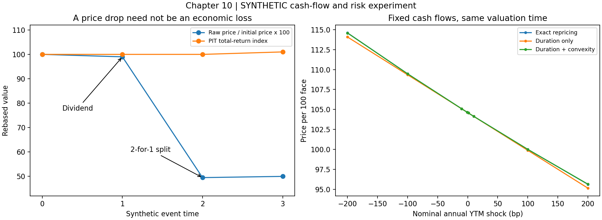

# 第10章　股票与债券的现金流和风险

第9章说明价格怎样通过交易形成。本章再向前一步：交易的权利最终对应什么现金流？观察到的价格变化，又有多少是现金分配、份额变化或计价口径造成的？

股票从100元变成99元，可能同时产生每股1元的分红权利；债券净价下降，也可能同时收到票息。若平台只读取价格列，就可能把正常权益事件识别为暴跌，把票息收入遗漏，把收益率上升错误解释成债券投资盈利。

本章以EQ_DEMO与BOND_DEMO为主要例子。全部数据、参数、公司事件和情景均为 **SYNTHETIC人工构造**；没有真实证券推荐、官方赛题数据或真实策略收益。

## 学习目标与先修要求

需要掌握复利、等比数列、导数和二阶Taylor展开，以及第9章的证券权利与交易事件区分。

完成后应能：

1. 从持有人财富恒等式推导股票总收益，处理现金分红与拆股，并区分指数再投资约定与账户实际现金。
2. 解释复权因子的版本和时间可用性，识别真正的前视风险而不作一概而论的判断。
3. 根据现金流和计息约定计算债券全价、净价、应计利息和到期收益率。
4. 逐步推导折现因子、即期与远期利率、久期、凸性及DV01。
5. 区分信用风险、信用利差和利率风险，解释股债可能同涨、反向或同跌。
6. 用完整程序复核定价、求根、敏感度和公司事件处理，并记录可复现实验结果。

## 10.1 股权、分红、复权与总收益

### 10.1.1 股权与剩余索取权

股权（Equity）代表对企业相应权益的所有权。普通股股东通常承担经营结果的不确定性，在适用的清偿顺序下享有剩余索取权；具体表决、分红和清偿权利仍由法律与证券条款确定。

用一个极简终值模型理解股票与债券的差异。设企业清偿时可分配资产价值为 $V_T$ ，只有一层债务，到期应付金额为 $F$ ，暂不考虑破产成本与其他优先债权。债权人和股东终值分别为：

```math
B_T=\min(V_T,F),\qquad E_T=\max(V_T-F,0).
```

当资产足够时，债权人得到约定金额，剩余归股东；资产不足时，股东没有剩余，债权人承担不足部分。因此：

```math
B_T+E_T=V_T.
```

这只是支付结构恒等式，不是已经完成的期权定价模型。它说明股票和债券都与企业价值相关，但暴露形状不同：股票的上行收益不受债务面值限制，债券通常有约定支付上限，却仍可能违约。因此，“股票有风险、债券无风险”不是可用的标签体系。

### 10.1.2 从财富恒等式推导股票收益

先假设期间没有增减股数。期初持有一股，价格为 $P_{t-1}$ ；期末股票价格为 $P_t$ ，期间每股获得现金分配或已确认的相应权利 $D_t$ 。忽略税费，期末经济财富为股票价值加现金或应收权利：

```math
W_t=P_t+D_t.
```

一期总收益率（Total Return）因此为：

```math
R_t^{\mathrm{total}}
=\frac{P_t+D_t-P_{t-1}}{P_{t-1}}
=\frac{P_t-P_{t-1}}{P_{t-1}}+\frac{D_t}{P_{t-1}}.
```

右侧第一项是价格收益，第二项是现金分配贡献。二者口径一致才能相加。

如果期初价格100元，除息后价格99元，每股分红1元，则价格收益为负1%，总收益为零。这是一个无其他价格变化的人工例子，**不表示真实除息日价格必然恰好下降分红金额**。税收、消息、供求和交易摩擦都可能使实际价格偏离这个机械参照。

如果期间还发生拆股（Stock Split），设每一股旧股变为 $s_t$ 股新股，现金分配仍以“每一股旧股”为单位，则：

```math
R_t^{\mathrm{total}}
=\frac{s_tP_t+D_t}{P_{t-1}}-1.
```

一拆二时，若旧股99元、新股49.5元、无分红，则：

```math
\frac{2\times49.5}{99}-1=0.
```

裸价格看起来下跌50%，原持有人财富并没有因此减少。若数据源把分红按新股计量，需要先转换到旧股口径；不能直接代入上述公式。

配股、分拆、合并、现金选择权等事件可能涉及新增投入或多个证券。此时应回到“期初财富、外部资金流和期末各项权利”的完整账本，不能只给价格乘一个通用因子。

### 10.1.3 四个日期与两种收益口径

|日期|英文名称|平台应记录的事实|
|---|---|---|
|公告日|Announcement Date|分配方案何时公开，是否仍有条件|
|股权登记日|Record Date|按适用制度确定登记资格|
|除息日|Ex-dividend Date|证券开始按不含该次分红权利的条件交易|
|支付日|Payment Date|现金何时实际支付|

这些日期不能合并成一个“分红时间”。确切资格还可能受到交易、结算和特殊安排影响，应使用对应市场的有效规则。

经济收益计算可在权利确立时计入应收分红；账户现金账必须等到实际到账。总收益指数（Total Return Index，TRI）还会指定分红再投资方式。指数方法中的再投资不等于投资者在支付前已能使用现金。[S&P Dow Jones Indices指数计算方法](https://www.spglobal.com/spdji/en/methodology/article/index-mathematics-methodology/)明确区分价格变动与分红再投资。

若采用无税费、可分割份额、按指定时点再投资的教学约定，指数递推为：

```math
I_t=I_{t-1}(1+R_t^{\mathrm{total}}),\qquad I_0=100.
```

它描述一个约定下的财富指数。若投资者把分红留在现金账户、不再投资，后来股票价格变化对这部分现金没有同样影响，长期财富就不再由同一个乘积表示。

实盘回测必须明确：分红资格、税率、到账日、再投资时间、成交价格和费用。状态监控中的总收益序列可以采用指数规则，但应把这种规则写进元数据。

### 10.1.4 复权解决什么问题，又不能解决什么

复权价格（Adjusted Price）通过规定的调整方法，使公司行动前后的序列具有某种可比性。常见前复权、后复权名称通常涉及锚定近期或历史基准，但不同供应商的现金分配、配股、税费与四舍五入规则可能不同。不能只凭一个“adjusted”字段名推断它一定是完整总收益。

若供应商定义乘法调整因子 $A_t$ ，则：

```math
\widetilde P_t=A_tP_t,\qquad
\widetilde R_t=\frac{A_tP_t}{A_{t-1}P_{t-1}}-1.
```

必须核对因子比值究竟消除了哪些事件、是否含分红再投资，而不是把复权价当成当时可成交的价格。

这里有一个重要细节：**使用今天下载的复权数据，不意味着每个历史收益率都必然发生前视泄漏。**

如果某次未来事件只把一个历史区间内所有价格统一乘以同一常数 $a$ ，那么区间内部相邻收益的比例会抵消：

```math
\frac{aP_t}{aP_{t-1}}-1=\frac{P_t}{P_{t-1}}-1.
```

但历史绝对价格、绝对阈值、股数换算、跨越调整边界的收益，以及后来修正过的事件字段，可能发生变化。是否泄漏必须根据特征表达式、数据版本和决策时间逐项判断。

安全实现是保留未复权行情、公司事件表、供应商因子版本、首次发布时间和首次获取时间。历史决策只能使用当时已可获得的版本；事后修订可以生成独立的重述序列，不能覆盖当时真实使用的值。

本章实验故意安排一条“分红数据源纠错”：事件已生效后，源端把旧记录中的1元改成1.2元。这是人工数据质量案例，并非宣称真实分红通常会事后改变。实验会同时保存在线口径与事后重述口径。

### 10.1.5 股利贴现模型及其推导

股利贴现模型（Dividend Discount Model，DDM）把股权价值与未来现金分配联系起来。它是解释现金流和折现率敏感性的工具，不是无需估计就能给出可靠“合理股价”的公式。[OpenStax股利贴现章节](https://openstax.org/books/principles-finance/pages/11-2-dividend-discount-models-ddms)可作为入门阅读。

先用确定性现金流与固定必要报酬率 $k$ 建立教学模型。一期定价关系为：

```math
P_0=\frac{D_1+P_1}{1+k}.
```

将下一期同类关系代入：

```math
P_0=\frac{D_1}{1+k}
+\frac{D_2}{(1+k)^2}
+\frac{P_2}{(1+k)^2}.
```

反复代入到第 $T$ 期：

```math
P_0=\sum_{t=1}^{T}\frac{D_t}{(1+k)^t}
+\frac{P_T}{(1+k)^T}.
```

要变成无限股利现值之和，需要额外终值条件：

```math
\lim_{T\to\infty}\frac{P_T}{(1+k)^T}=0.
```

不能无理由删去终值。若假设股利以常数 $g$ 增长，且 $k\gt g\gt -1$ ，则：

```math
\begin{aligned}
P_0
&=\sum_{t=1}^{\infty}\frac{D_1(1+g)^{t-1}}{(1+k)^t}\\[0pt]
&=\frac{D_1}{1+k}\sum_{j=0}^{\infty}
\left(\frac{1+g}{1+k}\right)^j\\[0pt]
&=\frac{D_1}{1+k}
\frac{1}{1-\frac{1+g}{1+k}}
=\frac{D_1}{k-g}.
\end{aligned}
```

这是Gordon增长模型。若下一期股利3元，必要报酬率8%，增长率3%，教学估值为60元。

参数敏感性为：

```math
\frac{\partial P}{\partial D_1}=\frac1{k-g},\qquad
\frac{\partial P}{\partial k}=-\frac{D_1}{(k-g)^2},\qquad
\frac{\partial P}{\partial g}=\frac{D_1}{(k-g)^2}.
```

分母差很小时，轻微参数误差也能产生巨大估值差。令 $k=g$ 并不是得到“无限好公司”，而是破坏了级数收敛条件。

现实现金流有风险，必要报酬率也可能变化。一般随机定价不能随意把“随机股利的期望”除以一个任意平均利率；第13章将介绍更完整的资产定价框架。当前不分红也不代表股权价值为零：未来分配、回购及其他权益支付需要合适的模型，不能把当前零分红永久外推。

## 10.2 债券定价、收益率曲线、久期与凸性

### 10.2.1 从证券条款生成现金流

债券（Bond）通常规定本金、利息及相关支付条件。固定票息债券的合同现金流较明确，但实际收到金额仍可能受违约、赎回或重组影响。

本节先研究：无违约、无嵌入期权、固定票息、到期一次偿还本金、等间隔付息的债券。估值日位于付息之后，下一次付息尚未发生。

设面值为 $F$ ，年票面利率为 $c$ ，每年付息 $m$ 次，剩余 $N$ 次支付。每期票息为：

```math
C=\frac{Fc}{m}.
```

前 $N-1$ 次支付为 $C$ ，最后支付为 $C+F$ 。票面利率只决定合同票息，不是市场要求的收益率。

以面值100元、年票息4%、半年付息、剩余5年为例，每半年支付2元，第10期支付102元。现金流时间为0.5、1、……、5年。

实际数据模型必须另外记录币种、面值单位、付息日历、日计数规则、营业日调整、除息安排、赎回和违约条款。仅有“5年、4%”不足以精确重建真实债券。

### 10.2.2 折现因子与无套利定价

折现因子（Discount Factor） $d(0,t)$ 表示在所选信用、币种和抵押等口径下，未来时点 $t$ 的一单位确定支付在今天的价格。

如果每笔确定现金流都可以用相同口径的零息工具复制，根据一价定律，组合价格为：

```math
P=\sum_{i=1}^{N}CF_i\,d(0,t_i).
```

推理过程是：购买 $CF_i$ 份在 $t_i$ 支付一单位的工具，就复制该时点现金流；将各时点工具相加复制整只债券；若价格不同且可按假设交易，就出现相同支付不同价格的矛盾。

这个推理有交易可行性、信用口径一致等前提。不能把有违约风险的承诺现金流直接按无风险折现后称为公平价格。

年复利即期利率（Spot Rate） $z_t$ 与连续复利即期利率 $r_t$ 分别满足：

```math
d(0,t)=(1+z_t)^{-t}=\exp(-r_tt).
```

同一个折现因子可以用不同利率口径表达。负利率可能使折现因子大于1，不能仅因其超过1就自动删除。

### 10.2.3 到期收益率不是整条收益率曲线

到期收益率（Yield to Maturity，YTM）是使未来承诺现金流现值等于当前价格的内部收益率。若采用每年复利 $m$ 次的名义年收益率 $y$ ：

```math
P(y)=\sum_{i=1}^{N}CF_i
\left(1+\frac ym\right)^{-i}.
```

这是一只债券的单参数价格摘要，不表示所有期限的即期利率都相等。有效年收益率为：

```math
y_{\mathrm{eff}}=\left(1+\frac ym\right)^m-1.
```

因此半年复利名义年率3%对应有效年率3.0225%，不能和年复利3%不加转换地混用。

在同一付息频率、固定票息、付息日估值等前提下，票面利率等于YTM时价格等于面值；票息高于YTM通常形成溢价，反之形成折价。对正现金流，收益率提高意味着折现更强，所以价格下降。

YTM的定义本身是现金流内部收益率关系，不需要先假设实际已发生再投资。但若把它解释为“持有到期后的终值复合收益率”，还需合同支付兑现、票息按相应收益率再投资等条件。提前卖出时更应计算实际持有期收益，不能直接拿初始YTM作已实现收益。

求YTM通常没有方便的解析解。对正现金流、正价格与 $y\gt -m$ ，价格函数连续且严格递减，可采用二分法：先找使目标价格落在两端价格之间的收益率区间，反复取中点，比较价格并缩小区间。每次区间长度减半；未包围根应报错，而不是返回任意边界。

这些关系可与[MIT固定收益课程](https://ocw.mit.edu/courses/15-401-finance-theory-i-fall-2008/pages/video-lectures-and-slides/fixed-income-securities/)及[OpenStax债券估值章节](https://openstax.org/books/principles-finance/pages/10-2-bond-valuation)交叉学习。

### 10.2.4 净价、全价与应计利息

全价或含息价（Dirty/Full Price）与净价（Clean Price）的关系为：

```math
P_{\mathrm{dirty}}=P_{\mathrm{clean}}+AI,
```

其中 $AI$ 是应计利息（Accrued Interest）。[上交所净价交易问答](https://www.sse.com.cn/aboutus/mediacenter/hotandd/c/c_20150912_3988250.shtml)提供了这一概念的中文说明；这是历史教育资料，不用于断言所有当前债券采用相同规则。

在本章等长付息期间的教学约定中，上一付息日至估值日已走过当前周期比例 $u$ ，则：

```math
AI=Cu,\qquad
P_{\mathrm{dirty}}(y,u)
=\sum_{i=1}^{N}CF_i
\left(1+\frac ym\right)^{-(i-u)}.
```

下一笔支付的剩余时间为 $(1-u)/m$ 年。由于所有现金流都比周期起点近了 $u/m$ 年：

```math
P_{\mathrm{dirty}}(y,u)
=P_{\mathrm{dirty}}(y,0)
\left(1+\frac ym\right)^u.
```

本例走过半个半年周期， $u=0.5$ ，应计利息为1元。代码得到全价约105.392755元，净价约104.392755元。

真实计算中的ACT/ACT、ACT/365、30/360等日计数约定并非可互换；除息期还可能改变应计利息和支付资格。本章的周期比例模型不能冒充通用债券日历引擎。

若期间收到票息，并在期末按全价卖出，无再投资的单期持有收益为：

```math
R_H=\frac{P_1^{\mathrm{dirty}}+\text{期间现金收入}
-P_0^{\mathrm{dirty}}}{P_0^{\mathrm{dirty}}}.
```

不能只看净价变化，也不能把票息同时作为现金收入和仍包含在期末价格中的权利重复计算。

### 10.2.5 自举收益率曲线

收益率曲线（Yield Curve）描述不同期限的利率。即期曲线、平价曲线和YTM曲线不是同一对象。

曲线自举（Bootstrapping）利用较短期限已确定的折现因子，逐步求较长期限因子。这里的“自举”是顺序解方程，不是第6章的统计重采样Bootstrap。

设有每年付息一次、每个整数到期年限一只债券，信用与结算口径一致。到期为 $n$ 年的债券价格为 $P_n$ ，每年票息为 $C_n$ ，则：

```math
P_n=C_n\sum_{i=1}^{n-1}d_i+(C_n+F)d_n.
```

将已知的前期票息现值移到左边：

```math
d_n=\frac{P_n-C_n\sum_{i=1}^{n-1}d_i}{C_n+F}.
```

一年期平价债券面值100、票息2，给出：

```math
d_1=\frac{100}{102}=0.9803921569.
```

两年期平价债券票息3，第一年付3，第二年付103，因此：

```math
d_2=\frac{100-3d_1}{103}=0.9423186750.
```

两年即期年利率为：

```math
z_2=d_2^{-1/2}-1\approx0.0301515040.
```

即约3.01515%，并不恰好等于两年期平价票息3%。

真实市场的现金流日期未必整齐，需要插值和更多工具。插值折现因子、零息利率或远期利率，会给出不同曲线形状与风险敏感度；算法必须记录，而不是隐藏在一个“收益率曲线”字段后面。

### 10.2.6 远期利率与预测的区别

在0时点约定从 $t_1$ 到 $t_2$ 的年复利远期利率为 $f_{t_1,t_2}$ 。两种投资路径终值一致要求：

```math
d(0,t_1)
=d(0,t_2)(1+f_{t_1,t_2})^{t_2-t_1}.
```

因此：

```math
f_{t_1,t_2}
=\left(\frac{d(0,t_1)}{d(0,t_2)}\right)^{1/(t_2-t_1)}-1.
```

上例第二年的一年期远期利率为：

```math
f_{1,2}=\frac{d_1}{d_2}-1\approx0.04040404.
```

约4.0404%的远期利率是当前价格结构隐含的合约关系，不是对未来一年期利率的无条件保证。期限溢价、风险偏好和市场摩擦都会影响预测解释。

### 10.2.7 久期：从导数到加权时间

久期（Duration）用于描述利率敏感性，但不同定义不能混用。

令每笔现金流剩余时间为 $t_i$ ，仍使用每年复利 $m$ 次的名义YTM，设 $b=1+y/m$ ：

```math
P(y)=\sum_iCF_i b^{-mt_i}.
```

对一项求导，先求幂函数导数，再乘内部函数导数 $1/m$ ：

```math
\frac{\partial}{\partial y}\big(CF_i b^{-mt_i}\big)
=CF_i(-mt_i)b^{-mt_i-1}\frac1m
=-t_iCF_i b^{-mt_i-1}.
```

定义现值权重：

```math
w_i=\frac{CF_i b^{-mt_i}}{P},\qquad\sum_iw_i=1.
```

于是：

```math
-\frac1P\frac{\partial P}{\partial y}
=\frac{\sum_it_iw_i}{b}.
```

麦考利久期（Macaulay Duration）与修正久期（Modified Duration）分别定义为：

```math
D_{\mathrm{Mac}}=\sum_it_iw_i,\qquad
D_{\mathrm{mod}}=\frac{D_{\mathrm{Mac}}}{1+y/m}.
```

前者是现金流现值权重下的平均等待时间，后者是针对所选YTM口径的价格比例敏感度。因此：

```math
\frac{\Delta P}{P}\approx-D_{\mathrm{mod}}\Delta y.
```

收益率变动必须使用小数：100基点为0.01，而不是100或1。对于正现金流零息债券，全部权重在到期时点，所以麦考利久期等于剩余期限；有较早正票息的债券，其麦考利久期通常短于最后到期时间。

### 10.2.8 凸性与二阶近似

继续对一阶导数求导：

```math
\begin{aligned}
\frac{\partial^2}{\partial y^2}
\big(CF_i b^{-mt_i}\big)
&=(-t_i)CF_i(-mt_i-1)b^{-mt_i-2}\frac1m\\[0pt]
&=t_i\left(t_i+\frac1m\right)CF_i b^{-mt_i-2}.
\end{aligned}
```

本章采用按价格归一化的凸性（Convexity）：

```math
\mathcal C
=\frac1P\frac{\partial^2P}{\partial y^2}
=\frac{\sum_iw_it_i(t_i+1/m)}{(1+y/m)^2}.
```

把它代入二阶Taylor展开：

```math
\frac{\Delta P}{P}
\approx-D_{\mathrm{mod}}\Delta y
+\frac12\mathcal C(\Delta y)^2.
```

正现金流、固定现金流和当前定义域下凸性为正。对同样大小的收益率升降，价格的二阶修正都向上：收益率下降时涨幅比切线预测更大，上升时跌幅比切线预测更小。但更大的冲击还包含三阶及更高项，二阶近似不是精确重估。

若债券带有赎回权，现金流会随利率与行权行为改变，不能继续把它们固定再套上述公式。应使用含期权模型对曲线扰动重估，计算有效久期、有效凸性；某些可赎回债券区间可呈负凸性。CFA官方学习要求也明确区分收益率敏感度与含期权债券的曲线风险度量。[CFA固定收益学习要求](https://www.cfainstitute.org/sites/default/files/-/media/documents/study-session/2024-l1-los-t6.pdf)

### 10.2.9 DV01、规模与曲线形变

一个基点收益率变动对应的金额敏感度称为DV01（Dollar Value of One Basis Point）。本章把它报告为收益率上升一个基点时的一阶价格损失正值：

```math
\mathrm{DV01}=PD_{\mathrm{mod}}\times10^{-4}.
```

本例每100元面值DV01约0.047332元。100万元面值持仓是10000个报价单位，所以持仓DV01约473.323元/基点。若报价是每百元面值，却直接乘100万元，会高估100倍。

这个DV01针对所有现金流用同一YTM变化的扰动。实际收益率曲线可能变陡、变平或弯曲。用连续零息利率表示：

```math
P=\sum_iCF_i e^{-r_it_i},\qquad
\frac{\partial P}{\partial r_i}=-t_iCF_i e^{-r_it_i}.
```

因此各支付节点的归一化敏感度为 $t_iw_i$ 。本章实验在每个支付时点直接设置一个独立零息率，逐个扰动。实际关键利率久期（Key Rate Duration，KRD）通常使用较少的曲线节点及插值，不能把教学支付节点敏感度原样当成市场标准KRD。

若连续零息曲线所有节点平行上移，节点敏感度之和等于该口径下的平均现金流时间。它不必等于名义YTM口径的修正久期：两种参数变化的定义不同。

匹配资产负债的市场价值和金额久期可以抵消小幅平行利率变化的一阶影响，但不能同时保证非平行曲线、信用、期权、流动性和未来再平衡风险都被消除。

## 10.3 信用利差、违约风险与股债差异

### 10.3.1 承诺现金流不等于实际现金流

违约概率（Probability of Default，PD）描述指定期限内发生违约的概率；违约损失率（Loss Given Default，LGD）描述违约条件下的损失比例；违约风险暴露（Exposure at Default，EAD）描述违约时暴露金额。

在暴露和损失率被简化为固定值时，预期损失为：

```math
EL=PD\times LGD\times EAD.
```

如果暴露、损失率与违约共同随机，就应计算联合期望，不能无条件用三个边际均值相乘。现实回收还存在时间、法律程序、担保和费用问题。

### 10.3.2 一期信用定价模型

考虑一年后承诺支付面值 $F$ 的零息债券，违约时在同一终点回收比例 $R$ 的面值。采用风险中性违约概率 $q^{\mathbb Q}$ ，无风险一年期利率为 $r$ ，忽略其他溢价与摩擦：

```math
P=\frac{(1-q^{\mathbb Q})F+q^{\mathbb Q}RF}{1+r}
=\frac{F[1-q^{\mathbb Q}(1-R)]}{1+r}.
```

风险中性概率是用于当前价格表示的概率权重，不等于历史统计频率。此处只引入其定价作用，第13章再说明与风险溢价的关系。

按承诺面值计算的一年YTM为 $y=F/P-1$ 。代入后，信用利差为：

```math
\begin{aligned}
s&=y-r\\[0pt]
&=\frac{1+r}{1-q^{\mathbb Q}(1-R)}-1-r\\[0pt]
&=\frac{(1+r)q^{\mathbb Q}(1-R)}
{1-q^{\mathbb Q}(1-R)}.
\end{aligned}
```

当违约损失项和利率都较小时，才近似为 $q^{\mathbb Q}(1-R)$ 。这不是无条件的“信用利差等于实际违约概率乘损失率”。

取面值100、无风险利率3%、风险中性违约概率2%、回收率40%，价格约95.922330元，承诺YTM约4.251012%，利差约125.1012基点。直接计算2%乘60%只得到120基点，是近似而不是精确式。

若在极端假设下确定零回收违约，价格为零，则承诺YTM没有有限值，程序返回缺失，不把它保存成无穷大污染后续特征。

### 10.3.3 信用利差还含有什么

同期限收益率差可能混有信用损失补偿、风险溢价、流动性、税收、供求和期权等因素。对两只票息、期限或选择权差异很大的债券，简单YTM相减甚至不能干净隔离同一种风险。

常数零息利差（Z-spread）是在指定基准零息曲线上添加常数，使承诺现金流价格匹配市场价格的参数。含期权债券还需区分期权调整利差（Option-Adjusted Spread，OAS）；其结果依赖利率与行权模型，不是直接观察到的违约概率。

BIS研究强调了预期违约损失与风险溢价的区别，但其具体样本结论不应不加检验地迁移到所有债券或所有时期。[BIS关于主权利差的研究介绍](https://www.bis.org/media-releases/20070314-quarterly-review-march-2007)

因此平台可报告“同口径信用利差扩大”，却不应自动生成“违约概率上升同样多个基点”的解释。

### 10.3.4 股债关系为什么会变化

股票价格同时受预期现金流与必要报酬率影响；固定现金流债券价格受折现率、信用和条款变化影响。因此股债相关性不是常数，也不是资产名称决定的定理。

两个人工比较情景如下，均在同一估值时点改变模型输入，不包含持有期间现金收入：

|情景|股票模型输入|股票教学估值|债券YTM|债券教学全价|
|---|---|---:|---:|---:|
|基准|下一期股利3，必要报酬率8%，增长3%|60.0000|3%|104.6111|
|增长压力|下一期股利2.7，必要报酬率7.5%，增长2%|49.0909|2%|109.4713|
|折现率压力|下一期股利3，必要报酬率10%，增长3%|42.8571|4%|100.0000|

增长压力例中，股利和增长预期下降压低股票，即使必要报酬率也下降；教学无违约债券因利率下降而上涨。折现率压力例中，两种资产同时下降。

这些数字只证明所给模型和参数可以产生两种联动方向，不证明真实宏观冲击必然产生相同结果。企业信用债在增长压力下还可能遭遇利差扩大，抵消无风险利率下降的价格收益。不能把所有“债券”都当成同一个避险资产。

状态识别应分别记录股票总收益、基准曲线变化、信用利差、久期、现金流与数据质量，再研究它们的联合变化。识别“股债同跌”属于描述；预测下一期收益和提出交易建议属于另外的任务。

## 10.4 完整实验：公司事件、债券重估与风险分解

### 10.4.1 实验内容与运行方法

实验包括四部分：按可用版本处理股票分红和拆股；计算债券价格及解析敏感度；用有限差分和精确重估核验；计算自举曲线、一期信用价格和股债人工情景。

所有程序输入是人工数据，不需要网络。主程序仅使用Python标准库；配图使用已安装的Matplotlib。直接使用现有Anaconda，在code/ch10目录运行：

```powershell
& 'D:\Anaconda\python.exe' -X utf8 cashflow_lab.py
& 'D:\Anaconda\python.exe' -X utf8 -m unittest -v test_cashflow_lab.py
```

每次生成新的runs子目录，保存results.json与包含环境、口径和文件哈希的manifest.json。图可运行plot_cashflows.py，依次传入该manifest路径和输出图片路径。

完整主程序与[独立源文件](./code/ch10/cashflow_lab.py)一致：

```python
"""SYNTHETIC cash-flow lab; not a production security master or trading model."""
from dataclasses import asdict, dataclass
from datetime import datetime, timezone
from pathlib import Path
import hashlib
import json
import math
import platform


def finite(x):
    return type(x) in (int, float) and math.isfinite(x)


@dataclass(frozen=True)
class Bond:
    face: float = 100.
    coupon: float = .04
    periods: int = 10
    frequency: int = 2
    elapsed: float = 0.

    def __post_init__(self):
        if not finite(self.face) or self.face <= 0:
            raise ValueError("Positive face required")
        if not finite(self.coupon) or self.coupon < 0:
            raise ValueError("Nonnegative coupon required")
        if type(self.periods) is not int or self.periods < 1:
            raise ValueError("Positive integer periods required")
        if type(self.frequency) is not int or self.frequency < 1:
            raise ValueError("Positive integer frequency required")
        if not finite(self.elapsed) or not 0 <= self.elapsed < 1:
            raise ValueError("Elapsed coupon-period fraction must be in [0,1)")

    def flows(self):
        coupon = self.face * self.coupon / self.frequency
        return [((i - self.elapsed) / self.frequency,
                 coupon + (self.face if i == self.periods else 0))
                for i in range(1, self.periods + 1)]

    def metrics(self, y):
        m = self.frequency
        if not finite(y) or y <= -m:
            raise ValueError("Nominal yield must be finite and greater than -frequency")
        base = 1 + y / m
        pv = [(t, cash * base ** (-m * t)) for t, cash in self.flows()]
        price = sum(v for _, v in pv)
        if not math.isfinite(price) or price <= 0:
            raise ValueError("Numerically invalid price")
        macaulay = sum(t * v for t, v in pv) / price
        modified = macaulay / base
        convexity = sum(t * (t + 1 / m) * v for t, v in pv) / price / base**2
        accrued = self.face * self.coupon / m * self.elapsed
        return {"dirty": price, "clean": price - accrued, "accrued": accrued,
                "macaulay": macaulay, "modified": modified,
                "convexity": convexity, "dv01": price * modified * 1e-4}

    def price(self, y):
        return self.metrics(y)["dirty"]


def solve_ytm(bond, dirty, low=-.5, high=1., tolerance=1e-10):
    if not finite(dirty) or dirty <= 0 or not finite(tolerance) or tolerance <= 0:
        raise ValueError("Positive target price and tolerance required")
    if not finite(low) or not finite(high) or low >= high:
        raise ValueError("Invalid yield bracket")
    pl, ph = bond.price(low), bond.price(high)
    if not ph <= dirty <= pl:
        raise ValueError("Target price is not bracketed; supply a valid range")
    for _ in range(200):
        mid = (low + high) / 2
        price = bond.price(mid)
        if abs(price - dirty) <= tolerance:
            return mid
        if price > dirty:
            low = mid
        else:
            high = mid
    raise RuntimeError("Yield solver did not converge to the price tolerance")


def bootstrap_annual(prices, coupons, face=100.):
    """One annual bond per maturity, integer years, same credit/settlement basis."""
    if len(prices) != len(coupons) or not prices or not finite(face) or face <= 0:
        raise ValueError("Invalid bootstrap inputs")
    discounts = []
    for price, coupon in zip(prices, coupons):
        if not finite(price) or price <= 0 or not finite(coupon) or coupon < 0:
            raise ValueError("Invalid quote")
        d = (price - face * coupon * sum(discounts)) / (face * (1 + coupon))
        if not math.isfinite(d) or d <= 0:
            raise ValueError("Nonpositive discount factor; inspect quotes")
        discounts.append(d)
    return discounts


def curve_price(bond, continuous_zeros):
    flows = bond.flows()
    if len(flows) != len(continuous_zeros) or not all(map(finite, continuous_zeros)):
        raise ValueError("One finite continuous zero rate per payment time required")
    return sum(cash * math.exp(-z * t) for (t, cash), z in zip(flows, continuous_zeros))


def select_action(versions, event_id, as_of):
    if not finite(as_of):
        raise ValueError("Finite as_of required")
    available = [v for v in versions if v["id"] == event_id
                 and max(v["published_at"], v["received_at"]) <= as_of]
    if not available:
        raise LookupError("Corporate-action version unavailable at decision time")
    return max(available, key=lambda v: v["version"])


def stock_return(previous, current, split=1., dividend=0.):
    # dividend is cash/receivable per OLD share; split is new shares per old share.
    if not all(map(finite, (previous, current, split, dividend))):
        raise ValueError("Finite equity inputs required")
    if min(previous, current, split) <= 0 or dividend < 0:
        raise ValueError("Invalid equity prices or corporate-action terms")
    return (split * current + dividend) / previous - 1


def gordon(dividend_next, required, growth):
    if not all(map(finite, (dividend_next, required, growth))):
        raise ValueError("Finite model inputs required")
    if dividend_next < 0 or growth <= -1 or required <= growth:
        raise ValueError("Require nonnegative dividend and required > growth > -1")
    return dividend_next / (required - growth)


def credit_zero(face, risk_free, q_risk_neutral, recovery):
    if not all(map(finite, (face, risk_free, q_risk_neutral, recovery))):
        raise ValueError("Finite credit inputs required")
    if face <= 0 or risk_free <= -1 or not 0 <= q_risk_neutral <= 1 or not 0 <= recovery <= 1:
        raise ValueError("Invalid one-year credit model inputs")
    price = face * (1 - q_risk_neutral * (1 - recovery)) / (1 + risk_free)
    return {"price": price, "promised_yield": face / price - 1 if price > 0 else None,
            "spread": face / price - 1 - risk_free if price > 0 else None}


def main():
    bond, y = Bond(), .03
    base = bond.metrics(y)
    shocks = []
    for bp in (-200, -100, -10, -1, 1, 10, 100, 200):
        dy = bp * 1e-4
        exact = bond.price(y + dy)
        linear = base["dirty"] * (1 - base["modified"] * dy)
        quadratic = linear + base["dirty"] * .5 * base["convexity"] * dy**2
        shocks.append({"shock_bp": bp, "exact": exact, "linear": linear, "quadratic": quadratic})
    # Each revision is a synthetic feed correction, not a real issuer announcement.
    versions = [
        {"id": "DIV1", "version": 1, "effective": 1, "published_at": .2, "received_at": .3, "split": 1., "dividend": 1.},
        {"id": "DIV1", "version": 2, "effective": 1, "published_at": 3.2, "received_at": 3.3, "split": 1., "dividend": 1.2},
        {"id": "SPLIT2", "version": 1, "effective": 2, "published_at": 1.2, "received_at": 1.3, "split": 2., "dividend": 0.}]
    prices = [100., 99., 49.5, 50.]
    index, stock = 100., []
    for t in range(1, len(prices)):
        aid = {1: "DIV1", 2: "SPLIT2"}.get(t)
        action = select_action(versions, aid, t + .1) if aid else {"split": 1., "dividend": 0., "version": None}
        if aid and action["effective"] != t:
            raise ValueError("Action effective date does not match return interval")
        ret = stock_return(prices[t-1], prices[t], action["split"], action["dividend"])
        index *= 1 + ret
        stock.append({"t": t, "available_at": t + .1, "version": action["version"],
                      "raw_return": prices[t] / prices[t-1] - 1,
                      "total_return": ret, "total_index": index})
    corrected = select_action(versions, "DIV1", 3.4)
    revised_first = stock_return(prices[0], prices[1], corrected["split"], corrected["dividend"])
    discounts = bootstrap_annual([100., 100.], [.02, .03])
    zeros = [.03 + .001 * i for i in range(bond.periods)]
    curve_base = curve_price(bond, zeros)
    key_durations = []
    h = 1e-5
    for i in range(len(zeros)):
        up, down = zeros.copy(), zeros.copy()
        up[i] += h
        down[i] -= h
        key_durations.append((curve_price(bond, down)-curve_price(bond, up))/(2*h*curve_base))
    scenarios = []
    for name, d, k, g, by in [("base", 3., .08, .03, .03),
                              ("growth_stress", 2.7, .075, .02, .02),
                              ("discount_stress", 3., .10, .03, .04)]:
        scenarios.append({"name": name, "equity_value": gordon(d, k, g),
                          "bond_price": bond.price(by), "equity_inputs": [d, k, g], "bond_yield": by})
    report = {"source": "SYNTHETIC", "contract": asdict(bond), "base_yield": y,
              "stock_prices": prices, "curve_continuous_zeros": zeros,
              "bootstrap_prices": [100., 100.], "bootstrap_coupons": [.02, .03],
              "bond": base, "ytm_recovered": solve_ytm(bond, base["dirty"]),
              "between_coupons": Bond(elapsed=.5).metrics(y), "shocks": shocks,
              "stock": stock, "action_versions": versions,
              "restated_first_return_as_of_3_4": revised_first,
              "discount_factors": discounts, "two_year_spot": discounts[1]**(-.5)-1,
              "forward_year_1_to_2": discounts[0]/discounts[1]-1,
              "curve_price": curve_base, "cashflow_node_durations": key_durations,
              "credit": credit_zero(100., .03, .02, .4), "scenarios": scenarios}
    out = Path(__file__).parent / "runs" / datetime.now(timezone.utc).strftime("run_%Y%m%dT%H%M%S_%fZ")
    out.mkdir(parents=True, exist_ok=False)
    target = out / "results.json"
    target.write_text(json.dumps(report, ensure_ascii=False, indent=2, allow_nan=False), encoding="utf-8")
    manifest = {"python": platform.python_version(), "source": "SYNTHETIC",
                "convention": "nominal annual YTM, semiannual, equal coupon periods; no calendar",
                "sha256": {p.name: hashlib.sha256(p.read_bytes()).hexdigest() for p in [Path(__file__), target]}}
    (out / "manifest.json").write_text(json.dumps(manifest, indent=2), encoding="utf-8")
    print(out.resolve())
    print(json.dumps(report, ensure_ascii=False, indent=2))


if __name__ == "__main__":
    main()
```

### 10.4.2 代码机制与边界

Bond先校验面值、票息、付息频率、剩余期数和已过周期比例，再生成剩余现金流。价格、久期、凸性全部使用同一组现金流和同一收益率口径，避免一个模块按年复利、另一个模块按半年复利。

solve_ytm以全价为目标。若用户只有净价，应先按正确结算口径加应计利息。二分法按价格残差停止；默认区间不是对所有债券的承诺，根不在区间内会明确报错。

bootstrap_annual仅支持每个整数年度一只、每年付息的教学债券；curve_price则直接接收每个支付时点的连续零息率。程序刻意保留两种接口，强调平价票息、单只债券YTM和零息率不是一列可互换的数字。

公司事件选择器只从发布时间和获取时间均不晚于决策时刻的版本中选取。本例输入表已规范化，并假定每个事件的版本号唯一且单调；它不是完整供应商接入校验器。真实接入仍需检测版本冲突、撤回、字段缺失、币种与每股口径。

已知存在公司事件而当时没有可用条款时，程序抛出不可用错误，不按“没有分红”继续计算。真实系统还需要完整性校验，因为完全漏报事件无法只靠一个选择函数发现。

股票的available_at是人工指定的行情与事件依赖均可用时刻，不是实测网络或计算延迟。债券实验是静态重估，不声称已经实现在线曲线服务。

### 10.4.3 实际运行结果

在既有Anaconda Python 3.13.5中运行，14项测试通过。债券基准为每100元面值、年票息4%、半年付息、剩余5年、名义YTM3%：

|指标|结果|
|---|---:|
|全价；此时应计利息为零|104.6110922759|
|麦考利久期/年|4.5924698067|
|修正久期|4.5246007948|
|凸性|23.8065816140|
|每100元面值DV01|0.0473323431|
|反解YTM|0.0300000000002|

反解误差属于浮点求根容差，不是市场收益率估计误差。

|YTM变动|精确重估价格|只用久期|久期加凸性|
|---:|---:|---:|---:|
|−200基点|114.595618|114.077561|114.575647|
|−100基点|109.471305|109.344327|109.468848|
|＋100基点|100.000000|99.877858|100.002380|
|＋200基点|95.623968|95.144624|95.642710|

二阶近似在这些人工冲击下明显改善，但200基点时仍不是精确价格。它不能代替超大压力、现金流改变或含期权情况下的完整重估。

股票示例为100、99、49.5、50元。第一期每旧股分红1元，第二期一拆二：

|时期|裸价格收益|当时可用版本总收益|总收益指数|
|---|---:|---:|---:|
|1|−1%|0%|100|
|2|−50%|0%|100|
|3|约1.010101%|约1.010101%|101.010101|

时间3.3之后收到分红字段更正，第一期重述收益成为0.2%。原在线记录仍为0%，必须保留；事后更正不能被写回时间1.1的特征输入。



图左比较归一化裸价格与按当时信息形成的总收益指数；图右比较相同估值时点下不同YTM扰动的价格。左图不是税费后的真实账户回测，右图不是未来利率预测。

### 10.4.4 工程实现与常见错误

|常见错误|后果|实现要求|
|---|---|---|
|把3%的收益率存为3而非0.03|折现严重错误|字段注明小数、百分数或基点，接入时统一|
|净价直接用于YTM求根|求得错误收益率|显式保存净价、全价、应计利息|
|把每百元报价当总持仓价值|风险敞口放大或缩小|面值、报价单位、币种分列|
|拆股只改价格不改股数|制造虚假暴跌|公司事件与持仓单位同步变换|
|分红既加入收益又重复使用含分红调整价|重复计收益|选择一致的一条收益计算路径|
|用最新修订覆盖历史在线特征|无法重现历史信息集|保留as-of版本和重述版本|
|只存YTM不存频率、日计数和结算日|模型不可复核|证券条款和计算约定版本化|
|将信用利差当历史违约概率|解释失真|区分信用损失、风险溢价及其他因素|
|把二阶近似当压力测试真值|忽略高阶与现金流变化|同时保留精确重估和近似残差|

本章[14项测试](./code/ch10/test_cashflow_lab.py)验证平价关系、零息闭式解、付息期间价格、负YTM、求根失败、解析与有限差分导数、凸性改善、自举回代、负零息率、曲线口径转换、节点敏感度、公司事件财富守恒、PIT版本和信用边界。

测试针对计算含义，不只检查程序能否运行。程序没有真实债券日历、市场报价清洗、违约现金流引擎或交易执行系统。极端参数还可能造成数值溢出；生产系统应隔离异常记录、保留输入和原因，不能把非有限结果替换为零继续推理。

## 本章总结

股票收益需要同时考虑价格、股数和现金分配；复权序列需要明确算法、版本和可用时间。债券价值来自特定条款下的现金流与折现，净价、全价、票面利率、YTM和实际持有收益分别承担不同角色。

久期与凸性是对明确定价函数求导的结果，必须注明利率口径、价格单位和固定现金流假设。信用利差包含风险定价，不能直接读取为实际违约概率。股债关系则由现金流、折现率、信用和制度共同决定。

对监控平台，本章提供的是能够解释经济含义的价格和风险特征。只有这些基础口径正确，后续状态标签和智能报告才有可信输入。

## 分层练习题

### 题1　财富恒等式

旧股价格120元，期间一拆三，并按每旧股派现金3元，期末每新股39元。计算裸价格收益与原持有人的总收益。若现金字段实际按每新股计量，公式应怎样改？

### 题2　时间有效性

时间1.1只能取得每股分红1元的版本；时间3.3收到同一事件更正为1.2元。解释历史在线收益与事后重述收益如何保存。再证明：仅对某历史区间统一乘相同复权常数时，哪些比例型指标可能不变，哪些绝对量可能改变？

### 题3　Gordon模型

下一期股利2元，必要报酬率9%，增长率4%。求价值；若必要报酬率升为10%、增长不变，精确价格变动是多少？用一阶导数近似并比较。说明为何不能令增长率等于必要报酬率。

### 题4　现金流与收益率单位

面值100元，年票息6%，半年付息，剩余两年。列出现金流。若名义YTM6%，价格是多少？对应有效年收益率是多少？

### 题5　净价与持有收益

某等间隔半年付息债券每期票息2元，已过周期比例0.25，净价101元，求应计利息与全价。另一次持有实验：以全价101.5元买入，期间收到2元，期末全价100.8元卖出，求未再投资的持有收益。

### 题6　曲线自举与远期

用面值100、一年平价票息2%、两年平价票息3%的债券，求两个折现因子、两年即期利率与第二年远期利率。解释为何远期不是必然实现的未来利率。

### 题7　久期与凸性推导

对三年零息债券，名义YTM5%，每年复利两次，推导麦考利久期、修正久期、凸性和价格。比较零息债券与同到期正票息债券的麦考利久期。

### 题8　风险金额与二阶近似

使用本章BOND_DEMO基准指标，计算100万元面值持仓DV01。YTM上升100基点时，用久期和凸性估计每100元面值价格，和精确价格比较。

### 题9　编程交叉验证

使用有限差分验证本章债券的一阶、二阶导数；先用步长万分之一，再缩小步长，解释为什么越小未必越好。程序应实际比较解析与数值结果，而不只打印公式。

### 题10　信用模型

沿用一年零息模型，面值100、无风险利率3%、风险中性违约概率2%、回收率40%。计算价格、承诺YTM、利差，并与120基点近似比较。若实际违约频率也为2%，能否因此断言两种概率总相等？

### 题11　金融分析

同一天股票总收益下降、国债收益率下降、企业信用利差上升。解释为什么国债可能上涨，而企业债未必上涨。需要哪些额外字段才能判断？

### 题12　开放工程设计

设计统一的股票和债券特征服务，至少覆盖原始报价、公司事件、债券条款、价格口径、曲线版本、计算版本和信息可用时间。给出三类故障输入和可检查的验收标准。

## 详细参考答案

### 题1答案

裸价格收益为39/120−1，即负67.5%。原持有人期末有三股及3元现金权利，总财富为3×39＋3＝120元，所以总收益为零。

若现金是每新股3元，旧股对应总现金为9元，分子应为3×39＋3×3，总收益为5%。关键是现金与拆股比例的计量基准，不能只看字段名称dividend。

### 题2答案

在线记录保留当时版本1、决策时间1.1和据此算出的收益；更正到达后新增版本2，并在事后重述结果中记录计算截止时间。不得改写原在线记录。区间内相邻收益在统一乘数下抵消；由这些相邻收益构造的波动率也可能保持不变。绝对价格、固定价格阈值和股数换算会变化；跨越调整边界或涉及其他修订时必须重新判断。

### 题3答案

初始价格2/(0.09−0.04)＝40元。必要报酬率升至10%时价格为2/0.06＝33.333333元，精确下降6.666667元，即约16.6667%。

初始对必要报酬率的导数为−2/0.05²＝−800，乘变化0.01得到近似下降8元。忽略曲率使该例跌幅被高估。增长率等于必要报酬率时等比级数公比为1，不再收敛，不能继续使用原式。

### 题4答案

每期票息100×0.06/2＝3元，在0.5、1、1.5年各付3元，2年付103元。名义YTM与票息相同且约定一致，所以价格100元。有效年收益率为1.03²−1＝6.09%，不是6%。

### 题5答案

应计利息2×0.25＝0.5元，全价101.5元。持有收益为：

```math
\frac{100.8+2-101.5}{101.5}
=\frac{1.3}{101.5}
\approx0.012807882.
```

即约1.280788%。这是给定持有区间收益；没有给出区间长度，不能自行声称为年化收益。

### 题6答案

一年折现因子100/102约0.9803921569。两年因子由3乘一年因子加103乘两年因子等于100求得，约0.9423186750。两年即期利率为该因子的负二分之一次幂减1，约3.0151504%；远期为两因子相除减1，约4.0404040%。远期来自当前可交易价格的一致关系，未来实际利率还受新的信息与风险补偿变化影响。

### 题7答案

全部现金流在3年后，故麦考利久期3年，修正久期为3/1.025，约2.926829268。价格为100/1.025⁶，约86.229687元。凸性为：

```math
\mathcal C=\frac{3(3+1/2)}{1.025^2}\approx9.99405116.
```

同样到期、具有较早正票息且现值权重为正的债券，其平均支付时间严格早于3年；这不等于所有利率风险维度都能用一个时间数字排序。

### 题8答案

100万元面值对应10000个百元报价单位，DV01约为0.0473323431×10000＝473.323431元/基点。

YTM增加0.01时，一阶价格约99.877858元，二阶加回约0.124522元，得到100.002380元。精确价格100元，因为此时YTM达到票息4%。二阶误差约0.002380元/百元面值；完整持仓误差还需乘10000。

### 题9答案

在code/ch10目录执行：

```python
import math
from cashflow_lab import Bond

bond = Bond()
y = .03
v = bond.metrics(y)
exact_first = -v["dirty"] * v["modified"]
exact_second = v["dirty"] * v["convexity"]
for h in (1e-4, 1e-5, 1e-6):
    first = (bond.price(y+h)-bond.price(y-h))/(2*h)
    second = (bond.price(y+h)-2*bond.price(y)+bond.price(y-h))/h**2
    print(h, abs(first-exact_first), abs(second-exact_second))
    if h == 1e-4:
        assert math.isclose(first, exact_first, rel_tol=1e-7)
        assert math.isclose(second, exact_second, rel_tol=1e-7)
```

中心差分截断误差通常随步长平方减小，但相近浮点数相减会损失有效数字；二阶差分还要除以步长平方，舍入误差更易放大。因此应报告步长敏感性，不能把“最小步长”当成“最准确”。

### 题10答案

风险中性预期支付为98.8元，除以1.03得价格95.922330元；按承诺100元反推YTM约4.251012%，利差约1.251012个百分点，即125.1012基点，比120基点近似高约5.1012基点。

即便某次历史估计恰好也是2%，也不能由数值巧合推出风险中性概率与实际概率一般相等。两者对应不同用途，价格中的风险溢价可能随状态变化。

### 题11答案

固定现金流国债在基准利率下降时可能上涨。企业债的折现变化还包含信用利差扩大；若利差上升超过基准利率下降的影响，其价格可能下跌，此外违约或赎回还可能改变现金流。

应取得同币种同日期的基准曲线、企业债期限与现金流、净全价口径、信用利差定义、久期、条款、报价新鲜度和成交条件。只看“国债收益率下降10基点、信用利差上升20基点”而忽略期限和度量口径，也不能精确定量每只债券的收益。

### 题12答案与评价标准

参考服务保留原始行情不可变日志，另建公司事件版本表、证券条款版本表和曲线快照表。派生记录引用输入ID、版本、币种、单位、价格类型、利率复利方式、日计数、估值日与各输入可用时间；计算服务输出计算版本、结果、有效性和失败原因。

故障输入至少包括：缺失分红条款、净价误标全价、收益率单位错误；可进一步加入迟到修订、无法包围YTM根、非正折现因子和过期报价。错误必须产生可查记录，不得静默删行或填零。

验收按100分：金融口径25分，PIT与版本25分，解析/数值/外部样例交叉验证20分，异常与审计20分，可复现和资源控制10分。核心不变量包括拆股财富守恒、净价加应计等于全价、YTM回代价格一致、历史结果不被未来版本覆盖。

## 推荐教材与延伸阅读

资料于2026年10月24日核对，优先在线阅读，未下载整本教材。以下数学与代码采用独立推导和人工案例；开放资源可阅读范围与转载许可分别判断。

|编号|作者、资料与年份|合法入口与阅读位置|推荐理由与阶段|
|---|---|---|---|
|P2-09|Julie Dahlquist、Rainford Knight，Principles of Finance，2022，OpenStax|[10.2债券估值](https://openstax.org/books/principles-finance/pages/10-2-bond-valuation)、[11.2股利贴现](https://openstax.org/books/principles-finance/pages/11-2-dividend-discount-models-ddms)、[作者与出版信息](https://openstax.org/books/principles-finance/pages/index)|基础阶段；免费合法教材，逐项核对百分数和假设。网页前言注明CC BY-NC-SA 4.0，不等于无条件商业转载|
|P2-10|Andrew W. Lo，MIT Finance Theory I，2008年秋，Lectures 4–6|[固定收益课程与讲义](https://ocw.mit.edu/courses/15-401-finance-theory-i-fall-2008/pages/video-lectures-and-slides/fixed-income-securities/)，重点第12—23张即期/远期、第28—43张定价与风险|中阶；从复制、价格到风险度量建立联系。历史市场统计不作为当前事实|
|P2-11|Bruce Tuckman、Angel Serrat，Fixed Income Securities: Tools for Today's Markets，第4版，2022|[Wiley官方目录](https://onlinelibrary.wiley.com/doi/book/10.1002/9781119835622)，第1章折现与套利、第2章即期远期、第3章收益与利差、第4章DV01久期凸性、第5章关键利率、第14章公司债|高年级至研究生；适合系统扩展。本次核对目录和书目信息，不声称全文免费|
|P2-12|上海证券交易所，《债券净价交易投资者问答》，页面日期2008-10-09|[官方问答](https://www.sse.com.cn/aboutus/mediacenter/hotandd/c/c_20150912_3988250.shtml)，净价、全价、应计利息解释|中文入门；区分定义与历史实施细节，真实产品仍查现行规则和合同|
|P2-13|S&P Dow Jones Indices，Index Mathematics Methodology，持续维护，访问2026|[官方方法页](https://www.spglobal.com/spdji/en/methodology/article/index-mathematics-methodology/)，Different Varieties、Total Return与Index Divisor|数据工程阶段；区分价格指数、总收益及公司事件调整。未锁定具体PDF版本，不编造发布日期|
|P2-14|CFA Institute，2024 Level I Fixed Income学习要求|[官方4页PDF](https://www.cfainstitute.org/sites/default/files/-/media/documents/study-session/2024-l1-los-t6.pdf)，第2—3页价格收益率、期限结构、久期凸性和曲线风险|本章后自检；这是学习要求，不是完整教材或公式证明，不转载课程全文|
|P2-15|Eli M. Remolona、Michela Scatigna、Eliza Wu，Interpreting Sovereign Spreads，2007年3月|[BIS官方研究介绍](https://www.bis.org/media-releases/20070314-quarterly-review-march-2007)，主权利差段落；[研究入口](https://www.bis.org/publications/interpreting-sovereign-spreads)|进阶；理解预期损失与风险溢价。本次核对研究介绍和索引摘要，PDF直接访问失败，不声称全文已读|
|P2-02复用|张亦春、郑振龙、林海，《金融市场学》第6版，2020|[官方课程大纲中的教材登记](https://www.shmeea.edu.cn/download/20250701/020301.pdf)；通过图书馆或合法购书继续阅读股票、债券市场内容|国内课程衔接；书目信息已在第9章核对，此处不编造未查看的页码|

**本章完成。下一章：第11章《商品、外汇及衍生品基础》，依次讨论商品期限结构、汇率与利差、远期与期货及期权入门。**
