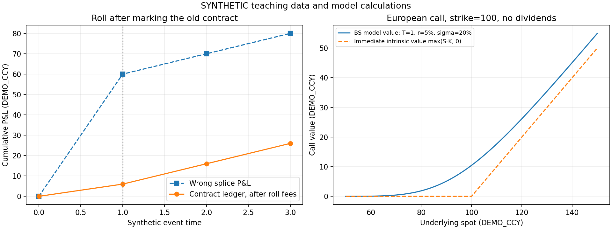

# 第11章 商品、外汇及衍生品基础

> 第二篇：金融市场与多资产建模。前接[第10章](./10_第10章_股票与债券的现金流和风险.md)，后接第12章《收益、波动、相关性与金融统计特征》。本章全部程序数据均为SYNTHETIC人工示例；历史事件只用于解释制度和建模边界。

## 学习目标与前置知识

前置知识是第4章的导数和数值求根、第5章的条件期望与正态分布、第7章的布朗运动和伊藤公式，以及第10章的现金流贴现。遇到连续时间推导困难时，可以先完成单期二叉树，再回到偏微分方程；两条路径都在回答“用什么可交易现金流复制这个支付”。

完成本章后，应能够：

1. 区分商品现货、不同交割月份期货、连续合约序列和可投资组合，建立合约级盈亏账本。
2. 识别汇率的计价方向、买卖价和本外币单位，推导抛补利率平价，解释高利率不等于无风险高回报。
3. 区分远期交割价、远期报价和合约价值，解释逐日盯市与保证金流动性风险。
4. 从复制组合推导二叉树价格，从自融资对冲与正态积分推导Black–Scholes–Merton公式。
5. 计算隐含波动率并明确适用范围，把期限结构、外汇融资和期权风险特征接入监控平台。

本章贯穿一个问题：**同一段行情看起来“异常”，究竟是经济状态变化、合约切换、计价方向改变，还是模型超出适用范围？** 状态识别服务必须先排除语义错误，才能讨论统计异常。

## 11.1 商品供需、期限结构与合约换月

### 11.1.1 商品价格对应的是带交付条件的实物

商品（Commodity）是可用于生产、消费或储藏的实物产品，例如能源、金属和农产品。现货（Spot）交易通常围绕较近的交付安排；期货（Futures）是按照交易场所规定的标准化条款，在未来交割或现金结算的合约。

“原油价格”不是一个充分定义的数据字段。质量等级、地点、计量单位、交割月份、运输条件和币种不同，对应的经济对象就不同。黄金现货、黄金期货、黄金ETF和矿业股票也不是可直接互换的同一资产。

用存量—流量关系描述一个地区某期商品库存：

```math
I_t=I_{t-1}+Q_t^{\mathrm{prod}}+Q_t^{\mathrm{import}}
-Q_t^{\mathrm{use}}-Q_t^{\mathrm{export}}-Q_t^{\mathrm{loss}}.
```

其中库存 $I$ 是期末实物存量，其他项都是同一期内的实物流量。若库存以吨计，生产流量却以吨/日计，必须先乘期间天数。这个恒等式约束数据一致性，**并不是价格预测方程**：市场还会交易未来需求、运输瓶颈和库存数据的可信度。

库存“已发生”也不意味着已公开。周度库存报告涉及观察区间、发布时间、系统获取时间和修订版本；不能把周末库存倒填为本周每一分钟都已知的特征。

对于平台，可以把商品特征分成三组：

|层次|例子|直接回答的问题|
|---|---|---|
|实物供需|库存、产量、运输与可用库容|实物是否紧张？|
|合约价格|现货、近月、远月、价差|不同交付时间如何定价？|
|交易与资金|成交量、持仓量、价差、保证金要求|能否交易、能否承受资金占用？|

持仓量（Open Interest，OI）是尚未平仓合约的数量，不能简单当作“多头资金”。每份未平仓合约都有相应多空双方，统计口径还应查明是单边还是其他计数方式。

### 11.1.2 从现金流复制推导持有成本

先考虑可储存、质量不变的商品。现价为 $S_0$ ，交付时点为 $T$ ，连续复利无风险利率为 $r$ 。假设能按同一利率借贷、没有交易费用、没有违约，购买与交割的商品完全一致。

如果全部储存费用在今天支付，其现值为 $U_0$ ，现在借入 $S_0+U_0$ ，购买并保存一单位商品，到期必须偿还：

```math
(S_0+U_0)e^{rT}.
```

同时卖出一份远期，约定到期交货收取 $F_{0,T}$ 。到期净现金流为：

```math
F_{0,T}-(S_0+U_0)e^{rT}.
```

若这个差额严格为正，并且整个操作可以执行，就存在现金套利（Cash-and-Carry Arbitrage）。若还能够反向卖空商品、安排归还并消除持有实物的额外利益，反向复制也成立，才能把无套利约束写成等式：

```math
F_{0,T}=(S_0+U_0)e^{rT}.
```

注意：当 $U_0$ 是今天已知的绝对费用现值时，不能直接写成“现价乘储存费率”，二者是不同费用模型。

常见的连续比例持有成本表达是：

```math
F_{0,T}=S_0e^{(r+u-y)T}.
```

这里 $u$ 是按价格比例表达的年化储存等成本， $y$ 是便利收益率（Convenience Yield），表示持有实物对生产连续性、及时履约等带来的经济利益。把比例成本和利益作为连续净持有成本，会得到：

```math
\frac{dF(T)}{dT}=(r+u-y)F(T),\qquad F(0)=S_0,
```

分离变量、从0积分到 $T$ ：

```math
\log F(T)-\log S_0=(r+u-y)T.
```

于是得到上述指数关系。**这一步只说明该成本模型如何积分，不证明便利收益是可交易现金股息。** 实物消费品常不能自由卖空，便利收益也不能像债券票息一样直接收取；因此该式常是经济解释和隐含量度工具，而不是无条件成立的套利等式。

在现货和期货均为正、其他参数已给定时，可以反解：

```math
y_{\mathrm{implied}}=r+u-\frac{1}{T}\log\frac{F_{0,T}}{S_0}.
```

这个隐含便利收益还会吸收质量差异、融资成本误差和报价不同步等影响。不能把残差全部解释为“真实库存稀缺”。

电力等难以低成本储存的商品、受约束的实物空头，以及负价格区间，不能机械套用这套正价格指数关系。技术选型应允许不同商品使用不同模型。

### 11.1.3 基差、期限结构与状态含义

本章把基差（Basis）定义为同一时刻现货减对应期货：

```math
b_t=S_t-F_{t,T}.
```

有些数据源采用相反符号，所以必须把定义存入特征元数据。合约到期、交付对象和条件一致且交割机制有效时，现货与期货受到收敛约束；地区现货和另一地点交割期货却可能保留运输价差。

期限结构（Term Structure）是固定观察时刻、不同到期月份的价格排列。远月高于近月通常称为正向市场（Contango），反向排列称为反向市场（Backwardation）；也有资料用期货相对现货描述这两个词。平台必须明确比较的是现货—期货，还是两个期限的期货。[CME官方入门资料](https://www.cmegroup.com/education/courses/introduction-to-ferrous-metals/what-is-contango-and-backwardation)

可先用不要求正价格的价差：

```math
\mathrm{spread}_t=F_{t,T_2}-F_{t,T_1},\qquad T_2>T_1.
```

只有两个价格均为正，才考虑按期限间距年化的对数斜率：

```math
s_t=\frac{\log F_{t,T_2}-\log F_{t,T_1}}{T_2-T_1}.
```

原始价差单位是货币/实物单位，年化对数斜率单位是每年；不能把两者混为同一阈值。季节性商品还应比较相同月份组合，而不是把冬夏价差一律判断为危机。

可观察曲线向下倾斜，与“期货价格低于未来现货的真实期望”是两回事。后者涉及正常逆价差（Normal Backwardation）等风险溢价理论，未来现货期望不能从当天两个月份的报价直接读出。

状态监控应使用“库存偏低、近月相对走强、盘口变薄”等多条证据，而不只用一个斜率命名“牛市”。同一个向上曲线既可能反映库存充足，也可能受资金与储存成本影响。

### 11.1.4 连续合约不是可以直接持有的证券

连续合约（Continuous Futures Series）把不同月份的合约按规则拼接，方便画长期走势图。换月（Roll）则是关闭原合约头寸并建立另一合约头寸的实际操作。两者必须分别建模。

假设下列价格都为人工构造；每手乘数10，始终持有1手多头，在第1期计入旧合约盈亏后换月：

|期数|近月价格|远月价格|本期结束后持仓|
|---|---:|---:|---|
|0|100|105|近月|
|1|101|106|远月|
|2|102|107|远月|
|3|103|108|远月|

直接拼接得到100、106、107、108。把第一段当作同一合约收益，会得到6%的“上涨”。实际第一期旧合约只从100涨到101：

```math
\Delta\Pi_1=1\times10\times(101-100)=10.
```

如果平旧、开新每腿手续费2，第一期净盈利6。初始权益1000，此后三期末权益分别是1006、1016、1026。

一般地，令 $q_{t-1}$ 是上一期持有手数， $m$ 是乘数， $c_{t-1}$ 是该持仓合约，先计算：

```math
\Delta\Pi_t=q_{t-1}m
\left(F^{c_{t-1}}_t-F^{c_{t-1}}_{t-1}\right).
```

然后才更新持仓与费用：

```math
E_t=E_{t-1}+\Delta\Pi_t-\mathrm{fee}_t
+\mathrm{interest}_t+\mathrm{deposit}_t-\mathrm{withdrawal}_t.
```

入金是外部现金流，不是投资盈利。若用权益计算收益，必须剔除外部流入流出的影响。

新期货按当时公平报价建立时通常初始合约价值为零，不是按远月报价购买整份实物。因此固定手数期货换月时，不能直接把“远月106减近月101”记为50元现金亏损。跨期价差会影响此后的价格收敛与收益分解，但不是这个时点必须支付的全额购买差价。变换为固定名义敞口或固定风险目标时，手数和再平衡现金流又需要另算。

“正向市场通常不利于长期滚动多头”是附带持有规则与曲线演化条件的经验表述：若持有的远月不断向较低现货收敛，确实可能有负向滚动收益；若整条曲线同时大涨，实际总盈亏仍可能为正。报告应给出定义和账本，不以一句口号替代计算。

加法后复权、比例后复权、固定期限插值都可用于分析，但会改变价格水平、收益或历史值。事后选“最终最活跃合约”会使用未来成交量；过去窗口中的复权值随以后换月重写，也会污染训练快照。至少保存原始合约行情、当时可知的选择规则和每次换月映射。用于图形的连续序列与用于盈亏的持仓序列分开存储。

### 11.1.5 历史事件：负油价为何不能直接删除

2020年4月20日，NYMEX的2020年5月WTI原油期货合约结算于每桶−37.63美元。该事实有特定合约、月份和时间含义，不等于“所有原油现货都变成负数”。CFTC于2020年11月23日发布的阶段性报告介绍涉及需求骤降、供应和储存压力、到期前流动性等因素，同时明确个别价格变动的根因分析超出报告范围。[CFTC官方发布](https://www.cftc.gov/PressRoom/PressReleases/8315-20)

EIA在2020年4月27日的说明也把有限可用储存空间、临近交割和低流动性联系起来。适合作为复盘材料，但这份文章不能倒填成4月20日已可用的在线新闻特征。[EIA官方说明](https://www.eia.gov/todayinenergy/detail.php?id=43495)

工程上，负价格应触发产品规则核验，而不是普遍删除。价格从20变为−5，再到−2，价格差分别是−25和3；对数收益均不适用。把负数取绝对值再取对数，会改变经济含义；对缺失对数收益填0，也会虚构“没有变化”。

应保留原始值、价格变化、合约乘数、金额盈亏和原因码，并暂停依赖正价格模型的指标。异常数据隔离与异常市场预警可以同时发生，不能混为一种标签。

## 11.2 汇率标价、利差、套息与汇率风险

### 11.2.1 先用单位解释汇率

外汇（Foreign Exchange，FX）是不同货币间的兑换关系。本章规定：

```math
S_t=\text{取得1单位外币所需的本币数量}.
```

因此 $S_t$ 的单位是“本币/外币”；上涨表示外币相对本币升值。真实数据应分别保存基础货币（Base Currency）和报价货币（Quote Currency），不要仅依赖“直接/间接标价”这类与观察者所在地有关的名称。

若反向汇率 $X_t=1/S_t$ ，设原汇率简单收益为 $r_t^S$ ：

```math
\frac{X_t}{X_{t-1}}=\frac{S_{t-1}}{S_t}
=\frac{1}{1+r_t^S},
\qquad
r_t^X=-\frac{r_t^S}{1+r_t^S}.
```

所以原方向上涨10%，反方向下跌约9.09%，并非10%。对数收益则满足：

```math
\log(X_t/X_{t-1})=-\log(S_t/S_{t-1}).
```

报价有买卖方向。若原方向银行买入外币的价格为 $S_{\mathrm{bid}}$ 、卖出外币的价格为 $S_{\mathrm{ask}}$ ，反向报价是：

```math
X_{\mathrm{bid}}=\frac{1}{S_{\mathrm{ask}}},
\qquad
X_{\mathrm{ask}}=\frac{1}{S_{\mathrm{bid}}}.
```

倒数以后还必须交换买卖边，否则容易造出负价差。

交叉汇率（Cross Rate）依靠单位相消。例如“本币/美元”乘“美元/欧元”得到“本币/欧元”。中间价的代数关系不自动等于可执行套利：实际交易要逐腿选择买卖价，考虑报价时效、额度、结算时间和成本。

### 11.2.2 抛补利率平价的逐步推导

抛补利率平价（Covered Interest Parity，CIP）比较已经用远期锁定汇率的两条资金路径。设本币和外币连续复利利率为 $r_d,r_f$ ，期限同为 $T$ ，远期 $F_{0,T}$ 仍用本币/外币报价。

从1单位本币出发。

路径A：在本币账户投资，到期得到 $e^{r_dT}$ 本币。

路径B分三步：

1. 现在换成 $1/S_0$ 外币；
2. 投资到期得到 $e^{r_fT}/S_0$ 外币；
3. 今天就签订远期，把这笔外币到期卖出，锁定本币金额。

路径B的到期本币为：

```math
\frac{e^{r_fT}}{S_0}F_{0,T}.
```

在可按相同利率借贷、没有信用差异和交易成本、现金流期限完全匹配时，两条确定现金流必须相等：

```math
e^{r_dT}=\frac{e^{r_fT}}{S_0}F_{0,T}
\quad\Longrightarrow\quad
F_{0,T}=S_0e^{(r_d-r_f)T}.
```

用同币种贴现因子 $D_d,D_f$ 表示，可写成更适合曲线系统的形式：

```math
F_{0,T}=S_0\frac{D_f(0,T)}{D_d(0,T)}.
```

若输入的是同一期限的单利年利率，则应重新按单利积累：

```math
F_{0,T}=S_0\frac{1+r_dT}{1+r_fT}.
```

两种公式都可能正确，但不能把一个公式中的连续利率与另一个公式中的单利利率混用。现实还要匹配即期起息日、到期日、货币假日和日计数；名义“1个月”并不一定对应相同天数。

人工例： $S_0=7.2$ ，本币利率2%，外币利率5%，均为连续年利率，期限1年：

```math
F_{0,1}=7.2e^{0.02-0.05}\approx6.98720784.
```

外币高利率对应外币远期贴水，使已经锁汇的投资收益回到本币无风险积累率。这个关系是对当下价格的约束，**不是预测一年后现货汇率必为6.9872**。

### 11.2.3 套息收益与汇率风险

套息交易（Carry Trade）常指借入低利率货币、投资高利率货币并承担未对冲汇率风险。若用自有1单位本币投资外币，到期再按未知现货 $S_T$ 换回，本币总收益率为：

```math
R_{\mathrm{unhedged}}=e^{r_fT}\frac{S_T}{S_0}-1.
```

若全部初始本币来自借款，则到期净现金流为：

```math
\Pi_T=e^{r_fT}\frac{S_T}{S_0}-e^{r_dT}.
```

后者是“每借入1单位本币的到期净现金流”，不能在初始净投入为零时冒充一个有限的权益收益率。

上述例子若一年后现货变为6.8，自有资金的本币收益约为−0.7133%。外币利息为正，仍不足以抵消外币贬值。锁定远期后则为：

```math
R_{\mathrm{hedged}}=e^{0.05}\frac{6.98720784}{7.2}-1
=e^{0.02}-1\approx2.0201\%.
```

非抛补利率平价（Uncovered Interest Parity，UIP）涉及未来现货的条件期望，以及风险溢价等假设，不是把远期换成未来现货后仍然成立的无套利保证。实际未对冲套息还可能在风险偏好突降时出现集中平仓。

BIS的2016年研究提出，外汇对冲需求与银行资产负债表约束等因素可以解释持续的跨币种基差。平台发现CIP偏离时，应先检查报价、期限与利率口径，再研究融资和风险承担能力，不能直接发布“无风险赚钱”结论。[Borio等，2016](https://www.bis.org/publ/qtrpdf/r_qt1609e.htm)

为了监控，可以定义自己的连续利率残差：

```math
\epsilon_{\mathrm{CIP}}
=\frac{1}{T}\log\frac{F_{0,T}}{S_0}-(r_d-r_f).
```

必须写清它是本平台的诊断残差。市场跨币种掉期基差可能加在不同币种的浮动腿上，符号和现金流不同，不能未经转换就把两者画在同一纵轴。

### 11.2.4 多资产收益换算与外汇敞口

本币投资者持有一项外币计价资产。令该资产外币总收益率为 $R^A$ ，外币对本币汇率收益为 $R^S$ ，忽略税费并假设收益按期末统一换算：

```math
1+R^D=(1+R^A)(1+R^S).
```

展开：

```math
R^D=R^A+R^S+R^AR^S.
```

最后一项是交互项。外国股票涨5%，外币贬值10%，本币收益计算为：

```math
1.05\times0.90-1=-5.5\%.
```

只相加得到−5%会漏掉交互项。若存在期间股息或部分汇率对冲，应按每笔现金流的日期和汇率处理，而不是机械使用这一单期公式。

对监控平台，至少同时展示本地货币资产收益、汇率收益和本币总收益。跨资产相关性矩阵必须先明确基准货币，否则“多种资产同时上涨”可能只是共同报价货币贬值。

## 11.3 远期、期货、期权与风险中性定价入门

### 11.3.1 交割价格、市场报价与合约价值

衍生品（Derivative）是支付依赖某个标的或状态变量的合约。远期（Forward）约定未来按固定交割价 $K$ 买卖标的。多头到期按 $K$ 买入，若以现金差额表示，一单位标的的支付为：

```math
H_T=S_T-K.
```

必须区分三种量：

|记号|含义|合约存续期间是否通常变化|
|---|---|---|
| $K$ |这份旧合约签订时确定的交割价|通常固定|
| $F_{t,T}$ |时刻 $t$ 新签同期限远期的公平交割报价|随市场变化|
| $V_t$ |旧合约在时刻 $t$ 的价值|随市场变化|

旧合约多头到期得到 $S_T-K$ 。在时刻 $t$ 另卖出一份新远期，到期得到 $F_{t,T}-S_T$ 。两者相加，随机现货抵消，确定支付变成 $F_{t,T}-K$ 。新远期初始价值为零，所以旧合约价值必须等于该确定支付的现值：

```math
V_t=D(t,T)(F_{t,T}-K).
```

若包含 $Q$ 单位标的，再乘 $Q$ 。到期贴现因子为1，远期报价收敛至相应现货，恢复支付 $Q(S_T-K)$ 。

以上假设信用、抵押、融资等条件一致。真实场外合约还需考虑对手方与抵押条款，不能把简化价值当作所有交易的结算金额。

例：企业未来要支付外币，担心外币升值，应考虑买入外币的远期多头。若误把其记为空头，系统恰好会在风险上升时报告“盈利对冲”。合约方向必须与现金流负债方向联动核对。

### 11.3.2 逐日盯市改变现金流时间

逐日盯市（Mark-to-Market，MTM）把期货持仓按结算价格计算盈亏并划转。保证金（Margin）为履约提供保障；初始保证金不是买入整个标的的价格，也不是最大可能亏损。

上海期货交易所2026年《结算规则》第17条把当日无负债结算描述为对合约盈亏、保证金、权利金和费用等结算并净额划转。具体客户资金安排还取决于适用规则和合同，教材中的单账户例子并不逐条实现交易所清算流程。[官方规则](https://www.shfe.cn/regulation/exchangerules/rules/202606/t20260603_831935.html)

对1手多头、乘数10、价格从100跌至88：

```math
\Delta\Pi=10(88-100)=-120.
```

若原权益只有100，盯市后权益为−20；若下一阶段要求账户具备80权益，所需补充现金为100。不能把亏损截断到原先100，也不能默认一定能及时追加保证金或按目标价格平仓。

设每期已经实现的期货现金流为 $\Delta\Pi_i$ 。如果把它们都积累到共同终点 $T$ ，终值为：

```math
W_T=\sum_i\Delta\Pi_i
\exp\left(\int_{t_i}^{T}r_s\,ds\right).
```

现金流的发生路径和再投资、融资利率都会影响终值。远期通常把差额集中到到期结算，期货则较早产生现金需求。在适当理想条件和确定性利率下，远期与期货报价可相同；随机利率与标的相关时，两者可能不同。**到期方向性暴露相似，不代表期间流动性需求相同。**

因此监控平台需要“市场损失”和“现金缺口”两个视角。资产最终可能恢复价格，持仓者也可能在恢复前就因资金不足而被迫退出。

### 11.3.3 期权支付、利润与平价关系

期权（Option）赋予持有者按行权价（Strike Price）买入或卖出标的的权利。看涨期权（Call）赋予买入权，看跌期权（Put）赋予卖出权。欧式（European）在到期时行权；美式（American）允许按合同在到期前的允许时点行权，名称并不表示交易所在地。

对于一单位非负价格标的：

```math
C_T=\max(S_T-K,0),\qquad P_T=\max(K-S_T,0).
```

支付（Payoff）不等于利润（Profit）。若期初看涨权利金为 $C_0$ ，以连续利率 $r$ 融资并持有到期，则终值口径利润为：

```math
\Pi_T^{\mathrm{call}}=\max(S_T-K,0)-C_0e^{rT}.
```

如果忽略时间价值，用支付减原始权利金也可以作为简化损益口径，但必须说明。期权买方在单独持有已付权利金的期权时具有与卖方不同的损失结构；不能将其推广到含融资、裸卖期权或复杂组合的整个账户。

先考虑不分红股票、相同到期与行权价的欧式期权。在到期时：

```math
\max(S_T-K,0)-\max(K-S_T,0)=S_T-K.
```

验证分两种情形：若 $S_T\ge K$ ，左边为 $S_T-K-0$ ；若 $S_T\lt K$ ，左边为 $0-(K-S_T)$ 。两者都等于右边。

因此“看涨多头+看跌空头”的终值等于“股票多头−到期偿还 $K$ 的借款”。同支付同价格，得到看涨—看跌平价（Put–Call Parity）：

```math
C_0-P_0=S_0-Ke^{-rT}.
```

若标的支付已知连续比例股息率 $q$ ，股票复制部分改为能在到期积累为一股的头寸，价格关系相应为：

```math
C_0-P_0=S_0e^{-qT}-Ke^{-rT}.
```

后面的程序只实现 $q=0$ 。期货期权的标的是特定期货合约，现金流与贴现方式也应按其规则建模，不能直接把期货报价填进股票模型的现货位置。

不分红欧式看涨在上述理想模型下满足：

```math
\max(S_0-Ke^{-rT},0)\le C_0\le S_0.
```

下界来自平价和看跌非负，上界来自一股股票覆盖看涨到期支付。若报价违反该界限，先检查币种、乘数、买卖价、价格时点、分红和期权类型；有成交成本或不可执行的旧报价时，不能只凭代数差额宣布套利。

### 11.3.4 单期二叉树：风险中性概率从哪里来

二叉树模型（Binomial Model）假设一期后标的只有两个价格。当前价格 $S$ ，上行乘数 $u$ ，下行乘数 $d$ ，无风险总积累因子 $R$ ，并假设：

```math
0<d<R<u.
```

这是无套利条件：若无风险资产回报不在股票两种回报之间，便可能用股票与借贷构造单向优势。上、下两种状态都假设可能发生，股票可以做多做空，借贷对称且无交易费。

期权两种支付为 $C_u,C_d$ 。建立复制组合（Replicating Portfolio）：持有 $\Delta$ 股股票，现金账户初始金额为 $B$ ，负的 $B$ 代表借款。到期要求：

```math
\begin{aligned}
\Delta Su+BR&=C_u,\\[0pt]
\Delta Sd+BR&=C_d.
\end{aligned}
```

两式相减，现金项消失：

```math
\Delta S(u-d)=C_u-C_d
\quad\Longrightarrow\quad
\Delta=\frac{C_u-C_d}{S(u-d)}.
```

代入下行状态：

```math
B=\frac{C_d-\Delta Sd}{R}
=\frac{uC_d-dC_u}{(u-d)R}.
```

复制组合初始成本是：

```math
\begin{aligned}
C_0&=\Delta S+B\\[0pt]
&=\frac{C_u-C_d}{u-d}
+\frac{uC_d-dC_u}{(u-d)R}\\[0pt]
&=\frac{(R-d)C_u+(u-R)C_d}{(u-d)R}.
\end{aligned}
```

定义：

```math
p_Q=\frac{R-d}{u-d},\qquad 1-p_Q=\frac{u-R}{u-d},
```

于是：

```math
C_0=\frac{p_QC_u+(1-p_Q)C_d}{R}.
```

无套利条件保证两个权重在0与1之间。它们构成风险中性概率（Risk-Neutral Probability），对应定价测度 $Q$ 。这些权重是从复制推出来的，并不是先假设投资者不怕风险。

物理测度（Physical Measure） $P$ 描述真实世界的发生概率；估计未来上涨概率、训练市场状态转移模型通常属于这个问题。复制定价的 $Q$ 和真实预测的 $P$ 不能互换。[MIT 15.401期权课程及讲义](https://ocw.mit.edu/courses/15-401-finance-theory-i-fall-2008/pages/video-lectures-and-slides/options/)

人工例： $S=100,K=100,u=1.2,d=0.8,R=1.05$ 。上下支付为20和0：

```math
\Delta=0.5,\quad
B=-38.09523810,\quad
p_Q=0.625,\quad
C_0=11.90476190.
```

上行时股票价值60减偿债40得到20；下行时40减40得到0。即使研究者认为真实上涨概率只有0.5，只要模型的两状态和复制条件成立，复制价格仍是11.90476。用真实概率直接贴现得到9.52381，会忽略支付风险的价格。

### 11.3.5 多期树与向后递推

Cox–Ross–Rubinstein二叉树（CRR Tree）把期限分成 $N$ 步， $\Delta t=T/N$ 。对无股息标的，给定波动率 $\sigma$ ：

```math
u=e^{\sigma\sqrt{\Delta t}},\quad d=u^{-1},
\quad R=e^{r\Delta t},\quad
p_Q=\frac{R-d}{u-d}.
```

时刻 $i$ 、累计上行 $j$ 次的节点价格是：

```math
S_{i,j}=S_0u^jd^{i-j}.
```

因为 $ud=1$ ，先上后下与先下后上到达同一节点，树可以重合。先在末端计算支付，再逐层向前：

```math
C_{i,j}=e^{-r\Delta t}
\left[p_QC_{i+1,j+1}+(1-p_Q)C_{i+1,j}\right].
```

递推来自每个节点上的单期复制。节点总数为 $1+2+\cdots+(N+1)$ ，计算量是 $O(N^2)$ ；只保存当前一层，存储量是 $O(N)$ 。

美式期权要比较立即行权与继续持有：

```math
C_{i,j}^{A}=\max\left(H(S_{i,j}),
e^{-r\Delta t}[p_QC_{i+1,j+1}^{A}+(1-p_Q)C_{i+1,j}^{A}]\right).
```

其中 $H$ 是行权支付。本章代码仅实现欧式看涨，不把这个公式写出来就声称已经支持真实美式产品。含离散股息、障碍条件或路径依赖时，还需扩展状态与节点处理。

当步长过粗、利率或波动参数不适合时，可能出现 $p_Q$ 不在0与1内。正确做法是报告离散模型失效并调整网格或模型，而不是截断概率到0或1后继续计算。

### 11.3.6 从自融资对冲推导BSM偏微分方程

Black–Scholes–Merton模型（BSM）把不分红股票建模为几何布朗运动：

```math
dS_t=\mu S_t\,dt+\sigma S_t\,dW_t.
```

这里 $\mu$ 是真实测度下的漂移， $\sigma\gt 0$ 是常数波动率， $W$ 是布朗运动。假设利率恒定、股票可连续交易、允许做空和借贷、没有跳跃或交易成本。欧式期权价值为 $C(t,S)$ 。

由第7章的伊藤公式：

```math
dC=\left(C_t+\mu SC_S+\frac12\sigma^2S^2C_{SS}\right)dt
+\sigma SC_S\,dW.
```

下标代表偏导数，例如 $C_S$ 是对股票价格的一阶偏导。复制组合由 $\Delta_t$ 股股票和货币市场账户组成，其总价值为 $C$ 。自融资（Self-Financing）要求调仓只使用组合内部资金，不能靠未记录的外部注资制造复制。

因此价值增量满足：

```math
dC=\Delta_t\,dS+r(C-\Delta_tS)\,dt.
```

右边第一项为股票持仓收益，第二项为剩余现金或借款利息。令 $\Delta_t=C_S$ ，两边的随机项完全一致；比较漂移项：

```math
C_t+\mu SC_S+\frac12\sigma^2S^2C_{SS}
=\mu SC_S+r(C-SC_S).
```

消去两侧相同的真实漂移项：

```math
C_t+\frac12\sigma^2S^2C_{SS}+rSC_S-rC=0.
```

终端条件是 $C(T,S)=\max(S-K,0)$ 。价格方程里没有 $\mu$ ，原因是理想连续对冲消除了该项，而不是现实股票的平均收益必定等于无风险利率。

在满足相应正则性和增长条件时，这个方程的解可以用风险中性期望表示：

```math
C_0=e^{-rT}\mathbb E_Q[(S_T-K)^+],
\qquad
S_T=S_0e^{(r-\sigma^2/2)T+\sigma\sqrt T Z},
\quad Z\sim N(0,1).
```

记号 $x^+=\max(x,0)$ 。这里从真实测度换到定价测度；它是同一复制价格的概率表示。一般偏微分方程与期望的对应理论属于后续随机分析课程，本章接下来把这个特定终端支付的积分实际算完。[MIT 18.642第21讲：风险中性定价与Black–Scholes方程](https://ocw.mit.edu/courses/18-642-topics-in-mathematics-with-applications-in-finance-fall-2024/resources/mit18_642_f24_lec21_pdf/)

### 11.3.7 将风险中性积分算成闭式公式

定义标准正态密度和分布函数：

```math
\phi(z)=\frac{e^{-z^2/2}}{\sqrt{2\pi}},
\qquad \Phi(x)=\int_{-\infty}^{x}\phi(z)\,dz.
```

看涨有正支付当且仅当 $S_T\gt K$ 。对数化并移项：

```math
Z>a=\frac{\log(K/S_0)-(r-\sigma^2/2)T}{\sigma\sqrt T}.
```

令：

```math
d_2=-a=\frac{\log(S_0/K)+(r-\sigma^2/2)T}{\sigma\sqrt T},
\qquad d_1=d_2+\sigma\sqrt T.
```

把期望拆为股票项和行权价项：

```math
C_0=e^{-rT}\mathbb E_Q[S_T\mathbf 1_{\lbrace Z>a\rbrace }]
-Ke^{-rT}\Pr_Q(Z>a).
```

第二项中的概率由正态对称性等于 $\Phi(d_2)$ 。

第一项把 $S_T$ 代入并合并指数：

```math
e^{-rT}\mathbb E_Q[S_T\mathbf 1_{\lbrace Z>a\rbrace }]
=S_0\int_a^\infty
e^{-\sigma^2T/2+\sigma\sqrt T z}\phi(z)\,dz.
```

关键的配方步骤是：

```math
-\frac{z^2}{2}+\sigma\sqrt T z-\frac{\sigma^2T}{2}
=-\frac{(z-\sigma\sqrt T)^2}{2}.
```

令 $w=z-\sigma\sqrt T$ ，积分下限变为 $a-\sigma\sqrt T$ ：

```math
S_0\int_{a-\sigma\sqrt T}^{\infty}\phi(w)\,dw
=S_0\Phi(\sigma\sqrt T-a)=S_0\Phi(d_1).
```

因此：

```math
C_0=S_0\Phi(d_1)-Ke^{-rT}\Phi(d_2),
\qquad
d_1=\frac{\log(S_0/K)+(r+\sigma^2/2)T}{\sigma\sqrt T}.
```

再由平价得到看跌价格：

```math
P_0=Ke^{-rT}\Phi(-d_2)-S_0\Phi(-d_1).
```

这是模型内的公平价格，不是“计算得到就必然能成交”的市场事实。现实中波动随时间与价格改变、跳跃、交易摩擦、离散对冲都会造成模型风险。

### 11.3.8 Greeks、隐含波动率与监控特征

希腊字母风险指标（Greeks）描述模型价格对输入的局部敏感度。先验证一个有用恒等式：

```math
S_0\phi(d_1)=Ke^{-rT}\phi(d_2).
```

因为 $d_1-d_2=\sigma\sqrt T$ ，计算密度比：

```math
\log\frac{\phi(d_1)}{\phi(d_2)}
=-\frac{d_1^2-d_2^2}{2}
=-\log(S_0/K)-rT,
```

两侧指数化即可得到恒等式。对看涨公式求股票价格导数时：

```math
\frac{\partial C}{\partial S}
=\Phi(d_1)+S\phi(d_1)\frac{\partial d_1}{\partial S}
-Ke^{-rT}\phi(d_2)\frac{\partial d_2}{\partial S}.
```

由于两个 $d$ 对 $S$ 的导数都是 $1/(S\sigma\sqrt T)$ ，后两项抵消，于是：

```math
\Delta=\frac{\partial C}{\partial S}=\Phi(d_1),
\qquad
\Gamma=\frac{\partial^2C}{\partial S^2}
=\frac{\phi(d_1)}{S\sigma\sqrt T}.
```

对波动率求导，利用 $\partial d_1/\partial\sigma-\partial d_2/\partial\sigma=\sqrt T$ 及同一密度恒等式：

```math
\mathrm{Vega}=\frac{\partial C}{\partial\sigma}
=S\phi(d_1)\sqrt T.
```

Vega这里对应波动率变化1.00；提高一个波动率百分点对应0.01，要再乘0.01。对小幅变动，在其他输入固定时：

```math
\Delta C\approx\Delta\,\Delta S
+\frac12\Gamma(\Delta S)^2+\mathrm{Vega}\,\Delta\sigma.
```

这不是完整损益归因：还有时间、利率及交叉项，较大冲击应完整重估。Delta也不是一般意义下“到期赚钱的概率”；本模型中到期实值概率是 $\Phi(d_2)$ ，而不是 $\Phi(d_1)$ 。

隐含波动率（Implied Volatility，IV）是给定市场期权价格后，使模型价格与其相等的 $\sigma$ ：

```math
C_{\mathrm{BSM}}(S,K,r,\sigma,T)-C_{\mathrm{market}}=0.
```

由于正常参数域内Vega为正，价格随波动率单调增加。二分法可在有效括区内求根：

1. 核对欧式、不分红、正价格、正剩余期限以及单位。
2. 检查价格上下界；边界值不能强行解释为一个普通正的有限IV。
3. 给定波动率区间，检查端点价格能夹住市场价格。
4. 取中点，按模型价格偏高或偏低缩小区间。
5. 达到价格误差阈值后返回，同时记录模型、括区与输入快照。

Newton法利用Vega通常更快，但在极度价内外或临近到期时Vega很小，更新容易失控；可以使用有括区的混合求根。程序保留二分法，便于检查失败语义。

IV不是直接观测到的未来波动率，也不是单纯的历史标准差。不同期限、行权价对应的IV形成波动率曲面（Volatility Surface）；笑脸、偏斜和期限结构含有尾部风险价格、供需和模型偏差等信息。跨日比较时应固定期限与相对行权位置，避免仅因合约变近到期而误判市场状态。

|方法|优点|本章中的边界|
|---|---|---|
|静态复制与平价|假设清楚，适合数据一致性检查|只覆盖相应现金流和产品|
|CRR二叉树|可看见状态与递推，易扩展提前行权|网格误差，计算量随步数平方增长|
|BSM闭式|速度快、便于理解Greeks与IV|恒定波动、正标的、不分红欧式等限制|
|Monte Carlo模拟|适合多维及路径依赖支付|有抽样误差；普通模拟不直接解决提前行权|
|偏微分方程数值法|适合较低维边界与提前行权问题|需要网格、稳定性与边界条件验证|

本章先建立可解释基线。未来即使用深度模型提取期权曲面状态，也应保留这些现金流恒等式作为约束检查。

## 11.4 完整实验：合约换月、汇率转换与期权定价

### 11.4.1 数据协议与实验问题

本实验扩展统一案例中的GOLD_DEMO与FX_DEMO，并用SYNTHETIC股票期权解释EQ_DEMO可能对应的非线性风险；不是给已有股票数据增加一个真实上市期权。BOND_DEMO提供利率风险背景，本章直接给定人工利率，不伪装成实时曲线。

输入包括四个时刻的两个商品期货价格、预先确定的换月计划、本外币利率、一个外汇终值情景，以及欧式看涨模型参数。程序不需要网络或账号。

对事件时刻 $t$ ，假设数据在 $t+0.05$ 到达，决策在 $t+0.10$ ；换月计划在时刻0已知。所有时间是模拟逻辑时钟，不代表秒级实测延迟。程序检查：

```math
t_{\mathrm{event}}\le t_{\mathrm{available}}\le t_{\mathrm{decision}}.
```

此处假定同一行中的两个月份价格同时可用，并把该标记价格当作可成交价。这是为了隔离“错误合约拼接”问题；真实系统必须分别记录报价和成交的时间、买卖边、滑点、成交数量，不能由历史收盘价自动保证可成交。

实验回答六个可核对问题：

1. 换月应在哪个合约上计算当期盈亏？
2. 计价方向与CIP是否满足同币种财富恒等式？
3. 期货亏损是否可能超过原账户权益？
4. 单期复制组合能否在两个状态准确支付？
5. CRR结果是否接近独立BSM公式，IV是否能恢复输入参数？
6. 出现负价格时，哪些指标继续计算，哪些明确停用？

### 11.4.2 环境、完整代码与运行方式

主程序和测试仅使用Python标准库；绘图使用电脑上已有的Matplotlib。独立源文件为[derivatives_lab.py](./code/ch11/derivatives_lab.py)，测试见[test_derivatives_lab.py](./code/ch11/test_derivatives_lab.py)，绘图见[plot_derivatives.py](./code/ch11/plot_derivatives.py)。

在仓库根目录运行：

```powershell
& 'D:\Anaconda\python.exe' -X utf8 教材/code/ch11/derivatives_lab.py
& 'D:\Anaconda\python.exe' -X utf8 -m unittest discover -s 教材/code/ch11 -v
```

第一条命令会打印本次输出目录。把该目录作为绘图参数：

```powershell
& 'D:\Anaconda\python.exe' -X utf8 教材/code/ch11/plot_derivatives.py '这里替换为刚打印的运行目录'
```

下面是与独立源文件一致的完整主程序：

```python
"""SYNTHETIC teaching lab. Standard library only; no trading connections."""
import hashlib
import json
import math
import platform
from datetime import datetime, timezone
from pathlib import Path


def finite(*values):
    if any(isinstance(x, bool) or not isinstance(x, (int, float))
           or not math.isfinite(x) for x in values):
        raise ValueError("finite real numbers required")


def fx_forward(spot, domestic_rate, foreign_rate, years):
    finite(spot, domestic_rate, foreign_rate, years)
    if spot <= 0 or years < 0:
        raise ValueError("positive FX spot and nonnegative tenor required")
    return spot * math.exp((domestic_rate - foreign_rate) * years)


def inverse_quote(bid, ask):
    finite(bid, ask)
    if not 0 < bid <= ask:
        raise ValueError("invalid bid/ask")
    return 1 / ask, 1 / bid


def forward_value(forward, delivery, rate, years, units=1):
    finite(forward, delivery, rate, years, units)
    if years < 0:
        raise ValueError("negative tenor")
    return units * math.exp(-rate * years) * (forward - delivery)


def price_change(previous, current):
    finite(previous, current)
    valid_log = previous > 0 and current > 0
    return {"difference": current - previous,
            "log_return": math.log(current / previous) if valid_log else None,
            "reason": None if valid_log else "NONPOSITIVE_PRICE_LOG_UNDEFINED"}


def roll_ledger(rows, schedule, capital=1000.0, multiplier=10.0,
                fee_per_leg=2.0, schedule_available=0.0):
    """One long contract. Schedule fixed before initial entry; marks equal fills."""
    finite(capital, multiplier, fee_per_leg, schedule_available)
    if capital <= 0 or multiplier <= 0 or fee_per_leg < 0 or not rows:
        raise ValueError("invalid account or empty input")
    if len(rows) != len(schedule):
        raise ValueError("schedule length mismatch")
    if schedule_available > rows[0]["decision_at"]:
        raise ValueError("roll schedule was not known at entry")
    nav, old_contract, old_price, last_time = capital, None, None, -math.inf
    ledger = []
    for row, new_contract in zip(rows, schedule):
        t, available, decision = row["event_at"], row["available_at"], row["decision_at"]
        finite(t, available, decision)
        if not last_time < t <= available <= decision:
            raise ValueError("unordered or unavailable mark")
        needed = {new_contract} | ({old_contract} if old_contract else set())
        if not needed <= row["prices"].keys():
            raise ValueError("missing held/entry contract; no silent fill")
        for contract in needed:
            finite(row["prices"][contract])
        pnl = (0.0 if old_contract is None else
               multiplier * (row["prices"][old_contract] - old_price))
        fee = 2 * fee_per_leg if old_contract and new_contract != old_contract else 0.0
        nav += pnl - fee
        ledger.append({"event_at": t, "available_at": available, "decision_at": decision,
                       "earned_on": old_contract, "held_after": new_contract,
                       "mark_after": row["prices"][new_contract],
                       "variation": pnl, "fee": fee, "equity": nav})
        old_contract, old_price = new_contract, row["prices"][new_contract]
        last_time = t
    return ledger


def margin_stress(equity, old_price, new_price, multiplier, required_margin):
    """One long future; required_margin is supplied, not estimated from price."""
    finite(equity, old_price, new_price, multiplier, required_margin)
    if multiplier <= 0 or required_margin < 0:
        raise ValueError("invalid multiplier or requirement")
    after = equity + multiplier * (new_price - old_price)
    return {"equity_after": after, "cash_shortfall": max(required_margin - after, 0)}


def one_step(spot, strike, up, down, gross):
    finite(spot, strike, up, down, gross)
    if spot <= 0 or strike <= 0 or not 0 < down < gross < up:
        raise ValueError("require positive spot/strike and d < R < u")
    cu, cd = max(spot * up - strike, 0), max(spot * down - strike, 0)
    delta = (cu - cd) / (spot * (up - down))
    cash = (up * cd - down * cu) / ((up - down) * gross)
    probability = (gross - down) / (up - down)
    return {"delta": delta, "cash": cash, "q_probability": probability,
            "call": delta * spot + cash, "up_payoff": cu, "down_payoff": cd}


def option_inputs(spot, strike, rate, sigma, years):
    finite(spot, strike, rate, sigma, years)
    if spot <= 0 or strike <= 0 or sigma <= 0 or years <= 0:
        raise ValueError("BS/CRR require S,K,sigma,T > 0; no boundary extrapolation")


def cdf(x):
    return 0.5 * (1 + math.erf(x / math.sqrt(2)))


def bs_call(spot, strike, rate, sigma, years):
    option_inputs(spot, strike, rate, sigma, years)
    width = sigma * math.sqrt(years)
    d1 = (math.log(spot / strike) + (rate + sigma * sigma / 2) * years) / width
    d2 = d1 - width
    return spot * cdf(d1) - strike * math.exp(-rate * years) * cdf(d2)


def crr_call(spot, strike, rate, sigma, years, steps=200):
    option_inputs(spot, strike, rate, sigma, years)
    if isinstance(steps, bool) or not isinstance(steps, int) or not 1 <= steps <= 2000:
        raise ValueError("steps must be an integer in [1, 2000]")
    dt = years / steps
    up = math.exp(sigma * math.sqrt(dt))
    down, gross = 1 / up, math.exp(rate * dt)
    if not down < gross < up:
        raise ValueError("tree has no interior risk-neutral probability")
    prob = (gross - down) / (up - down)
    values = [max(spot * up ** (2 * j - steps) - strike, 0)
              for j in range(steps + 1)]
    for level in range(steps, 0, -1):
        values = [(prob * values[j + 1] + (1 - prob) * values[j]) / gross
                  for j in range(level)]
    return values[0]


def implied_vol(price, spot, strike, rate, years, low=1e-6, high=3.0):
    finite(price, spot, strike, rate, years, low, high)
    option_inputs(spot, strike, rate, low, years)
    if not low < high:
        raise ValueError("invalid volatility bracket")
    lower = max(spot - strike * math.exp(-rate * years), 0)
    if not lower < price < spot:
        raise ValueError("price not strictly within BS call bounds")
    if not bs_call(spot, strike, rate, low, years) <= price <= bs_call(
            spot, strike, rate, high, years):
        raise ValueError("price outside requested volatility bracket")
    for _ in range(100):
        mid = (low + high) / 2
        value = bs_call(spot, strike, rate, mid, years)
        if abs(value - price) < 1e-10:
            return mid
        if value < price:
            low = mid
        else:
            high = mid
    raise ArithmeticError("IV did not meet price tolerance")


def synthetic_inputs():
    return {"label": "SYNTHETIC", "currency": "DEMO_CCY", "multiplier": 10.0,
            "capital": 1000.0, "fee_per_leg": 2.0, "schedule_available": 0.0,
            "schedule": ["GOLD_DEMO_NEAR", "GOLD_DEMO_FAR",
                         "GOLD_DEMO_FAR", "GOLD_DEMO_FAR"],
            "rows": [{"event_at": float(t), "available_at": t + .05,
                      "decision_at": t + .10,
                      "prices": {"GOLD_DEMO_NEAR": 100.0 + t,
                                 "GOLD_DEMO_FAR": 105.0 + t}}
                     for t in range(4)],
            "fx": {"spot": 7.2, "domestic_rate": .02, "foreign_rate": .05,
                   "years": 1.0, "terminal_spot": 6.8},
            "option": {"spot": 100.0, "strike": 100.0, "rate": .05,
                       "sigma": .20, "years": 1.0},
            "negative_prices": [20.0, -5.0, -2.0]}


def run():
    inputs = synthetic_inputs()
    ledger = roll_ledger(inputs["rows"], inputs["schedule"], inputs["capital"],
                         inputs["multiplier"], inputs["fee_per_leg"],
                         inputs["schedule_available"])
    fx, option = inputs["fx"], inputs["option"]
    forward = fx_forward(**{k: v for k, v in fx.items() if k != "terminal_spot"})
    call = bs_call(**option)
    results = {
        "label": "SYNTHETIC", "ledger": ledger,
        "naive_splice_pnl": [10 * (x["mark_after"] - ledger[0]["mark_after"])
                             for x in ledger],
        "fx_forward": forward,
        "fx_unhedged_return": math.exp(fx["foreign_rate"]) * fx["terminal_spot"] / fx["spot"] - 1,
        "fx_hedged_return": math.exp(fx["foreign_rate"]) * forward / fx["spot"] - 1,
        "margin": margin_stress(100, 100, 88, 10, 80),
        "binomial": one_step(100, 100, 1.2, .8, 1.05),
        "bs_call": call, "bs_put_by_parity": call - 100 + 100 * math.exp(-.05),
        "recovered_iv": implied_vol(call, 100, 100, .05, 1),
        "crr": {str(n): crr_call(**option, steps=n) for n in [25, 50, 100, 200, 400, 401]},
        "negative_price_features": [price_change(a, b) for a, b in
                                    zip(inputs["negative_prices"], inputs["negative_prices"][1:])]}
    root = Path(__file__).resolve().parent / "runs"
    out = root / datetime.now(timezone.utc).strftime("run_%Y%m%dT%H%M%S_%fZ")
    out.mkdir(parents=True)
    for name, data in [("inputs.json", inputs), ("results.json", results)]:
        (out / name).write_text(json.dumps(data, indent=2, ensure_ascii=False,
                                         allow_nan=False) + "\n", encoding="utf-8")
    digest = lambda p: hashlib.sha256(p.read_bytes()).hexdigest()
    manifest = {"label": "SYNTHETIC", "python": platform.python_version(),
                "code_sha256": digest(Path(__file__)),
                "files": {p.name: digest(p) for p in sorted(out.glob("*.json"))},
                "assumptions": ["marks equal executable fills by construction",
                                "one long contract, fixed schedule known at entry",
                                "zero collateral interest; roll fees only",
                                "European no-dividend options; constant r and sigma",
                                "toy arrival times, not measured system latency"]}
    (out / "manifest.json").write_text(json.dumps(manifest, indent=2) + "\n",
                                      encoding="utf-8")
    print(out)
    print(json.dumps(results, ensure_ascii=False, indent=2))


if __name__ == "__main__":
    run()
```

核心逻辑按现金流顺序排列：roll_ledger先给旧持仓记账，再扣换月费用并记录新持仓；one_step直接解复制系数；crr_call由终端支付反推；bs_call独立计算正态积分闭式；implied_vol检查边界后用二分法反解。

每次运行生成inputs.json、results.json和manifest.json。清单记录代码、输入、结果哈希及Python版本；运行目录使用UTC时间以避免跨机器时区歧义。本次没有随机数，所以不需要声称“固定随机种子”来保证复现。所有金额都是人工单位，不是实际投资收益。

### 11.4.3 实际运行结果与解释

使用既有Anaconda Python 3.13.5，14项程序检查实际通过。包括缺失持仓合约、迟到数据、未知换月计划、负价格、保证金不足、两个状态的复制、树与闭式交叉核对、IV恢复和不适用参数拒绝。

|项目|本次实际结果|解释|
|---|---:|---|
|换月后第1期权益|1006|旧合约盈利10，双腿费用4|
|最后一期权益|1026|全程合约毛利30，费用4|
|错误拼接的累计“盈利”|80|其中含不可直接实现的合约价格级差|
|外汇远期|6.9872078415|本币/外币，连续利率CIP|
|未对冲外币投资收益|−0.7132853423%|外币利息未抵消贬值|
|对冲后收益|2.0201340027%|等于本币连续2%的年积累收益|
|压力情景权益/补款缺口|−20 / 100|原权益100，要求恢复到80|
|单期树看涨价格|11.9047619048|上下乘数1.2/0.8，积累因子1.05|
|BSM看涨/看跌|10.4505835722 / 5.5735260223|现价与行权价100，年利率5%，波动20%，期限1年|
|反解IV|0.199999999998|数值误差内恢复20%|

注意两类树例子的上、下参数不同：单期例手工指定1.2和0.8；多期CRR使用指数参数。不能要求它们的一期价格完全相等。

|CRR步数|欧式看涨价格|
|---:|---:|
|25|10.5209656240|
|50|10.4106915407|
|100|10.4306116622|
|200|10.4405912599|
|400|10.4455858413|
|401|10.4549555011|

偶数和奇数网格会使行权价相对节点的位置不同，误差可能从两侧逼近。增加步数不意味着每一步误差严格单调下降。测试检查400和401步都在BSM价格的0.006以内，不编造“每次加步数都改善”的性质。



图左是同一人工价格输入下的错误拼接与合约账本，纵轴是金额而非可比策略收益率；图右是不同当前股价下的模型价值与立即内在价值，不是未来股价预测。图片由运行结果和清单内参数生成，并已检查。

### 11.4.4 接入平台的数据模型与工程边界

本章先运行单进程计算核。进入后续分布式篇章时，应围绕金融对象划分数据，而不是将不同对象都塞进一个price列。

|记录|最少字段|避免的问题|
|---|---|---|
|合约主数据|contract_id、underlying_id、到期、币种、单位、乘数、交割类型、规则版本|月份、单位和标的混用|
|行情事件|contract_id、买卖价/成交价/结算价类型、event_at、published_at、available_at、来源与修订号|把后来结算价当盘中可交易价|
|换月记录|旧新合约、手数、规则版本、规则可用时间、决定时间、成交引用、费用|拼接跳点进入收益|
|估值快照|模型版本、输入事件引用、曲线版本、输出时间、估值与Greeks|新曲线回填旧时点|
|特征结果|计算区间、币种、质量码、有效期限、依赖版本|缺失值被当零或过期特征被使用|
|预警证据|触发指标、当时阈值、证据引用、生成时间、修订关系|后来报告解释被当成当时判断|

同一条商品新闻可能同时影响现货供需、远期曲线和风险溢价，不能重复累计为三次独立证据。一个监控仪表盘可以分别显示“近月紧张”“外汇融资偏离”“期权尾部风险定价上升”，再由后续状态模型综合；这些是观察维度，不自动构成买卖指令。

生产服务还需处理下列问题：

- **数据质量**：产品规则允许负价不等于所有负价都正确。查价格类型、单位、来源和规则版本，保留原记录与核验结论。
- **时间与修订**：事件时间、发布时间、系统获取时间分别保存。历史回放按当时可用版本选取，不能用最新主数据覆盖所有历史合约。
- **服务可靠性**：计算应有输入事件ID与幂等键；重复消息不重复计费或记盈亏，失败记录进入可重放队列。当前程序尚未实现消息消费、持久化恢复或Exactly-once语义。
- **数值范围**：教学实现使用普通浮点数、erf和指数，极端参数下可能溢出或相消。生产实现需要稳定正态尾部、输入尺度检查和明确错误状态，不能靠返回0掩盖失败。
- **模型边界**：程序对到期为0或波动率为0主动拒绝。实际服务应另设到期支付、确定性极限分支；IV在这些边界往往不能唯一识别。
- **账户边界**：账本固定1手、固定乘数、只扣换月费、抵押利息为0，没有初始开仓费与最后平仓费，最后一期是盯市权益；保证金压力函数独立于账本，没有实现强平与融资。
- **安全与授权**：本程序没有交易入口。未来行情凭证不写入日志或代码；市场数据再分发须符合来源授权，监控权限和交易权限分离。

14项检查验证的是限定实验，不是生产交易系统验收。基准结果也不涉及学习任务，所以不存在训练/测试准确率；后续将这些特征喂给状态模型时，才需要按统一时间切分公平比较。

## 本章总结

商品的经济对象包含实物质量、地点与交割时间；期货价格期限结构不能脱离库存、融资和交付条件解释。连续合约帮助观察历史，持仓账本负责真实现金流，二者不可替代。

汇率必须先明确计价方向。抛补利率平价约束当前可复制资金路径，未对冲套息仍承担汇率风险。本币收益还要包含资产与汇率的交互项。

衍生品定价从现金流复制出发。远期交割价不等于合约价值；逐日盯市引入资金时点风险；二叉树与BSM中的风险中性概率用于定价，不是真实市场状态发生概率。

平台应输出可追溯的价格、敞口、模型风险和质量状态。知道一个公式何时不适用，与知道如何算出一个数同样重要。

## 分层练习题

### 题1：基础理解——同名资产

现货黄金、近月黄金期货、后复权黄金连续合约、黄金矿业股票，能否仅用asset_name合并？列出至少五个必须保留的区分字段。

### 题2：数学推导——持有成本

商品现货100，未来一年全部储存费用的现值为3，连续利率4%，无便利收益。假设双向复制可行，求一年远期价。若远期报价110，写出现金套利的每一步和到期净收入。

### 题3：编程与会计——换月

把实验每腿手续费改为3，手数不变。求最终权益，给出账本守恒式。解释为何不能在换月时再扣“远月减近月”。

### 题4：数学推导——反向汇率

原方向汇率从7.0涨到7.7，求反向简单收益和两个方向的对数收益。原方向买卖价为7.19/7.21，求反向买卖价并说明边为何交换。

### 题5：金融分析——有利差就有盈利吗

使用本章FX参数，求未对冲自有资金投资收益为0时的终值汇率；再求借入本币投资外币的净现金流为0时的汇率。解释两个阈值为何不同。

### 题6：数学推导——远期价值与对冲

一份外汇远期多头买入10000单位外币，交割价7.1，当前同期限远期报价7.3，剩余半年、本币连续利率2%。求价值；若原业务是半年后支付10000外币，说明远期方向是否合适。

### 题7：复制与概率——二叉树

取 $S=100,K=100,u=1.2,d=0.8,R=1.05$ ，推导看跌的复制头寸和价格，核对看涨—看跌平价。再说明若 $R=1.25$ ，为什么不能把公式计算出的“概率”当概率使用。

### 题8：推导与数值——BSM与Greeks

对本章BSM例计算 $d_1,d_2$ 、Delta、Gamma、Vega，并估计价格上涨1、波动率提高一个百分点时的局部价格变动。说明估算忽略了什么。

### 题9：编程——树误差与失效状态

比较CRR在400和401步相对BSM的误差。为什么不能把“加一步误差必下降”写入测试？给出一组使单步CRR无套利条件失败的参数，并说明应采取的处理。

### 题10：数据质量——负价格与模型切换

价格序列为20、−5、−2。写出价格差与对数收益质量码；若有人把非正价格取绝对值后训练波动模型，指出错误。正态价格模型能否自动解决所有问题？

### 题11：开放设计——实时跨资产预警

设计“商品近月紧张，同时外汇融资压力上升”的监控方案。必须包括至少四类输入、PIT时间、两个不同层次的质量检查、解释证据和误报控制，不要求生成交易建议。

### 题12：研究与审计——事后解释和真实概率

复盘2020年4月20日事件时，有团队把11月发布的监管报告作为当天新闻特征，并用期权模型的风险中性概率给出“历史危机真实发生概率”。指出两个错误，给出可审计的纠正方案。

## 详细参考答案

### 题1参考答案

不能。asset_name是显示名称，不是可唯一确定现金流的主键。至少保留资产类型、唯一合约ID、标的ID、到期月份、币种、价格单位、合约乘数、交割地点/等级、价格类型与规则版本。连续合约另需拼接/复权方法及版本，矿业股票还包含经营与公司融资风险。

程序应先用主数据定义对象，再做带时间条件的连接；禁止同名记录自动覆盖。评分看字段是否能区分现金流、能否追溯合约切换，而不只看列出的字段数量。

### 题2参考答案

现在需融资103，其中100买商品、3支付以现值表示的全部储存安排。一年后偿还：

```math
F=103e^{0.04}\approx107.20350974.
```

若卖出交割价110的远期，到期交付库存，收入110并偿还107.20351，净收入约2.79649。起初投资净额为0。

成立条件包括储存服务可落实、商品质量与交付条件一致、可按4%融资且没有额外交易或信用成本。若储存报价不保证可用库容，纸面差额不等于可执行套利。

### 题3参考答案

三段持仓毛盈利均为10，换月两腿共6，因此最终权益为1024。守恒式是：

```math
1024=1000+(10+10+10)-(3+3).
```

在主程序所在目录可运行：

```python
from derivatives_lab import roll_ledger, synthetic_inputs
data = synthetic_inputs()
ledger = roll_ledger(data["rows"], data["schedule"], fee_per_leg=3)
assert ledger[-1]["equity"] == 1024
assert sum(x["variation"] - x["fee"] for x in ledger) == 24
```

新合约初始价值为零，远月与近月的价格级差不是必须支付的全额现金差。将其再次扣除会创造账本中不存在的现金流。实际手续费、价差和滑点则应依据成交记录逐项计入。

### 题4参考答案

原方向简单收益为10%，反向：

```math
\frac{1/7.7}{1/7.0}-1=\frac{7}{7.7}-1
=-\frac{1}{11}\approx-9.090909\%.
```

对数收益分别为 $\log(1.1)\approx0.09531018$ 和 $-0.09531018$ 。反向买价约0.1386962552，卖价约0.1390820584，单位也改为原外币/原本币。倒数交换次序，是因为在反向买入一种货币等价于在原方向卖出另一种货币。

### 题5参考答案

自有资金不亏本金要求 $e^{r_fT}S_T/S_0=1$ ，所以：

```math
S_T=S_0e^{-r_fT}=7.2e^{-0.05}\approx6.84885186.
```

借入本币的资金还需偿还本息，净现金流为0要求：

```math
e^{r_fT}S_T/S_0=e^{r_dT}
\quad\Longrightarrow\quad
S_T=7.2e^{-0.03}\approx6.98720784.
```

第二个阈值更高，因为需要覆盖本币融资成本。自有资金“保住本金”也未必跑赢本币无风险投资。两者都是情景边界，没有预测实际汇率。

### 题6参考答案

未来确定差额为 $10000(7.3-7.1)=2000$ 本币，折现：

```math
V=2000e^{-0.02\times0.5}\approx1980.09966750.
```

价值为正，因为旧多头能以较低交割价买外币。未来应付外币的企业需要买入外币，多头方向符合其风险对冲目的。是否完整对冲还取决于数量、币种、到期和交割条件是否一致；不能只看当前估值正负。

### 题7参考答案

看跌上涨状态支付0，下跌状态支付20：

```math
\Delta_P=\frac{0-20}{100(1.2-0.8)}=-0.5,
\qquad
B_P=\frac{1.2\times20-0.8\times0}{0.4\times1.05}
=57.14285714.
```

初始价格 $P=-50+57.14285714=7.14285714$ 。上行时−60加60等于0，下行时−40加60等于20。平价：

```math
C-P=11.90476190-7.14285714
=100-\frac{100}{1.05}=4.76190476.
```

若 $R=1.25$ ，计算出的 $p_Q=(1.25-0.8)/0.4=1.125$ 超过1。原因是无风险回报大于股票两个状态的回报：做空股票收100并投资无风险资产，到期有125，买回股票最多120仍有正剩余。应拒绝该参数组合，而不是将1.125截为1。

### 题8参考答案

因为 $\log(S/K)=0$ 、 $T=1$ ：

```math
d_1=\frac{0.05+0.2^2/2}{0.2}=0.35,\qquad d_2=0.15.
```

代入公式：

```math
\Delta\approx0.63683065,\quad
\Gamma\approx0.01876202,\quad
\mathrm{Vega}\approx37.52403469.
```

局部近似为：

```math
\Delta C\approx0.63683065\times1
+\frac12(0.01876202)\times1^2
+37.52403469\times0.01
\approx1.02145201.
```

结果忽略时间推进、利率变动、股票与波动率交叉项和更高阶项。它用于局部风险解释；若需要精确情景值，应分别调用bs_call计算新旧参数价格。

### 题9参考答案

400步误差约−0.00499773，401步约+0.00437193；这一次绝对误差变小，不构成一般单调性证明。网格奇偶会改变行权边界附近节点，测试应采用有依据的容差，并观察多个步数，不强制不存在的数学性质。

例如 $r=1,\sigma=0.01,T=1,N=1$ ，则 $R=e^1$ ，而 $u=e^{0.01}$ ，有 $R\gt u$ 。单步模型失效。可以增加步数并重新检查，或者更换离散化，但不能悄悄改变输入利率。完整程序对此抛出明确错误。

### 题10参考答案

两个价格差为−25和3。两段都返回log_return为空，原因码NONPOSITIVE_PRICE_LOG_UNDEFINED。虽然−2除以−5为正，也不能把负价格之间比率的对数继续解释成标准正资产的对数财富收益。

取绝对值会把“从负5涨至负2”变成“从5跌至2”，方向都反了。取绝对值还丢失零点附近的结构信息。

可使用金额变化、按固定正风险预算归一化的盈亏，或为允许负值的价格过程选择相应模型。正态价格模型允许负值，但仍需校准波动单位、现金流、期限、非平稳性和产品条款；允许负值只解决模型支持集的一项问题。

### 题11参考方案与评分标准

输入可包含近远月买卖价、合约主数据与换月日历、库存首次发布及修订、持仓/成交量、FX即远期报价、本外币期限匹配利率。每条数据带实际观察时间、发布时间和获取时间，指标仅用决策前已取得版本。

第一层检查格式与制度语义：单位、币种、到期、买卖价顺序、乘数。第二层检查跨源和经济一致性：报价是否同步、期限是否匹配、极端价差是否由换月造成、CIP残差是否超出交易成本和陈旧报价所能解释的范围。

输出应分别保留“供需紧张证据”“市场流动性证据”“融资价格证据”。持续若干有效窗口才触发、严重程度分级、设置解除阈值和冷却时间；数据缺失单独报质量预警，不补成风险解除。

开放题评分建议：金融含义与替代解释30%，时间安全25%，质量与恢复设计20%，误报控制15%，可复现证据与可视化10%。只有一个综合红灯、没有证据时间线的方案不能获得高分。

### 题12参考答案

错误一是前视偏差。11月报告可以作为事后研究材料和解释来源，不能成为4月20日在线模型的输入。把报告的published_at设为真实11月日期；如系统后来获取，还要保存更晚的available_at。回放4月20日时过滤掉它，复盘报告中单列“当时信息”和“事后补充证据”。

错误二是混淆定价测度与真实测度。风险中性概率反映复制价格权重，包含风险价格信息；真实危机频率需要定义事件、历史样本和可用特征后，在时间外样本上估计与校准，不能把二者直接互称。

若研究风险中性指标是否能预测危机，可以把当时可用的期权特征作为预测变量，在统一训练、验证、测试时段检验；报告概率校准、误报漏报、阈值选择和不确定性。把“有预测价值”作为待验证命题，而不是模型名称带来的保证。

## 推荐教材与延伸阅读

以下访问核对日期为2026-10-25。公开课程与官方网页可以合法在线阅读，但不意味着可以任意复制其全部内容。出版社页面用于核对书目和目录，不当作免费教材全文。

|编号|资料、作者、年份与合法入口|可核实阅读位置|推荐理由与学习阶段|
|---|---|---|---|
|P2-16|John C. Hull，Options, Futures, and Other Derivatives，Global Edition第11版；Pearson标注2021年出版、版权2022。[出版社页面](https://www.pearson.com/en-gb/subject-catalog/p/options-futures-and-other-derivatives-global-edition/P200000004519/9781292410654)|第2章期货与中央对手方、第5章远期与期货价格、第11章期权性质、第13章二叉树、第15章BSM、第19章Greeks、第35章商品衍生品|本章后系统阅读，适合高年级与研究生；本次核对目录与书目，全文通过图书馆或合法购买获取|
|P2-17|Andrew W. Lo，MIT 15.401 Finance Theory I，2008年秋。[远期与期货](https://ocw.mit.edu/courses/15-401-finance-theory-i-fall-2008/pages/video-lectures-and-slides/forward-and-futures-contracts/)、[期权](https://ocw.mit.edu/courses/15-401-finance-theory-i-fall-2008/pages/video-lectures-and-slides/options/)|期权讲义第16—21张，单期复制与真实概率消失；视频Options III|入门到中阶；帮助把抽象公式连到现金流。OCW官方公开资源，遵守页面许可|
|P2-18|Vasily Strela，MIT 18.642，2024年秋，第21讲Risk Neutral Valuation, Black-Scholes Equation。[官方讲义](https://ocw.mit.edu/courses/18-642-topics-in-mathematics-with-applications-in-finance-fall-2024/mit18_642_f24_lec21.pdf)|第10—13页二叉树与测度，第14—20页伊藤公式、方程与价格|掌握第7章后阅读；PDF首页署名Strela，不把课程其他教师误写为该讲作者|
|P2-19|CME Group Education，What Is Contango and Backwardation?，持续维护，未核定原始出版年。[官方页面](https://www.cmegroup.com/education/courses/introduction-to-ferrous-metals/what-is-contango-and-backwardation)|全文中的持有成本、库存利益与期限结构|基础阶段；直观了解术语，使用时仍明确现货—期货或近远月比较口径|
|P2-20|Claudio Borio、Robert N. McCauley、Patrick McGuire、Vladyslav Sushko，Covered interest parity lost: understanding the cross-currency basis，BIS Quarterly Review，2016年9月。[官方文章](https://www.bis.org/publ/qtrpdf/r_qt1609e.htm)|A framework、Box A、Limits to arbitrage|本章之后进阶；将CIP的理想复制与资金、资产负债表约束联系起来|
|P2-21|美国能源信息署EIA，Low liquidity and limited available storage pushed WTI crude oil futures prices below zero，2020-04-27。[官方说明](https://www.eia.gov/todayinenergy/detail.php?id=43495)|WTI特定合约、储存与交割相关段落|案例阅读；特别练习把事件日与文章发布日分开|
|P2-22|美国商品期货交易委员会CFTC，发布号8315-20，2020-11-23。[官方发布](https://www.cftc.gov/PressRoom/PressReleases/8315-20)|2020年5月WTI合约、4月20日结算价、报告范围与限制|研究训练；核对确切价格和因果解释边界。本次读发布说明，不声称已阅读全文报告|
|P2-23|上海期货交易所，《结算规则》，官方页发布日期2026-06-12。[官方规则](https://www.shfe.cn/regulation/exchangerules/rules/202606/t20260603_831935.html)|第6—10条中央对手方与保证金，第17—18条盯市及追加，第19条交割|国内制度衔接；实际接入还需保存实施日期、品种细则和后续修订，不把教学金额当现行标准|

本章理论、数字例子和代码独立组织与计算。没有下载完整教材，没有使用未经授权的教材副本，也没有删除用户文件。程序运行产物按项目规则不纳入版本库，保留源代码、正文、图和核对记录即可重建。

**本章完成。下一章：第12章《收益、波动、相关性与金融统计特征》。**
