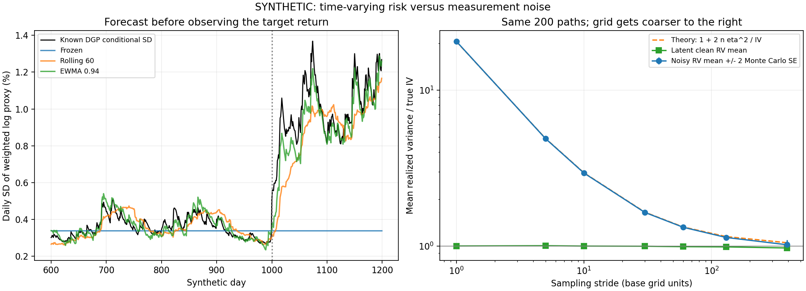

# 第12章 收益、波动、相关性与金融统计特征

> 第二篇：金融市场与多资产建模。前接[第11章](./11_第11章_商品、外汇及衍生品基础.md)。全部实验数据均为SYNTHETIC人工生成，不是赛题官方数据或真实市场业绩。

## 学习目标与前置知识

前置知识：第3章的协方差矩阵与半正定性，第5—6章的矩、估计和抽样误差，第7—8章的条件信息与时间依赖，以及第10—11章的总收益、币种和合约语义。

完成本章后，应能正确聚合收益、计算组合风险、说明年化公式的条件，区分厚尾与波动聚集，识别非同步报价对相关性的干扰，并建立不读取未来数据的波动监控实验。

上一章解决“这是什么合约、现金流如何计算”，本章解决“对已经定义正确的收益，应统计什么”。收益很小不一定风险低，相关系数接近零不一定彼此独立，采样频率很高也不一定估计更准。

## 12.1 简单收益、对数收益、协方差与组合风险

### 12.1.1 收益率必须绑定财富与观察区间

设 $V_{t-1}\gt 0$ 是期初财富， $V_t$ 是剔除外部入金出金、按约定计入期间现金流后的期末财富。总积累因子（Gross Return）、简单收益率（Simple Return）和对数收益率（Log Return）分别为：

```math
G_t=\frac{V_t}{V_{t-1}},\qquad R_t=G_t-1,\qquad
x_t=\log G_t=\log(1+R_t).
```

前两章已说明，原始除息价格、换月拼接价、债券净价和期货保证金余额不能不经处理就当作上述财富。对数要求两端财富为正；亏损100%时对数不再有限，期货负报价也不能用这个公式解释财富。

逆变换为：

```math
R_t=e^{x_t}-1.
```

程序用log1p和expm1计算接近零的变化，比先做1加减后再取对数或指数更适合小量。还要先核对收益单位：0.01代表1%，而不是0.01%。把收益统一乘100，标准差也乘100，协方差则乘10000。

价格收益、总收益、超额收益不能混用。相对同期限无风险简单收益 $R_f$ ，常用算术超额收益 $R-R_f$ ；相对财富增长率则是 $(1+R)/(1+R_f)-1$ 。两者不同，差异不应被变量名“excess_return”掩盖。

### 12.1.2 时间聚合：简单收益连乘，对数收益相加

由财富递推 $V_t=V_{t-1}(1+R_t)$ ：

```math
\frac{V_T}{V_0}=\prod_{t=1}^{T}(1+R_t).
```

所以累计简单收益和累计对数收益为：

```math
R_{1:T}=\prod_{t=1}^{T}(1+R_t)-1,\qquad
x_{1:T}=\sum_{t=1}^{T}x_t.
```

先涨10%再跌10%，财富从100到110，再到99。两期简单收益相加为0，真实累计收益却为−1%。对应对数收益之和：

```math
\log(1.1)+\log(0.9)=\log(0.99).
```

几何平均每期收益 $g$ 由 $(1+g)^T=V_T/V_0$ 定义：

```math
g=\exp\left(\frac1T\sum_t x_t\right)-1.
```

算术平均收益描述每期样本收益的平均，几何平均描述实际复利增长；不能为了“哪个更好看”随意选择。

对数展开：

```math
\log(1+R)=R-\frac{R^2}{2}+\frac{R^3}{3}-\cdots,
\qquad |R|<1.
```

若收益足够小、可忽略高阶项：

```math
\mathbb E[x]\approx\mathbb E[R]-\frac12\mathbb E[R^2]
=\mu-\frac12(\sigma^2+\mu^2).
```

这里 $\mu=\mathbb E[R]$ ， $\sigma^2=\mathrm{Var}(R)$ 。常见的“平均增长约为均值减半个方差”还忽略了 $\mu^2$ 。它是局部近似，不适用于接近破产的大幅亏损；厚尾下高阶项的期望也未必存在。

### 12.1.3 横截面聚合：组合收益不能直接平均对数收益

设期初资产权重 $w_i$ 的和为1，期间不调仓、没有费用和外部现金流。第 $i$ 项期末财富为 $w_iV_0(1+R_i)$ ，因此：

```math
V_1=V_0\sum_iw_i(1+R_i)
=V_0\left(1+\sum_iw_iR_i\right),
\qquad R_p=\sum_iw_iR_i.
```

组合对数收益则是：

```math
x_p=\log\left(\sum_iw_ie^{x_i}\right),
```

通常不等于 $\sum_iw_ix_i$ 。对非负权重，利用对数的凹性：

```math
\log\left(\sum_iw_ie^{x_i}\right)
\ge\sum_iw_i\log(e^{x_i})=\sum_iw_ix_i.
```

两只资产各占一半，一只涨10%、另一只跌10%，组合当期财富不变，对数收益为0；加权资产对数收益却为 $\frac12\log(0.99)\lt 0$ 。

小收益时还能量化差异。设 $m=\sum_iw_ix_i$ ，先把指数展开，再把对数展开：

```math
\sum_iw_ie^{x_i}\approx1+m+\frac12\sum_iw_ix_i^2,
```

```math
x_p\approx m+\frac12\sum_iw_ix_i^2-\frac12m^2.
```

所以二阶差额是资产对数收益横截面加权离散程度的一半。这解释了为什么线性对数收益适合作为短期风险近似，却不能未经说明当作准确组合净值。

若每天调回固定权重，以上是每期计算；若买入后一直不调仓，下一期权重会随价格变化。带空头或杠杆时还要计入现金和融资，非负权重的Jensen不等式也不能原样使用。

### 12.1.4 从协方差定义推导组合方差

设收益向量为 $\mathbf R$ ，均值为 $\boldsymbol\mu$ ，协方差矩阵为：

```math
\Sigma=\mathbb E[(\mathbf R-\boldsymbol\mu)
(\mathbf R-\boldsymbol\mu)^{\mathsf T}].
```

第 $i,j$ 项为 $\sigma_{ij}$ ，对角项是方差。组合偏离均值：

```math
R_p-\mathbb E[R_p]=\mathbf w^{\mathsf T}
(\mathbf R-\boldsymbol\mu).
```

平方、展开并取期望：

```math
\begin{aligned}
\mathrm{Var}(R_p)
&=\mathbb E\left[\sum_i\sum_jw_iw_j
(R_i-\mu_i)(R_j-\mu_j)\right]\\[0pt]
&=\sum_i\sum_jw_iw_j\sigma_{ij}
=\mathbf w^{\mathsf T}\Sigma\mathbf w.
\end{aligned}
```

相关系数（Correlation）把协方差无量纲化：

```math
\rho_{ij}=\frac{\sigma_{ij}}{\sigma_i\sigma_j}.
```

由Cauchy–Schwarz不等式，分子绝对值不超过分母，所以相关系数在−1与1之间；任一方差为零时，相关系数未定义，不能填为0。

对两个资产：

```math
\sigma_p^2=w_1^2\sigma_1^2+w_2^2\sigma_2^2
+2w_1w_2\rho_{12}\sigma_1\sigma_2.
```

设日标准差2%与1%、权重0.6与0.4。相关系数−0.3时，组合方差0.0001312，标准差约1.1454%；相关变为0.8而单资产波动不变，组合方差升至0.0002368，标准差约1.5388%。

这给出了监控跨资产依赖的理由：即使各资产波动没有明显变化，原来的对冲关系消失也会增加组合风险。[MIT组合理论课程](https://ocw.mit.edu/courses/15-401-finance-theory-i-fall-2008/pages/video-lectures-and-slides/portfolio-theory/)

若 $n$ 个资产等波动、等权重且两两相关均为 $\rho$ ：

```math
\sigma_p^2
=\frac{n\sigma^2+n(n-1)\rho\sigma^2}{n^2}
=\sigma^2\left(\rho+\frac{1-\rho}{n}\right).
```

只有共同风险足够小，增加资产数量才显著降低风险。这样的等相关矩阵本身还要求 $\rho\ge-1/(n-1)$ ；不能固定一个负相关系数同时无限增加资产数。

### 12.1.5 风险贡献、样本估计与矩阵有效性

对 $\sigma_p=\sqrt{\mathbf w^{\mathsf T}\Sigma\mathbf w}\gt 0$ 求导：

```math
\frac{\partial\sigma_p}{\partial w_i}
=\frac{(\Sigma\mathbf w)_i}{\sigma_p}.
```

定义第 $i$ 个资产的波动风险贡献：

```math
\mathrm{RC}_i=w_i\frac{(\Sigma\mathbf w)_i}{\sigma_p},
\qquad \sum_i\mathrm{RC}_i=\sigma_p.
```

最后一个等式由分子求和等于 $\mathbf w^{\mathsf T}\Sigma\mathbf w$ 得到。这是局部敏感度分解，某项可以为负，表示在当前权重下具有对冲作用；不是“这项资产不可能亏损”。方差贡献与波动贡献的单位不同，也不能混画。

对 $n$ 行完整收益观测，样本协方差为：

```math
\widehat\Sigma=\frac1{n-1}\sum_{t=1}^n
(\mathbf R_t-\overline{\mathbf R})
(\mathbf R_t-\overline{\mathbf R})^{\mathsf T}.
```

分母 $n-1$ 的无偏解释需要相应抽样假设，例如独立同分布且二阶矩有限。金融序列的时间依赖与结构变化并不会被减去一个自由度自动消除。

对任意向量 $\mathbf a$ ：

```math
\mathbf a^{\mathsf T}\widehat\Sigma\mathbf a
=\frac1{n-1}\sum_t
\left[\mathbf a^{\mathsf T}
(\mathbf R_t-\overline{\mathbf R})\right]^2\ge0.
```

所以同一完整数据面板计算的样本协方差是半正定的。若每一对资产使用不同缺失样本，分别算出的相关系数虽然都在合法范围内，拼出的矩阵却可能不半正定。第3章已讨论修复；这里强调先查时间对齐和样本集合，不能用特征值裁剪掩盖错误。

NumPy中样本放在行、资产放在列时，应显式设置rowvar=False和ddof=1；var默认ddof=0，和cov默认口径不同。程序必须明确选择，而不能凭函数名称猜测。[NumPy 2.1官方文档](https://numpy.org/doc/2.1/reference/generated/numpy.cov.html)

### 12.1.6 年化的条件：先处理时间依赖

设对数收益 $x_t$ 协方差平稳，自协方差为 $\gamma_h=\mathrm{Cov}(x_t,x_{t-h})$ 。连续 $K$ 期累计对数收益是其和，因此：

```math
\mathrm{Var}\left(\sum_{t=1}^{K}x_t\right)
=\sum_{t=1}^{K}\sum_{s=1}^{K}\mathrm{Cov}(x_t,x_s).
```

对角线有 $K$ 个 $\gamma_0$ ；距离对角线为 $h$ 的上下两条线上分别有 $K-h$ 个 $\gamma_h$ ：

```math
\mathrm{Var}(x_{1:K})
=K\gamma_0+2\sum_{h=1}^{K-1}(K-h)\gamma_h.
```

若所有非零滞后协方差为零，就简化为 $K\gamma_0$ ，标准差为 $\sqrt K\thinspace \sigma$ 。这里不必要求独立，但必须满足所用二阶条件。对某个固定期限，非零协方差也可能恰好相互抵消；不能反过来仅凭缩放成立就断言各期不相关。

若AR(1)型自协方差为 $\gamma_h=\gamma_0\phi^h$ ，取 $\phi=0.5,K=5$ ：

```math
\frac{\mathrm{Var}(x_{1:5})}{\gamma_0}
=5+2(4\times0.5+3\times0.25+2\times0.125+0.0625)
=11.125.
```

直接乘5会低估。负自相关也可能使简单缩放高估。另一方面，即使收益不相关，条件波动仍可能随时间变化，因此过去日波动乘根号252未必是未来一年风险预测。

252只是常用交易日数量约定，不是自然常数。股票、外汇、全天交易资产的日历不同；一分钟波动年化还涉及开盘收盘、隔夜收益和日内季节性。

若独立正态对数收益单期均值为 $\mu$ 、方差为 $\sigma^2$ ，累计对数收益服从 $N(K\mu,K\sigma^2)$ 。累计简单收益的方差其实是：

```math
\mathrm{Var}(e^{x_{1:K}}-1)
=e^{2K\mu+K\sigma^2}\left(e^{K\sigma^2}-1\right).
```

推导用正态指数矩： $\mathbb E[e^{aX}]=e^{a m+a^2v/2}$ ，分别取 $a=2$ 和 $a=1$ 再相减。它不等于把单期简单收益方差乘 $K$ 。平台应明确显示“对数收益波动的年化尺度”还是“累计简单收益风险”。

## 12.2 厚尾、偏度、波动聚集与非同步交易

### 12.2.1 风格化事实是经验规律，不是全部市场的公理

风格化事实（Stylized Facts）是跨样本经常观察到的统计特征，例如极端收益多于简单正态模型的预期、波动聚集，以及收益和平方收益具有不同的时间依赖。

Cont的综述把无条件分布、条件分布、尾部和时间依赖分开讨论。它们应当成为模型检验问题，不能成为无需看数据就写入结果的结论。[Cont，Stylized Properties of Asset Returns](https://onlinelibrary.wiley.com/doi/abs/10.1002/9780470061602.eqf19027)

较新的研究也重新检查这些特征是否在统一股票样本中同时成立。这里引用的是2024年修订的公开论文版本，不能把其观点说成全部市场已达成的共识。[Ratliff-Crain等，2024版本](https://arxiv.org/abs/2311.07738v2)

本章的人工GOLD_DEMO样本甚至可能有负的样本超额峰度。这不说明程序必须“修正”成厚尾；有限样本、资产载荷和时期划分都会影响统计量。

### 12.2.2 偏度、峰度与尾部矩存在条件

设均值 $\mu$ 、标准差 $\sigma\gt 0$ ，偏度（Skewness）和超额峰度（Excess Kurtosis）定义为：

```math
\mathrm{Skew}(X)=\frac{\mathbb E[(X-\mu)^3]}{\sigma^3},
\qquad
\mathrm{ExKurt}(X)=\frac{\mathbb E[(X-\mu)^4]}{\sigma^4}-3.
```

正态超额峰度为0。负偏度刻画一类分布不对称性，但单个负偏度数值不能概括所有下跌风险；峰度则对极端观测非常敏感。高峰度也不等于已经证明幂律尾部。

程序使用样本中心矩 $m_k=n^{-1}\sum_t(x_t-\bar x)^k$ ，计算 $m_3/m_2^{3/2}$ 和 $m_4/m_2^2-3$ ，明确不是小样本无偏修正版。不同库的bias和fisher选项会导致结果不同。

若分布密度尾部近似 $f(x)\propto |x|^{-(\nu+1)}$ ，绝对 $k$ 阶矩尾部积分近似：

```math
\int_M^\infty x^k f(x)\,dx
\propto\int_M^\infty x^{k-\nu-1}\,dx.
```

这个积分仅在 $k\lt \nu$ 时收敛。Student t分布就是一类例子：自由度不超过2时方差不存在，自由度不超过4时四阶矩不存在。样本软件仍能输出一个有限峰度，但它未必在估计一个有限总体参数。

因此，先报告样本长度、频率、缺失比例和极端值影响，再解释偏度峰度。对潜在真实极端事件，不应为了让分布“接近正态”而无记录删除。

### 12.2.3 条件正态也能产生无条件厚尾

令：

```math
x_t=\sqrt{h_t}\,z_t,\qquad
z_t\mid\mathcal F_{t-1}\sim N(0,1),
```

其中 $h_t\gt 0$ 在过去信息集 $\mathcal F_{t-1}$ 下已知， $z_t$ 独立于过去。于是条件均值为0、条件方差为 $h_t$ 。

由迭代期望：

```math
\mathbb E[x_t^2]=\mathbb E[h_t],
\qquad
\mathbb E[x_t^4]=3\mathbb E[h_t^2].
```

假设这些矩存在，无条件峰度为：

```math
\frac{\mathbb E[x_t^4]}{\mathbb E[x_t^2]^2}
=3\frac{\mathbb E[h_t^2]}{\mathbb E[h_t]^2}
=3+3\frac{\mathrm{Var}(h_t)}{\mathbb E[h_t]^2}.
```

只要条件方差会变，无条件分布就可能有正超额峰度，不需要每个时刻的冲击分布都厚尾。把高低波动时期混在一起，还可能把结构变化误当作单一稳定厚尾分布。

这也说明“收益的直方图像正态”和“条件风险模型正确”不是同一检验。

### 12.2.4 波动聚集：收益不相关仍可能平方相关

波动聚集（Volatility Clustering）指大幅波动倾向于接着大幅波动，小幅波动也常连续出现，并不表示涨跌方向必然连续。

考虑一阶自回归条件异方差模型（Autoregressive Conditional Heteroskedasticity，ARCH）：

```math
x_t=\sqrt{h_t}z_t,\qquad
h_t=\omega+\alpha x_{t-1}^2,\qquad \omega>0,\ \alpha\ge0.
```

由于 $\mathbb E[x_t\mid\mathcal F_{t-1}]=0$ ，任意过去收益 $x_{t-k}$ 都满足：

```math
\mathbb E[x_tx_{t-k}]
=\mathbb E[x_{t-k}\mathbb E(x_t\mid\mathcal F_{t-1})]=0.
```

但设 $\eta_t=x_t^2-h_t=h_t(z_t^2-1)$ ，则：

```math
x_t^2=\omega+\alpha x_{t-1}^2+\eta_t,
\qquad \mathbb E[\eta_t\mid\mathcal F_{t-1}]=0.
```

若四阶矩存在，对两边与 $x_{t-1}^2$ 取协方差：

```math
\mathrm{Cov}(x_t^2,x_{t-1}^2)
=\alpha\,\mathrm{Var}(x_{t-1}^2).
```

当 $\alpha\gt 0$ 且平方收益不退化时，平方收益呈正相关。这是收益方向不可线性预测、风险强度却可变化的明确例子。

平稳二阶矩满足：

```math
m_2=\omega+\alpha m_2
\quad\Longrightarrow\quad m_2=\frac{\omega}{1-\alpha},
\qquad \alpha<1.
```

正态创新下四阶矩还需更强条件。用 $\mathbb E[z^4]=3$ ：

```math
m_4=3\mathbb E[(\omega+\alpha x_{t-1}^2)^2]
=3\omega^2+6\omega\alpha m_2+3\alpha^2m_4.
```

因此在 $3\alpha^2\lt 1$ 时：

```math
\frac{m_4}{m_2^2}
=\frac{3(1-\alpha^2)}{1-3\alpha^2}.
```

二阶平稳不保证四阶矩存在。也不能把所有波动聚集都解释为同一ARCH机制：随机波动、制度变化、共同冲击和日内季节性都可能产生相似现象。GARCH模型的完整估计留到后续建模篇，本章只把它作为已知真值的人工发生器。

### 12.2.5 非同步交易如何制造低相关和领先滞后

设潜在同步收益为：

```math
a_t=f_t,\qquad b_t=\rho f_t+\sqrt{1-\rho^2}\,e_t,
```

其中 $f_t,e_t$ 是独立、单位方差、跨期独立的创新。同步相关为 $\rho$ 。若第二个市场的报价滞后一格，观测到的是 $b_{t-1}$ ，则：

```math
\mathrm{Cov}(a_t,b_{t-1})=0,
\qquad \mathrm{Cov}(a_{t-1},b_{t-1})=\rho.
```

同一经济联动没有消失，只是两个收益覆盖的信息区间不同。程序将同步相关约0.80降至接近0，再用事后滞后诊断恢复关系；这不是新的套利发现。

非交易与非同步价格对方差、自相关和交叉相关的影响有专门研究。[Lo与MacKinlay，1989工作论文，1990期刊版](https://www.nber.org/papers/w2960)

实际市场比固定滞后一格更复杂。用前值填充会产生连续零收益和随后集中跳变；全球市场收盘时间不同；不同源的发布时间也不同。高频相关随采样频率变化的现象常称Epps效应，但非同步只是可能机制之一，不能把所有频率效应都归为延迟。

对齐方案包括共同交易区间、固定网格配合陈旧度限制、刷新时间采样，以及处理重叠区间的专门协方差估计。减少频率可缓解某些问题，却损失时效与样本量。任何“向前挪动未来报价”都只能用于离线诊断，不能进入当时的在线特征。

### 12.2.6 从统计特征到市场状态，还缺哪些证据

波动、相关、偏度和峰度是描述维度，不是自动标签。至少区分：

|观察|可能的经济解释|必须排查的替代解释|
|---|---|---|
|股债相关转正|共同通胀或融资冲击|收益口径变化、时区错配|
|短周期波动跃升|新信息冲击或流动性下降|买卖价跳动、重复或坏点|
|收益负偏度加大|下行风险不对称|少数公司事件未调整|
|跨资产相关升高|共同因子占比增加|样本重叠改变、基准币种变化|

Pearson相关为零不保证独立；相关较高不证明因果。计算滚动统计还应报告窗口、有效样本量和不确定性。反复搜索许多窗口后只展示最显著结果，也会制造选择偏差。

## 12.3 实现波动率、微观结构噪声与尺度选择

### 12.3.1 已实现方差与积分方差

已实现方差（Realized Variance，RV）是在指定区间内把高频对数收益平方相加：

```math
\mathrm{RV}_{[0,T]}=\sum_{i=1}^{n}
(X_{t_i}-X_{t_{i-1}})^2,
```

其中 $X$ 是对数价格。已实现波动率是其平方根。它既不是除以 $n-1$ 的样本方差，也不是直接对价格水平取标准差。

先看无漂移、常波动率的理想模型 $X_t=\sigma W_t$ ，等间隔步长 $T/n$ 。增量独立且服从 $N(0,\sigma^2T/n)$ ，因此：

```math
\mathbb E[\mathrm{RV}]=n\sigma^2T/n=\sigma^2T.
```

若 $Z\sim N(0,v)$ ，则 $\mathbb E[Z^4]=3v^2$ ，从而 $\mathrm{Var}(Z^2)=2v^2$ 。所以：

```math
\mathrm{Var}(\mathrm{RV})
=n\times2(\sigma^2T/n)^2
=\frac{2\sigma^4T^2}{n}\longrightarrow0.
```

这给出了RV向 $\sigma^2T$ 的均方收敛，说明理想无噪声情况下提高采样密度为何有效。

更一般地，对适当正则条件下的连续伊藤过程：

```math
dX_t=\mu_tdt+\sigma_tdW_t,
```

网格最大间隔趋于0时，RV依概率收敛到二次变差：

```math
[X]_T=\int_0^T\sigma_t^2dt.
```

右边称积分方差（Integrated Variance，IV）。此处IV表示积分方差，**不是上一章的隐含波动率**；变量名必须写成integrated_variance或implied_volatility，不能只写iv。

漂移部分的增量阶通常为时间间隔，其平方和趋于0；随机部分增量的平方阶为时间间隔，累加后保留下来。这与第7章布朗运动二次变差的推导相连。

若存在有限活动跳跃，极限还包含：

```math
[X]_T=\int_0^T\sigma_t^2dt+\sum_{0<s\le T}(\Delta X_s)^2.
```

因此普通RV同时计入连续风险与跳跃。只凭某日RV很高不能断言“连续波动率变高”，也不能任意删除跳跃后仍称原来的总风险。分离跳跃需另用有明确假设的估计方法。

### 12.3.2 报价噪声为何随采样数累积

设观察到的对数价格为：

```math
Y_{t_i}=X_{t_i}+\varepsilon_i,
```

噪声 $\varepsilon_i$ 独立同分布、均值0、方差 $\eta^2$ ，并独立于潜在价格过程。于是：

```math
\Delta Y_i=\Delta X_i+\varepsilon_i-\varepsilon_{i-1}.
```

平方取期望，交叉项为0；两个端点噪声的差的方差为 $2\eta^2$ ：

```math
\mathbb E[(\Delta Y_i)^2]
=\mathbb E[(\Delta X_i)^2]+2\eta^2.
```

相加得到：

```math
\mathbb E[\mathrm{RV}(Y)]
=\mathbb E[\mathrm{RV}(X)]+2n\eta^2.
```

提高采样数 $n$ ，真实价格部分的估计精度原本会改善，噪声偏差却线性增加。相邻噪声收益还共享一个符号相反的端点：

```math
\mathrm{Cov}(\varepsilon_i-\varepsilon_{i-1},
\varepsilon_{i-1}-\varepsilon_{i-2})=-\eta^2.
```

因此微观结构可以制造负的一阶收益自相关。真实成交噪声可能有依赖、异方差并与有效价格相关，上述偏差式就要修改，不能见到负自相关就全部扣为噪声。

若每日潜在标准差1%，则一天积分方差0.0001；设每个对数报价的噪声标准差0.0005，一天3900个增量：

```math
\mathbb E[\mathrm{RV}(Y)]
=0.0001+2\times3900\times0.0005^2=0.00205.
```

它是真实积分方差的20.5倍，平方根约为真实标准差的4.53倍。这里0.0005是价格水平噪声的标准差，不是每段收益噪声标准差。

高频估计研究会比较采样频率及抗噪方法；结论与市场、价格类型和流动性有关，不存在所有资产都适用的唯一采样间隔。[美联储IFDP 905r，2009修订版](https://www.federalreserve.gov/pubs/ifdp/2007/905/revision/ifdp905r.htm)

### 12.3.3 采样尺度如何选择

波动率特征图（Volatility Signature Plot）把不同采样间隔对应的RV画在一起，有助于检查超高频噪声敏感性。它是诊断工具，不是看到某条曲线就自动选一个“真实频率”。

|方案|主要优势|主要代价或条件|
|---|---|---|
|较稀疏固定网格|直观、便于审计，通常减弱噪声累积|样本更少，估计随机误差增大|
|多个起点的子采样平均|降低某个网格起点的偶然性|不自动完全消除噪声偏差|
|预平均、双尺度、已实现核|针对微观结构噪声设计|需要带宽和噪声条件，不能只移植名称|
|买卖中间价|减少部分成交价跳动影响|仍有报价离散性、陈旧和非同步问题|

本章只实现干净价格与带噪价格的RV和尺度比较，不声称已经实现抗噪估计器。

选尺度时应使用训练或独立校准期间的诊断，记录单位与日历。在测试集上选出最接近已知人工真值的网格，再宣称它的测试误差最低，会发生选择偏差。真实市场通常也没有可见的潜在积分方差。

日内区间与收盘到收盘区间不同。若只用交易时段内增量求和，会漏掉隔夜跳变；将隔夜收益平方另列，能看清风险来源，不能悄悄把它当一个普通分钟增量。

### 12.3.4 滚动窗口与EWMA：让估计先于目标发生

波动监控常用最近 $L$ 期，而不是把全部历史等权相加。窗口太长反应慢，太短则噪声大；阈值、频率和窗口须一起定义。

若已假设条件均值为零，可用二阶矩作为协方差目标：

```math
\widehat\Sigma_{t\mid t-1}^{\mathrm{roll}}
=\frac1L\sum_{j=1}^{L}\mathbf x_{t-j}\mathbf x_{t-j}^{\mathsf T}.
```

这不是减去样本均值并除以 $L-1$ 的样本协方差，不能把两者写成同一估计量。

指数加权移动平均（Exponentially Weighted Moving Average，EWMA）递推为：

```math
\widehat\Sigma_{t\mid t-1}
=\lambda\widehat\Sigma_{t-1\mid t-2}
+(1-\lambda)\mathbf x_{t-1}\mathbf x_{t-1}^{\mathsf T},
\qquad 0<\lambda<1.
```

展开 $m$ 次：

```math
\widehat\Sigma_{t\mid t-1}
=\lambda^m\widehat\Sigma_{t-m\mid t-m-1}
+(1-\lambda)\sum_{j=1}^{m}\lambda^{j-1}
\mathbf x_{t-j}\mathbf x_{t-j}^{\mathsf T}.
```

初始矩阵权重与观测权重之和为1。外积矩阵半正定，非负加权也半正定；共同衰减系数有助于维持整体矩阵一致性。逐资产对分别选择衰减系数会失去这个简单保证。

权重相对衰减到一半的滞后长度为：

```math
h_{1/2}=\frac{\log(1/2)}{\log\lambda}.
```

取 $\lambda=0.94$ 时约11.20期。对无限几何权重，按独立加权平均定义的等效样本量为：

```math
N_{\mathrm{eff}}
=\frac1{\sum_{j=1}^{\infty}[(1-\lambda)\lambda^{j-1}]^2}
=\frac{1+\lambda}{1-\lambda}\approx32.33.
```

这是特定权重定义下的等效数量，不是有时间依赖时的真实独立信息数，也不同于按“累计权重达到某百分比”定义的截断长度。

RiskMetrics历史技术文档讨论过0.94的日频设定，但它不是自然常数。本实验预先固定该值用于教学，没有在测试期挑选最优值。[RiskMetrics第四版，1996，第5.2—5.3节](https://www.msci.com/documents/10199/5915b101-4206-4ba0-aee2-3449d5c7e95a)

关键顺序是先输出时刻 $t$ 的风险估计，再等 $\mathbf x_t$ 可用后更新下一次状态。若先更新再评价当天风险，就把当日冲击偷放进了预测。发生冲击后估计随后上升，可称“响应”；不能称“提前预警”。

### 12.3.5 评估风险预测，不把波动预测当收益预测

令 $y_t=\mathbf w^{\mathsf T}\mathbf x_t$ 是线性对数收益风险代理，预测条件方差为 $v_t\gt 0$ 。在条件均值为零时，可用损失：

```math
\ell_t(v_t)=\log v_t+\frac{y_t^2}{v_t}.
```

它常被称为QLIKE型损失，来自高斯负对数似然中去掉与预测无关的常数及共同倍数。若真实条件二阶矩为 $h_t$ ，条件期望损失为 $\log v+h_t/v$ 。求导：

```math
\frac{d}{dv}\left(\log v+\frac{h_t}{v}\right)
=\frac{v-h_t}{v^2}.
```

在 $v\lt h_t$ 时为负，在 $v\gt h_t$ 时为正，因此于 $v=h_t$ 取得最小值。这一目标不需要为了比较损失就宣称真实创新正态，但需要明确被预测的是条件二阶矩；非零均值时它不再单纯等于条件方差。

这个损失可以为负。只在相同数据、相同单位、相同日期比较，较低为好；绝对值不是“准确率”。若把收益单位乘100，方差同步乘10000，损失整体增加 $\log(10000)$ ，排序不变。

人工实验还可与发生器给出的条件方差真值比较，但真实市场通常看不到这个真值。一次随机种子下胜出，不等于显著优于，也不是策略盈利证明。完整统计比较还需要多个时期、独立重复和适合依赖样本的不确定性评估。

## 12.4 完整实验：多资产风险更新与采样偏差

### 12.4.1 人工发生器、时间协议与比较设计

生成1200期四资产对数收益，之前先运行500期预热；预热减轻初始状态影响，不保证已经从精确平稳分布抽样。设共同因子为：

```math
f_t=\sqrt{h_t}\,z_t,\qquad
h_t=\omega_t+0.08f_{t-1}^2+0.90h_{t-1},
```

创新均为独立标准正态。前1000期 $\omega_t=0.000002$ ，第1000期起变为0.000008；参数改变仅用于构造测试情景。

资产收益为：

```math
\mathbf x_t=\mathbf b_t f_t+D\boldsymbol\epsilon_t,
\qquad
D=\mathrm{diag}(0.004,0.002,0.006,0.003).
```

原先载荷为 $(1,-0.3,0.2,-0.2)$ ，第1000期债券载荷由−0.3改为0.5。EQ与BOND的共同因子关系从负变正，同时因子波动逐渐增加。已知条件协方差：

```math
\Sigma_t^{\mathrm{oracle}}
=h_t\mathbf b_t\mathbf b_t^{\mathsf T}+DD^{\mathsf T}.
```

oracle表示人工真值，只供事后评价，不传给预测函数。这个例子体现风险机制变化，不对真实股债关系作因果宣称。

前600期初始化；第600—1199期作为统一样本外区间。比较冻结二阶矩、最近60期二阶矩和EWMA0.94。窗口、衰减和权重都在实验前固定，因此本次没有参数搜索，也没有另设用于选参的验证集；如果以后要调参，必须增加验证区间或嵌套时间验证，保留新的最终测试。

固定权重为0.4、0.3、0.15、0.15。风险预测对象是加权对数收益的线性代理，不是精确组合对数收益。程序另外按简单收益算真实单期组合增长，用其与线性代理的差额揭示近似误差；不计算交易业绩。

事件 $t$ 的收益假定在 $t+0.1$ 可用，针对它的预测在 $t-0.2$ 发布。因此最多使用 $t-1$ 及更早观测。首个测试预测时刻599.8，只使用截至599、在599.1已可用的收益。时间都是逻辑时钟，实际训练耗时没有测量。

另设两组独立随机流：200条无漂移日内布朗路径检验噪声偏差；20000期同步创新检验陈旧报价。统一主种子20261026，使用SeedSequence生成三个子流，避免新增一个子实验改变其他实验的随机输入。

### 12.4.2 环境与完整程序

使用已有Anaconda Python3.13.5与NumPy2.1.3。绘图使用已有Matplotlib；没有安装新依赖。

[主程序](./code/ch12/risk_lab.py)、[测试](./code/ch12/test_risk_lab.py)、[绘图](./code/ch12/plot_risk.py)分别保存，可独立运行。在仓库根目录：

```powershell
& 'D:\Anaconda\python.exe' -X utf8 教材/code/ch12/risk_lab.py
& 'D:\Anaconda\python.exe' -X utf8 -m unittest discover -s 教材/code/ch12 -v
```

把主程序打印的运行目录交给绘图程序：

```powershell
& 'D:\Anaconda\python.exe' -X utf8 教材/code/ch12/plot_risk.py '这里替换为本次运行目录'
```

完整主程序如下：

```python
"""SYNTHETIC returns, conditional risk, stale quotes and noisy realized variance."""
import hashlib
import json
import platform
from datetime import datetime, timezone
from pathlib import Path
import numpy as np

ASSETS = ["EQ_DEMO", "BOND_DEMO", "GOLD_DEMO", "FX_DEMO"]
CONFIG = {"seed": 20261026, "days": 1200, "burn": 500, "train": 600,
          "change": 1000, "window": 60, "decay": .94,
          "weights": [.4, .3, .15, .15], "intraday_paths": 200,
          "intraday_steps": 3900, "daily_sigma": .01, "noise_sigma": .0005,
          "strides": [1, 5, 10, 30, 60, 130, 390]}


def matrix(x):
    x = np.asarray(x, dtype=float)
    if x.ndim != 2 or len(x) < 2 or not np.isfinite(x).all():
        raise ValueError("finite 2D panel with >=2 complete rows required")
    return x


def covariance(x):
    x = matrix(x)
    centered = x - x.mean(axis=0)
    return centered.T @ centered / (len(x) - 1)


def second_moment(x):
    x = matrix(x)
    return x.T @ x / len(x)


def correlation(cov):
    cov = np.asarray(cov, dtype=float)
    if (cov.ndim != 2 or cov.shape[0] != cov.shape[1]
            or not np.isfinite(cov).all() or not np.allclose(cov, cov.T)
            or np.linalg.eigvalsh(cov).min() < -1e-12
            or np.any(np.diag(cov) <= 0)):
        raise ValueError("symmetric PSD matrix with positive variances required")
    sd = np.sqrt(np.diag(cov))
    return cov / np.outer(sd, sd)


def aggregate_log_variance(gamma, horizon):
    gamma = np.asarray(gamma, dtype=float)
    if (isinstance(horizon, bool) or not isinstance(horizon, int)
            or horizon < 1 or gamma.ndim != 1 or len(gamma) < horizon
            or not np.isfinite(gamma[:horizon]).all()):
        raise ValueError("provide autocovariances 0,...,horizon-1")
    h = np.arange(1, horizon)
    return float(horizon * gamma[0] + 2 * np.dot(horizon-h, gamma[1:horizon]))


def describe(x):
    x = matrix(x)
    z = x - x.mean(axis=0)
    m2 = (z*z).mean(axis=0)
    if np.any(m2 == 0):
        raise ValueError("standardized moments undefined for constant columns")
    return {"mean": x.mean(axis=0).tolist(),
            "sd_ddof1": np.sqrt(np.diag(covariance(x))).tolist(),
            "skew_moment": ((z**3).mean(axis=0)/m2**1.5).tolist(),
            "excess_moment": ((z**4).mean(axis=0)/m2**2-3).tolist()}


def generate_daily(rng):
    h, previous = .0001, 0.0
    returns, truth = [], []
    idio = np.array([.004, .002, .006, .003])
    for t in range(-CONFIG["burn"], CONFIG["days"]):
        stressed = t >= CONFIG["change"]
        omega = 8e-6 if stressed else 2e-6
        h = omega + .08 * previous**2 + .90 * h
        factor = np.sqrt(h) * rng.normal()
        loading = np.array([1., .5 if stressed else -.3, .2, -.2])
        x = loading * factor + idio * rng.normal(size=4)
        if t >= 0:
            returns.append(x)
            truth.append(h * np.outer(loading, loading) + np.diag(idio**2))
        previous = factor
    return np.array(returns), np.array(truth)


def forecasts(x, start=600, window=60, decay=.94, available=None):
    """Emit covariance proxies before consuming the target observation."""
    x = matrix(x)
    if not 2 <= window <= start < len(x) or not 0 < decay < 1:
        raise ValueError("invalid split/window/decay")
    available = np.arange(len(x)) + .1 if available is None else np.asarray(available)
    if available.shape != (len(x),) or not np.isfinite(available).all():
        raise ValueError("invalid arrival times")
    frozen = second_moment(x[:start])
    state = frozen.copy()
    predictions, protocol = [], []
    for t in range(start, len(x)):
        decision = t - .2
        if np.max(available[:t]) > decision:
            raise ValueError("history contains an observation not yet available")
        rolling = second_moment(x[t-window:t])
        predictions.append(np.stack([frozen, rolling, state.copy()]))
        protocol.append([t, t-1, float(np.max(available[:t])), decision])
        # This update is used only for the NEXT prediction.
        state = decay * state + (1-decay) * np.outer(x[t], x[t])
    return np.array(predictions), np.array(protocol)


def evaluate(predicted, x, truth, start):
    weights = np.array(CONFIG["weights"])
    variance = np.einsum("i,tmij,j->tm", weights, predicted, weights)
    actual_square = (x[start:] @ weights)**2
    oracle = np.einsum("i,tij,j->t", weights, truth[start:], weights)
    if np.any(variance <= 0):
        raise ValueError("positive forecast variance required")
    result = {}
    for name, mask in [("all", np.arange(start, len(x)) >= start),
                       ("before_change", np.arange(start, len(x)) < CONFIG["change"]),
                       ("after_change", np.arange(start, len(x)) >= CONFIG["change"])]:
        result[name] = {
            model: {"qlike": float(np.mean(np.log(variance[mask, i]) +
                                          actual_square[mask]/variance[mask, i])),
                    "oracle_variance_mae": float(np.mean(abs(variance[mask, i]-oracle[mask])))}
            for i, model in enumerate(["frozen", "rolling60", "ewma94"])}
    return result, variance, oracle


def sampling_experiment(rng):
    # Same latent paths for all sampling grids; independent additive level noise.
    n, paths = CONFIG["intraday_steps"], CONFIG["intraday_paths"]
    sigma, eta = CONFIG["daily_sigma"], CONFIG["noise_sigma"]
    latent = np.column_stack([np.zeros(paths),
                              np.cumsum(rng.normal(0, sigma/np.sqrt(n), (paths, n)), axis=1)])
    observed = latent + rng.normal(0, eta, latent.shape)
    records = []
    for stride in CONFIG["strides"]:
        if n % stride:
            raise ValueError("grid must include the common close")
        clean = np.sum(np.diff(latent[:, ::stride], axis=1)**2, axis=1)
        noisy = np.sum(np.diff(observed[:, ::stride], axis=1)**2, axis=1)
        records.append({"stride": stride, "increments": n//stride,
                        "clean_mean": float(clean.mean()), "noisy_mean": float(noisy.mean()),
                        "noisy_mc_se": float(noisy.std(ddof=1)/np.sqrt(paths)),
                        "expected_noisy": sigma**2 + 2*(n//stride)*eta**2})
    return records


def stale_experiment(rng):
    common, independent = rng.normal(size=(2, 20000))
    a = common
    b = .8 * common + .6 * independent
    return {"synchronous": float(np.corrcoef(a, b)[0, 1]),
            "b_stale_one_step": float(np.corrcoef(a[1:], b[:-1])[0, 1]),
            "lag_restored_for_diagnosis": float(np.corrcoef(a[:-1], b[:-1])[0, 1]),
            "note": "lag alignment is retrospective diagnosis, not current observable information"}


def run():
    streams = [np.random.default_rng(s) for s in
               np.random.SeedSequence(CONFIG["seed"]).spawn(3)]
    x, truth = generate_daily(streams[0])
    predicted, protocol = forecasts(x, CONFIG["train"], CONFIG["window"], CONFIG["decay"])
    metrics, variance, oracle = evaluate(predicted, x, truth, CONFIG["train"])
    prices = 100 * np.exp(np.vstack([np.zeros(4), np.cumsum(x, axis=0)]))
    simple = np.expm1(x)
    weights = np.array(CONFIG["weights"])
    actual_portfolio_log = np.log1p(simple @ weights)
    weighted_log = x @ weights
    results = {"label": "SYNTHETIC", "assets": ASSETS, "config": CONFIG,
               "train_log_moments": describe(x[:CONFIG["train"]]),
               "full_sample_log_moments_descriptive_only": describe(x),
               "train_simple_covariance": covariance(simple[:CONFIG["train"]]).tolist(),
               "metrics_log_proxy": metrics,
               "max_daily_portfolio_log_gap": float(np.max(abs(actual_portfolio_log-weighted_log))),
               "sampling": sampling_experiment(streams[1]),
               "stale": stale_experiment(streams[2])}
    out = Path(__file__).resolve().parent / "runs" / datetime.now(timezone.utc).strftime(
        "run_%Y%m%dT%H%M%S_%fZ")
    out.mkdir(parents=True)
    np.savez_compressed(out/"daily.npz", log_returns=x, prices=prices,
                        oracle_covariance=truth, predicted=predicted, protocol=protocol,
                        proxy_variance=variance, oracle_proxy_variance=oracle)
    (out/"results.json").write_text(json.dumps(results, ensure_ascii=False, indent=2,
                                             allow_nan=False)+"\n", encoding="utf-8")
    digest = lambda p: hashlib.sha256(p.read_bytes()).hexdigest()
    manifest = {"label": "SYNTHETIC", "python": platform.python_version(),
                "numpy": np.__version__, "code_sha256": digest(Path(__file__)),
                "files": {p.name: digest(p) for p in sorted(out.iterdir())},
                "protocol": "first 600 fit; 600 out-of-sample; hyperparameters fixed beforehand",
                "input_policy": "daily data saved; intraday/stale regenerated from child seeds and code",
                "limitations": ["zero conditional log mean is a DGP assumption",
                                "weighted logs are a linear risk proxy, not exact portfolio log return",
                                "no real feeds, fees, missing-data recovery or measured latency"]}
    (out/"manifest.json").write_text(json.dumps(manifest, indent=2)+"\n", encoding="utf-8")
    print(out)
    print(json.dumps(results, ensure_ascii=False, indent=2))


if __name__ == "__main__":
    run()
```

输入协议集中在CONFIG；daily.npz保留日频输入、真值、预测和时序记录；results.json保存统计与评估；manifest.json记录参数来源、版本、文件和代码哈希。日内与陈旧报价样本由种子、子流顺序和代码重建，未额外保存大量逐笔数组。跨版本数值复现应同时核对NumPy版本。

预测函数根本不接收真值矩阵和断点位置。测试修改第70期及以后的收益，要求对第70期及以前的预测完全不变；这个检查比仅查看一行shift代码更能发现泄漏。

### 12.4.3 实际结果与金融解释

12项测试实际通过，覆盖协方差与NumPy交叉核对、组合方差恒等式、单位缩放、跨期聚合、预测因果顺序、半正定、迟到拒绝、缺失和常量列、人工真值与噪声公式。

同一600期样本外区间的损失如下，**越低越好**：

|模型|全样本外QLIKE|变化前400期|变化后200期|全样本外真值方差MAE|
|---|---:|---:|---:|---:|
|冻结|−7.740475|−10.217339|−2.786747|0.0000320793|
|滚动60|−9.483441|−10.225134|−8.000055|0.0000112500|
|EWMA0.94|−9.539956|−10.234116|−8.151638|0.0000061135|

MAE是Mean Absolute Error，即平均绝对误差；这里误差对象是方差，单位为对数收益的平方。EWMA在本次情景下表现更好，但它观察到冲击后才调整。变化前各方法差异很小，不能仅凭这个表得出普遍最优结论。

训练期四资产超额峰度约为0.4691、0.2166、−0.3020、−0.1512；全样本约为1.0662、3.5650、−0.0948、0.3841。后者只用于事后描述，不进入当时的预测器。债券全样本峰度提高，部分来自把机制不同的时期合在一起，不能直接声称“债券始终服从某个固定厚尾分布”。

精确组合对数收益与加权对数代理的最大单日差约0.000282695，即约2.827个对数基点。差额数值不大也不等于数学上相等；更大波动或杠杆下应重新评估。

陈旧报价实验：同步相关0.800825，B报价滞后一格后约−0.003850，事后按滞后诊断约0.800854。恢复对齐只用于解释误差，不把晚到的数据提前发布。

日内噪声实验中，真实积分方差固定0.0001：

|网格步长|每条路径增量数|带噪RV均值|理论均值|均值的Monte Carlo标准误|
|---:|---:|---:|---:|---:|
|1|3900|0.00205534|0.00205000|0.00000392|
|10|390|0.00029393|0.00029500|0.00000167|
|60|65|0.00013192|0.00013250|0.00000183|
|390|10|0.00010191|0.00010500|0.00000373|

标准误描述200条独立路径平均值的模拟不确定性，不是单日估计误差。最稀疏网格本次均值接近真值，但样本很少、随机误差较大，而且理论噪声偏差仍为正；不能据此推荐所有市场每390个报价取一次。



图左显示线性对数代理的日标准差，黑线是发生器真值，只供审计；图右使用对数坐标比较不同尺度RV，误差线是均值加减两个Monte Carlo标准误，不是保证覆盖率的预测区间。

### 12.4.4 工程落地与常见故障

数据契约至少记录收益定义、基准币种、价格类型、观察区间起止、数据可用时间、有效样本数、模型版本和质量原因码。一个名为volatility的浮点数不足以支撑可解释监控。

|问题|本实验处理|生产系统还需补充|
|---|---|---|
|缺失收益|明确拒绝非有限完整面板|缺失策略、隔离队列、覆盖率与恢复|
|迟到历史|拒绝在预测时使用未到达观测|在线值与迟到重述分开版本化|
|常量资产|相关和标准化矩明确失败|停牌、报价冻结和低波动的业务区分|
|矩阵不合法|相关函数检查对称与半正定|尺度相关容差、收缩与修复审计|
|重复行情|实验无重复事件|事件ID幂等，避免方差更新两次|
|重启|离线可重复运行|原子保存估计状态、输入位置和版本|
|模型变化|断点仅用于事后评价|漂移检测、再训练与发布审批策略|

主程序为教学计算核，不是上线服务：它要求有序完整日频面板，没有网络接入、乱序缓冲或崩溃恢复。检查所有过去可用时间的实现是清楚但不高效的教学写法；生产可维护已消费数据的最大可用时间和偏移量，而不每次扫描整个历史。

EWMA每次矩阵更新复杂度约 $O(d^2)$ ；直接重算长度 $L$ 的滚动二阶矩约 $O(Ld^2)$ 。可用环形缓冲加新外积、减旧外积降至 $O(d^2)$ ，但要注意浮点累积误差和定期重建。全部历史矩阵是否保存，应按审计需求与存储预算选择。

在可视化中同时显示估计值、窗口和质量状态。缺失不能画成零风险，相关突变不能自动解释成因果传染。实时预警、离线风险预测损失和真实投资回测是三种不同结果。

## 本章总结

简单收益适合横截面组合，对数收益适合时间加总；把两种聚合方式互换会改变财富含义。组合风险取决于方差和协方差，资产数量增加不保证共同风险消失。

年化需要时间依赖与日历假设。收益不相关仍可能波动聚集；条件正态也能形成无条件高峰度。统计特征必须连同样本范围和矩存在条件解释。

已实现方差在理想模型中随采样加密而改善，微观结构噪声却可能使其严重高估。非同步行情会改变相关性。状态监控应同时监控经济风险和测量质量。

本章完成了三种风险估计的公平样本外比较，但没有把波动预测包装为收益预测、交易策略或提前预警。

## 分层练习题

### 题1：基础计算——复利与平均

财富先涨10%再跌10%。计算累计简单收益、累计对数收益、算术平均和几何平均每期收益。说明它们分别回答什么问题。

### 题2：数学推导——组合对数收益

两资产等权，一只涨10%、另一只跌10%。计算精确组合对数收益与加权资产对数收益，验证Jensen方向，并用二阶近似解释差额。

### 题3：金融分析——相关变化和风险贡献

使用本章日标准差2%/1%、权重0.6/0.4、相关−0.3的例子，算组合波动和两项波动贡献。若相关升至0.8，组合波动是否按相同比例变化？

### 题4：数学推导——根号时间何时错误

设 $\gamma_h=\gamma_0(0.5)^h$ 。求5期收益和的方差与标准差。解释为什么对简单复利收益不能无条件使用这个结果。

### 题5：统计推导——正态混合

某收益条件均值为0，条件方差以相同概率为0.0001或0.0009，条件分布正态。求无条件方差和超额峰度，并指出高峰度能否证明幂律尾部。

### 题6：随机过程——ARCH的矩

令 $\omega=0.00006,\alpha=0.4$ ，创新标准正态。求平稳方差与超额峰度。若 $\alpha$ 改为0.8，二阶矩与四阶矩的结论分别怎样？

### 题7：数据工程——陈旧报价

在本章共同因子例中取 $\rho=0.8$ 。解释同步相关与错配相关的差别；是否可以把未来一天的第二资产报价移到今天，以恢复在线相关？

### 题8：数学与单位——噪声偏差

日潜在标准差1%，独立对数价格噪声标准差0.0005。分别计算每天3900段与65段采样的RV期望。为什么对两个结果开平方并不等于期望已实现波动率？

### 题9：算法——EWMA时序

对当天的方差预测为0.0001，当天观测收益为0.03，衰减0.94。下一天预测是多少？如果把更新后的数作为当天事前预测，有什么问题？

### 题10：编程——因果性与公平比较

写一段程序验证：改变第70期及以后的输入，不应改变对第70期及以前的预测。再说明为什么比较模型必须使用相同评估日期和相同收益单位。

### 题11：线性代数——相关矩阵不一定合法

三个资产的两两相关分别为1、1、−1，形成：

```math
C=\begin{pmatrix}
1&1&1\\[0pt]
1&1&-1\\[0pt]
1&-1&1
\end{pmatrix}.
```

证明它不是合法协方差意义下的相关矩阵。若矩阵来自逐对删除缺失值，优先排查什么？

### 题12：开放设计——解释波动预警

平台在某日发现一分钟RV翻倍、五分钟RV变化很小，同时跨资产相关下降。提出至少三种竞争解释，设计数据核验、实时显示、后续复盘和误报控制方案。给出验收标准。

## 详细参考答案

### 题1参考答案

财富终值为 $100\times1.1\times0.9=99$ ，累计简单收益−1%，累计对数收益 $\log(0.99)\approx-0.01005034$ 。算术平均为0；几何平均：

```math
g=\sqrt{0.99}-1\approx-0.00501256.
```

即每期约−0.501256%。算术平均回答两次收益观测的平均是多少，几何平均回答每期相同增长率如何复现99的终值，累计收益回答整段财富改变多少。它们不是互相冲突的结果。

### 题2参考答案

简单组合收益为0，所以精确组合对数收益为0。加权资产对数收益：

```math
m=\frac{\log1.1+\log0.9}{2}
=\frac12\log0.99\approx-0.00502517.
```

精确差额约0.00502517且非负，符合Jensen。令两个资产对数收益为 $x_1,x_2$ ，等权二阶差额为：

```math
\frac12\left(\frac{x_1^2+x_2^2}{2}
-\left(\frac{x_1+x_2}{2}\right)^2\right)
=\frac{(x_1-x_2)^2}{8}\approx0.00503359.
```

二阶结果接近但不等于精确值，高阶项解释剩余误差。该结果是单期组合数学关系，不意味着存在无成本套利。

### 题3参考答案

协方差为 $-0.3\times0.02\times0.01=-0.00006$ ，因此：

```math
\Sigma\mathbf w=
\begin{pmatrix}
0.000216\\[0pt]
0.000004
\end{pmatrix},
\qquad \sigma_p=\sqrt{0.0001312}\approx0.01145426.
```

两项波动贡献分别为：

```math
\mathrm{RC}_1=\frac{0.6\times0.000216}{0.01145426}
\approx0.01131457,\qquad
\mathrm{RC}_2=\frac{0.4\times0.000004}{0.01145426}
\approx0.00013969.
```

相加回到组合波动。债券贡献很小，是当前波动、权重和负协方差共同作用，不意味着它永远安全。相关改为0.8后，方差为0.0002368、波动约0.01538831；波动是方差平方根，不能按相关系数变化倍数缩放。

### 题4参考答案

完整双重求和按滞后分组：

```math
\mathrm{Var}(x_{1:5})=11.125\gamma_0,\qquad
\mathrm{SD}(x_{1:5})=\sqrt{11.125}\sqrt{\gamma_0}
\approx3.335416\,\sqrt{\gamma_0}.
```

根号5法只有约2.236068倍，低估正序列相关引起的累计方差。该推导针对可加的收益变量；累计简单收益是连乘减1，必须考虑非线性变换，不能直接套用。

### 题5参考答案

方差为平均条件方差：

```math
\mathbb E[h]=\frac{0.0001+0.0009}{2}=0.0005.
```

条件方差的二阶矩：

```math
\mathbb E[h^2]=\frac{0.0001^2+0.0009^2}{2}=0.00000041.
```

无条件峰度为 $3\times0.00000041/0.0005^2=4.92$ ，超额峰度1.92。有限正态混合仍有有限各阶矩；高峰度不能单独证明幂律或无限四阶矩。

### 题6参考答案

二阶矩为 $0.00006/(1-0.4)=0.0001$ 。因 $3(0.4)^2=0.48\lt 1$ ，四阶矩有限，超额峰度：

```math
\frac{3(1-0.4^2)}{1-3(0.4)^2}-3
=\frac{2.52}{0.52}-3\approx1.84615385.
```

若 $\alpha=0.8$ ，仍小于1，二阶矩为0.0003；但 $3\alpha^2=1.92\gt 1$ ，没有有限平稳四阶矩。不能把形式上求解得到的负四阶矩当成答案；那意味着有限矩假设不成立。

### 题7参考答案

同步收益共享同一期因子，协方差0.8、各方差1，所以相关0.8。错配一格后，两个变量依赖不同期独立创新，协方差为0。

不可以提前使用未来报价。离线可以做交叉相关与时差诊断，线上应保留真实可用时间，在相同覆盖区间计算，或者降低更新频率并显示陈旧度。解决方法是修正观测语义，不是把晚到信息偷偷前移。

### 题8参考答案

使用 $\mathbb E[\mathrm{RV}]=0.0001+2n(0.0005)^2$ ，得到：

```math
n=3900:\ 0.00205,\qquad
n=65:\ 0.0001325.
```

两个均值开平方约为4.5277%和1.1511%，但平方根是凹函数：

```math
\mathbb E[\sqrt{\mathrm{RV}}]
\le\sqrt{\mathbb E[\mathrm{RV}]}.
```

因此“平均方差的平方根”不能自动称为“平均波动率”。同时，稀疏采样仍有噪声偏差，只是较小。

### 题9参考答案

下一期预测：

```math
v_{\mathrm{next}}=0.94\times0.0001+0.06\times0.03^2
=0.000148.
```

下一期标准差约0.01216553，即1.216553%。它使用了当天冲击，只能用于冲击可知之后的下一次预测。给当天的事前预测仍应是0.0001；否则会人为改善对冲击日的评价。

### 题10参考答案

在主程序目录运行：

```python
import numpy as np
from risk_lab import forecasts

x = np.random.default_rng(13).normal(size=(100, 4))
before, _ = forecasts(x, start=40, window=20)
changed = x.copy()
changed[70:] += 10
after, _ = forecasts(changed, start=40, window=20)
# 输出下标0对应目标40；下标30对应目标70。
np.testing.assert_array_equal(before[:31], after[:31])
assert not np.array_equal(before[31:], after[31:])
```

对目标70的预测只允许使用截至69的信息，所以也必须不变。不同评估日期可能包含不同危机比例，不能公平比较。单位变换也必须同时作用于目标和预测方差：若收益乘 $c\gt 0$ 、方差乘 $c^2$ ，QLIKE改变为原损失加 $2\log c$ ，同一批模型排序不变；只改目标不改预测会破坏比较。

### 题11参考答案

取 $\mathbf a=(-1,1,1)^{\mathsf T}$ ，有：

```math
C\mathbf a=(1,-1,-1)^{\mathsf T},\qquad
\mathbf a^{\mathsf T}C\mathbf a=-3<0.
```

违反协方差半正定性。直观上，资产1与2完全正相关、1与3完全正相关，应迫使2与3同方向，不能又完全负相关。

先检查每对相关使用的日期、时区、价格口径和缺失规则，构造一致面板；再考虑收缩或适当缺失数据模型。若确需矩阵修复，应保存原矩阵、修复方法、变化幅度和原因，不能悄悄覆盖。

### 题12参考方案与评分标准

竞争解释至少包括：真实短暂信息冲击；买卖价差扩大导致高频噪声增加；某数据源延迟或冻结造成相关下降；公司事件或合约换月未正确调整。多个机制可以同时存在。

核验时比较成交与中间价、多个采样尺度、原始消息序号与获取延迟、共同交易区间、公司事件和合约映射。证据只用当时可得版本；发现晚到更正后产生新版本，不重写旧预警。

界面分开显示市场风险与数据质量。若数据质量未过关，可显示“高频波动异常，原因待核验”，不能直接生成“系统性危机已发生”。连续有效窗口、触发/解除不同阈值和冷却时间可以减少反复报警，但参数应在训练或验证期确定。

复盘统计报警持续时间、每单位有效监控时间的报警数、确认事件的覆盖和确认延迟；同时保留没有确认事件的报警。人工真值实验可检验已知噪声扰动，真实数据中的事件标签则需定义与专家复核。

评分：金融竞争解释25%，时间与原始证据25%，质量诊断20%，误报控制15%，复现与验收15%。仅凭一分钟RV翻倍直接命名危机，或用未来修订美化当时结果，均不合格。

## 推荐教材与延伸阅读

核对日期2026-10-26。优先官方网页和公开课程，在线阅读必要内容；公开访问不等于任意转载授权。没有下载整本教材，没有读取搜索结果中的未授权教材副本。

|编号|资料、作者、年份与合法入口|可核实位置|适合阶段与理由|
|---|---|---|---|
|P2-24|Ruey S. Tsay，Analysis of Financial Time Series，第3版，2010。[Wiley-VCH官方书目与目录](https://www.wiley-vch.de/en/areas-interest/mathematics-statistics/analysis-of-financial-time-series-978-0-470-41435-4)|1.1收益、1.2分布、3.4—3.5 ARCH/GARCH、5.1非同步、10.1指数加权|本章后系统学习；数学与金融计量主线清楚。本次核对目录，试读链接403，不声称已读整章|
|P2-25|Andrew W. Lo，MIT 15.401 Finance Theory I，2008年秋。[官方组合理论讲义](https://ocw.mit.edu/courses/15-401-finance-theory-i-fall-2008/dd628e151309a7f23962b1a31b9356e5_MIT15_401F08_lec13.pdf)|第25—27张组合均值、方差、协方差和分散化|基础到中阶；理解风险来自共同变化而非资产个数|
|P2-26|Rama Cont，Stylized Properties of Asset Returns，2010-05-15，Encyclopedia of Quantitative Finance。[Wiley官方摘要](https://onlinelibrary.wiley.com/doi/abs/10.1002/9780470061602.eqf19027)|摘要中的条件/无条件分布、尾部、波动聚集和依赖|中阶；将经验现象转为检验问题。此条是2010综述，不混记为2001原论文|
|P2-27|J.P. Morgan/Reuters，RiskMetrics—Technical Document，第4版，1996。[MSCI官方PDF](https://www.msci.com/documents/10199/5915b101-4206-4ba0-aee2-3449d5c7e95a)|第5.2—5.3节；PDF第92、108—111页附近的EWMA与衰减讨论|实现阶段；学习递推与口径。历史日频参数不视为当前所有资产标准，网站入口日期1997不替代文档1996版本年|
|P2-28|Andrew W. Lo、A. Craig MacKinlay，An Econometric Analysis of Nonsynchronous Trading，NBER WP2960，1989；期刊版Journal of Econometrics 45，181—211，1990。[官方索引](https://www.nber.org/papers/w2960)|研究摘要和Published Versions|数据工程进阶；理解不交易对方差、自相关和交叉相关的影响。本次官方索引检索可读，直接打开403，不声称全文阅读|
|P2-29|Alain P. Chaboud、Benjamin Chiquoine、Erik Hjalmarsson、Mico Loretan，Frequency of Observation and the Estimation of Integrated Volatility in Deep and Liquid Financial Markets，IFDP905r，初稿2007，修订2009。[美联储官方全文](https://www.federalreserve.gov/pubs/ifdp/2007/905/revision/ifdp905r.htm)|第2节估计方法、第3节数据口径及采样比较|高年级至研究生；理解频率选择与微观结构，文中2005市场数据不是当前市场描述|
|P2-30|Ethan Ratliff-Crain、Colin M. Van Oort、James Bagrow、Matthew T. K. Koehler、Brian F. Tivnan，Revisiting Cont's Stylized Facts for Modern Stock Markets，2023首稿、2024修订v2。[arXiv官方版本](https://arxiv.org/abs/2311.07738v2)|摘要、版本历史与研究问题|研究训练；说明风格化事实也需要重复验证。本文使用v2，不把后续2025期刊版与其混同；本次只依据摘要介绍研究动机|
|P2-31|NumPy开发团队，NumPy 2.1文档，2024版本。[cov](https://numpy.org/doc/2.1/reference/generated/numpy.cov.html)、[var](https://numpy.org/doc/2.1/reference/generated/numpy.var.html)|Parameters中的rowvar、ddof及Notes|编程阶段；核对数组方向、归一化和单位，本机为2.1.3|

参考资料负责核对定义、研究背景和实现口径；本章推导与人工例子独立组织。受限或访问失败的内容已注明，不补造页码、实验结果或已读范围。

**第12章完成。下一章：第13章《市场有效性、风险溢价与资产定价》。**
