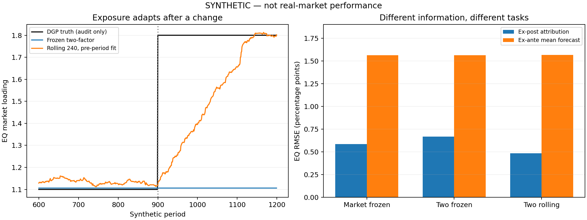

# 第13章 市场有效性、风险溢价与资产定价

> 第二篇：金融市场与多资产建模。前接[第12章](./12_第12章_收益、波动、相关性与金融统计特征.md)。本章全部数值实验均为SYNTHETIC人工示例，不是赛题官方数据，也不构成真实市场绩效证据。

## 学习目标与前置知识

前置知识是第3章的投影与最小二乘，第5—6章的条件期望和统计推断，第10—12章的现金流、收益和组合协方差。

完成本章后，应能区分市场有效、无套利和收益不可预测；从投资者决策推导CAPM与随机贴现因子的基本关系；解释多因子回归中的系数与截距；建立时间顺序正确的因子解释实验，并判断哪些证据不足以给市场命名。

平台不仅需要回答“今天跌了多少”，还要回答“跌幅中有多少与共同风险相关，剩余部分是否值得核查”。但**统计解释不等于因果解释，当期解释不等于未来预测，回归截距也不等于可交易利润**。本章把这些边界放进公式与代码。

## 13.1 有效市场假说及其可检验性边界

### 13.1.1 信息集、价格与市场有效

信息集（Information Set）记为 $\mathcal I_t$ ，表示在时刻 $t$ 已能获得的信息。它必须绑定主体、渠道与时间：交易所已经发布，但本系统尚未收到的信息，不属于本系统当时可用的信息集。

有效市场假说（Efficient Market Hypothesis，EMH）研究价格是否充分反映指定信息，以及利用这类信息能否系统性获得相对于适当风险基准、扣除相关成本后的异常收益。这里每个限定都重要：信息范围、风险基准、交易可行性和成本不清楚，就无法讨论一个具体可检验命题。

通常区分三类：

|形式|讨论的信息范围|在平台中的对应问题|
|---|---|---|
|弱式有效|历史价格、收益、交易等市场信息|历史动量是否有样本外增量信息|
|半强式有效|公开信息，包括财报、公告和宏观发布|公告之后是否仍有可利用的调整过程|
|强式有效|包括私人信息在内的全部相关信息|信息优势是否还产生异常收益|

强式是很强的理论命题，不应当作现实既定事实。某资产符合某个弱式检验，也不证明半强式或强式成立。MIT课程同时讨论有效市场、行为金融与适应性视角，可作为比较阅读。[MIT：Efficient Markets](https://ocw.mit.edu/courses/15-401-finance-theory-i-fall-2008/pages/video-lectures-and-slides/efficient-markets/)

本书不把市场有效解释为“价格永远正确”“价格不会暴跌”“投资者人人理性”或“所有策略都赚不到钱”。不同理论可以对信息处理、风险补偿和行为偏差提出不同机制；需要用明确数据和条件检验，而不是选一句口号。

### 13.1.2 公平博弈不要求收益均值恒定

用 $R_{i,t+1}$ 表示简单收益，定义条件期望收益：

```math
\mu_{i,t}=\mathbb E[R_{i,t+1}\mid\mathcal I_t],
\qquad R_{i,t+1}=\mu_{i,t}+u_{i,t+1}.
```

因此：

```math
\mathbb E[u_{i,t+1}\mid\mathcal I_t]=0.
```

对任何由当时信息决定、且乘积可积的信号 $z_t$ ：

```math
\mathbb E[z_tu_{i,t+1}]
=\mathbb E\!\left[z_t\mathbb E(u_{i,t+1}\mid\mathcal I_t)\right]=0.
```

这是条件期望误差的正交性。它本身来自条件期望定义，**不能单独作为EMH的证据**。实际检验必须提出可估计的 $\mu_{i,t}$ 模型，判断观察到的偏差来自信息处理还是模型失配。

若风险补偿随状态变化， $\mu_{i,t}$ 可以被过去信息预测。预测到衰退状态下要求的风险补偿较高，并不自动意味着市场无效；高期望收益可能正是承担坏状态损失的补偿。

随机游走（Random Walk）常写成：

```math
P_{t+1}=P_t+c+\varepsilon_{t+1},
```

若进一步要求创新独立同分布、方差恒定，它比一般的条件均值限制更强。收益存在条件异方差、风险溢价变化或非同步报价时，拒绝这个简单随机游走模型不能直接宣布EMH被推翻。

### 13.1.3 无套利与鞅：必须说明概率和计价方式

套利（Arbitrage）在无摩擦一期模型中指：初始成本不为正，所有状态终值不为负，而且至少有正概率获得严格收益。它与“预计会赚钱”不同；风险策略可能亏损，因此不因期望收益为正就构成套利。

上一章的风险中性定价使用风险中性概率（Risk-neutral Probability）。在适用条件下，无套利意味着存在使**适当贴现的含分红收益过程**成为鞅的等价概率测度。它不是说原始股票价格在真实概率下必须是鞅。

一期、确定无风险总积累因子为 $G_f=1+R_f$ 时：

```math
P_t=\frac1{G_f}\mathbb E_t^{Q}[P_{t+1}+D_{t+1}].
```

这里 $Q$ 是定价概率，不是经济状态真实出现频率。若误把 $Q$ 换成真实概率 $P$ ，就会抹掉风险补偿。

无套利约束的是支付与价格的一致性；市场有效讨论信息如何进入价格。存在正风险溢价的市场可以没有套利；暂时的定价偏离也可能因交易费用、借券限制和资本约束而无法被安全消除。

### 13.1.4 联合假设问题：异常相对于谁

设选定模型给出的基准期望收益为 $b_{i,t}$ 。观察到：

```math
\mathbb E[R_{i,t+1}-b_{i,t}]\ne0.
```

至少有几种解释：市场对信息反应不足；基准遗漏了被补偿的风险；估计误差；数据或时间对齐错误；反复试验后挑中了偶然显著结果。

市场效率检验同时依赖定价模型，这称联合假设问题（Joint-hypothesis Problem）。Fama的2013年讲座明确讨论：拒绝检验时，不能仅凭该结果确定是市场效率还是均衡模型出了问题。本次核对官方检索内容；PDF直接读取受限，不声称通读全文。[Fama：Two Pillars of Asset Pricing](https://www.nobelprize.org/uploads/2018/06/fama-lecture.pdf)

因此本章实验把“遗漏因子产生截距”作为反例。它不证明全部异常都由风险解释，也不证明所有多因子模型都正确；它说明单个显著截距不足以得出这些结论。

### 13.1.5 事件研究如何与监控平台连接

事件研究（Event Study）比较事件附近观察收益与基准收益。设已在事件前估计好参数：

```math
\mathrm{AR}_{i,t}=R_{i,t}-R_{f,t}
-\widehat\alpha_i-\widehat\beta_i(R_{m,t}-R_{f,t}),
```

其中AR表示异常收益（Abnormal Return），这里是相对于选定回归基准的残差，不是自动可交易的异常。

窗口 $[a,b]$ 内累积异常收益常定义为：

```math
\mathrm{CAR}_{i,[a,b]}=\sum_{t=a}^{b}\mathrm{AR}_{i,t}.
```

CAR是异常收益的算术和，不等于可直接兑现的复利财富差。其方差包含全部跨期协方差：

```math
\mathrm{Var}(\mathrm{CAR})
=\sum_{t=a}^{b}\sum_{s=a}^{b}
\mathrm{Cov}(\mathrm{AR}_{i,t},\mathrm{AR}_{i,s}).
```

还应考虑估计参数的不确定性、事件集中发生时的跨资产相关、其他同期新闻和事件导致的方差变化。不能把每一天残差当作独立样本。

事件前估计窗不得混入事件后收益。经济事件发生、公告发布、系统收到公告和生成解释可能是四个时间；“周五公告”若在收盘后发布，不能当作周五收盘前已知信息。第14章与数据工程篇将继续处理这些时间差。

## 13.2 CAPM、多因子模型与随机贴现因子

### 13.2.1 CAPM的假设与均值—方差决策

资本资产定价模型（Capital Asset Pricing Model，CAPM）把资产的期望超额收益与其市场风险暴露联系起来。经典Sharpe–Lintner形式依赖一组理想条件：单期投资；共同的收益均值与协方差判断；均值—方差偏好；可按同一无风险利率借贷；无税费和关键交易约束；市场出清。

均值—方差偏好可作为直接假设，也可在正态收益配合相应效用等特定环境下得到。它不是对所有厚尾、杠杆和非线性支付都自动准确。

设 $N$ 项风险资产的期望简单收益为 $\boldsymbol\mu$ ，协方差正定为 $\Sigma$ 。投资者 $h$ 的风险资产权重向量为 $\mathbf a_h$ ，其余财富放在无风险资产；风险厌恶参数 $A_h\gt 0$ 。目标写成：

```math
\max_{\mathbf a_h}\quad
R_f+\mathbf a_h^{\mathsf T}(\boldsymbol\mu-R_f\mathbf1)
-\frac{A_h}{2}\mathbf a_h^{\mathsf T}\Sigma\mathbf a_h.
```

一阶条件：

```math
\boldsymbol\mu-R_f\mathbf1-A_h\Sigma\mathbf a_h=0,
\qquad
\mathbf a_h=\frac1{A_h}\Sigma^{-1}(\boldsymbol\mu-R_f\mathbf1).
```

所有投资者选择相同风险组合方向，只是规模不同。设财富为 $W_h$ ，风险资产总市值为 $V_M$ ，市场组合权重为 $\mathbf w_M$ 。市场出清：

```math
V_M\mathbf w_M
=\sum_hW_h\mathbf a_h
=\left(\sum_h\frac{W_h}{A_h}\right)
\Sigma^{-1}(\boldsymbol\mu-R_f\mathbf1).
```

令 $K=\sum_hW_h/A_h$ ，整理得：

```math
\boldsymbol\mu-R_f\mathbf1
=\frac{V_M}{K}\Sigma\mathbf w_M.
```

左乘 $\mathbf w_M^{\mathsf T}$ ，利用权重和为1：

```math
\mathbb E[R_M]-R_f=\frac{V_M}{K}\sigma_M^2.
```

代回第 $i$ 个分量：

```math
\mathbb E[R_i]-R_f
=\frac{\mathrm{Cov}(R_i,R_M)}{\mathrm{Var}(R_M)}
\left(\mathbb E[R_M]-R_f\right)
=\beta_i\lambda_M.
```

其中 $\beta_i$ 是市场贝塔， $\lambda_M$ 是市场风险溢价。推导把“共同最优组合”与“市场出清”接起来，不是仅凭相关系数定义就推出定价结论。[MIT：The CAPM and APT，第3—8张](https://ocw.mit.edu/courses/15-401-finance-theory-i-fall-2008/411d7d9df37d4d0440b18e17e8cea3a9_MIT15_401F08_lec15.pdf)

市场组合理论上包含模型中的全部风险财富，某个股票指数只是代理。股票指数不能无条件代表债券、商品、房地产和人力资本的共同市场风险；代理选错也会影响CAPM检验。

### 13.2.2 贝塔、总波动与证券市场线

把资产收益对市场收益作总体线性投影：

```math
R_i=a_i+\beta_iR_M+\varepsilon_i,
\quad \mathrm{Cov}(\varepsilon_i,R_M)=0.
```

因此：

```math
\mathrm{Var}(R_i)=\beta_i^2\sigma_M^2
+\mathrm{Var}(\varepsilon_i).
```

CAPM补偿的是与市场共同波动的部分，不是每一份个别波动。即便资产总波动很大，若额外风险可分散，经典模型也不要求为它支付额外溢价。现实中的不完全分散、流动性和融资约束会改变这套解释，不能据此说个别风险“不重要”。

证券市场线（Security Market Line，SML）在横轴画贝塔、纵轴画期望收益。资本市场线（Capital Market Line，CML）则对有效组合画总标准差与期望收益；两者坐标和适用对象不同。

例如假设一年无风险收益2%、市场期望收益8%，资产贝塔1.5，则CAPM期望收益为：

```math
0.02+1.5(0.08-0.02)=0.11.
```

11%是给定假设下的期望，不是未来保证收益。贝塔为−0.5时模型期望为−1%，可理解为资产提供市场下跌时的保险特性；真实资产是否具备这种稳定属性仍需检验。

### 13.2.3 时间序列回归不是自动通过定价检验

定义超额收益 $y_{i,t}=R_{i,t}-R_{f,t}$ 和市场超额收益 $f_t=R_{M,t}-R_{f,t}$ 。常用回归：

```math
y_{i,t}=\alpha_i+\beta_i f_t+\varepsilon_{i,t}.
```

线性投影本身总能定义一组系数；CAPM另提出 $\alpha_i=0$ 的定价限制。高 $R^2$ 只能说明样本内线性共动解释得较多，不能替代截距限制，也不证明未来预测好。

总体最小二乘目标为 $\mathbb E[(y-\alpha-\beta f)^2]$ 。对截距与斜率求导：

```math
\mathbb E[y-\alpha-\beta f]=0,\qquad
\mathbb E[f(y-\alpha-\beta f)]=0.
```

由第一式 $\alpha=\mathbb E[y]-\beta\mathbb E[f]$ ，代入第二式：

```math
\beta=\frac{\mathrm{Cov}(y,f)}{\mathrm{Var}(f)},
\qquad
\alpha=\mathbb E[y]-\beta\mathbb E[f].
```

回归中的当前 $f_t$ 通常到本期结束才知道。用它解释 $y_t$ 是同期归因；要在 $t-1$ 预测 $y_t$ ，还必须给出当时可得的因子条件期望。

### 13.2.4 多因子：共同变化与被定价风险不是一回事

多因子模型（Multifactor Model）可写成：

```math
y_{i,t}=\alpha_i+\boldsymbol\beta_i^{\mathsf T}\mathbf f_t
+\varepsilon_{i,t}.
```

统计因子模型描述协方差与共同变化；因子定价模型另要求：

```math
\mathbb E[y_i]=\boldsymbol\beta_i^{\mathsf T}\boldsymbol\lambda.
```

不是每个解释波动的因子都必须有非零风险价格 $\lambda_k$ 。PCA主成分可以很好地压缩数据，却没有自动成为“通胀风险”的经济依据；换一个可逆因子坐标还可以得到相同拟合。

若 $\mathbf f$ 是可交易的零成本超额收益因子，且模型能够定价这些因子自身，那么其风险价格可对应期望因子收益。对宏观增长率、通胀意外等不可直接交易的因子，不能把其平均值直接叫风险溢价，也不能机械减去无风险收益。

Fama–French三因子包含市场超额收益、规模因子SMB（Small Minus Big）和价值因子HML（High Minus Low）。后两者是按规定股票分组构造的组合收益差，不是“市值”与“账面市值比”两个原始特征。应阅读构造口径、股票资格、权重和财务信息滞后规则。[French：三因子定义](https://mba.tuck.dartmouth.edu/pages/faculty/ken.french/Data_Library/f-f_factors.html)

套利定价理论（Arbitrage Pricing Theory，APT）使用多因子结构、残差可分散和无套利等条件约束期望收益。有限个、存在无法分散残差的资产，仅有一条线性回归并不足以证明APT精确定价。它也不唯一指定应该选择哪些因子。

若要估计非交易因子的价格，可先在时间序列上估计每项资产的贝塔，再用横截面平均收益解释贝塔差异；Fama–MacBeth方法还逐期做横截面回归，再汇总风险价格。但估计贝塔是带误差的解释变量，资产残差可能相关，风险价格可能序列相关；简单套普通回归标准误不够。四个示例资产不足以支持可信的广泛横截面定价检验，本章不伪装完成这种验证。[Cochrane：Classic Regressions Summary，第1—3页](https://www.johnhcochrane.com/s/Classic_regressions_summary.pdf)

### 13.2.5 从消费决策推导随机贴现因子

随机贴现因子（Stochastic Discount Factor，SDF）用一个随未来状态变化的权重，表达不同状态的一元支付对今天有多大价值。

设投资者今天消费 $c_t$ ，未来消费 $c_{t+1}$ ，主观时间折扣参数为 $\delta\in(0,1)$ 。资产价格为 $p_t$ ，下一期含转售价值的支付为 $X_{t+1}$ 。在原有最优配置上额外买入很小数量 $\xi$ 后，效用为：

```math
U(\xi)=u(c_t-\xi p_t)
+\delta\,\mathbb E_t[u(c_{t+1}+\xi X_{t+1})].
```

假设可作小幅双向交易、边际效用为正、可交换求导与期望，最优点 $\xi=0$ 的导数为零：

```math
-p_tu'(c_t)+\delta\,\mathbb E_t[u'(c_{t+1})X_{t+1}]=0.
```

除以今天边际效用，定义：

```math
m_{t+1}=\delta\frac{u'(c_{t+1})}{u'(c_t)},
\qquad p_t=\mathbb E_t[m_{t+1}X_{t+1}].
```

这一步是把跨状态的边际价值写成定价权重。存在交易约束或买卖价差时，一阶条件可能变成不等式；不能把这个等式直接用于任何受约束持仓。作者公开试读章节提供了这一框架及适用条件。[Cochrane：Asset Pricing，试读第1.1—1.4节](https://www.johnhcochrane.com/s/samplechapters-dy5d.pdf)

常相对风险厌恶效用（Constant Relative Risk Aversion，CRRA）在 $\gamma\ne1$ 时为：

```math
u(c)=\frac{c^{1-\gamma}}{1-\gamma},
\qquad u'(c)=c^{-\gamma},
\qquad m_{t+1}=\delta\left(\frac{c_{t+1}}{c_t}\right)^{-\gamma}.
```

$\gamma=1$ 时取对数效用，同样的边际效用表达仍成立。消费低的坏状态，边际效用高，SDF通常也高；能在这种状态支付的资产具有保险价值。现实宏观消费的口径、测量误差和模型失配，会使经验检验远比这条公式复杂。

若支付和价格以货币计价，而效用对应实物消费，还需处理物价水平：名义SDF等于真实SDF乘今天物价与未来物价之比。不能用真实消费SDF直接混配名义支付而忽略通胀。

### 13.2.6 从SDF推导无风险收益与风险溢价

用 $G_i=X_i/p_i=1+R_i$ 表示总积累因子。定价等式变为：

```math
1=\mathbb E_t[mG_i].
```

无风险 $G_f$ 在时刻 $t$ 已知，因此：

```math
G_f=\frac1{\mathbb E_t[m]}.
```

展开乘积期望：

```math
1=\mathbb E_t[m]\mathbb E_t[G_i]
+\mathrm{Cov}_t(m,G_i).
```

与无风险等式相减：

```math
\mathbb E_t[R_i]-R_f
=-\frac{\mathrm{Cov}_t(m,R_i)}{\mathbb E_t[m]}.
```

坏状态SDF高，若资产也在坏状态损失、好状态获利，则收益与SDF常负相关，要求正溢价；若资产在坏状态提供支付，可能接受低于无风险收益的期望回报。**风险补偿看的是何时亏损，不只是亏损方差有多大。**

由Cauchy–Schwarz不等式还得到：

```math
\frac{|\mathbb E_t[R_i]-R_f|}{\sigma_t(R_i)}
\le \frac{\sigma_t(m)}{\mathbb E_t[m]}.
```

这是一类Hansen–Jagannathan界的基本形式：若要解释很高的可实现风险调整收益，SDF必须有足够变动。它不是“观察到高样本夏普，就证明某模型错误”；样本估计、交易限制和二阶矩条件仍须处理。

### 13.2.7 两状态定价：真实概率与风险中性概率

考虑两个状态，各以0.5概率发生。坏状态SDF为1.1，好状态为0.8。状态价格（State Price）等于真实概率乘SDF：

```math
\pi_{\mathrm{bad}}=0.5\times1.1=0.55,\qquad
\pi_{\mathrm{good}}=0.5\times0.8=0.40.
```

每个状态都支付1的资产价格为0.95，所以 $G_f=1/0.95$ ，简单无风险收益约5.2632%。

顺周期资产支付为坏状态80、好状态120；保险型资产支付相反：

```math
p_A=0.55\times80+0.40\times120=92,
\qquad
p_B=0.55\times120+0.40\times80=98.
```

它们期望支付都是100，支付方差也一样，但价格不同，期望简单收益分别约8.6957%和2.0408%。相对无风险溢价为3.4325和−3.2223个百分点。

把状态价格归一化：

```math
q_s=\frac{\pi_s}{\sum_j\pi_j}=G_f\pi_s,
\qquad
q_{\mathrm{bad}}=\frac{11}{19},\quad
q_{\mathrm{good}}=\frac8{19}.
```

于是：

```math
p_i=\sum_s\pi_sX_{i,s}
=\frac1{G_f}\sum_s q_sX_{i,s}.
```

风险中性概率提高了坏状态的定价权重，却没有把真实坏状态发生概率从0.5改为11/19。

有限状态、无摩擦且状态具有正概率的环境中，严格正状态价格会排除套利：任何非负且某状态严格为正的支付，其价格加权和严格为正。反方向的存在性可由分离定理证明；若支付不能张成全部状态，正SDF一般不唯一。本例只演示给定正SDF的定价一致性。

### 13.2.8 线性因子SDF为何得到贝塔定价

暂略时间下标，设 $\mathbf f$ 的协方差 $\Sigma_f$ 可逆，SDF可写为：

```math
m=a-\mathbf b^{\mathsf T}\mathbf f.
```

令超额收益为 $y_i$ 。由 $\mathbb E[my_i]=0$ ：

```math
\mathbb E[m]\mathbb E[y_i]
=-\mathrm{Cov}(m,y_i)
=\mathbf b^{\mathsf T}\mathrm{Cov}(\mathbf f,y_i).
```

总体回归载荷定义为：

```math
\boldsymbol\beta_i=\Sigma_f^{-1}\mathrm{Cov}(\mathbf f,y_i).
```

因此：

```math
\mathbb E[y_i]=\boldsymbol\beta_i^{\mathsf T}\boldsymbol\lambda,
\qquad
\boldsymbol\lambda=\frac{\Sigma_f\mathbf b}{\mathbb E[m]}.
```

这说明线性因子定价与SDF可以联系起来，但任意线性拟合出来的 $m$ 未必严格为正。若因子无界，非恒定仿射SDF还可能在某些状态为负。因此“样本内矩条件很小”不自动等于“得到无套利且样本外有效的定价模型”。

## 13.3 风险补偿、异常收益与状态依赖

### 13.3.1 遗漏因子如何制造alpha

假设真实统计生成关系为：

```math
y=\beta_1f_1+\beta_2f_2+\varepsilon,
\quad \mathbb E[\varepsilon]=0,
\quad \mathrm{Cov}(\varepsilon,f_1)=\mathrm{Cov}(\varepsilon,f_2)=0.
```

真实关系没有截距。若只回归 $f_1$ ，根据协方差公式：

```math
\widetilde\beta_1
=\beta_1+\beta_2
\frac{\mathrm{Cov}(f_1,f_2)}{\mathrm{Var}(f_1)}.
```

令 $\delta_f=\mathrm{Cov}(f_1,f_2)/\mathrm{Var}(f_1)$ ，则遗漏后的截距为：

```math
\begin{aligned}
\widetilde\alpha
&=\mathbb E[y]-\widetilde\beta_1\mathbb E[f_1]\\[0pt]
&=\beta_1\mathbb E[f_1]+\beta_2\mathbb E[f_2]
-(\beta_1+\beta_2\delta_f)\mathbb E[f_1]\\[0pt]
&=\beta_2\left(\mathbb E[f_2]-\delta_f\mathbb E[f_1]\right).
\end{aligned}
```

即使原关系中没有异常截距，遗漏因子的均值与相关结构也能产生显著alpha。反过来，加上大量事后挑选的因子把alpha压到零，也不是对市场有效的独立证明；可能过拟合、引入未来数据或把异常本身包装成因子。

### 13.3.2 OLS、HAC与推断边界

把常数列和因子组成设计矩阵 $X$ ，列数为 $k$ ，观测数为 $n$ 。普通最小二乘（Ordinary Least Squares，OLS）最小化：

```math
L(\theta)=(\mathbf y-X\theta)^{\mathsf T}(\mathbf y-X\theta).
```

对 $\theta$ 求导：

```math
-2X^{\mathsf T}(\mathbf y-X\theta)=0.
```

满列秩时：

```math
\widehat\theta=(X^{\mathsf T}X)^{-1}X^{\mathsf T}\mathbf y.
```

这是数学表达，不意味着代码应该显式求逆计算系数；本章使用lstsq求解，并拒绝秩亏。近共线性仍可能造成大误差，应报告条件数并检查单位。

由 $\mathbf y=X\theta+\mathbf u$ ：

```math
\widehat\theta-\theta=(X^{\mathsf T}X)^{-1}X^{\mathsf T}\mathbf u.
```

令每期得分向量为 $\mathbf g_t=\mathbf x_tu_t$ ，则参数方差取决于得分和的协方差。异方差与自相关一致协方差估计（Heteroskedasticity and Autocorrelation Consistent，HAC）用截断加权的跨期乘积近似：

```math
\widehat S
=\sum_t\widehat{\mathbf g}_t\widehat{\mathbf g}_t^{\mathsf T}
+\sum_{\ell=1}^{L}w_\ell
\sum_{t=\ell+1}^{n}
\left(\widehat{\mathbf g}_t\widehat{\mathbf g}_{t-\ell}^{\mathsf T}
+\widehat{\mathbf g}_{t-\ell}\widehat{\mathbf g}_t^{\mathsf T}\right),
\qquad w_\ell=1-\frac{\ell}{L+1}.
```

本章采用Bartlett权重和明确的小样本乘数：

```math
\widehat{\mathrm{Var}}(\widehat\theta)
=\frac{n}{n-k}(X^{\mathsf T}X)^{-1}
\widehat S(X^{\mathsf T}X)^{-1}.
```

代码与statsmodels在相同滞后数、相同修正选项下交叉核对。官方文档要求连续、等间隔的单条时间序列；缺失后随意压缩日期不能假装满足原时间结构。[statsmodels 0.14.4：cov_hac](https://www.statsmodels.org/v0.14.4/generated/statsmodels.stats.sandwich_covariance.cov_hac.html)

截距t比率为 $\widehat\alpha/\mathrm{SE}(\widehat\alpha)$ 。HAC不是万能修复：它不补回遗漏变量，不消除选择偏差，也不保证跨断点的常参数回归具有正确推断。大样本近似需要适当矩、弱依赖和带宽条件；程序固定5阶只是可复现教学设定。

同时筛选几十个资产、因子和窗口时，单项“超过2”不能视为最终发现；还需多重比较、样本外验证和经济量级判断。此处不把四个资产的单项t比率冒充联合定价检验。

### 13.3.3 条件定价与状态变化

在状态 $s_t$ 下，可以提出条件模型：

```math
\mathbb E_t[y_{i,t+1}]
=\boldsymbol\beta_i(s_t)^{\mathsf T}\boldsymbol\lambda(s_t).
```

状态可以影响风险暴露、风险价格，也可以改变残差分布。仅看到预期收益变化，不能确定是贝塔还是风险价格变化。

单因子情形取无条件期望：

```math
\mathbb E[y]=\mathbb E[\beta_t\lambda_t]
=\mathbb E[\beta_t]\mathbb E[\lambda_t]
+\mathrm{Cov}(\beta_t,\lambda_t).
```

所以把平均贝塔乘平均风险价格，一般漏掉共同变化项。无条件回归贝塔也不必等于平均条件贝塔；不能用这条恒等式草率给无条件回归“纠偏”。

例如两状态等概率，贝塔分别0.5和1.5，条件风险溢价分别1%和5%，则平均条件溢价为4%，平均贝塔乘平均风险价格仅3%；差额1个百分点来自共同变化。本例仅说明代数，不证明这些数字构成完整均衡。

状态估计同样有时间约束：用未来完整序列平滑得到的危机标签，只能用于事后研究；在线状态必须由截至当时的信息过滤得到。后续HMM篇将严格区分过滤概率与平滑概率。

### 13.3.4 同样的跌价，可能对应不同机制

一期价格 $p=\mathbb E[mX]$ 中，跌价可以来自支付预期下降，也可以来自风险调整变化，还可能二者同时变化。

在非常简化、满足 $k\gt g$ 的永续增长模型中：

```math
P=\frac{D_1}{k-g}.
```

若预期下一期分红4、要求收益8%、增长2%，价格为66.6667。分红预期不变、要求收益上升到10%，价格降为50；这个模型中价格下跌同时伴随更高的要求收益。反之，分红预期下降也会降低价格。

因此“下跌就是未来期望收益更低”并不普遍成立。平台可以把现金流预期、利率、风险暴露与信用条件作为竞争解释，但不能仅用一次回归就确定是哪条传导机制，更不能把市场下跌机械标成套利机会。

### 13.3.5 因子数据也必须满足PIT

Kenneth R. French的数据库覆盖多个市场，使用数据时必须明确具体市场范围和构造方式。

French官方数据说明：2025年1月起美国研究收益切换到CRSP的CIZ格式，月收益的复合与分红再投资口径和旧FIZ不同；网站同时提供部分历史归档。这说明“同名历史序列”也需要版本管理。[French Data Library：格式变更与归档](https://mba.tuck.dartmouth.edu/pages/faculty/ken.french/data_library.html)

2026年的开放论文研究了因子构造变化对历史回归结论的影响。这是特定实证研究的发现，支持检查版本敏感性，不能扩大成所有因子都不可信。[Akey、Robertson与Simutin，2026](https://academic.oup.com/rof/article/30/5/1437/8443460)

平台应存储factor_id、方法版本、观察区间、发布与获取时间、下载批次、原始文件哈希和单位。在线计算用当时可得版本，后来修订产生独立重述结果。公开下载的日频因子可能在交易结束后才生成，不能因为它带有当天日期就视为开盘前已知。

对自建财务因子，要用当时已发布的报表、保留退市证券与历史成分，而不是今天的股票池回填历史。因子和资产价格都换到统一币种时，还应检查共同汇率暴露是否制造“解释力”。

## 13.4 完整实验：因子遗漏、暴露变化与实时归因边界

### 13.4.1 输入、生成关系与评估协议

延续四资产EQ_DEMO、BOND_DEMO、GOLD_DEMO、FX_DEMO。生成1200期两个人工因子，不使用真实宏观或股票数据：

```math
f_{M,t}=0.0003+0.01z_{1,t},
\qquad
f_{G,t}=0.0012+0.3(f_{M,t}-0.0003)+0.006z_{2,t}.
```

两个创新跨期独立、各服从标准正态。GROWTH_DEMO只是因子名称，不是已估计的真实经济增长意外；均值0.0012为放大遗漏效应的教学设定，不应外推成日频经济预测。

资产简单超额收益为：

```math
\mathbf y_t=B_t\mathbf f_t+\boldsymbol\varepsilon_t.
```

初始载荷矩阵的行对应四资产，列对应市场与第二因子：

```math
B_0=
\begin{pmatrix}
1.1&0.8\\[0pt]
-0.2&0.4\\[0pt]
0.1&-0.4\\[0pt]
-0.1&0.2
\end{pmatrix}.
```

独立残差标准差分别为0.004、0.002、0.006、0.003。第900期起，EQ载荷变为 $(1.8,-0.2)$ ，BOND变为 $(0.4,0.8)$ ，其他资产不变。真值截距始终为零。

这是一种统计收益发生器，不是经过证明的均衡经济。正态简单收益理论上无下界，不能直接作为保证有限责任的长期股票财富模型。本实验不构造净值和交易回测，也不声称从真实消费过程生成了这些收益。单独的两状态SDF例子才演示严格的定价一致性。

所有输入已经是超额收益，CONFIG中的人工无风险收益0.00005仅说明若转换回总简单收益应加多少；回归不再次扣除它。

前600期用于初始化和训练期截距诊断，后600期统一评估。模型为单因子冻结、双因子冻结、双因子240期滚动。窗口240、HAC滞后5在运行前固定，无测试选参；今后若搜索窗口，应加入独立验证区间或嵌套滚动验证。

协议分成两个不同任务：

|时点|可做的计算|不能声称的结果|
|---|---|---|
|目标期 $t-0.2$ |只用截至 $t-1$ 的数据估计参数和均值预测|不能使用当前因子 $f_t$ |
|本期 $t+0.1$ |本期因子和资产收益按人工协议可用|这是假定可用时点，不是测得网络延迟|
|本期 $t+0.2$ |用提前冻结的参数解释本期收益|同期解释不是事前预测|

事前均值预测把因子均值估计为相应训练窗均值：

```math
\widehat y_{i,t\mid t-1}
=\widehat\alpha_{i,t-1}
+\widehat{\boldsymbol\beta}_{i,t-1}^{\mathsf T}
\overline{\mathbf f}_{\mathrm{train}}.
```

带截距OLS满足 $\widehat\alpha+\widehat{\boldsymbol\beta}^{\mathsf T}\bar{\mathbf f}=\bar y$ ，因此两个冻结模型的上述预测相同，都退化为训练期资产平均超额收益。多放一个同期因子并不会凭空提供未来因子信息。

同期解释则使用已经可用的当前因子：

```math
y_{i,t}=
\widehat\alpha_{i,t-1}
+\sum_k\widehat\beta_{ik,t-1}f_{k,t}
+e_{i,t}^{\mathrm{attribution}}.
```

最后的残差是按这个等式定义的账面差额，求和还原观察收益只是核算正确性，不等于经济模型正确性。当前残差也不是当天“实现的alpha”。

### 13.4.2 完整代码与运行

主程序使用已安装的Anaconda Python3.13.5和NumPy2.1.3；测试用已有statsmodels0.14.4作HAC交叉核对；绘图用已有Matplotlib3.10.0。未安装新库。

[主程序](./code/ch13/pricing_lab.py)、[12项测试](./code/ch13/test_pricing_lab.py)、[绘图程序](./code/ch13/plot_pricing.py)已经单独保存。在仓库根目录运行：

```powershell
& 'D:\Anaconda\python.exe' -X utf8 教材/code/ch13/pricing_lab.py
& 'D:\Anaconda\python.exe' -X utf8 -m unittest discover -s 教材/code/ch13 -v
```

绘图程序接受主程序打印的运行目录：

```powershell
& 'D:\Anaconda\python.exe' -X utf8 教材/code/ch13/plot_pricing.py '这里替换为本次运行目录'
```

完整主程序如下：

```python
"""SYNTHETIC factor attribution; forecasts and contemporaneous explanations differ."""
import hashlib
import json
import platform
from datetime import datetime, timezone
from pathlib import Path
import numpy as np

ASSETS = ["EQ_DEMO", "BOND_DEMO", "GOLD_DEMO", "FX_DEMO"]
MODELS = ["market_frozen", "two_frozen", "two_rolling"]
CONFIG = {"seed": 20261027, "days": 1200, "train": 600,
          "change": 900, "window": 240, "hac_lags": 5,
          "factor_names": ["MKT_DEMO", "GROWTH_DEMO"], "rf": .00005}


def panel(value):
    value = np.asarray(value, dtype=float)
    if value.ndim != 2 or not np.isfinite(value).all():
        raise ValueError("finite two-dimensional panel required; no silent deletion")
    return value


def design(factors):
    factors = panel(factors)
    return np.column_stack([np.ones(len(factors)), factors])


def fit(factors, returns):
    x, y = design(factors), panel(returns)
    if len(x) != len(y) or len(x) <= x.shape[1]:
        raise ValueError("aligned observations and positive residual degrees required")
    beta, _, rank, singular = np.linalg.lstsq(x, y, rcond=None)
    if rank != x.shape[1]:
        raise ValueError("unidentified coefficients: rank deficient design")
    return beta, y-x @ beta, float(singular[0]/singular[-1])


def hac_cov(factors, residual, lags=5):
    x = design(factors)
    u = np.asarray(residual, dtype=float)
    n, k = x.shape
    if (u.shape != (n,) or not np.isfinite(u).all() or n <= k
            or not isinstance(lags, int) or isinstance(lags, bool)
            or not 0 <= lags < n or np.linalg.matrix_rank(x) != k):
        raise ValueError("invalid residual, lag or design")
    scores = x*u[:, None]
    meat = scores.T @ scores
    for lag in range(1, lags+1):
        cross = scores[lag:].T @ scores[:-lag]
        meat += (1-lag/(lags+1))*(cross+cross.T)
    bread = np.linalg.solve(x.T @ x, np.eye(k))
    return (n/(n-k))*bread @ meat @ bread


def generate():
    rng = np.random.default_rng(CONFIG["seed"])
    n = CONFIG["days"]
    shock = rng.normal(size=(n, 2))
    market = .0003 + .01*shock[:, 0]
    growth = .0012 + .3*(market-.0003) + .006*shock[:, 1]
    factors = np.column_stack([market, growth])
    load = np.broadcast_to(np.array([[1.1, .8], [-.2, .4],
                                    [.1, -.4], [-.1, .2]]), (n, 4, 2)).copy()
    load[CONFIG["change"]:, 0] = [1.8, -.2]
    load[CONFIG["change"]:, 1] = [.4, .8]
    noise = rng.normal(size=(n, 4))*[.004, .002, .006, .003]
    excess = np.einsum("tik,tk->ti", load, factors)+noise
    return factors, excess, load


def prefit(factors, returns, start=600, window=240, available=None):
    f, y = panel(factors), panel(returns)
    n = len(f)
    if len(y) != n or f.shape[1] != 2 or not 3 < window <= start < n:
        raise ValueError("invalid dimensions or split")
    available = np.arange(n)+.1 if available is None else np.asarray(available)
    if available.shape != (n,) or not np.isfinite(available).all():
        raise ValueError("invalid availability")
    one = fit(f[:start, :1], y[:start])[0]
    one = np.vstack([one, np.zeros(y.shape[1])])
    two = fit(f[:start], y[:start])[0]
    estimates, forecasts, protocol = [], [], []
    for t in range(start, n):
        decision = t-.2
        if max(available[:t]) > decision:
            raise ValueError("training information not available at decision")
        rolling = fit(f[t-window:t], y[t-window:t])[0]
        b = np.stack([one, two, rolling])
        means = np.stack([f[:start].mean(axis=0), f[:start].mean(axis=0),
                          f[t-window:t].mean(axis=0)])
        forecasts.append(b[:, 0, :] + np.einsum("mk,mki->mi", means, b[:, 1:, :]))
        estimates.append(b)
        protocol.append([t, t-1, max(available[:t]), decision])
    return np.array(estimates), np.array(forecasts), np.array(protocol)


def attribute(beta, factor, observed, available_at, as_of):
    if not np.isfinite([available_at, as_of]).all() or available_at > as_of:
        raise ValueError("current factor/return unavailable; explanation cannot be published")
    beta, factor = panel(beta), np.asarray(factor, dtype=float)
    observed = np.asarray(observed, dtype=float)
    if (factor.shape != (beta.shape[0]-1,) or observed.shape != (beta.shape[1],)
            or not np.isfinite(factor).all() or not np.isfinite(observed).all()):
        raise ValueError("invalid attribution inputs")
    components = np.vstack([beta[0], factor[:, None]*beta[1:]])
    residual = observed-components.sum(axis=0)
    return components, residual


def sdf_example():
    probability = np.array([.5, .5])
    sdf = np.array([1.1, .8])
    payoffs = np.array([[1., 80., 120.], [1., 120., 80.]])
    state_prices = probability*sdf
    prices = state_prices @ payoffs
    gross = payoffs/prices
    rf_gross = 1/state_prices.sum()
    return {"states": ["bad", "good"], "probabilities": probability.tolist(),
            "sdf": sdf.tolist(), "state_prices": state_prices.tolist(),
            "payoffs": payoffs.tolist(), "prices": prices.tolist(),
            "risk_neutral_probabilities": (state_prices/state_prices.sum()).tolist(),
            "gross_rf": float(rf_gross),
            "expected_excess": (probability @ gross-rf_gross).tolist(),
            "euler_errors": (state_prices @ gross-1).tolist()}


def run():
    f, y, true_beta = generate()
    start = CONFIG["train"]
    b, forecast, protocol = prefit(f, y, start, CONFIG["window"])
    parts, residuals = [], []
    for j, t in enumerate(range(start, len(f))):
        row = [attribute(b[j, m], f[t], y[t], t+.1, t+.2) for m in range(3)]
        parts.append([r[0] for r in row])
        residuals.append([r[1] for r in row])
    parts, residuals = np.array(parts), np.array(residuals)
    alpha = {}
    for label, cols in [("market", 1), ("two", 2)]:
        coef, residual, condition = fit(f[:start, :cols], y[:start])
        se = np.array([np.sqrt(hac_cov(f[:start, :cols], residual[:, i],
                                     CONFIG["hac_lags"])[0, 0]) for i in range(4)])
        alpha[label] = {"intercept": coef[0].tolist(), "hac_se": se.tolist(),
                        "t_ratio": (coef[0]/se).tolist(), "condition": condition}
    metrics = {}
    times = np.arange(start, len(f))
    for label, mask in [("all", times >= start), ("before", times < CONFIG["change"]),
                        ("after", times >= CONFIG["change"])]:
        metrics[label] = {model: {
            "attribution_rmse": np.sqrt(np.mean(residuals[mask, m]**2, axis=0)).tolist(),
            "forecast_rmse": np.sqrt(np.mean((y[start:][mask]-forecast[mask, m])**2,
                                             axis=0)).tolist()}
            for m, model in enumerate(MODELS)}
    results = {"label": "SYNTHETIC", "config": CONFIG, "assets": ASSETS,
               "models": MODELS, "train_alpha": alpha, "metrics": metrics,
               "sdf": sdf_example(),
               "max_accounting_error": float(np.max(abs(parts.sum(axis=2)+residuals-y[start:, None, :])))}
    out = Path(__file__).resolve().parent/"runs"/datetime.now(timezone.utc).strftime(
        "run_%Y%m%dT%H%M%S_%fZ")
    out.mkdir(parents=True)
    np.savez_compressed(out/"inputs_outputs.npz", factors=f, excess_returns=y,
                        true_beta=true_beta, estimated_beta=b, forecast=forecast,
                        components=parts, residuals=residuals, protocol=protocol)
    (out/"results.json").write_text(json.dumps(results, ensure_ascii=False,
                                             indent=2, allow_nan=False)+"\n", encoding="utf-8")
    digest = lambda p: hashlib.sha256(p.read_bytes()).hexdigest()
    manifest = {"label": "SYNTHETIC", "python": platform.python_version(),
                "numpy": np.__version__, "code_sha256": digest(Path(__file__)),
                "files": {p.name: digest(p) for p in sorted(out.iterdir())},
                "policy": "fixed 600/600 split; window240 and HAC5 fixed before evaluation",
                "timing": "coefficients and forecasts t-.2; data t+.1; attribution t+.2",
                "limitations": ["factor DGP is not a proved equilibrium or real market",
                                "post-period factor explanations are not forecasts",
                                "no production data service or measured latency"]}
    (out/"manifest.json").write_text(json.dumps(manifest, indent=2)+"\n", encoding="utf-8")
    print(out)
    print(json.dumps(results, ensure_ascii=False, indent=2))


if __name__ == "__main__":
    run()
```

fit同时处理多资产，系数矩阵首行为截距；prefit仅传入历史收益与因子，不接收断点和真值载荷；attribute单独检查当前数据可用时间。预测结果和同期解释使用不同数组，不共用“prediction”这个含糊字段。

inputs_outputs.npz保留人工因子、超额收益、真值、参数、预测、分项贡献、残差和时序；results.json保存统计；manifest.json记录环境和哈希。每次新建运行目录，不覆盖旧结果。随机种子20261027是固定整数标识，不表示实验运行日期。

### 13.4.3 实际运行结果：遗漏风险与模型变化

12项测试通过，包括精确系数恢复、残差正交、因子单位变换、HAC与statsmodels核对、未来数据扰动、迟到拒绝、同期数据禁止提前使用、归因核算、秩亏与缺失拒绝、遗漏因子反例、SDF定价和确定性重放。

训练期EQ的回归截距：

|模型|每日截距|HAC标准误|t比率|
|---|---:|---:|---:|
|单因子|0.00112403|0.00021064|5.3364|
|双因子|0.00021366|0.00015891|1.3446|

单因子约11.24个基点的日截距看起来很突出，但发生器真实截距为零。双因子截距变小，不能据此宣称市场有效“被证明”；这里只有一个人为知道正确结构的反例。

总体遗漏截距理论值为：

```math
0.8(0.0012-0.3\times0.0003)=0.000888.
```

样本单因子截距不等于这个总体值，是有限样本波动造成的。没有通过重新挑种子让它恰好吻合。

对EQ，在相同600期样本外日期比较，下面RMSE均为小数收益单位：

|模型|同期解释RMSE：全部|变化前300期|变化后300期|事前均值预测RMSE：全部|
|---|---:|---:|---:|---:|
|单因子冻结|0.00585481|0.00584729|0.00586233|0.01562859|
|双因子冻结|0.00667095|0.00417800|0.00845857|0.01562859|
|双因子滚动240|0.00483906|0.00416434|0.00543059|0.01564569|

变化前双因子解释更好，变化后固定旧暴露的双因子反而不如遗漏因子的单因子；这与“模型越接近过去真实结构就永远越好”相矛盾。滚动模型逐渐适应，但并未提前知道断点。

事前预测几乎没有改善；滚动均值在本次样本甚至略差。同期解释已拿到本期因子，而事前预测没有；不能用两列RMSE的差额宣称预测提升。它们在表中并列是为了展示任务差异，不能作为同一任务的公平竞赛。

四资产全部结果保存在results.json；正文展示EQ避免只把一串数字当金融解释。归因各项加残差还原观察收益，最大浮点差约 $3.47\times10^{-18}$ 。

两状态例子输出价格0.95、92、98，三项Euler定价误差均为数值零；顺周期资产与保险型资产相对无风险溢价分别约3.4325和−3.2223个百分点。



左图黑线为只供审计的真实载荷，橙线为事前估计的滚动载荷；右图按百分数收益单位画EQ的两种任务误差。黑线断点不输入估计器。

### 13.4.4 服务化接口的语义与工程边界

以后把计算核接入微服务时，至少将三种对象分开：forecast保存事前均值或风险预测；attribution保存数据到达后的同期分解；diagnostic保存残差、载荷变化和模型失配证据。

|问题|处理原则|
|---|---|
|当前因子尚未发布|归因状态标为waiting_for_factor，不拿未来数据填上|
|残差大|先核对数据，再检查遗漏风险、非线性、暴露变化和事件；不直接称错误定价|
|多个因子相关|报告条件数和系数不确定性；不能把不稳定单因子贡献当独立因果|
|新版本因子|保留旧在线结果，创建独立重述版本|
|重复收益事件|按事件与模型版本幂等，防止重复更新|
|重启和补数|恢复训练窗、数据位置与模型版本，区分首次发布和重算|
|多人尝试很多模型|保存全部实验配置和选择规则，不能只留赢家|

本章代码是离线计算核，不包含消息队列、持久化在线服务、并发安全和真实延迟测量。时间检查在预加载数组上模拟可用性，不等于实现了迟到缓存。主程序未实现Fama–MacBeth、自动再训练或真实事件因果分析。

对 $N$ 个资产、 $K$ 个因子和窗口 $L$ ，直接滚动最小二乘每次需要处理整个窗口；可以用共享设计矩阵分解服务多个资产，或用递推最小二乘降低开销。递推需要处理遗忘因子、数值漂移、故障恢复和历史重述，不能只为了快就放弃审计。

状态面板可以显示“市场暴露升高”“已知因子解释后仍有大残差”“因子版本待核验”等证据。把这些证据进一步组合成增长、通胀或危机状态，需要宏观信息与标签定义；本章不把回归残差直接命名为市场状态。

## 本章总结

市场有效、无套利和不可预测是不同命题。效率检验离不开基准模型；预测到期望收益变化，可能反映状态相关风险补偿。

CAPM通过均值—方差决策与市场出清得到贝塔定价。SDF从跨状态边际价值出发，说明坏状态支付为何更贵。多因子回归描述共动，额外的定价限制才连接到风险价格。

alpha依赖基准、时期和版本。HAC改善某些标准误口径，不修复遗漏因子、数据泄漏和结构变化。把本期因子带入回归得到的是同期解释，不是提前预测。

本章已实现可审计的因子估计、时间检查和归因核算，下一章将把增长、通胀、货币政策与实际可用的宏观发布连接起来。

## 分层练习题

### 题1：基础理解——三种命题

某研究拒绝独立同分布随机游走，同时发现波动可以由历史数据预测。是否因此证明市场无效或存在套利？写出还缺少的条件。

### 题2：数学推导——正交性与联合假设

若 $R_{t+1}=\mu_t+u_{t+1}$ ， $\mu_t=\mathbb E_t[R_{t+1}]$ ，证明任何可积的过去信号与创新的乘积期望为零。为什么这个证明不能成为市场有效的经验检验？

### 题3：计算与金融分析——CAPM

无风险年收益2%、市场期望年收益8%、市场年标准差20%。资产贝塔1.5、与市场正交的残差标准差15%。求期望收益、总方差及总标准差。若残差标准差翻倍，经典CAPM期望是否随之翻倍？

### 题4：数学推导——遗漏因子

真实关系 $y=1.1f_1+0.8f_2+\varepsilon$ ，因子均值0.0003与0.0012， $\mathrm{Cov}(f_1,f_2)/\mathrm{Var}(f_1)=0.3$ 。求单因子总体斜率与截距，解释截距不是选股能力的理由。

### 题5：状态定价——保险的价格

沿用本章两状态真实概率和SDF，分别计算无风险、顺周期与保险型资产价格和期望收益，验证风险中性概率下贴现定价。再计算顺周期资产收益与SDF的协方差。

### 题6：效用推导——消费增长

CRRA系数2、时间折扣0.98；未来消费相对今天增长因子分别0.9与1.1，各概率一半。求两状态SDF和无风险总积累因子。为什么不能先平均消费增长再代入幂函数？

### 题7：状态依赖——平均的乘积

两状态等概率，贝塔0.5/1.5、风险价格1%/5%。求平均条件溢价，分解为均值乘积与协方差。能否把差额直接加到任意无条件回归alpha上？

### 题8：程序验证——未来扰动

修改第70期及之后的因子和收益，验证对第70期及之前的参数与均值预测都不变。随后验证在当前因子未到达前拒绝发布同期归因。

### 题9：统计推断——HAC不是万能工具

截距0.001、HAC标准误0.0002。计算t比率；说明若筛选了200个模型、数据跨结构断点或因子使用最新修订值，还能否直接宣布发现异常收益。

### 题10：估计机制——增加因子为何不改善均值预测

证明带截距OLS中，用训练窗因子均值代入拟合关系，结果等于训练窗收益均值。由此解释本章两个冻结模型的事前预测为何相同。

### 题11：事件研究——累计异常收益的风险

三期异常收益的方差均为0.0001，相邻两期协方差0.00002，首尾协方差0。求CAR方差与标准差。如果每期都以独立标准差相加，会出现什么错误？

### 题12：开放设计——增长冲击还是模型失配

股债同时下跌，平台双因子残差扩大，某宏观指标随后被修订。设计实时归因和历史复盘流程，给出数据、模型、解释文本和验收标准。不得把事后修订当成当时已知事实。

## 详细参考答案

### 题1参考答案

不能。独立同分布随机游走同时限制均值、方差和依赖结构；波动聚集足以使它不成立，但不代表收益方向可以被净盈利地预测。

需说明信息何时可得、风险基准是什么、预测是否样本外成立、费用与融资是否可行，以及收益是否只是承担风险的补偿。套利还要求状态支付的非负性，而不是较高平均收益。

### 题2参考答案

对 $\mathcal I_t$ 可测的 $z_t$ ，在条件期望合法时：

```math
\mathbb E[z_tu_{t+1}]
=\mathbb E[\mathbb E(z_tu_{t+1}\mid\mathcal I_t)]
=\mathbb E[z_t(\mathbb E_t[R_{t+1}]-\mu_t)]=0.
```

这个等式对任何正确条件期望定义都成立。实际研究不知道真正的 $\mu_t$ ，必须指定估计模型；残差可预测可能是条件均值模型错误，不能只归因于市场无效。

### 题3参考答案

期望收益为11%。系统性方差与残差方差相加：

```math
\sigma_i^2=1.5^2\times0.2^2+0.15^2
=0.09+0.0225=0.1125,
\qquad \sigma_i\approx0.335410.
```

即总标准差约33.5410%。残差标准差变为0.30后，总方差0.18、标准差约42.4264%，但贝塔和市场溢价不变时经典CAPM期望仍为11%。这不意味着实际持有人可以忽略新增风险，只是它在该模型中不另获系统性补偿。

### 题4参考答案

遗漏后的斜率：

```math
\widetilde\beta_1=1.1+0.8\times0.3=1.34.
```

截距：

```math
\widetilde\alpha=0.8(0.0012-0.3\times0.0003)
=0.000888.
```

即每日8.88个基点。这个截距来自第二因子的平均收益中未被第一因子解释的部分；真实生成关系截距为零。不能把它直接乘252当作可实现年化alpha，因为截距估计、复利、费用和策略可执行性还没有建立。

### 题5参考答案

状态价格为0.55和0.40，因此无风险单位支付价格0.95，顺周期价格92，保险价格98。简单期望收益：

```math
R_f=\frac1{0.95}-1\approx0.0526316,
\quad \mathbb E[R_A]=\frac{100}{92}-1\approx0.0869565,
\quad \mathbb E[R_B]=\frac{100}{98}-1\approx0.0204082.
```

风险中性概率为11/19与8/19。顺周期支付的定价期望：

```math
\mathbb E^Q[X_A]=\frac{11\times80+8\times120}{19}
=\frac{1840}{19}.
```

乘贴现因子0.95得到92。对于真实协方差，SDF相对均值0.95的偏差为正负0.15；A收益相对均值的偏差为正负20/92，方向相反：

```math
\mathrm{Cov}(m,R_A)
=-\frac{0.15\times20}{92}
=-\frac3{92}\approx-0.0326087.
```

负协方差除以SDF均值并取负，得到溢价0.0343249，与直接计算一致。

### 题6参考答案

两状态SDF为：

```math
m_{\mathrm{bad}}=\frac{0.98}{0.9^2}\approx1.2098765,
\qquad
m_{\mathrm{good}}=\frac{0.98}{1.1^2}\approx0.8099174.
```

均值约1.009897，因此无风险总积累因子约0.990200，简单收益约−0.9800%。这是模型数值，不是市场利率预测。

函数 $x^{-2}$ 非线性且对正数凸，平均后再代入不等于先代入再平均。先平均增长得到1，再给出SDF0.98，会漏掉消费不确定性对边际价值的影响。

### 题7参考答案

平均条件溢价：

```math
\frac12(0.5\times0.01+1.5\times0.05)=0.04.
```

贝塔均值1，风险价格均值0.03；协方差：

```math
\frac12[(-0.5)(-0.02)+(0.5)(0.02)]=0.01.
```

故4%=3%+1%。这是一条条件参数的总体恒等式，无条件回归贝塔还受条件因子方差、均值等影响，不能把1个百分点机械加到任意回归alpha。

### 题8参考答案

在主程序目录运行：

```python
import numpy as np
from pricing_lab import prefit, attribute

rng = np.random.default_rng(18)
f = rng.normal(size=(100, 2))
y = rng.normal(size=(100, 4))
old = prefit(f, y, start=40, window=20)
f2, y2 = f.copy(), y.copy()
f2[70:] += 10
y2[70:] -= 20
new = prefit(f2, y2, start=40, window=20)
for a, b in zip(old, new):
    np.testing.assert_array_equal(a[:31], b[:31])
# 下标30对应目标70，训练仍只到69。
try:
    attribute(old[0][0, 0], f[40], y[40], 40.1, 39.8)
except ValueError:
    pass
else:
    raise AssertionError("future factor was accepted")
```

参数和均值预测不变验证训练因果性；时间拒绝验证同期解释的发布边界。它们仍不能替代真实数据版本与消息流的集成测试。

### 题9参考答案

t比率为5。这个数值只在给定样本、模型和标准误设定下描述离零程度。

200个试验引入选择和多重比较；断点可能破坏稳定参数与弱依赖假设；最新修订因子使历史在线信息集失真。HAC不修复任何一个问题。应保存全部尝试，预先定义选择规则，做独立样本外核验，并分别使用当时版本与重述版本报告结果。经济意义还需考察收益单位、费用和真实执行条件。

### 题10参考答案

截距的一阶条件是残差和为零：

```math
0=\sum_t(y_t-\widehat\alpha-\widehat{\boldsymbol\beta}^{\mathsf T}\mathbf f_t).
```

除以样本数，整理：

```math
\widehat\alpha+\widehat{\boldsymbol\beta}^{\mathsf T}\bar{\mathbf f}=\bar y.
```

因此无论单因子或双因子，只要同一个训练窗、带截距、用该训练窗因子均值作未来因子预测，预测就等于同一个训练窗收益均值。要获得新的预测信息，需建立合规的条件因子均值模型，而不是把当前已实现因子偷渡进去。

### 题11参考答案

三项对角方差加上两对相邻协方差的双倍：

```math
\mathrm{Var}(\mathrm{CAR})
=3\times0.0001+2(0.00002+0.00002+0)
=0.00038.
```

标准差约0.0194936，即1.94936%。即使独立，也应先加方差再开方，得到约1.73205%，不能直接把三个1%标准差相加。这里还存在正协方差，忽略它会低估。

### 题12参考方案与评分标准

实时保存原始收益、因子、事件实际时间、公布时间、系统获取时间、模型训练截止和解释发布时间。宏观首次发布与后续修订分别存储。第一份解释明确“截至某时点”及哪些因子尚未可用。

竞争机制至少包括增长预期下降、通胀或贴现率上升、融资压力、因子暴露改变、非同步报价和遗漏风险。先核验币种、价格口径、停牌、换月和时区，再比较多个事先指定的模型；不为某次下跌临时挑选最合意因子。

文本应写“在当前模型与数据版本下，共同因子解释了哪些分项，剩余残差仍较大”，并给出证据和替代解释。没有识别策略时，不写“政策导致下跌已被模型证明”。

复盘同时展示当时结果和修订后结果，记录结论为何变化；参数重新训练只能影响新的在线版本。验收包括可重放、无未来数据、收益分解可核算、缺失不伪装为零、解释引用可追溯和模型失配可见。

评分：时间与版本25%，金融竞争解释25%，统计设计20%，工程与核算20%，表达和不确定性10%。使用未来宏观修订或当期尚未发布的因子冒充预测，属于关键不合格项。

## 推荐教材与延伸阅读

核对日期2026-10-26。在线阅读官方页面与必要试读，不下载整本教材。公开阅读不等于获得整本转载许可；下表明确实际核对范围。

|编号|资料、作者和年份|阅读位置与合法入口|推荐理由与阶段|
|---|---|---|---|
|P2-32|Andrew W. Lo，MIT 15.401，2008年秋|[CAPM与APT官方讲义](https://ocw.mit.edu/courses/15-401-finance-theory-i-fall-2008/411d7d9df37d4d0440b18e17e8cea3a9_MIT15_401F08_lec15.pdf)，第3—8、15—18张|基础至中阶：连接组合理论、贝塔和经验实现|
|P2-33|Andrew W. Lo，MIT 15.401，2008年秋|[Efficient Markets课程页](https://ocw.mit.edu/courses/15-401-finance-theory-i-fall-2008/pages/video-lectures-and-slides/efficient-markets/)，配套第1—26张讲义|入门与讨论：比较效率、行为与适应性观点，不把2008课堂案例当当前市场事实|
|P2-34|Eugene F. Fama，Two Pillars of Asset Pricing，2013|[Nobel官方讲座PDF](https://www.nobelprize.org/uploads/2018/06/fama-lecture.pdf)，联合假设讨论及式(1)—(3)|中阶：理解效率检验依赖定价模型。本次官方检索片段可读，直接PDF403，不声称全文阅读|
|P2-35|John H. Cochrane，Asset Pricing，修订版2005|[作者教材页](https://www.johnhcochrane.com/asset-pricing)与[官方作者提供试读](https://www.johnhcochrane.com/s/samplechapters-dy5d.pdf)，第1.1—1.4节；课程模块4—6|中高阶：系统学习SDF和因子定价。作者提供的试读未单独标明版本年份，不声称与2005印本逐页相同|
|P2-36|John H. Cochrane，Classic Regressions Summary，未标明年份|[作者公开讲义](https://www.johnhcochrane.com/s/Classic_regressions_summary.pdf)，第1—3页；教材页模块9|研究生：区分时间序列、横截面与Fama–MacBeth，不编造讲义年份|
|P2-37|Kenneth R. French，Data Library与因子说明，持续更新|[三因子定义](https://mba.tuck.dartmouth.edu/pages/faculty/ken.french/Data_Library/f-f_factors.html)、[数据与变更记录](https://mba.tuck.dartmouth.edu/pages/faculty/ken.french/data_library.html)|工程阶段：核对组合构造、数据资格、历史归档和2025格式变化|
|P2-38|statsmodels开发团队，0.14.4版本文档，页面未独立标注出版年|[cov_hac](https://www.statsmodels.org/v0.14.4/generated/statsmodels.stats.sandwich_covariance.cov_hac.html)，参数与等间隔假设|实现阶段：固定nlags、Bartlett权重与修正选项，和手工实现交叉核对|
|P2-39|Pat Akey、Adriana Z. Robertson、Mikhail Simutin，Noisy factors? The retroactive impact of methodological changes on the Fama–French factors，2026|[Review of Finance官方开放全文](https://academic.oup.com/rof/article/30/5/1437/8443460)，摘要、第2—3节；30(5)，1437—1485；DOI 10.1093/rof/rfag002|研究训练：因子版本敏感性。2026-01-28在线发表，9月卷期；页面注明CC BY 4.0。本章只概括研究问题，不移用论文绩效数字|

重要关系经公开课程、教材试读与实现文档交叉核对；本章推导、两状态例子和人工实验独立组织。没有下载或使用未经授权的完整教材副本。

**第13章完成。下一章：第14章《宏观指标、政策传导与经济周期》。**
