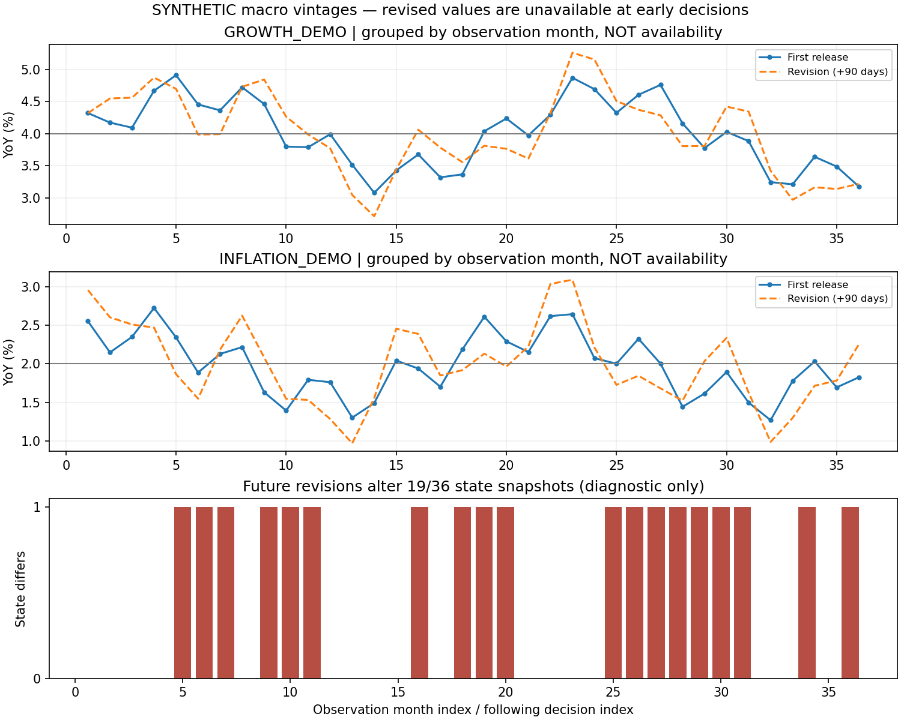

# 第14章 宏观指标、政策传导与经济周期

> 第二篇：金融市场与多资产建模。前置知识：第5—8章的条件期望、统计估计与时间序列，第10—13章的现金流定价、久期、收益与风险溢价。配套实验全部为 **SYNTHETIC人工数据**，没有使用尚未提供的赛题数据。

## 学习目标与本章任务

读完本章，你应能解释：为什么“GDP增长”“增长超出预期”“增长数据被上修”是三个不同事件；为什么降息不能直接翻译为股票上涨；为什么数据库中同一个月份必须保留多个数值版本。

你还应能完成四项工程任务：定义宏观指标元数据，保存不可变的发布版本，按历史决策时点重建可见信息，输出带证据与时效标记的宏观状态。

贯穿案例是一条人工新闻：“某月增长指标公布为4.3%，预期4.0%；三个月后修订为3.8%。”在线监控器在首次发布时不能看到3.8%；也不能把4.3%误写成增长比上月加快0.3个百分点，因为4.0%是预期而非上月值。

第13章讨论价格如何补偿风险。本章进一步回答：增长、通胀与政策消息怎样改变现金流、贴现率和风险补偿；这些信息究竟何时进入系统。

## 14.1 增长、通胀、就业、信用及领先指标

### 14.1.1 指标不是一个没有语境的数

宏观经济指标（Macroeconomic Indicator）是对经济总体活动某个侧面的统计测量。一个完整观测至少包含：

|维度|例子|忽略后可能产生的错误|
|---|---|---|
|经济对象与地域|某经济体居民消费价格|把生产价格当居民生活成本|
|统计期间|2024年1月、2024年第一季度|把月度数据当季度数据|
|数量口径|总量、指数、同比、环比|把指数102解释成增长102%|
|价格与单位|现价亿元、不变价、百分点|把通胀造成的金额增加当实际增长|
|调整方法|季节调整、工作日调整|把春节位置变化当经济拐点|
|版本与来源|首次发布、后续修订、原始链接|使用未来修订数重写历史|
|时间与质量|发布时间、系统可用时间、缺失原因|在发布前使用数值|

季节调整（Seasonal Adjustment，SA）试图从序列中分离有规律的季节变化。消费受节日影响，一个月比上个月高并不自动意味着需求趋势改善。季调参数和端点估计可能随新数据改变，所以“已经季调”不等于“无需版本管理”。

平台必须把数值和元数据一起存储。`4.3`只有与`percent_yoy`、地域、频率和价格口径结合后才有经济意义。

### 14.1.2 GDP：总量、增长率与核算恒等式

国内生产总值（Gross Domestic Product，GDP）衡量一定时期内一个经济体境内生产的最终产品和服务的价值。增加值等于产出减中间投入，避免沿产业链重复相加。

在支出法的简化符号中：

```math
Y=C+I+G+NX,\qquad NX=X-M.
```

$C$ 是私人最终消费， $I$ 是投资，包括固定资本形成与存货变化， $G$ 是政府购买最终产品和服务的支出， $X$ 、 $M$ 分别为出口和进口。购买股票不属于这个意义上的投资；政府转移支付也不是直接新增的政府购买。

进口项被减去，是因为前面的消费、投资等可能已包含进口品；不能据此推断任何进口增加都会机械地损害经济。

这首先是**核算关系**。要推断政府支出增加使产出增加多少，还需要消费、投资、价格、利率和供给等行为假设。

对一个简化的最终产品经济，设数量为 $q_{i,t}$ 、价格为 $p_{i,t}$ ，固定基期为0：

```math
Y_t^N=\sum_i p_{i,t}q_{i,t},
\qquad Y_t^R=\sum_i p_{i,0}q_{i,t}.
```

上标 $N$ 表示名义或现价， $R$ 表示实际或不变价。在这个固定基期例子里，GDP平减指数（GDP Deflator）为：

```math
D_t=100\frac{Y_t^N}{Y_t^R}.
```

由定义：

```math
\frac{Y_t^N}{Y_{t-1}^N}
=\frac{D_t}{D_{t-1}}\frac{Y_t^R}{Y_{t-1}^R}.
```

若名义增长、实际增长与平减指数涨幅分别为 $g_N,g_R,\pi_D$ ：

```math
1+g_N=(1+g_R)(1+\pi_D),
\qquad g_N=g_R+\pi_D+g_R\pi_D.
```

“名义增长减通胀等于实际增长”通常只是近似，而且这里的价格口径应与GDP一致，不能随意用CPI代替。

例：实际产出增长3%，相应价格上涨2%，名义增长为 $1.03\times1.02-1=0.0506$ ，即5.06%。反算时， $1.0506/1.02-1=0.03$ ，即3%，而简单相减得到3.06%。

真实核算使用更细的行业方法。中国2025年GDP发布说明列出不变价缩减和物量外推；美国链式数量指标也不能理解为永久按同一篮子固定价格相加。跨国数据库必须保留方法差异，不能强行加总不同口径的实际分项。参见[国家统计局核算说明](https://www.stats.gov.cn/sj/zxfb/202601/t20260120_1962349.html)及[BEA GDP补充说明](https://www.bea.gov/news/gdp-release-additional-information)。

### 14.1.3 同比、环比与年化

对季度实际产出 $Y_t$ ，环比增长率（Quarter-on-Quarter，QoQ）和同比增长率（Year-on-Year，YoY）为：

```math
g_t^Q=\frac{Y_t}{Y_{t-1}}-1,\qquad
g_t^Y=\frac{Y_t}{Y_{t-4}}-1.
```

同比混合较长时期的信息；环比更贴近近期变化，但更易受季节性和短期噪声影响。

假设本季度环比增速在未来四个季度完全重复，才得到年化环比：

```math
Y_{t+4}^{\mathrm{hyp}}=Y_t(1+g_t^Q)^4,
\qquad g_t^A=(1+g_t^Q)^4-1.
```

这是假设性复合换算，不是未来一年预测，也不是已经观察到的同比。环比1%对应年化约4.0604%，不是严格的4%。[BEA季度增长年化说明](https://www.bea.gov/help/faq/122)使用四期复合方法。

还要区分“增长率年化”和“流量金额折成年率”：季度流量金额折成年率可乘4；增长率一般应复合。

同比的**基数效应**可以用对数恒等式理解。对月度价格指数，令 $\ell_t=\log P_t$ ，对数同比通胀为：

```math
\pi_t^{Y,\log}=\ell_t-\ell_{t-12}.
```

连续两个月的同比差为：

```math
\begin{aligned}
\pi_t^{Y,\log}-\pi_{t-1}^{Y,\log}
&=(\ell_t-\ell_{t-12})-(\ell_{t-1}-\ell_{t-13})\\[0pt]
&=(\ell_t-\ell_{t-1})-(\ell_{t-12}-\ell_{t-13}).
\end{aligned}
```

它等于本月环比对数涨幅减去年同月环比对数涨幅。因此，本月价格继续上涨时，同比涨幅仍可能下降。监控器应同时展示水平、近期变化和基数背景。

### 14.1.4 通胀：指数、权重与不完全传导

居民消费价格指数（Consumer Price Index，CPI）关注居民消费相关价格；生产者价格指数（Producer Price Index，PPI）关注生产环节价格。两者覆盖范围、权重与传导链不同。

为理解指数，构造固定篮子，令基期消费量为 $q_{i,0}$ ：

```math
P_t^L=
100\frac{\sum_i p_{i,t}q_{i,0}}{\sum_i p_{i,0}q_{i,0}}
=100\sum_i w_{i,0}\frac{p_{i,t}}{p_{i,0}},
\qquad
w_{i,0}=\frac{p_{i,0}q_{i,0}}{\sum_j p_{j,0}q_{j,0}}.
```

权重之和为1。这个Laspeyres型简化例子说明：占比小的商品暴涨，不等于总体价格同比同幅上涨。实际指数还涉及抽样、替代、质量调整和权重更新；该式不宣称所有国家所有时期CPI都按一个固定篮子实现。

核心通胀（Core Inflation）是按明确规则排除某些波动成分后得到的指标族，并非全球只有一个定义。总体通胀影响购买力；核心指标有时更便于观察持续性，两者用途不同。

PPI向CPI传导取决于成本占比、库存、进口价格、竞争和利润率。成本上升可能被利润吸收，也可能滞后转嫁，不能写成确定的一步线性因果规则。

### 14.1.5 就业：分母也会变

设就业人数 $E$ ，失业人数 $U$ ，劳动力 $L=E+U$ ，统计口径下适龄人口 $W$ 。失业率、劳动参与率、就业人口比为：

```math
u=\frac{U}{L},\qquad \ell=\frac{L}{W},\qquad e=\frac{E}{W}.
```

把 $E=L-U=L(1-u)$ 代入：

```math
e=\ell(1-u).
```

所以失业率下降不一定意味着就业增加。例：适龄人口100人，就业60人、失业6人，失业率为6/66；若2名失业者退出劳动力，就业仍60人，失业率却变为4/64。

现实中是否算失业，还涉及求职、可工作性、临时解雇等定义；不同调查的地域、年龄和样本框也不同。美国CPS具体口径见[BLS官方定义](https://www.bls.gov/cps/definitions.htm)，不能直接当作中国所有就业统计的口径。

平台应结合失业率、参与率、就业变化和工时。企业调查岗位数与住户调查就业人数，也不能仅按名字“就业”拼接。

### 14.1.6 信用、货币与存量—流量

货币数量、银行贷款和社会融资从不同角度描述金融条件。信用扩张可能支持支出，也可能用于偿还旧债、补充现金或资产交易；数量增加不直接等于实体投资增加。

一般性存量—流量账本可写为：

```math
B_t-B_{t-1}=F_t+V_t+K_t.
```

$B_t$ 为期末存量， $F_t$ 为当期净交易流量， $V_t$ 为估值和汇率变动， $K_t$ 为核销、分类调整等其他变动。各统计项目的具体调整必须查定义，不能默认公布增量严格等于存量差。

信用脉冲（Credit Impulse）有不同实现。一个可复现的研究定义是先算过去四季净信用流量相对过去四季名义GDP的比例，再求同比变化：

```math
c_t=\frac{\sum_{j=0}^{3}F_{t-j}}{\sum_{j=0}^{3}Y_{t-j}^N},
\qquad CI_t=c_t-c_{t-4}.
```

这是本章举例的定义，不是唯一行业标准，也不同于贷款存量增速或其一阶差分。GDP与信用数据发布时间不一致时，每个输入都须按决策时点选版本。

### 14.1.7 领先指标与PMI

采购经理指数（Purchasing Managers' Index，PMI）通过企业调查形成景气信号。扩散指数（Diffusion Index，DI）测量改善广度，不直接测量总量增长幅度。

增加、不变、减少的回答比例分别为 $p_+,p_0,p_-$ ，三者之和为1：

```math
DI=100(p_++0.5p_0).
```

代入 $p_0=1-p_+-p_-$ ：

```math
DI-50=50(p_+-p_-).
```

50表示增加与减少的占比相等，不是产出增长率为50%。30%增加、50%不变、20%减少，对应55。

国家统计局制造业PMI由新订单、生产、就业、供应商配送时间和原材料库存分项加权，配送时间采用逆向处理。具体方法见[官方编制说明](https://www.stats.gov.cn/zs/tjws/zytjzbqs/cgzlzs/202501/t20250121_1958396.html)。

交货变慢可能来自需求旺盛，也可能来自供给中断；相同指数变化未必代表相同冲击。领先、同步和滞后也不是永久标签，应在特定经济体、阶段与真实可用时点下检验。

## 14.2 货币政策、财政政策、预期与传导链

### 14.2.1 从政策操作到资产价格

货币政策（Monetary Policy）通过政策利率、流动性工具、资产负债表操作和沟通等影响金融条件。财政政策（Fiscal Policy）通过支出、税收和转移支付等影响收入、需求与资源配置。各国制度不同，本章不把某国框架当通用操作规则。

传导应分五步理解：

1. 政策决定相对市场原有预期改变了什么。
2. 短端利率、未来政策路径、期限溢价和信用利差如何变化。
3. 融资条件、资产负债表和现金流如何变化。
4. 消费、投资、生产、就业与价格如何反应。
5. 新数据怎样反馈到政策预期。

金融价格反应可能很快，经济数量调整通常较慢；银行资本约束或借款需求不足也可能削弱传导。[美联储传导说明](https://www.federalreserve.gov/monetarypolicy/monetary-policy-what-are-its-goals-how-does-it-work.htm)介绍利率、资产价格、汇率与支出的联系，其中历史政策描述不能当作当前操作参数。

### 14.2.2 名义利率、实际利率与期限结构

今天一单位货币投资后变为 $1+i_t$ ，下一期物价变为今天的 $1+\pi_{t+1}$ 倍，则购买力总回报为：

```math
1+r_{t+1}^{\mathrm{real}}=\frac{1+i_t}{1+\pi_{t+1}}.
```

这是事后实际回报恒等式。整理得：

```math
i_t=r_{t+1}^{\mathrm{real}}+\pi_{t+1}
+r_{t+1}^{\mathrm{real}}\pi_{t+1}.
```

小幅变化时交叉项较小，常写事前近似：

```math
r_t^e\approx i_t-\mathbb E_t[\pi_{t+1}].
```

期望不能任意穿过倒数。不确定通胀下，还要区分期望实际回报、确定实际利率和含风险补偿的名义利率。该近似足以解释：名义利率降50个基点、通胀预期降100个基点时，事前实际利率反而约升50个基点。

基点（Basis Point，bp）等于0.01个百分点，即小数利率0.0001。公式用小数还是百分点必须明确。

期限 $n$ 的债券收益率常作如下近似分解：

```math
y_t^{(n)}\approx
\frac{1}{n}\sum_{j=0}^{n-1}\mathbb E_t[i_{t+j}]+TP_t^{(n)}.
```

$TP$ 为期限溢价（Term Premium）。这不是任意复利口径下的精确恒等式，实际估计涉及凸性与模型选择。

即使今天降息，如果市场此前预期降得更多，或未来政策预期更紧、期限溢价上升，长债收益率仍可上升。要分开本次操作变化、相对预期变化和整条曲线变化。

### 14.2.3 同一个消息为什么产生相反的股票反应

用恒定增长股利模型作局部说明：

```math
P=\frac{D_1}{k-g},\qquad k>g.
```

$D_1$ 为下一期股利， $k$ 为必要收益率， $g$ 为长期增长率。取对数再全微分：

```math
\log P=\log D_1-\log(k-g),
```

```math
\frac{dP}{P}=\frac{dD_1}{D_1}-\frac{dk-dg}{k-g}.
```

增长消息改善可能提高 $D_1,g$ ，也可能通过政策利率和风险补偿提高 $k$ 。价格方向取决于净效应。

人工例子：股利预期升1%， $k-g=0.05$ ，必要收益率升0.003，长期增长率升0.001。局部近似为：

```math
\frac{dP}{P}\approx0.01-\frac{0.003-0.001}{0.05}=-0.03.
```

现金流变好与股价下降可以并存。这里只做局部敏感度分析，不把无限期恒定增长当现实预测模型。

债券一阶关系在第10章已推导：

```math
\frac{\Delta P_B}{P_B}\approx-D_{\mathrm{mod}}\Delta y.
```

修正久期6、收益率升20bp时，价格约跌1.2%。信用债还受利差影响，国债利率下降不保证信用债价格上涨。

|贯穿资产|解释通道|不能省略的条件|
|---|---|---|
|EQ_DEMO股票|利润、增长、无风险利率、风险溢价|行业结构、融资约束、消息是否已反映|
|BOND_DEMO债券|短端路径、期限溢价、信用利差|久期、币种、信用风险|
|GOLD_DEMO黄金|实际利率、计价货币、避险与持有需求|关系可变，不能假设单因子决定|
|FX_DEMO外汇|两国相对政策、风险溢价、资本流动|明确标价方向，宽松不等于必然单向变化|

这张表提供待检验机制，不是固定交易信号。

### 14.2.4 财政乘数：把假设写进推导

财政乘数（Fiscal Multiplier）描述给定模型与环境下，政府支出等变化对应的产出变化。

构造固定价格、存在闲置产能的短期模型：

```math
T=T_0+\tau Y,\quad C=C_0+c(Y-T),\quad
I=I_0-bi,\quad NX=X_0-mY.
```

$c$ 是边际消费倾向，满足 $0\lt c\lt 1$ ； $\tau$ 为边际税率； $m\ge0$ 为边际进口倾向； $b\ge0$ 为投资对利率的敏感度； $T$ 为净税收。

代入支出均衡：

```math
Y=C_0+c(Y-T_0-\tau Y)+I_0-bi+G+X_0-mY.
```

展开消费项：

```math
c(Y-T_0-\tau Y)=c(1-\tau)Y-cT_0.
```

将含 $Y$ 的项移至左边：

```math
[1-c(1-\tau)+m]Y=C_0-cT_0+I_0-bi+G+X_0.
```

记 $A=1-c(1-\tau)+m\gt 0$ ，则：

```math
Y=\frac{C_0-cT_0+I_0-bi+G+X_0}{A}.
```

若利率与其他外生项不变，分别求偏导：

```math
\frac{\partial Y}{\partial G}=\frac{1}{A},
\qquad \frac{\partial Y}{\partial T_0}=-\frac{c}{A}.
```

令 $c=0.8,\tau=0.25,m=0.1$ ，则 $A=0.5$ ，支出乘数2、定额税乘数−1.6。这是人工模型算出的值，不是任何国家的实际乘数估计。

若利率随产出上升，即 $i=i_0+\phi Y$ 、 $\phi\gt 0$ ，把它代回投资方程并移项，分母变为：

```math
A+b\phi,\qquad \frac{\partial Y}{\partial G}=\frac{1}{A+b\phi}.
```

这是“挤出”渠道的简化表达。价格、供给、债务预期和私人行为变化还会改变结果。支出—产出框架参见[OpenStax附录B](https://openstax.org/books/principles-macroeconomics-3e/pages/b-the-expenditure-output-model)；上述扩展和数值为本章独立推演。

### 14.2.5 政策内生性与信息效应

政策往往是对经济变化的反应。增长恶化促使降息时，回归可能发现降息与增长下降同时出现，不能据此证明降息导致衰退。

设真实关系为：

```math
y=\beta x+\gamma z+\varepsilon,\qquad \mathrm{Cov}(x,\varepsilon)=0.
```

$x$ 为政策操作， $z$ 为政策制定者观察到的经济前景。漏掉 $z$ 时，带截距一元回归的总体斜率为：

```math
\begin{aligned}
b&=\frac{\mathrm{Cov}(x,y)}{\mathrm{Var}(x)}\\[0pt]
&=\beta+\gamma\frac{\mathrm{Cov}(x,z)}{\mathrm{Var}(x)}.
\end{aligned}
```

第二项可能改变符号。第13章的遗漏变量问题，在这里成为识别因果效应的障碍。

高频事件研究可缩窄干扰窗口，却不自动消除混杂。中央银行公告既改变政策路径，也可能透露经济前景。

Jarociński与Karadi的2020年论文利用公告附近利率与股票价格的共同变化区分政策和信息冲击；这依赖识别假设，不是把某种价格同向变化当普遍真值。[期刊摘要](https://www.aeaweb.org/articles?id=10.1257%2Fmac.20180090)，[ECB作者解释](https://www.ecb.europa.eu/press/research-publications/resbull/2018/html/ecb.rb180921.ga.html)。

2026年法国央行工作论文进一步研究公告中的“传导保护”消息，讨论政策利率、前瞻指引、资产购买与金融稳定信息并存。这是特定论文的研究结果，不是本平台已验证的算法。本章只据官方摘要介绍方向。[工作论文1061](https://www.banque-france.fr/en/publications-and-statistics/publications/missing-surprise-transmission-protection-central-bank-announcements)。

## 14.3 周期划分、宏观意外与资产重定价

### 14.3.1 水平、增速和动量

经济周期（Business Cycle）指总体经济活动围绕扩张与收缩发生的变化。必须区分：产出水平、增长率、增长率的变化，以及实际产出相对潜在产出的偏离。

令潜在产出为 $Y_t^\ast$ ，对数产出缺口定义为：

```math
x_t=\log Y_t-\log Y_t^\ast.
```

潜在产出不是直接观察量。趋势模型、生产函数和滤波器会给出不同估计；双边滤波若用了未来数据，历史缺口就不能直接作为当时在线特征。

增长率从5%降到3%时，产出仍可能增长；增长转正时，水平仍可能低于先前高点。不能让一个“好/坏”灯代替所有维度。

### 14.3.2 为什么周期标签没有唯一答案

美国NBER结合多项活动指标判断周期，不是机械采用连续两季GDP下降规则。其官方记录显示，2001年3月峰值于2001年11月26日宣布。经济转折时间与机构确认时间不同。[NBER FAQ与宣布时间表](https://www.nber.org/research/business-cycle-dating/business-cycle-dating-procedure-frequently-asked-questions)。

事后标签可用于研究评价，但历史训练必须检查标签当时是否公布。不能在2001年4月特征里填入11月才确认的官方判断。

一种比赛起步方案是增长—通胀二维标签。设在线可见指标为 $g_t,\pi_t$ ，预先确定阈值 $g_0,\pi_0$ ：

```math
z_t=\left(\mathbf 1(g_t\ge g_0),\mathbf 1(\pi_t\ge\pi_0)\right).
```

四象限只表示相对阈值的高低，不能未经解释就命名为复苏、繁荣、滞胀、衰退。若改用增长动量与通胀动量，经济含义又不同。

标签必须明确指标与地域、水平还是变化、阈值来源、信息时点、无法判断时的处理。缺数据不能默认低增长。

滞回（Hysteresis）可规定超过上阈值才进入高状态、跌破下阈值才退出，中间保留原状态，以减少噪声切换，代价是反应延迟。概率标签也可以使用，但需要模型和校准依据，不能把随意打分叫作真实置信度。

### 14.3.3 首次发布意外、修订与预期偏差

宏观意外（Macroeconomic Surprise）通常指发布值相对发布前预期的偏离。令首次值为 $a_k^{(1)}$ ，发布前一致预期为 $f_k^-$ ：

```math
u_k=a_k^{(1)}-f_k^-.
```

一致预期（Consensus Forecast）是某调查样本的汇总，不等于所有市场参与者共同的真实期望。应保存调查截止时间、样本数、均值或中位数和供应商版本。

发布4.3%、预期4.0%，意外是0.3**个百分点**。不能含糊写成“超预期0.3%”。

不同指标单位和波动不同，可用过去可见意外的样本标准差标准化。当前事件之前的合格历史集合为 $\mathcal H_k$ ：

```math
\bar u_{k,-}=\frac{1}{n_k}\sum_{j\in\mathcal H_k}u_j,\qquad
s_{k,-}^2=\frac{1}{n_k-1}\sum_{j\in\mathcal H_k}(u_j-\bar u_{k,-})^2,
```

```math
S_k=\frac{u_k}{s_{k,-}}.
```

分母不包括当前或未来意外；历史首次值后来修订，也不回写首次发布意外。样本不足或标准差近零时返回不可标准化，不能制造无穷大报警。

这里分子未减历史均值，衡量相对当期调查预期的消息幅度。若改用 $(u_k-\bar u_{k,-})/s_{k,-}$ ，额外校正了调查历史偏差，解释应另说明。

修订消息另记：

```math
v_k^{(2)}=a_k^{(2)}-a_k^{(1)}.
```

它在修订发布时才成为消息。若市场已有修订预期，真正的修订意外还要减该预期；程序只称其修订幅度，不称不可预测冲击。

同一公告可能包含新一期首次值、前几期修订、季调方法变化，文本抽取必须分栏保存。

### 14.3.4 公告窗口与归因边界

设资产 $i$ 的对数价格为 $p_i(t)$ ，发布时间为 $\tau_k$ ，窗口回报为：

```math
R_{i,k}=p_i(\tau_k+h)-p_i(\tau_k-\ell).
```

端点报价规则应预先固定，并检查时区、开市状态、报价陈旧、价差与同期公告。

可以估计：

```math
R_{i,k}=\alpha_i+\beta_{i,g}S_{g,k}+\beta_{i,\pi}S_{\pi,k}
+\gamma_i^\top W_k+\varepsilon_{i,k}.
```

$W_k$ 为事先指定的控制变量。回归首先提供条件关联，讨论因果还需论证消息外生性、无重要混杂、样本选择与测量可信等条件。

即时解释的响应系数应只用过去事件估计。窗口结束后的回报只能在结束后归档；不能拿完整窗口收益解释开始时已发出的预警，也不能用当次收益挑选最合意的标签。

### 14.3.5 宏观数据的时间模型

时点一致数据（Point-in-Time Data，PIT）指重建历史时点可获得的信息，不是把当前数据库按日期重新排列。

|字段|含义|用途|
|---|---|---|
|`period_end`|统计覆盖期末|选最新统计期间|
|`published_at`|该版本公开发布时间|识别公告前预期|
|`available_at`|进入本系统可用状态的时间|确定历史可见性|
|`version`|同一统计期的发布版本|防止迟到旧值回滚|
|`event_id`|来源事件唯一标识|幂等与冲突检测|
|`value`、`unit`|值与完整单位|防止百分比和基点混用|

宏观统计覆盖一段区间，不应伪造为精确一秒的经济事件。本章用期末排序，不声称期末已知结果。

决策时点 $t$ ，对指标 $s$ 、统计期 $o$ ，可见版本集合为：

```math
\mathcal V(s,o;t)=\lbrace v:\mathrm{available}_{s,o,v}\le t\rbrace.
```

在其中选择已验证的最新版本：

```math
x_{s,o}^{[t]}=x_{s,o,v^\ast},\qquad v^\ast=\max\mathcal V(s,o;t).
```

随后选择所需统计期。“最新可见指标”通常优先最新统计期，不是最后到达的消息。旧月份今天修订，不应覆盖昨天公布的新月份。

新鲜度也要拆开：

```math
A_{\mathrm{obs}}=t-\mathrm{period\_end},\qquad
A_{\mathrm{pub}}=t-\mathrm{published\_at}.
```

旧月份今天修订，发布年龄很小，观测年龄仍大。

ALFRED支持按历史日期检索数据版本；FRED API默认实时期间通常是今天。日期级版本不能代替本系统秒级获取记录，高频研究仍须另存实际时间与时区。[官方实时期间说明](https://fred.stlouisfed.org/docs/api/fred/realtime_period.html)。

## 14.4 完整实验：宏观发布账本、PIT快照与修订偏差

### 14.4.1 实验设计

本实验实现离线发布账本，不训练预测模型，验证历史可见性、版本顺序、发布前预期和修订隔离。

生成2022年1月至2024年12月的36个月、两个人工同比指标，每月各有首次和修订，共144条发布事件。

增长、通胀首次发布时间为月末后15天、10天的08:00 UTC，常规获取延迟5分钟；修订在首次发布后90天。增长第11个月故意延迟6天；通胀第13个月的预期故意在发布后1分钟才可用。**这些日期与延迟是教学协议，不是真实机构日历或测得延迟。**

增长与通胀阈值固定为4和2，单位为同比百分数。它们不是政策目标或潜在增长估计。每月末后第18天12:00形成快照，用统计期年龄60天作新鲜度上限。

对照组故意取**同一个已选统计期的最终修订值**，隔离修订泄漏，不额外提前加入尚未公布的新月份。对照列命名`LEAKY_DIAGNOSTIC`，禁止用作在线输入。

生成过程是确定性三角函数，无随机种子；人工预期与发布值共同生成，仅用于测试口径，不代表预测能力。

### 14.4.2 完整主程序

保存为[macro_lab.py](./code/ch14/macro_lab.py)，只依赖Python标准库，使用已有Anaconda。

<!-- MAIN_PROGRAM -->

```python
"""SYNTHETIC macro releases: immutable vintages and point-in-time snapshots."""
from __future__ import annotations

import calendar
import hashlib
import json
import math
import platform
from dataclasses import asdict, dataclass
from datetime import datetime, timedelta, timezone
from pathlib import Path
from statistics import stdev

UTC = timezone.utc
SERIES = ("GROWTH_DEMO", "INFLATION_DEMO")
THRESHOLDS = {"GROWTH_DEMO": 4.0, "INFLATION_DEMO": 2.0}


@dataclass(frozen=True)
class Release:
    event_id: str
    series: str
    period_end: datetime
    version: int
    published_at: datetime
    available_at: datetime
    value: float
    unit: str = "percent_yoy"


@dataclass(frozen=True)
class Forecast:
    forecast_id: str
    series: str
    period_end: datetime
    available_at: datetime
    value: float
    unit: str = "percent_yoy"


class Ledger:
    def __init__(self):
        self.events: dict[str, Release] = {}
        self.audit: list[dict] = []

    def add(self, e: Release) -> bool:
        times = (e.period_end, e.published_at, e.available_at)
        reason = None
        if any(t.tzinfo is None or t.utcoffset() is None for t in times):
            reason = "NAIVE_TIME"
        elif not e.period_end <= e.published_at <= e.available_at:
            reason = "TIME_ORDER"
        elif e.series not in SERIES or e.unit != "percent_yoy":
            reason = "SCHEMA"
        elif e.version < 1 or not math.isfinite(e.value):
            reason = "VALUE_OR_VERSION"
        old = self.events.get(e.event_id)
        if not reason and old is not None:
            reason = "DUPLICATE" if old == e else "ID_CONFLICT"
        if not reason:
            for prior in self.events.values():
                if (prior.series, prior.period_end) != (e.series, e.period_end):
                    continue
                if prior.version == e.version:
                    reason = "VERSION_CONFLICT"
                elif ((e.version > prior.version) !=
                      (e.published_at > prior.published_at)) or (
                        e.published_at == prior.published_at):
                    reason = "VERSION_ORDER"
        self.audit.append({"event_id": e.event_id, "action": reason or "ACCEPT"})
        if reason == "DUPLICATE":
            return False
        if reason:
            raise ValueError(reason)
        self.events[e.event_id] = e
        return True

    def snapshot(self, series, decision_at, max_age_days=60):
        candidates = [e for e in self.events.values()
                      if e.series == series and e.available_at <= decision_at]
        if not candidates:
            return None, "MISSING"
        # Arrival order must not overwrite a newer period or a newer vintage.
        chosen = max(candidates, key=lambda e: (e.period_end, e.version))
        age = (decision_at - chosen.period_end).total_seconds() / 86400
        return chosen, "STALE" if age > max_age_days else "OK"


def forecast_before(e, forecasts):
    rows = [f for f in forecasts if f.series == e.series
            and f.period_end == e.period_end and f.unit == e.unit
            and f.available_at < e.published_at and math.isfinite(f.value)]
    return max(rows, key=lambda f: (f.available_at, f.forecast_id)) if rows else None


def surprise(e, ledger, forecasts, min_history=6):
    if e.version != 1:
        raise ValueError("REVISIONS_ARE_NOT_FIRST_RELEASE_SURPRISES")
    f = forecast_before(e, forecasts)
    if f is None:
        return {"event_id": e.event_id, "reason": "NO_PRE_RELEASE_FORECAST",
                "raw_pp": None, "z": None, "history_n": 0}
    history = []
    for h in ledger.events.values():
        if (h.series == e.series and h.version == 1
                and h.published_at < e.published_at
                and h.available_at < e.published_at):
            hf = forecast_before(h, forecasts)
            if hf is not None:
                history.append(h.value - hf.value)
    raw = e.value - f.value
    scale = stdev(history) if len(history) >= min_history else None
    reason = "OK" if scale is not None and scale > 1e-12 else "WARMUP_OR_ZERO_SCALE"
    return {"event_id": e.event_id, "forecast_id": f.forecast_id,
            "raw_pp": raw, "scale_pp": scale,
            "z": raw / scale if reason == "OK" else None,
            "history_n": len(history), "reason": reason}


def quadrant(values):
    return "/".join(("G_HIGH" if values[0] >= 4 else "G_LOW",
                     "I_HIGH" if values[1] >= 2 else "I_LOW"))


def dataset():
    events, forecasts, decisions = [], [], []
    for k in range(36):
        year, month0 = 2022 + k // 12, k % 12
        end = datetime(year, month0 + 1,
                       calendar.monthrange(year, month0 + 1)[1], tzinfo=UTC)
        decisions.append(end + timedelta(days=18, hours=12))
        for j, series in enumerate(SERIES):
            center = THRESHOLDS[series] + (0.65 if j == 0 else 0.45) * math.sin(k / 3 + j)
            error = 0.32 * math.cos(1.7 * k + j)
            first = center + error
            revised = first + 0.48 * math.sin(0.9 * k + j)
            pub = end + timedelta(days=15 if j == 0 else 10, hours=8)
            delay = timedelta(days=6) if k == 10 and j == 0 else timedelta(minutes=5)
            tag = f"{series}:{k:02d}"
            events.extend([
                Release(tag + ":1", series, end, 1, pub, pub + delay, first),
                Release(tag + ":2", series, end, 2, pub + timedelta(days=90),
                        pub + timedelta(days=90, minutes=5), revised)])
            # One forecast arrives after publication: unusable as an expectation.
            ftime = pub + timedelta(minutes=1) if k == 12 and j == 1 else pub - timedelta(days=1)
            forecasts.append(Forecast(tag + ":F", series, end, ftime, center))
    return sorted(events, key=lambda e: (e.available_at, e.event_id)), forecasts, decisions


def experiment(events, forecasts, decisions):
    ledger = Ledger()
    for e in events:
        ledger.add(e)
    ledger.add(events[0])  # Deliberate retry: retained in the audit log.
    rows = []
    for t in decisions:
        selected = [ledger.snapshot(s, t) for s in SERIES]
        valid = all(e is not None and status == "OK" for e, status in selected)
        pit = quadrant([e.value for e, _ in selected]) if valid else "UNKNOWN"
        # Invalid counterfactual: future revision, but keep the SAME selected periods.
        final = [max((x for x in events if x.series == e.series and
                      x.period_end == e.period_end), key=lambda x: x.version)
                 for e, _ in selected if e is not None]
        leaky = quadrant([e.value for e in final]) if valid else "UNKNOWN"
        rows.append({"decision_at": t, "pit_state": pit,
                     "LEAKY_DIAGNOSTIC_state": leaky,
                     "selected": [{"event": asdict(e) if e else None, "status": s}
                                  for e, s in selected]})
    surprises = [surprise(e, ledger, forecasts) for e in events if e.version == 1]
    revisions = []
    for e in events:
        if e.version == 2:
            original = next(x for x in events if x.series == e.series
                            and x.period_end == e.period_end and x.version == 1)
            revisions.append({"event_id": e.event_id, "available_at": e.available_at,
                              "revision_pp": e.value - original.value})
    results = {"data_kind": "SYNTHETIC", "events": len(events),
               "snapshots": len(rows),
               "revision_state_disagreements": sum(r["pit_state"] != r["LEAKY_DIAGNOSTIC_state"] for r in rows),
               "standardized_surprises": sum(s["z"] is not None for s in surprises),
               "missing_pre_release_forecasts": sum(s["reason"] == "NO_PRE_RELEASE_FORECAST" for s in surprises),
               "duplicates": sum(a["action"] == "DUPLICATE" for a in ledger.audit)}
    return results, rows, surprises, revisions, ledger.audit


def encode(value):
    if isinstance(value, datetime):
        return value.isoformat()
    raise TypeError(type(value).__name__)


def main():
    events, forecasts, decisions = dataset()
    results, rows, surprises, revisions, audit = experiment(events, forecasts, decisions)
    out = Path(__file__).parent / "runs" / datetime.now(UTC).strftime("run_%Y%m%dT%H%M%S_%fZ")
    out.mkdir(parents=True, exist_ok=False)
    artifacts = {"inputs.json": {"releases": [asdict(e) for e in events],
                                 "forecasts": [asdict(f) for f in forecasts],
                                 "decisions": decisions},
                 "results.json": results, "snapshots.json": rows,
                 "surprises.json": surprises, "revisions.json": revisions,
                 "audit.json": audit}
    hashes = {}
    for name, data in artifacts.items():
        path = out / name
        path.write_text(json.dumps(data, default=encode, ensure_ascii=False,
                                   indent=2, allow_nan=False) + "\n", encoding="utf-8")
        hashes[name] = hashlib.sha256(path.read_bytes()).hexdigest()
    manifest = {"python": platform.python_version(), "data_kind": "SYNTHETIC",
                "thresholds_percent": THRESHOLDS, "min_history": 6,
                "freshness_basis": "period_end", "max_age_days": 60,
                "code_sha256": hashlib.sha256(Path(__file__).read_bytes()).hexdigest(),
                "files_sha256": hashes,
                "limitations": "Offline replay; no real calendar, forecasts, causal estimate or trading."}
    (out / "manifest.json").write_text(json.dumps(manifest, indent=2) + "\n", encoding="utf-8")
    print(json.dumps(results, indent=2))
    print(out.resolve())


if __name__ == "__main__":
    main()
```

`Release`保存不可变记录，`Ledger`验证并保存版本，`snapshot`与`surprise`分别生成状态输入和公告消息，`main`保存完整输入、输出、审计与哈希。

完全相同的重试返回`False`并记`DUPLICATE`；ID内容冲突、版本冲突和发布时间倒置均报错。不能靠“保留最后一条”抹去错误。生产接入应保存原始坏消息到隔离区，本章异常会中断普通导入。

完整账本查询仍须逐条限制可用时间。测试另建仅装入历史前缀的账本，逐时点与完整账本比较，检查输出相同。

### 14.4.3 运行、结果与解释

在仓库根目录运行：

```powershell
& 'D:\Anaconda\python.exe' -X utf8 教材/code/ch14/macro_lab.py
& 'D:\Anaconda\python.exe' -X utf8 -m unittest discover -s 教材/code/ch14 -v
```

主程序打印运行目录。绘图用已有Matplotlib，将参数换成本次目录：

```powershell
& 'D:\Anaconda\python.exe' -X utf8 教材/code/ch14/plot_macro.py 教材/code/ch14/runs/run_20261026T083600_158140Z
```

实际运行结果：

|项目|结果|
|---|---:|
|人工发布事件|144|
|历史快照|36|
|未来修订改变象限的快照|19|
|可标准化首次意外|59|
|缺合格发布前预期的首次事件|1|
|完全重复消息|1|
|通过的程序测试|12|

72次首次发布中，两指标各有前6次预热，另1次缺合格预期，所以59个意外可以标准化。后续分母不使用修订值补齐缺失。

19/36是人工发生器和阈值下的**状态不一致次数**，不是真实发生率或模型错误率。修订值也不宣称为无误差经济真值。



上两幅按统计月份对齐版本，便于比较，但不是在线可用时间轴；第三幅对应决策快照差异。把修订曲线当当时已知数据就是泄漏。

第11个月增长消息迟到时，快照保留第10个月首次值；旧月修订也不取代新月份。正确的时间语义不代表旧数据一定能准确描述当前经济。

运行目录保存`inputs.json`、`snapshots.json`、`surprises.json`、`revisions.json`、`audit.json`、`results.json`、`manifest.json`。清单记录环境、阈值、年龄口径、代码和输出哈希。

本次结果文件SHA256：`79a41e13359b43a2083e1e84a5240e5fabefcd672076100dc02c1647034b3b78`。目录时间随运行改变，结果由确定性输入复现。

### 14.4.4 从离线账本到服务

设发布数 $N$ 、查询次数 $Q$ ，逐次快照约为 $O(QN)$ ；本实现版本检查和历史意外计算可达 $O(N^2)$ 。144条消息无须分布式集群。

规模扩大后可按“指标—统计期”建索引，维护版本列表；均值方差可增量计算，但必须处理迟到记录，不能为了速度改变历史口径。

|组件|责任|证据|
|---|---|---|
|接入服务|保存原始发布与实际获取时间|原文哈希、来源、时间|
|原始存储|保留版本、重试及错误原文|事件ID、质量状态|
|PIT查询|返回当时可见记录|选中事件ID、查询规则版本|
|特征服务|水平、动量、意外、修订、年龄|输入版本与缺失原因|
|状态服务|执行规则或模型，允许未知|标签定义、证据、有效时间|

本章未实现Kafka、数据库事务、断点恢复、鉴权和在线投递，也未模拟真实交易日历。它提供可测试语义，后续架构必须保持该语义。

若数据源更正发布时间，仍要保存原始声明、纠正事件与本系统获知纠正的时间。预期只有日期没有时刻时，应标记精度不足，不能假装公告前一秒已知。

## 金融场景案例：给出可核验的解释

人工公告10:00发布、系统10:00:02可用，含增长首次4.3%、预期4.0%、上期从4.1%修订为3.9%。

系统可在10:00:02之后写：“本期首次值高于公告前已归档预期0.3个百分点；上期下修0.2个百分点。增长水平标签依据首次值与冻结阈值；资产反应待固定窗口结束后计算。”

不能写“增长加快0.3个百分点”“历史一直处于低增长”“利好股票，立即上涨”。它们混淆比较基准、数据版本和价格反应。

若10:05股票下跌、国债收益率上涨，可以提出贴现率预期变化抵消现金流改善的假设，并展示曲线、同期新闻与历史响应区间；不能仅凭两个方向宣布唯一因果机制。

历史背景也有时效。NBER2001年3月峰值适合事后讲解，11月才宣布的标签不能作为3月在线信号。中国GDP也有初步核算与最终核实流程；最新历史序列不等于过去每一天看到的序列。[国家统计局发布说明](https://www.stats.gov.cn/zs/tjws/zytjzbqs/gnsczz/202502/t20250226_1958798.html)。

## 工程实现与常见问题

1. **先统一含义，再标准化。** 同比3.2%与月环比0.3%不能仅通过缩放放进同一特征；先明确频率、价格口径、季调和年化。
2. **不插值制造提前知道的数据。** 用尚未公布的季度GDP向季度内每天插值会泄漏。发布后前向保持只表示最后已知值，应附年龄；当前估计须标为模型输出。
3. **区分缺失、延迟和经济平稳。** 没有新宏观数据可能是正常节奏。数据健康预警与经济风险预警要分开。
4. **原始决定与事后重述分开。** 实时回放用当时版本；最新版本研究须明示。保留原始决定，另列新版本重算，不能篡改历史。
5. **预期也需PIT。** 最新调查网页可能被补录。没有当时快照就不能保证公告前可用。自建预测可替代，但应叫模型预测误差，不能冒称一致预期差。
6. **阈值是模型配置。** 在训练阶段或经济假设中确定，不能用完整历史挑最漂亮的标签边界。
7. **检查含义漂移。** 口径、样本和季调改版可造成突变，先核对元数据，再决定重训。
8. **程序不是生产安全边界。** 类型注解不执行完整校验；预期记录假定已通过时区和来源验证。生产需增加预期ID冲突、权限、时钟、原文隔离和原子写入。

## 本章总结

宏观建模从测量开始：区分现价与实际、水平与增速、同比与环比、存量与流量。政策解释必须同时考虑现金流、贴现率、风险溢价与政策反应。

宏观状态具有时间版本。首次意外、修订和事后周期确认是不同信息事件。发布账本通过可用时间、版本排序与缺失规则，使历史决策能够重建和审计。

下一章研究多资产共同变化、尾部依赖、杠杆约束与风险传染。

## 分层练习

1. **基础理解。** GDP增长4%、环比年化4%、现价规模增长4%能否视为同一消息？需要哪些元数据？
2. **增长推导。** 季度产出100变101，求环比及年化。名义增长8%、相应GDP价格涨3%，求实际增长及简单相减误差。
3. **基数效应。** 本月与去年同月环比对数涨幅0.002、0.006，同比对数通胀如何变化？是否意味着本月降价？
4. **就业分母。** 适龄100人、就业60、失业6，2名失业者退出前后，各项比率怎样变化？
5. **扩散指数。** 30%增加、50%不变、20%减少，求DI。从55降52是否表示产出跌3%？配送延迟为何有歧义？
6. **财政推导。** $c=0.8,\tau=0.25,m=0.1$ ，政府购买增加10、定额税增加10分别怎样影响产出？同时增加呢？若 $b\phi=0.25$ ，支出乘数怎样变化？
7. **金融分析。** 名义利率降0.5个百分点、预期通胀降1个百分点，近似实际利率怎样变化？增长超预期而股价下跌为何不必然违背有效市场假说？
8. **手工回放。** 首次4.3在10:00发布、10:00:05可用，三个月后修订3.8。预期4.0在09:59可用、预期4.2在10:00:01可用。10:00:03和10:00:06各能看到什么？意外取多少？
9. **编程证明。** 改动未来与修订数据，验证较早首次意外不变。为何日期排序不能证明无泄漏？
10. **状态设计。** 增长高状态进入阈值4.2、退出3.8。初始4.0、缺失、迟到修订怎样处理？给出测试方案。
11. **研究设计。** 研究股债对增长意外的反应，怎样冻结预期、选窗口、处理同期新闻、切分数据与估计误差？哪些证据不足以证明因果？
12. **工程设计。** 设计支持重复、乱序修订、多来源冲突和审计的宏观服务，明确主键、版本、失败处理、快照及恢复标准。

## 详细参考答案

### 题1

不可以。需要地域、统计期、现价或实际、同比或环比、年化、季调、单位、版本和可用时间。环比年化4%对应季度 $(1.04)^{1/4}-1$ ，约0.9853%；现价增长含价格效应。

### 题2

环比 $101/100-1=0.01$ 。复合四期：

```math
g_A=1.01^4-1=0.04060401.
```

年化4.060401%，不代表未来一年确定增长。实际增长：

```math
g_R=\frac{1.08}{1.03}-1=0.0485436893.
```

约4.854369%。简单相减5%高估0.145631个百分点，因忽略交叉项。

### 题3

同比对数通胀变化 $0.002-0.006=-0.004$ ，下降0.4个对数百分点；实际同比百分比变化仅近似相同。本月环比仍正，价格仍涨，只是退出同比窗口的去年涨幅更高。

### 题4

退出前劳动力66，失业率 $6/66\approx0.090909$ ，即约9.0909%，参与率66%，就业人口比60%。退出后劳动力64，失业4，失业率 $4/64=0.0625$ ，即6.25%，参与率64%，就业人口比仍60%。

验证 $0.64(1-0.0625)=0.60$ 。下降来自分类与分母变化，不是就业增加。

### 题5

DI为 $100(0.30+0.5\times0.50)=55$ ，增加占比高于减少占比10个百分点。55降52表示改善广度下降，仍高于50；不能推出产出跌3%。配送变慢可能反映需求旺盛或供给中断，要结合新订单、生产与事件背景。

### 题6

分母0.5。购买增加10使产出增20，定额税增加10使产出减16，同时增加净增4。这是外生购买与定额税同步变化，不保证含内生税收后的预算余额不变，不能直接套最简封闭经济的平衡预算乘数。

当 $b\phi=0.25$ ，乘数 $1/(0.5+0.25)=4/3$ ，购买增10对应产出约增13.3333。仍依赖固定价格、线性行为和指定政策反应。

### 题7

近似实际利率变动（百分点）：

```math
\Delta r^e\approx-0.5-(-1.0)=+0.5.
```

名义降息可与实际融资条件收紧并存。增长消息可能改善现金流，也可能提高贴现率；后者影响更大时股票下降。有效市场假说不要求宏观词语永远对应固定涨跌。

### 题8

10:00:03首次值尚未进入系统，应保留旧值并标未更新；10:00:06可用4.3。意外 $4.3-4.0=0.3$ 个百分点。

4.2虽比本系统收到首次值更早，但晚于公开发布，不是合格发布前预期。三个月后修订幅度−0.5个百分点，不能把原首次意外0.3改成−0.2。

### 题9

在`教材/code/ch14`目录执行：

```python
from dataclasses import replace
from macro_lab import Ledger, dataset, surprise

events, forecasts, _ = dataset()
target = next(e for e in events if e.event_id == "GROWTH_DEMO:20:1")

def load(rows):
    book = Ledger()
    for row in rows:
        book.add(row)
    return book

changed = [
    replace(e, value=e.value + 1000)
    if e.version > 1 or e.published_at >= target.published_at
    else e
    for e in events
]
# 固定当前待评价事件，只扰动历史分母不能使用的记录。
a = surprise(target, load(events), forecasts)
b = surprise(target, load(changed), forecasts)
assert a == b
assert a["history_n"] == 20
print("PASS: future and revised values cannot change this surprise")
```

分母只允许同指标首次版本、发布时间与可用时间均早于目标、有公告前预期的记录。扰动对象均不在该集合；分子固定，所以结果不变。排序只改变顺序，不能阻止读取后面的未来元素。

### 题10

设`HIGH`、`LOW`、`UNKNOWN`。初始4.0在中间区，无前态则未知；也可提前指定初始化规则，但不能事后选择。

低态或未知遇到不低于4.2转高，高态或未知遇到不高于3.8转低，中间保留确定前态。缺失或超龄输出质量标记，不悄悄执行经济状态转换。

迟到修订到达时可重估当前状态，是否让旧期间修订影响当前值须预定义；历史快照不覆盖，重述另存。测试边界、区间来回波动、无初态、缺失恢复和旧消息。评价规则确定性、可复现性及噪声—延迟权衡。

### 题11

冻结指标、地域、公告类型和调查来源，把首次值匹配公告前快照，用训练期或过去事件尺度标准化。事前定窗口，检查时区、开市、陈旧报价和同期消息；所有剔除留日志，不删不合叙事的样本。

按时间切训练验证测试；参数、阈值不能用测试数据调整。同日或相邻事件误差可能相关，考虑符合设计的聚类或HAC。报告方向、区间、样本数、稳定性与版本敏感性。

短窗口、显著相关、高拟合度都不能自动排除政策信息效应或同期混杂；因果结论仍依赖识别假设。

### 题12

原始层追加保存来源事件、原文、哈希；规范层主键含来源、指标、统计期、版本。同名跨来源数据先核口径，不互相覆盖。

事件ID用于幂等，内容冲突入隔离区；来源版本与公开时间验证顺序，可用时间决定历史可见性。快照存决策时点、选中事件ID、规则版本、年龄与质量。

恢复时从持久检查点重放，对比历史输出内容哈希；外发告警另设幂等键。建议评分：时间语义30%、幂等冲突20%、恢复审计20%、单位元数据15%、性能权限15%。只有架构图、不定义修订如何影响历史快照，不能得完整工程分。

## 推荐教材与延伸阅读

资料于2026年10月26日核对。在线读必要页面，不下载整本教材。公开可读不等于任意转载授权；正文为独立组织的解释、推导和人工案例。

|编号|资料、作者和年份|阅读位置与合法入口|阶段与理由|
|---|---|---|---|
|P2-40|David Shapiro、Daniel MacDonald、Steven A. Greenlaw，Principles of Macroeconomics 3e，2022|[前言](https://openstax.org/books/principles-macroeconomics-3e/pages/preface)，第6—9、15—18章；[附录B](https://openstax.org/books/principles-macroeconomics-3e/pages/b-the-expenditure-output-model)|基础补课；本次读前言、索引与附录相关段落，不声称读完整本。当前页面列CC BY-NC-SA 4.0|
|P2-41|国家统计局，GDP发布及核算说明，2025、2026|[发布制度](https://www.stats.gov.cn/zs/tjws/zytjzbqs/gnsczz/202502/t20250226_1958798.html)；[2025年核算说明](https://www.stats.gov.cn/sj/zxfb/202601/t20260120_1962349.html)，不变价核算与发布部分|基础与工程；了解初步核算和最终核实，接入仍查具体日历|
|P2-42|BEA，季度增长年化FAQ，2006，更新2018|[FAQ122](https://www.bea.gov/help/faq/122)，两种增长公式；[GDP补充信息](https://www.bea.gov/news/gdp-release-additional-information)|计算阶段；区分年化增长与年率金额|
|P2-43|国家统计局，采购经理指数编制方法，2025|[官方方法](https://www.stats.gov.cn/zs/tjws/zytjzbqs/cgzlzs/202501/t20250121_1958396.html)，扩散指数、分项与逆向处理|基础阶段；避免把PMI当增长百分比|
|P2-44|BLS，Concepts and Definitions (CPS)，持续维护，未核定首发年|[定义页](https://www.bls.gov/cps/definitions.htm)，劳动力、参与率、失业率|指标比较；理解分母，不移植美国口径|
|P2-45|美联储理事会，Monetary Policy: What Are Its Goals? How Does It Work?，网页未独立核定年份|[官方页面](https://www.federalreserve.gov/monetarypolicy/monetary-policy-what-are-its-goals-how-does-it-work.htm)，传导及长期利率段|中阶；连接金融条件与支出，分开历史描述和当前操作|
|P2-46|NBER，Business Cycle Dating FAQ，持续更新；2001年公告|[FAQ](https://www.nber.org/research/business-cycle-dating/business-cycle-dating-procedure-frequently-asked-questions)判断方法及日期表；[公告索引](https://www.nber.org/research/business-cycle-dating/business-cycle-dating-committee-announcements)|标签设计；官方检索文本可读，直接打开403，交叉核对官方索引，不声称阅读全文公告|
|P2-47|圣路易斯联储，FRED API Real-Time Periods，持续维护，未标出版年|[官方文档](https://fred.stlouisfed.org/docs/api/fred/realtime_period.html)，Introduction和边界|工程；历史版本查询不能代替秒级接收日志|
|P2-48|Marek Jarociński、Peter Karadi，Deconstructing Monetary Policy Surprises—The Role of Information Shocks，2020|[官方摘要](https://www.aeaweb.org/articles?id=10.1257%2Fmac.20180090)，AEJ: Macroeconomics 12(2)，1—43；[ECB作者解释，2018](https://www.ecb.europa.eu/press/research-publications/resbull/2018/html/ecb.rb180921.ga.html)|研究生；识别政策与信息冲击，不声称本章复现论文|
|P2-49|Christoph Grosse Steffen、Stéphane Lhuissier、Daniel J. Lewis，The Missing Surprise: Transmission Protection in Central Bank Announcements，2026|[法国央行工作论文1061](https://www.banque-france.fr/en/publications-and-statistics/publications/missing-surprise-transmission-protection-central-bank-announcements)，8月26日摘要与非技术总结|前沿；多维信息与事件异质性，只读摘要及总结，未下载全文|

**进度：第14章全部教学栏目完成。下一章为第15章《多资产联动、风险传染与市场冲击》。**
