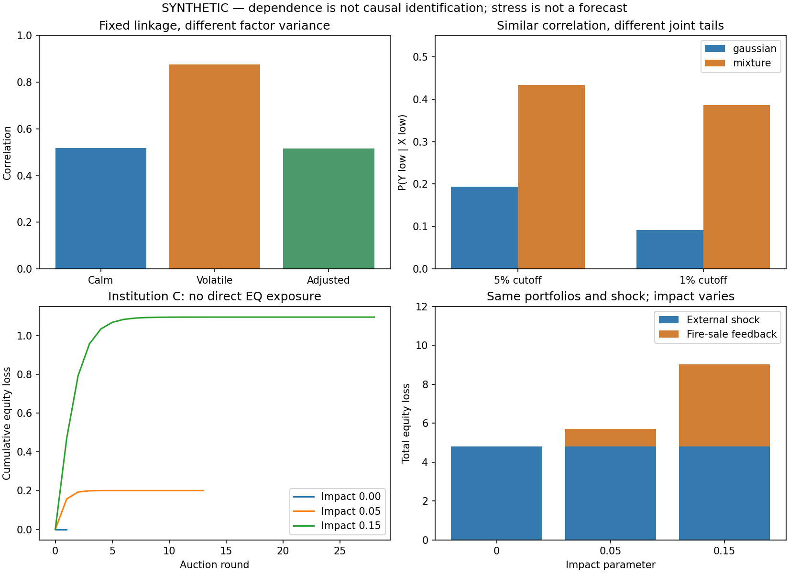

# 第15章 多资产联动、风险传染与市场冲击

> 第二篇：金融市场与多资产建模。前置知识：第3章矩阵与特征值，第5—6章条件概率与统计推断，第9—14章流动性、资产负债表、因子与宏观信息。实验数据全部为 **SYNTHETIC人工数据**，不是赛题官方数据。

## 学习目标

完成本章后，你应能区分共同冲击、统计依赖与风险传染；推导波动变化为什么能改变相关系数；解释相关性相同的两个模型为何有不同的极端共跌概率；从资产负债表推导杠杆约束下的卖出需求，并实现不会重复计算损失的压力传播程序。

工程目标是为平台增加三类可审计输出：依赖关系诊断、压力情景结果、风险传播证据。它们分别回答“资产如何共同变化”“如果发生某种冲击会怎样”“通过什么明确机制影响其他主体”，不能混写成一个预测分数。

贯穿问题：EQ_DEMO大幅下跌后，BOND_DEMO、GOLD_DEMO和FX_DEMO也出现变化。是共同宏观消息同时影响它们，还是某些机构被迫卖出其他资产？只看热力图能否回答？

## 15.1 共同因子、相关变化与尾部依赖

### 15.1.1 三个概念，三种证据

联动（Co-movement）描述资产共同变化，是统计事实。共同敞口（Common Exposure）指多个主体暴露于相同风险来源，例如都受利率或美元变化影响。

风险传染（Financial Contagion）在不同文献中有不同定义。一类研究把危机后的联系显著增强称为结构变化式传染；另一类研究关注一家机构的损失、卖出或融资行为如何进一步影响其他机构。前者是参数稳定性问题，后者是传播机制问题，二者不完全等价。

|观察或假设|能说明什么|不能单独说明什么|
|---|---|---|
|股票和商品同时下跌|存在同期共同变化|股票下跌导致商品下跌|
|共同因子方差上升|可能解释相关性增加|资产间结构关系改变|
|机构A卖出债券，压低机构B持仓价值|存在明确的价格外部性机制|已经识别现实中的冲击参数|
|A违约导致B债权减值|存在合同敞口传播渠道|只凭价格就能重建完整债务网络|

平台应同时保留统计证据、敞口证据和模型假设。没有持仓、融资和交易数据时，可以报告异常联动，不能把推测的债权关系画成已知事实。

### 15.1.2 共同因子怎样产生相关性

设 $r_t$ 是 $n$ 个资产收益组成的列向量， $f_t$ 是 $k$ 个共同因子， $B$ 是载荷矩阵：

```math
r_t=Bf_t+\varepsilon_t.
```

假设因子与特质项不相关，即 $\mathrm{Cov}(f_t,\varepsilon_t)=0$ 。先减去均值，再展开协方差：

```math
\begin{aligned}
\Sigma_r
&=\mathbb E[(B(f-\mu_f)+\varepsilon-\mu_\varepsilon)
(B(f-\mu_f)+\varepsilon-\mu_\varepsilon)^\top]\\[0pt]
&=B\Sigma_f B^\top+\Sigma_\varepsilon.
\end{aligned}
```

交叉项为零来自假设，不是代数自动消失。若残差仍存在共同遗漏因素， $\Sigma_\varepsilon$ 也不必是对角阵。

在两资产、一个因子且特质项相互不相关时：

```math
r_1=b_1f+\varepsilon_1,\qquad r_2=b_2f+\varepsilon_2,
```

```math
\rho_{12}
=\frac{b_1b_2\sigma_f^2}
{\sqrt{(b_1^2\sigma_f^2+\sigma_1^2)(b_2^2\sigma_f^2+\sigma_2^2)}}.
```

即使 $b_1,b_2$ 没变，因子波动上升也会改变相关性；当共同因子主导时，相关系数可接近载荷乘积的符号。股票和债券的载荷符号还可能随增长、通胀或政策驱动而改变，不能把历史负相关当永久保护。

### 15.1.3 相关性升高不自动意味着传染增强

为看清机制，考虑：

```math
y=\beta x+\varepsilon,\qquad
\mathrm{Cov}(x,\varepsilon)=0.
```

设 $\mathrm{Var}(x)=v$ ， $\mathrm{Var}(\varepsilon)=s^2$ ，且两者方差均为正：

```math
\mathrm{Cov}(x,y)=\beta v,\qquad
\mathrm{Var}(y)=\beta^2v+s^2.
```

因此：

```math
\rho=\frac{\beta\sqrt v}{\sqrt{\beta^2v+s^2}}.
```

假设高波动阶段仅 $x$ 的方差变为 $(1+\delta)v$ ，而 $\beta,s^2$ 不变，记低、高波动相关为 $\rho_L,\rho_H$ 。当 $\beta\ne0$ ：

```math
\rho_L^2=\frac{\beta^2v}{\beta^2v+s^2},
\qquad
\frac{s^2}{\beta^2v}=\frac{1-\rho_L^2}{\rho_L^2}.
```

代入高波动阶段：

```math
\rho_H^2
=\frac{(1+\delta)\rho_L^2}{1+\delta\rho_L^2}.
```

两边乘分母并整理：

```math
\rho_H^2
=\rho_L^2[1+\delta(1-\rho_H^2)].
```

保留相关的原符号，得到调整式：

```math
\rho_L=
\frac{\rho_H}{\sqrt{1+\delta(1-\rho_H^2)}}.
```

例： $\beta=0.6,s^2=1$ 。当 $v=1$ ，相关约0.5145；当 $v=9$ ，相关约0.8742。关系系数完全没变，相关性却大幅上升。

这个例子解释了Forbes与Rigobon提出的异方差问题。其论文对特定历史样本与定义的结论，不应推广为“金融市场从不存在传染”。调整式也不是通用净化器：如果残差方差变化、存在反向反馈、遗漏共同因素，或样本按结果选择，假设就可能不成立。[MIT作者稿及论文信息](https://mitsloan.mit.edu/shared/ods/documents?PublicationDocumentID=5001)。

实际监控应同时观察相关系数、因子载荷、残差相关、样本数量与估计区间。不能只设置“相关系数超过0.8即传染”的规则。

### 15.1.4 控制共同因素后的残差关系

对标准化变量 $x,y,z$ ，分别用 $z$ 作线性投影：

```math
e_x=x-\rho_{xz}z,\qquad
e_y=y-\rho_{yz}z.
```

展开可得：

```math
\mathrm{Cov}(e_x,e_y)=\rho_{xy}-\rho_{xz}\rho_{yz},
```

```math
\mathrm{Var}(e_x)=1-\rho_{xz}^2,\qquad
\mathrm{Var}(e_y)=1-\rho_{yz}^2.
```

所以偏相关（Partial Correlation）为：

```math
\rho_{xy\cdot z}
=\frac{\rho_{xy}-\rho_{xz}\rho_{yz}}
{\sqrt{(1-\rho_{xz}^2)(1-\rho_{yz}^2)}}.
```

它衡量剔除线性共同部分后的关系，不自动消除非线性、测量误差和遗漏变量。非高斯情形下，偏相关为零也一般不意味着条件独立。

如果用于在线异常检测，投影参数应在决策前冻结；当前收益与因子都到达后，才能计算当前残差。未来完整样本拟合出的残差不能伪装成历史实时特征。

### 15.1.5 尾部依赖：为什么平均相关不够

尾部依赖（Tail Dependence）关注极端区域的共同变化。令连续边际分布为 $F_X,F_Y$ ，通过概率积分变换得到：

```math
U=F_X(X),\qquad V=F_Y(Y).
```

二者边际均为区间 $[0,1]$ 上的均匀分布。联合分布

```math
C(u,v)=P(U\le u,V\le v)
```

称为联结函数（Copula）：它把边际分布与依赖结构分开。

对收益，低尾对应大幅亏损。有限阈值共跌概率为：

```math
\chi_L(u)=P(V\le u\mid U\le u)=\frac{C(u,u)}{u}.
```

若极限存在，下尾依赖系数为：

```math
\lambda_L=\lim_{u\downarrow0}\chi_L(u).
```

上尾系数相应为：

```math
\lambda_U=
\lim_{u\uparrow1}\frac{1-2u+C(u,u)}{1-u}.
```

分子来自容斥：同时超过阈值的概率等于1减两个边际不超过概率，再加联合不超过概率。若研究对象改成正损失，上尾才对应极端亏损，不能把收益与损失方向混用。定义与更多模型见[ETH作者公开讲义第3.5节](https://people.math.ethz.ch/~embrecht/ftp/copchapter.pdf)。

### 15.1.6 同样的边际与相关，完全不同的极端风险

下面给出一个可以从头推导的反例。令 $Z_1,Z_2$ 独立标准正态， $B$ 为独立Bernoulli变量， $P(B=1)=\eta$ ，其中 $0\lt \eta\lt 1$ 。构造：

```math
X=Z_1,\qquad Y=BZ_1+(1-B)Z_2.
```

$Y$ 无论来自哪个分支都是标准正态，所以两个边际都标准正态。又因为均值为零、方差为1：

```math
\begin{aligned}
\mathbb E[XY]
&=\mathbb E[BZ_1^2]+\mathbb E[(1-B)Z_1Z_2]\\[0pt]
&=\eta.
\end{aligned}
```

因此Pearson相关等于 $\eta$ 。

令 $q_u=\Phi^{-1}(u)$ ， $\Phi$ 为标准正态分布函数。按 $B$ 分支计算：

```math
P(X\le q_u,Y\le q_u)=\eta u+(1-\eta)u^2.
```

除以 $P(X\le q_u)=u$ ：

```math
\chi_L(u)=\eta+(1-\eta)u,\qquad \lambda_L=\eta.
```

取 $\eta=0.4$ ，1%阈值条件共跌概率为0.406。这个模型有概率0.4落在完全同步的对角线上，联合分布含奇异部分；它是数学反例，不是声称金融收益会以这种精确方式相等。

再构造标准二元高斯模型：

```math
X_G=Z_1,\qquad
Y_G=\eta Z_1+\sqrt{1-\eta^2}Z_2.
```

它同样有标准正态边际和相关 $\eta$ ，但当 $|\eta|\lt 1$ 时下尾依赖为零。以下给出上界证明，避免只记结论。

对 $a\gt 0$ ，若 $X_G\le-a,Y_G\le-a$ ，必有 $X_G+Y_G\le-2a$ 。和的方差为 $2(1+\eta)$ ，因此：

```math
P(Y_G\le-a\mid X_G\le-a)
\le
\frac{\Phi(-ca)}{\Phi(-a)},
\qquad c=\sqrt{\frac{2}{1+\eta}}>1.
```

令标准正态密度为 $\phi$ 。正态尾积分满足：

```math
\frac{a}{a^2+1}\phi(a)
\le\Phi(-a)\le\frac{\phi(a)}{a}.
```

上界由 $t/a\ge1$ 和 $\int_a^\infty t\phi(t)\thinspace dt=\phi(a)$ 得到。下界由分部积分

```math
\Phi(-a)=\frac{\phi(a)}{a}
-\int_a^\infty\frac{\phi(t)}{t^2}\,dt
```

以及积分余项不超过 $\Phi(-a)/a^2$ 得到。于是：

```math
\frac{\Phi(-ca)}{\Phi(-a)}
\le
\frac{a^2+1}{ca^2}
\exp\left[-\frac{(c^2-1)a^2}{2}\right]
\longrightarrow0.
```

所以高斯模型的极限尾依赖为零。**极限为零不意味着1%或5%阈值下不会共同大跌。** 本章实验正会看到高斯模型在有限阈值下仍有明显共跌概率。

### 15.1.7 有限样本怎样估计

给定事先确定的阈值 $q_X,q_Y$ ，一个直接估计是：

```math
\widehat\chi=
\frac{\sum_{t=1}^{T}\mathbf1(X_t\le q_X,Y_t\le q_Y)}
{\sum_{t=1}^{T}\mathbf1(X_t\le q_X)}.
```

分母为零时输出缺失；分母很小时输出低样本支持，不应声称尾部风险很低。真实序列存在波动聚集，简单独立二项标准误可能过于乐观，可采用保持时间依赖的分块重采样。

若用经验分位数，阈值只能由训练期或此前可用数据估计。采用全样本排名计算出的图适合事后描述，不能直接当在线可复现特征。还应报告多个阈值的敏感性，而不是选择最能制造危机图像的阈值。

## 15.2 流动性螺旋、杠杆约束与风险传染

### 15.2.1 市场流动性与融资流动性

市场流动性（Market Liquidity）关注交易能否以较小成本、较小价格影响完成；融资流动性（Funding Liquidity）关注是否能及时取得现金、续借或满足保证金。

它们通过资产负债表联系：融资收紧可能迫使卖出，卖出影响价格；价格下降又降低抵押品价值、提高杠杆或触发追加保证金。这样的相互强化称为流动性螺旋（Liquidity Spiral）。

Brunnermeier与Pedersen的经典模型研究了这两个维度的反馈。反馈强弱取决于资本、保证金规则、交易需求和市场条件，并不是所有价格下跌都会失控。[作者公开论文](https://www.princeton.edu/~markus/research/papers/liquidity.pdf)。

### 15.2.2 资产负债表上的杠杆放大

设资产 $A$ 、债务 $D$ 、权益 $E$ ：

```math
E=A-D,\qquad L=\frac{A}{E}.
```

在债务暂不变化、资产整体损失比例为 $d$ 时：

```math
A'=A(1-d),\qquad E'=E-Ad=E(1-Ld).
```

因此权益损失率为 $Ld$ 。例如初始杠杆5，资产损失4%，权益损失20%。这是账本恒等式，不是收益预测。

当 $E'\gt 0$ ，新杠杆为：

```math
L'=\frac{A(1-d)}{E(1-Ld)}
=\frac{L(1-d)}{1-Ld}.
```

对 $d$ 求导：

```math
\frac{dL'}{dd}
=\frac{L(L-1)}{(1-Ld)^2}>0
\quad (L>1).
```

资产下跌会推高杠杆。若 $Ld\ge1$ ，权益已非正，不能继续用正权益杠杆公式正常解释；需要进入偿付能力处理。

### 15.2.3 为什么损失1元可能要求卖出多元资产

先假设卖出时价格不再变化。机构卖出价值 $s$ 的资产，全部用于偿债：

```math
A''=A'-s,\qquad D''=D-s,
\qquad E''=A'-D=E'.
```

**卖出并还债本身不减少权益。** 亏损来自价格变化、交易成本等，不能把卖出金额全部记为损失。

为恢复杠杆上限 $\bar L$ ：

```math
\frac{A'-s}{E'}\le\bar L.
```

所以最小计划卖出价值为：

```math
s^\ast=\max(A'-\bar L E',0).
```

若冲击前恰好 $A=\bar L E$ ，资产损失金额为 $\ell$ ：

```math
s^\ast=(A-\ell)-\bar L(E-\ell)
=(\bar L-1)\ell.
```

杠杆上限5、损失4元，需要计划卖出16元。若实际出售压低价格，权益继续下降，第一轮卖出就可能不足以恢复约束。

另一渠道是抵押折扣（Haircut）。在简化回购融资中，抵押资产价值 $V$ 、折扣 $h$ ，可融资上限为 $(1-h)V$ 。债务为 $D$ 时，新增偿还需求：

```math
\mathrm{call}=\max[D-(1-h_{\mathrm{new}})V_{\mathrm{new}},0].
```

原来抵押品100、债务80，若抵押品降到95、折扣从20%升到30%，融资上限66.5，需要偿还13.5。经济上仍有正权益，不代表有足够即时现金。

本章程序实现杠杆目标，不实现抵押折扣或衍生品保证金引擎；两种机制不能只因都导致卖出就当作同一公式。

### 15.2.4 共同持仓形成间接网络

设机构 $i$ 对资产 $a$ 的持有数量为 $q_{ia}$ ，价格为 $p_a$ 。市值敞口：

```math
V_{ia}=q_{ia}p_a.
```

即使两机构没有借贷往来，也可能因共同持仓而相互影响。机构 $j$ 按当前组合市值比例 $w_{ja}$ 卖出金额 $s_j$ ，卖出数量约为 $w_{ja}s_j/p_a$ 。

若单位净卖出导致价格下降约 $\kappa_a$ ，机构 $i$ 的损失近似：

```math
\Delta E_i^{\mathrm{loss}}
\approx\sum_a q_{ia}\kappa_a\frac{w_{ja}}{p_a}s_j.
```

于是从卖出机构 $j$ 到受损机构 $i$ 的局部影响系数为：

```math
K_{ij}=\sum_a q_{ia}\kappa_a\frac{w_{ja}}{p_a}.
```

它依赖持仓重叠和市场深度；同样重叠程度下，薄弱市场可能传播更强。该式是局部近似，参数变化、非线性冲击与卖出策略都可能改变它。

中国共同持仓研究也讨论竞争性抛售与风险的关系，但其样本结论不能直接等同于我们的人工机制参数。[《金融研究》2024年第2期相关论文摘要](https://www.jryj.org.cn/CN/abstract/abstract1265.shtml)。

### 15.2.5 直接敞口与价格传染要分开记账

设 $C_{ij}$ 表示机构 $i$ 对机构 $j$ 的债权金额。若 $j$ 新发生违约、损失率为 $\mathrm{LGD}_j$ ，直接信用损失可写为：

```math
\ell_i^{\mathrm{credit}}
=\sum_{j\in\mathcal D_{\mathrm{new}}}C_{ij}\mathrm{LGD}_j.
```

这里必须使用“新发生”集合，不能每轮对同一笔债权重复扣除全部违约损失。复杂债务网络还需考虑清偿优先级、净额、抵押品与支付固定点，不能用相关矩阵代替。

共同外部冲击、信用减值、融资缺口和卖出价格冲击应分别核算。BIS的Contagion Accounting提供了结合直接与共同持仓渠道的研究框架，并强调价格冲击校准的重要性；具体渠道占比属于样本和模型结论。[BIS工作论文908](https://www.bis.org/publ/work908.htm)。

## 15.3 压力情景、冲击传播与网络风险

### 15.3.1 压力测试回答条件问题

压力测试（Stress Testing）问：“若指定冲击发生，给定持仓与行为规则下会怎样？”它不自动回答冲击发生概率。

历史情景可重放某次利率、汇率、波动变化，但需要处理今天持仓与历史工具差异；假设情景可探索未发生组合，但须检查经济一致性；反向压力测试寻找导致约束失效的情景，却也不因此得到该情景的真实概率。

至少固定四类输入：决策时点可见持仓、外生冲击、行为约束、市场响应参数。所有版本必须冻结。季末持仓在下月披露，不能在季末历史决策中提前使用。

### 15.3.2 线性传播与谱半径

先用线性模型理解反馈。令 $\ell^{(0)}$ 为初始损失向量， $H_{ij}$ 为主体 $j$ 的一单位新增损失引起主体 $i$ 下一轮新增损失的系数：

```math
\ell^{(k+1)}=H\ell^{(k)}.
```

注意行是接收方、列是来源方。迭代得到：

```math
\ell^{(k)}=H^k\ell^{(0)},
\qquad
\ell_{\mathrm{total}}=\sum_{k=0}^{\infty}H^k\ell^{(0)}.
```

对有限和 $S_m=I+H+\cdots+H^m$ ：

```math
(I-H)S_m=I-H^{m+1}.
```

若谱半径 $\rho(H)$ ，即特征值模的最大值，小于1，则 $H^{m+1}\to0$ ，从而：

```math
\ell_{\mathrm{total}}=(I-H)^{-1}\ell^{(0)}.
```

程序应解线性方程，不必显式形成逆矩阵。矩阵幂趋于零的理由是：Jordan分解中每个块的幂为有限阶多项式乘特征值的幂；模小于1时指数衰减压过多项式增长。

谱半径至少为1时，不能把逆矩阵偶然可计算当作稳定传播结果；线性损失模型可能给出负损失或发散。真实系统会受到有限资产、违约和制度干预约束，这也说明线性化只适合局部分析。

传播对象是**新增损失**。若误把累计损失每轮再当新冲击，会重复计数。该线性模型不是实际债务清偿算法，本章只将其作为独立数学校验。

### 15.3.3 可核算的非线性卖出模型

现在定义实验机制。机构只持有正价格、多头、全额计价的资产；债务来自模型外部；没有现金缓冲、利息、违约清算和衍生品。FX_DEMO在这里是已融资持有的外汇资产篮子，不是保证金合约。

外生冲击后的基准价格为：

```math
p_a^{\mathrm{ext}}=p_{a,0}(1-d_a),\qquad 0\le d_a<1.
```

第 $k$ 轮全部机构根据同一个轮前状态计算：

```math
A_i^k=\sum_a q_{ia}^kp_a^k,\qquad E_i^k=A_i^k-D_i^k.
```

对正权益机构，计划卖出额与比例为：

```math
s_i^k=\min\left(\max(A_i^k-\bar L E_i^k,0),D_i^k,A_i^k\right),
\qquad \theta_i^k=\frac{s_i^k}{A_i^k}.
```

本实验中资产为正时可直接求比例；实现对零资产设保护。出售数量：

```math
x_{ia}^k=\theta_i^k q_{ia}^k.
```

累计卖出量为 $Q_a^{k+1}=Q_a^k+\sum_i x_{ia}^k$ 。采用教学用永久价格冲击：

```math
p_a^{k+1}
=p_a^{\mathrm{ext}}
\exp\left(-\eta\frac{Q_a^{k+1}}{M_a}\right).
```

$M_a$ 为数量单位的深度尺度， $\eta\ge0$ 为无量纲冲击参数。因此指数无量纲，价格保持正值。这个函数不是经验定律，也没有声称由真实订单簿估计。

每轮按统一新价格成交，由模型外部买方吸收卖盘。还债所得为：

```math
c_i^k=\sum_a x_{ia}^kp_a^{k+1}.
```

更新账本：

```math
q_{ia}^{k+1}=q_{ia}^k-x_{ia}^k,\qquad
D_i^{k+1}=D_i^k-c_i^k.
```

因为只有向下价格冲击，成交收入不超过轮前计划卖出金额，而该金额不超过债务，所以不会靠卖出产生负债务。统一清算价是离散拍卖假设，不是沿连续价格曲线成交的积分均价。

### 15.3.4 损失恒等式：程序必须通过的检查

更新后的权益为：

```math
\begin{aligned}
E_i^{k+1}
&=\sum_a(q_{ia}^k-x_{ia}^k)p_a^{k+1}
-(D_i^k-c_i^k)\\[0pt]
&=\sum_a q_{ia}^kp_a^{k+1}-D_i^k\\[0pt]
&=E_i^k+\sum_a q_{ia}^k(p_a^{k+1}-p_a^k).
\end{aligned}
```

第二步用出售所得抵消被出售持仓的价值。每轮真实新增账面损失为：

```math
\ell_i^{k+1}=\sum_a q_{ia}^k(p_a^k-p_a^{k+1}).
```

不能再把出售金额扣一次。这里用轮前全部持仓，是因为该轮卖出的部分也以新的较低价格成交。

初始外生损失为：

```math
\ell_i^{\mathrm{direct}}
=\sum_a q_{ia}^{0}(p_{a,0}-p_a^{\mathrm{ext}}).
```

全部权益损失应等于外生损失加各轮新增损失之和。模型边界包含外部交易对手，因此研究的是被监控机构的权益变化，不是全社会财富守恒模型。

迭代停止条件不是“已经跑了很多轮”，而是所有正权益机构的杠杆超额金额低于容差。若达到轮数上限，应报告未收敛；若出现非正权益，停止并标记需要违约模块，不能把权益截成零后继续伪装正常清算。

### 15.3.5 哪些网络指标值得展示

相关网络用于展示统计依赖；债权网络用于展示合同敞口；共同持仓二部图连接机构与资产。三者的节点、边与单位不同，不应放在同一张图里不加说明。

度数、集中度、特征向量中心性可以帮助定位结构，但高中心性不自动等于高系统风险。规模、杠杆、资产深度、损失吸收能力和冲击方向同样重要。缺失敞口也不等于零敞口。

加拿大央行2024年工作论文尝试分解共同敞口与传染，并讨论随时间变化的结构；其估计依赖细粒度数据和模型假设，不能从一个相关热力图直接复制结论。[官方摘要](https://www.bankofcanada.ca/2024/05/staff-working-paper-2024-19/)。

## 15.4 完整实验：共同冲击、尾部共跌与去杠杆传播

### 15.4.1 数据、参数与比较规则

实验包含三个相互独立的教学模块：

1. 8万组独立人工观测，比较相同载荷、不同因子方差下的四资产联动。
2. 8万组高斯与混合样本，比较相同理论边际、相同理论相关0.4下的尾部共跌。
3. 三家机构、四资产的账本压力测试，并独立验证一个线性传播网络。

前两个是Monte Carlo机制验证，不是时间序列训练或交易回测。两种波动情景复用相同底层随机数以控制比较噪声；不是把8万期当成真实危机。尾部阈值直接取已知标准正态分位数，没有用未来样本估计阈值。

三家机构初始持仓数量如下，初始价格均为1，债务均80，权益均20，杠杆上限均5：

|机构|EQ_DEMO|BOND_DEMO|GOLD_DEMO|FX_DEMO|
|---|---:|---:|---:|---:|
|A|50|30|10|10|
|B|10|60|20|10|
|C|0|20|50|30|

只让EQ_DEMO外生下跌8%，其余资产初始不变。因此直接损失为4、0.8、0。C没有直接股票冲击，但与A、B共同持有其他资产。

冲击参数预先指定为0、0.05、0.15，深度尺度均100；三个情景使用相同持仓、外生冲击、卖出规则、容差和轮数上限，不挑选最好看的情景当“预测结果”。

配置可用时间设为2026年10月26日00:00 UTC，决策为次日00:00 UTC。这是人工时钟约定。数据检验只是拒绝晚于决策的配置，不等于实现真实接入与逐字段版本服务。程序回合不是测得的秒数。

### 15.4.2 完整主程序

保存为[contagion_lab.py](./code/ch15/contagion_lab.py)。使用现有Anaconda与NumPy2.1.3，无新增依赖。

<!-- MAIN_PROGRAM -->

```python
"""SYNTHETIC dependence diagnostics and auditable fire-sale stress scenarios."""
from __future__ import annotations

import hashlib
import json
import platform
from datetime import datetime, timezone
from pathlib import Path
from statistics import NormalDist

import numpy as np

ASSETS = ["EQ_DEMO", "BOND_DEMO", "GOLD_DEMO", "FX_DEMO"]
SEED = 20261027


def tail_rate(x, y, probability):
    cutoff = NormalDist().inv_cdf(probability)
    mask = x <= cutoff
    count = int(mask.sum())
    joint = int(np.sum(mask & (y <= cutoff)))
    return {"u": probability, "conditioning_count": count, "joint_count": joint,
            "conditional_rate": joint / count if count else None}


def dependence(n=80000):
    rng = np.random.default_rng(SEED)
    factor = rng.normal(size=n)
    noise = rng.normal(size=(n, 4))
    noise[:, 0] = 0
    beta = np.array([1.0, .6, -.2, .3])
    calm = .01 * (factor[:, None] * beta + noise)
    volatile = .01 * (3 * factor[:, None] * beta + noise)
    c0, c1 = np.corrcoef(calm.T), np.corrcoef(volatile.T)
    delta = np.var(volatile[:, 0]) / np.var(calm[:, 0]) - 1
    adjusted = c1[0, 1] / np.sqrt(1 + delta * (1 - c1[0, 1] ** 2))
    z = rng.normal(size=(n, 2))
    rho = .4
    gaussian = np.column_stack((z[:, 0], rho * z[:, 0] + np.sqrt(1-rho**2) * z[:, 1]))
    shared = rng.random(n) < rho
    mixture = np.column_stack((z[:, 0], np.where(shared, z[:, 0], z[:, 1])))
    stats = {"calm_correlation": float(c0[0, 1]),
             "volatile_correlation": float(c1[0, 1]),
             "variance_adjusted_correlation": float(adjusted),
             "delta": float(delta)}
    for name, sample in (("gaussian", gaussian), ("mixture", mixture)):
        stats[name] = {"correlation": float(np.corrcoef(sample.T)[0, 1]),
                       "tails": [tail_rate(sample[:, 0], sample[:, 1], u)
                                 for u in (.05, .01)]}
    arrays = {"factor": factor, "noise": noise, "calm": calm, "volatile": volatile,
              "gaussian": gaussian, "mixture": mixture, "mixture_shared": shared}
    return stats, arrays


def configuration():
    return {"assets": ASSETS, "institutions": ["A", "B", "C"],
            "holdings_units": [[50, 30, 10, 10], [10, 60, 20, 10], [0, 20, 50, 30]],
            "initial_prices": [1, 1, 1, 1], "debt": [80, 80, 80],
            "leverage_cap": 5.0, "external_drop": [.08, 0, 0, 0],
            "depth_units": [100, 100, 100, 100],
            "available_at": "2026-10-26T00:00:00+00:00",
            "decision_at": "2026-10-27T00:00:00+00:00",
            "time_kind": "SYNTHETIC protocol; rounds are not measured seconds"}


def validate(cfg):
    q = np.asarray(cfg["holdings_units"], float)
    p = np.asarray(cfg["initial_prices"], float)
    d = np.asarray(cfg["debt"], float)
    shock = np.asarray(cfg["external_drop"], float)
    depth = np.asarray(cfg["depth_units"], float)
    if (q.ndim != 2 or p.shape != (q.shape[1],) or
            d.shape != (q.shape[0],) or shock.shape != p.shape or depth.shape != p.shape):
        raise ValueError("SHAPE")
    if not all(np.isfinite(a).all() for a in (q, p, d, shock, depth)):
        raise ValueError("NONFINITE")
    cap = float(cfg["leverage_cap"])
    if (np.any(q < 0) or np.any(p <= 0) or np.any(d < 0) or np.any(depth <= 0)
            or np.any(shock < 0) or np.any(shock >= 1) or not np.isfinite(cap) or cap <= 1):
        raise ValueError("DOMAIN")
    available = datetime.fromisoformat(cfg["available_at"])
    decision = datetime.fromisoformat(cfg["decision_at"])
    if available.tzinfo is None or decision.tzinfo is None or available > decision:
        raise ValueError("PIT_TIME")
    if np.any(q @ p - d <= 0):
        raise ValueError("NONPOSITIVE_INITIAL_EQUITY")
    return q.copy(), p.copy(), d.copy(), shock, depth, cap


def stress(cfg, impact, tolerance=1e-9, max_rounds=300):
    q, initial_p, debt, shock, depth, cap = validate(cfg)
    if (not np.isfinite(impact) or impact < 0 or not np.isfinite(tolerance)
            or tolerance <= 0 or max_rounds < 1):
        raise ValueError("ALGORITHM_CONFIG")
    initial_equity = q @ initial_p - debt
    external_p = initial_p * (1 - shock)
    p = external_p.copy()
    direct_loss = q @ (initial_p - external_p)
    cumulative = np.zeros_like(p)
    records = []
    status = "MAX_ROUNDS"
    for k in range(max_rounds):
        assets = q @ p
        equity = assets - debt
        if np.any(equity <= 0):
            status = "INSOLVENT_STOP"
            break
        need = np.maximum(assets - cap * equity, 0)
        if np.max(need) <= tolerance:
            status = "CONVERGED"
            break
        sale_value = np.minimum(np.minimum(need, debt), assets)
        fraction = np.divide(sale_value, assets, out=np.zeros_like(assets), where=assets > 0)
        sold = q * fraction[:, None]  # Synchronous orders from the same pre-round state.
        cumulative += sold.sum(axis=0)
        new_p = external_p * np.exp(-impact * cumulative / depth)
        if not np.isfinite(new_p).all() or np.any(new_p <= 0):
            raise ArithmeticError("PRICE_NUMERICAL_RANGE")
        proceeds = sold @ new_p  # Single clearing price; outside buyers absorb sales.
        next_q = q - sold
        next_debt = debt - proceeds
        next_equity = next_q @ new_p - next_debt
        mark_loss = q @ (p - new_p)
        accounting_error = next_equity - (equity - mark_loss)
        if np.max(np.abs(accounting_error)) > 1e-9 or np.min(next_debt) < -1e-9:
            raise ArithmeticError("ACCOUNTING")
        records.append({"round": k + 1, "price_before": p.tolist(),
                        "price_after": new_p.tolist(), "sold_units": sold.tolist(),
                        "proceeds": proceeds.tolist(), "debt_after": next_debt.tolist(),
                        "equity_after": next_equity.tolist(), "mark_loss": mark_loss.tolist(),
                        "accounting_error_max": float(np.max(np.abs(accounting_error)))})
        q, debt, p = next_q, next_debt, new_p
    equity = q @ p - debt
    # A limit reached on the last iteration is reported explicitly.
    if np.any(equity <= 0):
        status = "INSOLVENT_STOP"
    elif np.max(np.maximum(q @ p - cap * equity, 0)) <= tolerance:
        status = "CONVERGED"
    loss = initial_equity - equity
    return {"impact": impact, "status": status, "rounds": len(records),
            "direct_loss": direct_loss.tolist(), "total_loss": loss.tolist(),
            "endogenous_loss": (loss-direct_loss).tolist(),
            "final_prices": p.tolist(), "final_holdings": q.tolist(),
            "final_debt": debt.tolist(), "final_equity": equity.tolist(),
            "leverage_excess_value": np.maximum(q @ p-cap*equity, 0).tolist(),
            "trace": records}


def linear_network(H, initial, tolerance=1e-12, max_steps=10000):
    H, initial = np.asarray(H, float), np.asarray(initial, float)
    if H.shape != (initial.size, initial.size) or np.any(H < 0) or np.any(initial < 0):
        raise ValueError("NETWORK_DOMAIN")
    if not np.isfinite(H).all() or not np.isfinite(initial).all():
        raise ValueError("NETWORK_NONFINITE")
    radius = float(np.max(np.abs(np.linalg.eigvals(H))))
    if radius >= 1:
        raise ValueError("UNSTABLE_LINEARIZATION")
    total = initial.copy()
    increment = initial.copy()
    for _ in range(max_steps):
        increment = H @ increment
        total += increment
        if np.max(np.abs(increment)) <= tolerance:
            exact = np.linalg.solve(np.eye(initial.size)-H, initial)
            return {"radius": radius, "total": total.tolist(),
                    "solve_error": float(np.max(np.abs(total-exact)))}
    raise RuntimeError("NETWORK_NOT_CONVERGED")


def main():
    stats, arrays = dependence()
    cfg = configuration()
    scenarios = [stress(cfg, a) for a in (0.0, .05, .15)]
    network = linear_network([[0, .2, 0], [.1, 0, .3], [0, .1, 0]], [1, 0, 0])
    result = {"data_kind": "SYNTHETIC", "dependence": stats, "network": network,
              "stress": [{k: v for k, v in s.items() if k != "trace"} for s in scenarios]}
    out = Path(__file__).parent / "runs" / datetime.now(timezone.utc).strftime("run_%Y%m%dT%H%M%S_%fZ")
    out.mkdir(parents=True, exist_ok=False)
    np.savez_compressed(out / "samples.npz", **arrays)
    files = {"configuration.json": cfg, "results.json": result, "traces.json": scenarios}
    for name, data in files.items():
        (out / name).write_text(json.dumps(data, ensure_ascii=False, indent=2, allow_nan=False)+"\n", encoding="utf-8")
    hashes = {p.name: hashlib.sha256(p.read_bytes()).hexdigest() for p in out.iterdir()}
    manifest = {"data_kind": "SYNTHETIC", "seed": SEED, "n": 80000,
                "python": platform.python_version(), "numpy": np.__version__,
                "impact_grid": [0, .05, .15], "tolerance": 1e-9, "max_rounds": 300,
                "code_sha256": hashlib.sha256(Path(__file__).read_bytes()).hexdigest(),
                "files_sha256": hashes,
                "boundary": "Outside buyers and lenders; no defaults, cash buffer, derivatives or forecast."}
    (out / "manifest.json").write_text(json.dumps(manifest, indent=2)+"\n", encoding="utf-8")
    print(json.dumps(result, indent=2))
    print(out.resolve())


if __name__ == "__main__":
    main()
```

`dependence`产生独立样本和依赖诊断；`stress`只接收冻结配置与指定冲击参数；`linear_network`用迭代和线性求解交叉核对；`main`保存原始样本、参数、逐轮账本、结果与哈希。

所有机构同步下单，避免循环中先处理A就让B提前看见A的价格影响。模型输入会复制，函数不改变原配置。

`INSOLVENT_STOP`、`MAX_ROUNDS`与`CONVERGED`含义不同：分别表示超出当前清算模块能力、尚未达到数值收敛、按给定容差满足约束。不能只输出最后一行数字而隐藏状态。

### 15.4.3 运行与实际结果

在仓库根目录运行：

```powershell
& 'D:\Anaconda\python.exe' -X utf8 教材/code/ch15/contagion_lab.py
& 'D:\Anaconda\python.exe' -X utf8 -m unittest discover -s 教材/code/ch15 -v
```

绘图使用已有Matplotlib，将参数替换为本次打印的运行目录：

```powershell
& 'D:\Anaconda\python.exe' -X utf8 教材/code/ch15/plot_contagion.py 教材/code/ch15/runs/run_20261026T171146_993373Z
```

目录以UTC命名，当前本地写作日期为2026年10月27日，二者并不冲突。

依赖实验实际得到：

|统计量|结果|
|---|---:|
|低因子波动下EQ—BOND相关|0.517834|
|高因子波动下EQ—BOND相关|0.875116|
|按简化假设调整后的相关|0.516262|
|高斯样本相关|0.398063|
|混合样本相关|0.400982|
|高斯1%阈值条件共跌|70/769，约0.091027|
|混合1%阈值条件共跌|297/769，约0.386216|

混合模型理论有限阈值概率0.406，样本0.386216的差异来自抽样波动；分母只有769，并非8万。不能将两个数字的差称为模型预测误差。高斯极限尾依赖为零，但有限阈值共跌概率显然不为零。

压力测试结果：

|冲击参数|卖出轮数|A总损失|B总损失|C总损失|总损失|
|---|---:|---:|---:|---:|---:|
|0|1|4.000000|0.800000|0|4.800000|
|0.05|13|4.365540|1.137397|0.200199|5.703135|
|0.15|28|5.515862|2.420921|1.095263|9.032046|

三者均按容差收敛。较强反馈情景中，C没有直接股票损失，却损失约1.095263，来源是其他资产的卖出冲击。相对初始总权益60，总损失由8%变成约15.0534%；不是这三个机构真实违约的概率。

线性独立例的谱半径约0.223607，总损失向量约为1.021053、0.105263、0.010526，迭代与直接求解最大差约 $2.06\times10^{-13}$ 。它没有与火售损失再次相加，以免把两套独立模型混成一个未定义的系统。



14项测试覆盖无冲击不交易、无价格冲击的解析结果、现金流与库存、损失逐轮加总、间接损失、机构顺序不变性、未收敛报告、非正权益停止、输入不变、时点与参数校验、网络方向、线性失稳和尾部缺失。

运行产物包括`samples.npz`、`configuration.json`、`traces.json`、`results.json`与`manifest.json`。本次结果SHA256为`b227e7f85c5bed784b160a37d8afeb64955a922f10232ffca0640c584b299733`。

### 15.4.4 从实验到平台模块

在线平台可在持仓、融资或市场深度版本更新后触发压力重算。每次结果至少带上：

- 输入可用截止时间与持仓版本，不能只给“数据日期”。
- 情景定义、冲击单位、市场深度参数来源。
- 外生损失与内生追加损失，分别列示。
- 迭代状态、约束剩余量、账本误差及计算耗时。
- 不确定性说明：缺失敞口、未建模合约和参数敏感性。

机构数为 $n$ 、资产数为 $m$ 、回合数为 $K$ 时，本模型主要计算约为 $O(Knm)$ 。大规模稀疏持仓可用稀疏矩阵，并行计算每轮订单与损失，但轮与轮之间仍有依赖；不能让不同节点用不同价格版本各自推进。

本章没有真实流式接入、数据库事务、断点恢复、市场深度估计或概率校准。后续工程实现应保存每轮输入摘要与确定性版本，使重放得到同一账本。

## 金融实际案例与证据边界

2022年英国国债市场事件提供了理解融资与市场流动性反馈的案例。负债驱动投资（Liability-Driven Investment，LDI）基金使用回购和利率衍生品等工具管理负债相关风险；国债价格急跌后，部分基金面临保证金与抵押品要求，资金不能及时调入时被迫卖出国债，进一步加重压力。[英格兰银行2022年金融稳定报告相关部分](https://www.bankofengland.co.uk/financial-stability-report/2022/december-2022)。

不能把这一过程缩写成“国债信用差所以崩盘”：信用风险、久期风险、保证金现金需求和市场深度是不同维度。也不能把养老计划长期偿付能力与某个LDI载体即时现金能力混为一谈。

Pinter的2023年研究使用交易级数据分析这一事件；Pinter、Siriwardane与Walker的2024年工作论文进一步研究资本转移迟缓和卖出压力。这些研究支持重视融资与组织摩擦，但本章没有复现其数据、识别或经验参数。[BoE工作论文1019](https://www.bankofengland.co.uk/working-paper/2023/an-anatomy-of-the-2022-gilt-market-crisis)，[BIS工作论文1233](https://www.bis.org/publications/working-paper-1233-fire-sales-safe-assets)。

我们的四资产模型只是机制教学：没有LDI衍生品、养老负债、抵押折扣变化或央行干预。真实案例帮助提出模型需求，不能给简化实验披上“真实危机复现”的标签。

## 工程实现与常见错误

**把相关边当因果边。** 相关网络应标统计口径、样本窗口与区间，不使用“导致”“债权”等未经证实标签。

**删除极端值后再研究极端风险。** 错误报价可以隔离，但真实危机数据正是研究对象。保留原始记录、剔除原因和修订日志，并做敏感性分析。

**跨市场时间不一致。** 股票收盘、债券估值、黄金报价和外汇时点可能不同，陈旧价格会改变相关与滞后关系。先检查时区、交易时段与可用时间。

**以新持仓回填旧决策。** 披露期末不等于披露日。持仓、负债、融资上限和市场深度都须PIT，不只是行情。

**重复计算损失。** 把卖出金额、成交价差与持仓重估都全额相加可能重复。先写资金与资产恒等式，再定义每项损失。

**用循环顺序制造传播方向。** 同步情景必须先冻结轮前状态、汇总订单、形成统一价格，再更新全部机构。

**默认参数精确。** 深度、冲击函数、卖出策略和外部承接能力通常不确定。展示情景区间与敏感性，比一个精确到小数点后六位的未校准数字更有意义。

**把数值收敛当经济正确。** 收敛只说明给定算法满足停止条件；模型仍可能遗漏现金缓冲、违约、抵押品和交易限制。

## 本章总结

共同因子波动可以使相关性上升，而不改变结构联系；相同边际与相关也不能确定尾部共跌风险。统计诊断应服务于提出和检验机制，不能代替因果识别。

风险传染需要明确渠道。杠杆约束把价格损失转化为卖出需求，共同持仓和有限市场深度再把卖出转化为其他机构的损失。以逐轮账本核对资产、负债和权益，是比只画传播箭头更可靠的工程基础。

## 分层练习

1. **基础理解。** 区分共同冲击、联动、结构变化式传染和共同持仓价格传播。各需要什么证据？
2. **公式推导。** 在 $y=0.6x+\varepsilon$ 中，残差方差1， $x$ 方差由1变9，计算两阶段相关和调整后的相关。
3. **偏相关。** 若 $\rho_{xy}=0.7,\rho_{xz}=0.8,\rho_{yz}=0.6$ ，计算偏相关；它是否证明因果联系？
4. **尾部反例。** 对本章 $\eta=0.4$ 的混合模型，求5%及1%阈值条件共跌概率和极限尾依赖。为何不能用高斯极限为零断言无需压力测试？
5. **抽样误差。** 8万观测中只有769个条件尾部事件，应如何理解尾部估计的样本量？若使用滚动252日窗口估计1%共跌有何问题？
6. **杠杆推导。** 资产100、债务80，资产损失4后杠杆是多少？无价格冲击时恢复上限5需卖出多少？为何卖出不是新增16元亏损？
7. **保证金。** 抵押品100、债务80，价格变95、折扣变30%，求补款需求。为何正权益仍可有流动性危机？
8. **网络计算。** 两节点矩阵的非零项 $H_{12}=0.2,H_{21}=0.1$ ，初始损失 $(1,0)^\top$ ，求总损失、谱半径，解释边方向。
9. **账本证明。** 推导统一新价格成交并全部还债时的权益更新，说明用轮后持仓估计本轮全部损失会漏掉什么。
10. **编程验证。** 改变机构排列顺序并恢复原顺序，验证结果一致；再使深度加倍，比较损失，避免宣称任意模型下都单调。
11. **金融分析。** 一机构不持股票，却在股票冲击后受损，列出至少三种可能机制。为何相关图不足以区分？
12. **开放设计。** 设计实时跨资产风险监控页，区分数据健康、依赖异常和情景压力，规定证据、版本和恢复验收。

## 详细参考答案

### 题1

共同冲击是同一外部因素影响多个主体；联动是结果上的共同变化；结构变化式传染要求比较联系参数是否在冲击后变化；共同持仓传播要求建立卖出、价格影响与其他持仓损失的机制。

对应证据分别是因子与经济背景、收益或价格统计、参数稳定性检验与识别假设、持仓及交易融资数据。不能用同一个相关系数代替四种证据。

### 题2

低波动相关：

```math
\rho_L=\frac{0.6}{\sqrt{0.36+1}}\approx0.514496.
```

高波动相关：

```math
\rho_H=\frac{0.6\times3}{\sqrt{0.36\times9+1}}\approx0.874157.
```

$\delta=8$ ，代入调整式回到约0.514496。结论依赖斜率、残差方差和正交条件不变；不能不检验就套到危机数据。

### 题3

分子 $0.7-0.8\times0.6=0.22$ ，分母：

```math
\sqrt{(1-0.64)(1-0.36)}=\sqrt{0.2304}=0.48.
```

偏相关约0.458333。它只剔除了 $z$ 的线性部分，可能仍有遗漏因素、非线性或同步反馈，不证明因果。

### 题4

公式为 $\chi_L(u)=0.4+0.6u$ 。5%阈值结果0.43，1%阈值0.406，极限0.4。高斯的极限为零只描述阈值趋向无穷远的行为，有限阈值共跌与大额组合损失仍可能存在。

### 题5

条件概率的直接分母是769，不是8万。仅作独立抽样的粗略诊断，以混合样本估计0.386计算：

```math
\mathrm{SE}\approx\sqrt{\frac{0.386(1-0.386)}{769}}\approx0.0176.
```

这不是对真实金融序列有效性的保证。252日窗口在1%阈值下通常仅有约2—3个条件样本，估计可在0、1/2、1等粗粒度数值间跳动。应报告计数、扩大可比历史、使用合理结构模型并做稳定性检查，不能把缺样本显示成零风险。

### 题6

冲击后资产96、权益16，杠杆6。计划卖出：

```math
s=96-5\times16=16.
```

卖出后资产80、债务64、权益16，杠杆5。权益只损失初始4；卖出16对应资产和负债同步减少。若价格再跌，新增亏损另按重估计算。

### 题7

新融资上限 $0.7\times95=66.5$ ，补款13.5。资产95减债务80，权益仍15，但权益可能锁在不可即时变现的资产中。偿付能力与支付时点的现金能力不同。

### 题8

方程：

```math
\ell_1=1+0.2\ell_2,\qquad \ell_2=0.1\ell_1.
```

代入得 $0.98\ell_1=1$ ，所以：

```math
\ell_1=\frac1{0.98}\approx1.020408,\qquad
\ell_2=\frac{0.1}{0.98}\approx0.102041.
```

特征方程 $\lambda^2-0.02=0$ ，谱半径 $\sqrt{0.02}\approx0.141421$ 。 $H_{12}$ 表示节点2损失传到节点1，不是相反方向。模型计算边际损失反馈，不等于法律意义上的违约清偿。

### 题9

出售所得 $c=x^\top p_{\mathrm{new}}$ ，因此：

```math
E_{\mathrm{new}}
=(q-x)^\top p_{\mathrm{new}}-(D-c)
=q^\top p_{\mathrm{new}}-D.
```

减去旧权益 $q^\top p_{\mathrm{old}}-D$ ，得到 $q^\top(p_{\mathrm{new}}-p_{\mathrm{old}})$ 。若只用轮后持仓 $q-x$ ，漏掉了被出售数量 $x$ 在新低价成交的损失。再另扣出售总金额则又重复。

### 题10

在`教材/code/ch15`运行：

```python
import copy
import numpy as np
from contagion_lab import configuration, stress

cfg = configuration()
base = stress(cfg, .15)
order = np.array([2, 0, 1])
permuted = copy.deepcopy(cfg)
permuted["holdings_units"] = np.array(cfg["holdings_units"])[order].tolist()
permuted["debt"] = np.array(cfg["debt"])[order].tolist()
changed = stress(permuted, .15)
restored = np.array(changed["total_loss"])[np.argsort(order)]
np.testing.assert_allclose(restored, base["total_loss"], atol=1e-10)

deeper = copy.deepcopy(cfg)
deeper["depth_units"] = [2*x for x in cfg["depth_units"]]
result = stress(deeper, .15)
print("base:", sum(base["total_loss"]))
print("double depth:", sum(result["total_loss"]))
assert sum(result["total_loss"]) < sum(base["total_loss"])
```

同步机制应对机构排列保持不变。这个实验中加深市场降低损失；因为冲击只依赖 $\eta/M_a$ ，全体深度加倍等价于参数从0.15变0.075。若其他模型含不同卖出优先级、外部响应或违约，不能未经证明推广全局单调性。

### 题11

可能是共同宏观冲击改变债券或汇率；可能是其他机构卖出共同资产压低价格；可能是借款方或交易对手受损导致其债权减值；也可能是融资方撤回资金，迫使自身变现。

相关图只显示共同变化，缺少持仓方向、合同、现金流与成交机制。需结合公告时间、因子控制、持仓披露与可用时间、资金需求和交易数据。没有足够证据时列候选机制，不输出确定归因。

### 题12

参考布局分三层：数据健康显示缺失、陈旧、时钟与版本；依赖诊断显示滚动相关、残差关系、尾部计数和区间；情景压力显示输入冲击、机构损失、直接与追加部分、约束及收敛状态。

每个结果可追到输入事件和配置版本。恢复测试注入重复、乱序与中断，比较恢复前后同一截止时点的快照及账本哈希；外发预警需幂等键。多节点计算必须使用同一轮的价格和持仓。

建议评分：经济口径25%、时间和版本25%、账本及恢复25%、统计不确定性15%、可读性与权限10%。把热力图命名为因果网络、把未收敛结果当确定损失，均属关键缺陷。

## 推荐教材与延伸阅读

本章于2026年10月27日核对下列资料。在线读必要页面与论文片段，没有下载整本教材或获取未授权副本。推导、人工例子与代码独立组织；公开可读不表示可任意全文转载。

|编号|资料、作者和年份|合法入口与阅读位置|适合阶段与理由|
|---|---|---|---|
|P2-50|Alexander J. McNeil、Rüdiger Frey、Paul Embrechts，Quantitative Risk Management: Concepts, Techniques and Tools，修订版2015|[作者书目](https://people.math.ethz.ch/~embrecht/papers.html)，[ETH馆藏目录](https://toc.library.ethz.ch/objects/pdf03/e01_978-0-691-16627-8_01.pdf)，第3.2、7.1—7.3节|高年级至研究生；依赖与风险管理主线。本次核对书目目录，不声称读完整本|
|P2-51|Paul Embrechts、Filip Lindskog、Alexander McNeil，Modelling Dependence with Copulas and Applications to Risk Management，2001-09-10作者稿|[ETH公开讲义](https://people.math.ethz.ch/~embrecht/ftp/copchapter.pdf)，第2、3.5、5.2—5.3节|数学进阶；Copula与尾依赖定义。重点核对3.5，未把网页抓取日期当出版年|
|P2-52|Kristin J. Forbes、Roberto Rigobon，No Contagion, Only Interdependence，Journal of Finance，2002，57(5)，2223—2261|[MIT作者稿](https://mitsloan.mit.edu/shared/ods/documents?PublicationDocumentID=5001)，2001-11-19版本，第II节异方差关系；[NBER索引](https://www.nber.org/papers/w7267)|计量进阶；理解相关变化与结构变化差异，不把特定样本结论普遍化|
|P2-53|Markus K. Brunnermeier、Lasse Heje Pedersen，Market Liquidity and Funding Liquidity，RFS，2009，22(6)，2201—2238|[作者公开PDF](https://www.princeton.edu/~markus/research/papers/liquidity.pdf)，摘要、引言和第1节模型；文件为2008在线先行版|研究生；学习市场与融资流动性反馈，不把教学杠杆模型当原文复现|
|P2-54|Iñaki Aldasoro、Anne-Caroline Hüser、Christoffer Kok Sørensen，Contagion Accounting，BIS WP908，2020|[官方摘要与研究说明](https://www.bis.org/publ/work908.htm)，Focus、Contribution、Findings|工程与研究；直接敞口与共同持仓渠道。本次主要核对摘要，不移用其经验参数|
|P2-55|曾伟、徐忠、李尚宸、沈吉、王翀，《基金共同持股下的投资行为与股价崩盘风险》，《金融研究》，2024年第2期，187—206|[期刊官方摘要](https://www.jryj.org.cn/CN/abstract/abstract1265.shtml)|国内研究衔接；共同持仓、竞争性卖出与行为差异。检索摘要可读，直接打开超时，不声称读全文|
|P2-56|英格兰银行，Financial Stability Report，2022年12月；Gabor Pinter，An anatomy of the 2022 gilt market crisis，2023|[报告第5节](https://www.bankofengland.co.uk/financial-stability-report/2022/december-2022)，[工作论文1019摘要](https://www.bankofengland.co.uk/working-paper/2023/an-anatomy-of-the-2022-gilt-market-crisis)|案例阶段；连接保证金、卖出与市场失灵，严格区分事件与事后论文时间|
|P2-57|Gabor Pinter、Emil Siriwardane、Danny Walker，Fire sales of safe assets，BIS WP1233，2024-12-06|[官方摘要与研究说明](https://www.bis.org/publications/working-paper-1233-fire-sales-safe-assets)|前沿衔接；资本转移与承接迟缓。本次读摘要与说明，未下载66页全文|
|P2-58|Grzegorz Halaj、Ruben Hipp，Decomposing Systemic Risk: The Roles of Contagion and Common Exposures，2024年5月，加拿大央行WP2024-19|[官方摘要](https://www.bankofcanada.ca/2024/05/staff-working-paper-2024-19/)|研究训练；共同敞口与传染分解、时间变化及识别限制，不声称复现|

**进度：第15章全部教学栏目完成。下一章为第16章《市场状态的经济解释与历史事件》。**
