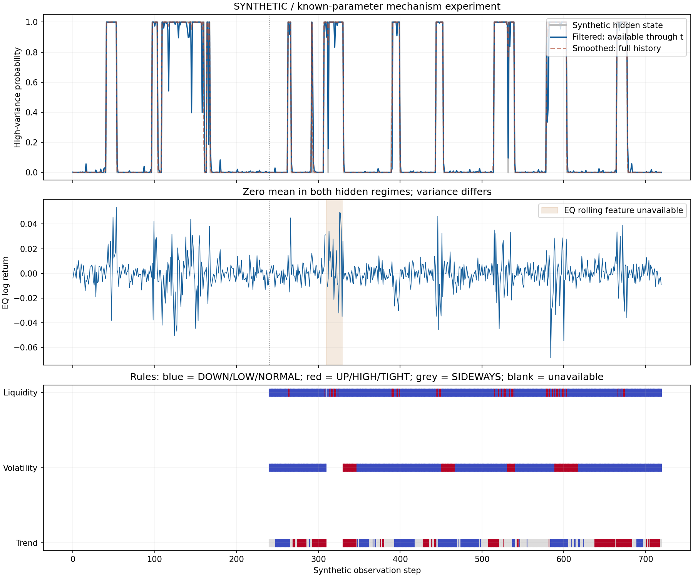

# 第16章 市场状态的经济解释与历史事件

> 第二篇：金融市场与多资产建模。前置知识：条件概率、马尔可夫链、收益与波动、宏观数据时间有效性及第15章风险传播。代码使用现有Anaconda和NumPy；行情、隐含状态和实验事件均为 **SYNTHETIC人工数据**。

## 学习目标

本章完成第二篇的金融解释主线。你应能够定义一份可执行的状态标签契约，解释标签的经济依据、统计依据和适用范围；区分实时判断与事后历史定性；从全概率公式和Bayes公式推导过滤概率，说明平滑概率为何不能直接用于历史在线监控；实现具有缺失处理、版本记录和前缀一致性检查的状态模块。

本章不把“市场存在一个唯一正确状态”作为前提。平台的职责是根据明确的信息集、尺度、对象和任务，给出可解释且可修订的判断。不同标签可以并存，但不能偷偷改变定义。

贯穿案例仍为EQ_DEMO、BOND_DEMO、GOLD_DEMO和FX_DEMO。一个市场可以同时是“近期上涨、波动偏高、报价偏宽”；这不是逻辑矛盾，而是不同维度描述同一时点。

## 16.1 趋势、波动、流动性和增长通胀状态

### 16.1.1 市场状态是什么

市场状态（Market Regime）描述某段时间内相对持续的市场行为或经济环境。它可以是人为规定的描述标签，也可以是生成模型中的隐变量。两者不是同一对象。

设截至决策时点 $t$ 真正可用的信息为 $\mathcal F_t$ ，特征为 $x_t$ ，规则版本为 $\theta_v$ 。规则状态是：

```math
z_t=g(x_t,z_{t-1};\theta_v).
```

上一状态进入函数，允许保持、迟滞和确认机制。规则输出具有明确的操作定义，例如“过去20期波动超过冻结阈值”，却不因可计算就成为自然界唯一的状态。

若设不可直接观察的状态为 $S_t$ ，模型表达的是：

```math
p(x_t\mid S_t=s;\theta),\qquad
P(S_t=s\mid\mathcal F_t;\theta).
```

概率取决于观测分布、参数、先验及可用数据。模型的“状态1”必须经过经济解释才能命名，不天然就是“牛市”“危机”或“衰退”。

经典状态转换框架研究序列行为参数如何随隐含状态变化；Hamilton教材第22章和作者综述是本章的理论入口。[教材出版目录](https://www.jstor.org/stable/j.ctv14jx6sm)，[作者2005年综述](https://econweb.ucsd.edu/~jhamilton/palgrav1.pdf)。

### 16.1.2 先写标签契约，再选模型

标签契约（Label Contract）是对一个标签的对象、含义和生成条件的完整说明。至少包含：

|字段|本章示例|缺失后会产生的问题|
|---|---|---|
|对象与范围|EQ_DEMO、四资产组合或某地区宏观经济|把单资产状态误称全球市场状态|
|时间尺度|日终20期窗口|把分钟冲击和经济周期混为一谈|
|经济含义|近期趋势、风险强度、报价成本|只给数字类别无法解释|
|输入与单位|对数收益、年化波动、小数比例、基点|把百分数与小数混用|
|规则和等号边界|进入高波动用大于等于，退出用小于等于|同一边界不同服务结果不一致|
|信息截止|特征完成且可被服务获取的时刻|计算完成前提前使用|
|版本|规则、模型、特征及训练区间版本|回放时标签含义变化|
|未知条件|窗口不足、陈旧、低置信度|把没数据误当低风险|
|证据与修订|输入事件ID、事后标签另存|历史判断被覆盖|

“全市场牛市”如果来自单只股票20日涨幅，范围和含义就不匹配。名称应与证据能力一致，例如“股票篮子20期上行趋势”。

### 16.1.3 趋势不是一天的涨跌

对已处理公司事件的可比价格或总收益指数 $P_t$ ，定义对数收益：

```math
r_t=\log(P_t/P_{t-1}).
```

过去 $W$ 期累积对数收益：

```math
m_t=\sum_{j=0}^{W-1}r_{t-j}
=\log(P_t/P_{t-W}).
```

中间价格项在对数之和中抵消，这解释了窗口累计的意义。相应简单累计收益为 $\exp(m_t)-1$ ，而不是一般情况下直接等于 $m_t$ 。

设中性带宽 $b\gt 0$ ：大于 $b$ 为UP，小于 $-b$ 为DOWN，其余为SIDEWAYS。等号归入中性带。本章取 $W=20,b=0.02$ 只是预先规定的教学尺度，不是牛熊市场通用标准。

窗口内也可计算斜率、市场宽度或累计收益相对波动的比值。它们关注不同性质，替代方案必须说明：斜率更关注路径，市场宽度需要成分及其历史版本，风险调整指标在低波动时可能数值不稳定。

回撤可定义为：

```math
D_t=1-\frac{P_t}{\max_{u\le t}P_u}.
```

它只使用过去高点，可以实时计算。但是“从最终顶部到最终底部的一整段熊市”通常涉及未来确认。不能把未来才确定的顶部日期提前标成当时已知。

20%之类的市场惯用阈值可以作为一种约定，不能据此宣称存在统一自然边界。本章没有采用该阈值作为真值。

### 16.1.4 波动标签与迟滞

过去 $W$ 期均值与样本标准差：

```math
\bar r_t=\frac1W\sum_{j=0}^{W-1}r_{t-j},
\qquad
s_t^2=\frac1{W-1}\sum_{j=0}^{W-1}(r_{t-j}-\bar r_t)^2.
```

教学中的年化指标为：

```math
v_t=\sqrt{252}\,s_t.
```

252是本实验的交易年尺度约定。平方根缩放要求相应的方差可加条件；存在自相关、变动方差或跨市场不同日历时，不能把该数值当作精确的一年风险预测。

若用一个阈值 $h$ ，阈值附近噪声会造成频繁切换。迟滞（Hysteresis）使用进入阈值 $h_{\mathrm{in}}$ 与退出阈值 $h_{\mathrm{out}}$ ，且：

```math
h_{\mathrm{out}}<h_{\mathrm{in}}.
```

规则为：当前LOW且 $v_t\ge h_{\mathrm{in}}$ 时转HIGH；当前HIGH且 $v_t\le h_{\mathrm{out}}$ 时转LOW；其余保持。它降低临界抖动，但也增加部分转折的响应延迟。

连续确认 $k$ 期、最短驻留期、指数平滑是替代方案。连续确认只能从确认时刻发出，不能回填成首个异常时刻就已经报警。

本章阈值由前240期校准区间中的有效20期波动计算：80%分位进入，60%分位退出。固定分位数定义和方法，避免不同实现产生差异。[NumPy2.1分位数文档](https://numpy.org/doc/2.1/reference/generated/numpy.quantile.html)。

相对分位数还有局限：长期危机中滚动阈值可能越来越高，把持续高风险重新称为“正常”。可以同时报告绝对值、参考期分位和固定经济阈值，不宜只保留一个颜色。

### 16.1.5 流动性、风险偏好与宏观维度

报价价差的一种相对口径为：

```math
s_t^{\mathrm{bps}}
=10^4\frac{a_t-b_t}{(a_t+b_t)/2},
```

其中 $a_t,b_t$ 分别是卖一和买一，bps为基点（Basis Points），一基点等于万分之一。价格为正且卖价不低于买价时，此量非负。

宽价差可以支持“报价成本偏高”，却不能单独证明融资流动性危机。还需检查深度、成交、冲击成本、抵押品和现金需求。无成交可能是正常休市，不能直接视为流动性枯竭。

风险偏好（Risk Appetite）不是直接观测量。信用利差、权益相对表现、资金流等可以构成代理，但也受盈利、通胀、供给和政策影响。名称宜为“风险偏好代理偏弱”，并列明证据，不把代理值当心理真值。

增长—通胀框架先要说明比较对象。如果采用变化方向：

```math
\Delta g_t=g_t-g_{t-1},\qquad
\Delta\pi_t=\pi_t-\pi_{t-1},
```

便可形成增长改善/减弱与通胀上行/下行的四种组合。但“增长减弱”不等于“产出收缩”；正增长从5%降到4%是减速，不是负增长。

可加入零附近的中性带和数据未知区。两项指标必须使用各自当时可见版本，不能把同统计期的最终修订值强行拼成实时快照。第14章的宏观账本是这一维度的实现基础。

“通胀上行环境”是描述；“通胀驱动市场下跌”是归因。后者需要识别冲击、预期差和传导机制，不能靠四象限自动推出。

### 16.1.6 跨资产状态与组合爆炸

股债同涨、股债同跌应使用明确窗口中的可比总收益。债券收益率上升通常对应价格下降，不能把“收益率上升”误记为债券上涨。

两个资产都上涨也不等于滚动相关为正：前者是两项累计收益的符号，后者描述窗口内共同偏离均值的方向。

本章建议先输出多轴向量：

```math
z_t=
(z_t^{\mathrm{trend}},
z_t^{\mathrm{vol}},
z_t^{\mathrm{liq}},
z_t^{\mathrm{macro}}).
```

三个趋势、两个波动、两个流动性、四个宏观类别已有：

```math
3\times2\times2\times4=48
```

种组合。1250个日观测若均匀分配，平均每组只有约26个，实际还高度不均匀且有时间依赖。每个组合再单独训练复杂模型，容易得到不稳定结论。

可采用分层标签：先看各维度，再为少量有明确业务意义的组合命名；保留不确定和未知，而不是强迫每个时点归入一个夸张的危机名称。

### 16.1.7 没有统一真值，怎样检验标签

规则标签可以检验计算是否符合契约，不能仅凭自身输入区分度证明经济有效。用波动分位数定义高低，再用高低组波动不同“证明模型准确”，属于定义循环。

无监督类别应检查训练外分布差异、重采样稳定性、状态持续性、不同尺度的敏感性，以及独立证据的一致与冲突。轮廓系数衡量聚类几何分离，不是金融含义评分。

隐含状态编号可以任意交换。重新训练后“状态0”可能不再是原来的低波动状态。应根据训练期的分布特征对齐语义，并记录映射版本；不能依据测试期未来收益把最赚钱的类别重新命名为牛市。

专家标签也有分歧，应保存标注依据、可用时间和争议；历史危机名单只能作为一种外部证据。国内也有从多指标构建总体及分维度金融安全指数，再研究状态转换的工作，但其指标与样本结论不等于赛题唯一标签。[梁琪等，2018，期刊官方摘要](https://xuebao.nankai.edu.cn/jss/CN/abstract/abstract4.shtml)。

## 16.2 危机与重大政策事件的证据时间线

### 16.2.1 事件发生、资料发布与系统获知不是一个时间

至少区分四个时间：

1. `event_time`：事情发生或所述统计期。
2. `published_at`：来源首次发布该信息。
3. `available_at`：本系统能够取得该版本。
4. `computed_at`：特征或标签计算完成。

另记`retrieved_at`表示本次研究抓取时间，不能冒充历史系统获取时间。来源只有日期时应保留日期精度，不补造某个UTC秒。

一条事后报告可能在2023年解释2022年的压力，其事件归属为2022年，但文本不能进入2022年的历史在线信息集。记录来源版本和内容哈希，可以识别后来网页更新造成的差异。

### 16.2.2 五个可核实的历史节点

|历史节点|已核实事实|可以支持的分析|不能由此直接推出|
|---|---|---|---|
|2008-09-15|Lehman Brothers申请破产|交易对手、信用与融资压力的事件锚点|此前所有波动都由该事件造成|
|2020-03-11|WHO表示COVID-19可被界定为大流行|公共卫生信息与市场时间线的节点|当天所有资产收益的唯一原因|
|2020-02的美国经济峰值|NBER于2020-06-08确认|事后经济周期参考标签|2月当时已经有此官方确认|
|2020-04的美国经济谷底|NBER于2021-07-19确认|区分经济归属月份与公告日期|所有资产4月都进入同一种牛市|
|2022-09-28|英格兰银行宣布临时购买长期英国国债|政策干预与市场功能压力的节点|一般货币政策方向已由此单一操作确定|

Lehman日期来自[美联储历史专题](https://www.federalreservehistory.org/essays/support-for-specific-institutions)。WHO节点来自[当天官方讲话](https://www.who.int/news-room/speeches/item/who-director-general-s-opening-remarks-at-the-media-briefing-on-covid-19---11-march-2020)。NBER峰谷与公告日期由[官方公告索引](https://www.nber.org/research/business-cycle-dating/business-cycle-dating-committee-announcements)及[官方日期程序FAQ](https://www.nber.org/research/business-cycle-dating/business-cycle-dating-procedure-frequently-asked-questions)交叉核对；部分直开返回403，使用官方检索返回内容，不声称抓到受限全文。

英国央行原公告说明操作以恢复有序市场为目的，具有临时、定向性质。这说明“市场功能支持”和“宏观货币政策立场”需要分别描述。[2022-09-28原公告](https://www.bankofengland.co.uk/news/2022/september/bank-of-england-announces-gilt-market-operation.)。

表中的日期不是本系统当时的获取日志。本章没有下载真实行情，所以不填造这些事件前后的涨跌幅、回撤、异常收益或识别准确率。

### 16.2.3 事后定性可以保存，但不能覆盖历史判断

应保存两种不同记录：

- 实时记录：在时点 $t$ 用 $\mathcal F_t$ 和当时模型生成的结果。
- 事后记录：在较晚时点 $T$ 根据更多证据，对历史 $t$ 作出的重估。

例如，6月确认2月经济峰值时，可以为2月增加一条事后事件标注。但不能把2月原监控输出覆盖成“当时已识别官方衰退”。

模型重跑也一样：新参数与新数据得到的历史图应标`retrospective`。数据库中用独立的生成时刻、证据版本和替代关系保存；界面可以切换“当时视图”和“最新研究视图”。

本章人工事件程序将参考期200、公告268、可用270分开，并在340接收同参考期的新版本。它只是演示协议，不映射真实NBER发布间隔。

### 16.2.4 事件窗口不等于因果识别

一个基础事件研究可先在事件前估计正常收益：

```math
r_{i,t}=\alpha_i+\beta_i r_{m,t}+\varepsilon_{i,t}.
```

冻结估计后定义异常收益：

```math
AR_{i,t}=r_{i,t}-\hat\alpha_i-\hat\beta_i r_{m,t},
\qquad
CAR_i[a,b]=\sum_{t=a}^{b}AR_{i,t}.
```

若残差独立同方差、参数已知，长度 $L=b-a+1$ 的累计异常收益方差是 $L\sigma_\varepsilon^2$ 。存在序列相关时：

```math
\mathrm{Var}(CAR)
= L\gamma_0+2\sum_{h=1}^{L-1}(L-h)\gamma_h.
```

推导来自双重求和：同一时点的方差共 $L$ 项，相距 $h$ 的协方差在两侧各有 $L-h$ 项。实际还要考虑参数估计误差，不能直接把这个理想式当完整标准误。

同时发生的政策、信息预期、交易时段差异、选择事件窗口及多个事件重叠都会影响解释。事后围绕最大跌幅选事件日，再报告显著性，含有选择偏差。

历史事件更适合帮助提出机制、检查时间、设计情景；仅凭CAR或事件窗口图，不能证明单一因果关系。本章不实施事件研究估计，把它作为案例证据审查的方法框架。

## 16.3 状态识别、未来预测和交易决策的区别

### 16.3.1 三个任务有三个目标

|任务|对象|典型输出|应采用的验证|
|---|---|---|---|
|状态识别|当前或历史的状态|类别、概率、证据|语义、稳定性、在线可重放性|
|未来预测|未来收益、风险或事件|预测分布或概率|时间外误差、校准、覆盖率|
|交易决策|在约束下采取行动|仓位、订单|含成本与约束的回测及在线执行验证|

识别当前高波动并不自动预测明天上涨或下跌；预测有一定准确率，也不保证扣除成本后有利润。

以下用两状态隐马尔可夫模型（Hidden Markov Model，HMM）展示这个区别。本章只推导给定参数时的推断；参数学习、模型阶数选择和复杂状态切换将在后续模型篇展开。

### 16.3.2 从全概率公式得到预测概率

令 $S_t\in\lbrace 0,1\rbrace$ ，转移矩阵定义为：

```math
A_{ij}=P(S_t=j\mid S_{t-1}=i),
\qquad \sum_j A_{ij}=1.
```

本章约定行是上一状态、列是下一状态。不同资料采用不同矩阵方向，照搬公式前必须核对。

已知上期过滤概率：

```math
\alpha_{t-1}(i)=P(S_{t-1}=i\mid x_{1:t-1}).
```

用全概率公式：

```math
\begin{aligned}
\pi_t(j)
&=P(S_t=j\mid x_{1:t-1})\\[0pt]
&=\sum_i P(S_t=j\mid S_{t-1}=i,x_{1:t-1})
P(S_{t-1}=i\mid x_{1:t-1})\\[0pt]
&=\sum_i\alpha_{t-1}(i)A_{ij}.
\end{aligned}
```

最后一步使用一阶马尔可夫假设。行向量程序写为`previous @ transition`。第一个观测使用事先给定的初始分布，不多做一次转移。

### 16.3.3 从Bayes公式得到过滤概率

设给定状态后的观测密度为 $f_j(x_t)$ 。条件独立假设意味着，在给定当前状态后，观测不再额外依赖更早观测。

当前观测的预测密度：

```math
p(x_t\mid x_{1:t-1})=\sum_j\pi_t(j)f_j(x_t).
```

Bayes公式给出：

```math
\alpha_t(j)
= \frac{\pi_t(j)f_j(x_t)}
{\sum_k\pi_t(k)f_k(x_t)}.
```

这叫过滤（Filtering）：只利用截至当前的数据。Hamilton作者综述的公式(5)—(12)给出相同的信息递推逻辑；该文的矩阵排布与本章行随机约定不同，不能直接复制乘法方向。[作者综述相关段落](https://econweb.ucsd.edu/~jhamilton/palgrav1.pdf)。

简单例子：高风险先验为0.1，当前数据在高风险状态下的密度是低风险的4倍，则：

```math
P(H\mid x)
= \frac{0.1\times4}{0.1\times4+0.9}
= \frac4{13}
\approx0.307692.
```

证据支持高风险，但后验仍未超过0.5。概率更新需要同时考虑先验和似然，不能看到单个异常就把状态概率置为1。

本实验采用四资产条件独立、零均值高斯观测：

```math
f_j(x_t)
= \prod_{a\in O_t}
\frac{1}{\sqrt{2\pi}\sigma_{ja}}
\exp\left(-\frac{x_{ta}^2}{2\sigma_{ja}^2}\right),
```

其中 $O_t$ 是当前实际观测到的资产集合。缺失维度被边际化，不填成零。由于这里条件协方差为对角阵，边际化只需保留已观测分量；一般相关高斯应使用对应子协方差，不能直接独立相乘。

对数密度：

```math
\log f_j(x_t)
= -\frac12\sum_{a\in O_t}
\left[
\log(2\pi\sigma_{ja}^2)
+\frac{x_{ta}^2}{\sigma_{ja}^2}
\right].
```

设 $u_j=\log\pi_t(j)+\log f_j(x_t)$ ， $m=\max_j u_j$ ，用：

```math
\alpha_t(j)=\frac{\exp(u_j-m)}{\sum_k\exp(u_k-m)}
```

避免小密度连续相乘下溢。

若全部观测缺失，空乘积为1，后验等于预测概率。这只是传播先验，必须标“没有新观测支持”，不能称作当期数据已经确认。若缺失机制与状态有关，还需要显式建模缺失机制；本实验把缺失当外生注入。

### 16.3.4 为什么平滑概率包含未来信息

平滑（Smoothing）计算：

```math
\gamma_t(i)=P(S_t=i\mid x_{1:T}),\qquad T>t.
```

它使用未来观测，适合事后研究。推导其反向递推：

```math
P(S_t=i\mid S_{t+1}=j,x_{1:t})
= \frac{\alpha_t(i)A_{ij}}{\pi_{t+1}(j)}.
```

这是对相邻状态联合概率应用Bayes公式。给定下一状态后，后续观测不再提供关于当前状态的额外信息，这是HMM条件独立结构的用途。

对下一状态加权：

```math
\gamma_t(i)
= \alpha_t(i)
\sum_j A_{ij}
\frac{\gamma_{t+1}(j)}{\pi_{t+1}(j)}.
```

边界为 $\gamma_T=\alpha_T$ 。本程序转移概率严格为正，所以分母正；更一般实现需要处理不可达状态。

过滤结果的关键性质是前缀一致性：固定参数、固定已到达输入时，向后追加数据不能改变过去的过滤概率。平滑通常不满足这个性质。

还要注意更隐蔽的泄漏：即使使用名为filtered的输出，如果参数由整个未来样本估计，过去结果仍使用了未来信息。`filtered`这个属性名不是PIT安全证明。官方statsmodels示例展示状态模型及平滑结果，读者应检查所选输出和拟合范围，不能把教学图直接当历史实时回测。[官方示例](https://www.statsmodels.org/stable/examples/notebooks/generated/markov_regression.html)。

### 16.3.5 状态持续性、不确定性与拒判

状态 $j$ 自我保持概率为 $a=A_{jj}$ 。从进入该状态开始，连续驻留 $d$ 期的概率为：

```math
P(D=d)=a^{d-1}(1-a),\quad d=1,2,\ldots
```

因为先保持 $d-1$ 次，再离开一次。由几何级数求导：

```math
\sum_{d=1}^{\infty}d a^{d-1}=\frac1{(1-a)^2},
\qquad
\mathbb E[D]=\frac1{1-a}.
```

这说明自保持概率本身引入持续性，但不会保证每段至少持续多少期。若要求更灵活持续时间，可考虑半马尔可夫模型；不能把HMM与“连续确认三期”视为同一机制。

概率熵：

```math
H_t=-\sum_j\alpha_t(j)\log\alpha_t(j)
```

衡量模型内部分类不确定性。两状态等概率时熵最大为 $\log2$ 。高熵可以触发“待确认”；低熵却不保证输入属于模型适用范围，分布外样本也可能被错误地自信分类。

本章示例用最大后验低于0.8标记不确定，不把它当通用概率校准结论。数据缺失造成UNKNOWN，与观测完整但后验接近一半造成UNCERTAIN，应分别显示。

### 16.3.6 正确识别风险仍不保证收益预测

给定当前过滤概率，下一期状态权重为：

```math
w_{t+1,j}=\sum_i\alpha_t(i)A_{ij}.
```

未来收益预测分布是混合：

```math
p(r_{t+1}\mid\mathcal F_t)
= \sum_j w_{t+1,j}p(r_{t+1}\mid S_{t+1}=j).
```

若各状态均值为 $\mu_j$ 、方差为 $\sigma_j^2$ ，则：

```math
\bar\mu_{t+1}=\sum_jw_{t+1,j}\mu_j,
```

```math
\mathrm{Var}(r_{t+1}\mid\mathcal F_t)
= \sum_jw_{t+1,j}
\left[\sigma_j^2+(\mu_j-\bar\mu_{t+1})^2\right].
```

后式由 $\mathbb E[r^2]-\mathbb E[r]^2$ 展开，也称全方差分解：状态内方差加状态间均值差异。

本章所有状态的对数收益均值都为零，所以无论状态识别多准确，下一期条件对数收益均值仍是零，但方差可以变化。

注意简单收益为 $\exp(r)-1$ ，高斯零均值对数收益的简单收益均值并不为零。这里证明的是“波动状态识别不自动产生方向信息”，不能把两个收益口径混写。

交易还需要明确标的、现金账户、仓位与成本。若另设某资产的条件**简单超额收益**均值为零，时点 $t$ 可测仓位 $w_t$ 的下一期超额损益减交易成本为：

```math
G_{t+1}=w_tR^{\mathrm{excess}}_{t+1}
-c|w_t-w_{t-1}|.
```

则：

```math
\mathbb E[G_{t+1}\mid\mathcal F_t]
=-c|w_t-w_{t-1}|\le0.
```

这是另一个具有明确收益假设的反例，并非对本章对数收益样本直接计算出的策略业绩。

### 16.3.7 标签评价与概率评价

有人工真值 $y_t\in\lbrace 0,1\rbrace$ 时，可用二分类Brier分数：

```math
\mathrm{BS}=\frac1N\sum_t(p_t-y_t)^2.
```

若真实条件概率为 $q$ ，则期望平方误差：

```math
\begin{aligned}
q(p-1)^2+(1-q)p^2
&=p^2-2pq+q\\[0pt]
&=(p-q)^2+q(1-q).
\end{aligned}
```

最小值在 $p=q$ ，因此该评分鼓励诚实报告概率。对数损失同样是适当评分规则：

```math
-\frac1N\sum_t[y_t\log p_t+(1-y_t)\log(1-p_t)].
```

本章代码为避免数值无穷进行极小幅裁剪，并声明精度，不用裁剪掩盖大量错误的极端概率。

真实市场没有可靠统一真值时，不能把某个规则生成的标签当唯一标准去排名所有经济状态模型。可以把它定义成“复现该规则”的监督目标，但必须说明任务已经改变。

评价还应报告状态占比、转移频率、停留时间、迟滞、数据覆盖、概率校准和版本稳定性。预测未来事件则必须另设预测时距、事件定义及时间切分；不与当前识别的评分混排。

## 16.4 完整实验：多维标签、在线过滤与历史证据

### 16.4.1 人工机制与公平边界

共720期人工四资产对数收益，编号0—719。状态转移为：

```math
A=
\begin{pmatrix}
0.97&0.03\\[0pt]
0.10&0.90
\end{pmatrix}.
```

平稳先验为 $(10/13,3/13)$ 。由 $\pi_0(0.03)=\pi_1(0.10)$ 和概率和为1得到。

两状态的标准差向量：

```math
\sigma_0=(0.006,0.003,0.005,0.004),
\qquad \sigma_1=4\sigma_0.
```

条件均值都为零、条件资产相关为零；无条件平方收益仍可因共享波动状态而共同变化。报价价差为正的人工辅助观测，但不输入本章HMM似然。

**推断器事先知道人工生成参数，即known-parameter oracle。** 它验证概率递推和时间边界，没有学习参数，不代表实际可获得的预测性能。不能把它与未知参数的真实模型公平排名。

前240期只用于校准规则阈值，规则从240开始输出。没有在测试段调参，也不设虚假的“验证集选择最佳模型”。HMM固定参数从第0期开始过滤，评分仅用240—719中至少一个收益分量可见的479期；常数先验也用同一目标和时点。平滑是事后对照，不参与在线优劣排名。

规则启动的内部记忆预设为LOW，并从第240期当前波动检查是否进入HIGH；这是一项初始化约定，不是对启动前历史状态的确认。实验中的当期观测假设同步可用，整数步不代表真实市场日历或数据到达日志。

第310期全部收益及价差缺失，第420期只缺GOLD收益。缺失是已登记的注入，未删除行、未填零。规则需要完整EQ窗口，因此310—329期趋势和波动UNKNOWN；过滤在310只传播先验，420使用其他三个资产的边际似然。

### 16.4.2 可运行的完整主程序

保存为[regime_lab.py](./code/ch16/regime_lab.py)。代码只依赖NumPy和标准库；没有下载Python或安装库。

<!-- MAIN_PROGRAM -->

```python
"""SYNTHETIC regime labels: causal filtering, retrospective smoothing and evidence."""
from __future__ import annotations
import hashlib
import json
import platform
from datetime import datetime, timezone
from pathlib import Path
import numpy as np

SEED, TRAIN, WINDOW = 20261028, 240, 20
ASSETS = ["EQ_DEMO", "BOND_DEMO", "GOLD_DEMO", "FX_DEMO"]
P = np.array([[.97, .03], [.10, .90]])  # row: previous; column: next
SD = np.array([[.006, .003, .005, .004], [.024, .012, .020, .016]])
PRIOR = np.array([10/13, 3/13])


def generate(n=720):
    rng = np.random.default_rng(SEED)
    states, returns, spreads = [], [], []
    state = int(rng.choice(2, p=PRIOR))
    for t in range(n):
        if t:
            state = int(rng.choice(2, p=P[state]))
        states.append(state)
        returns.append(rng.normal(size=4) * SD[state])
        spreads.append(max(.1, 2 + 10*state + rng.normal()))
    return np.array(states), np.array(returns), np.array(spreads)


def infer(returns, transition=P, scales=SD, prior=PRIOR):
    """Known DGP parameters for a mechanism experiment, NOT fitted estimates."""
    x = np.asarray(returns, float)
    a, sd, initial = map(lambda v: np.asarray(v, float), (transition, scales, prior))
    if (x.ndim != 2 or not len(x) or a.shape != (2, 2)
            or sd.shape != (2, x.shape[1]) or initial.shape != (2,)):
        raise ValueError("SHAPE")
    if (np.isinf(x).any() or not np.isfinite(a).all() or np.any(a <= 0)
            or not np.allclose(a.sum(axis=1), 1, rtol=0, atol=1e-12)
            or not np.isfinite(sd).all() or np.any(sd <= 0)
            or not np.isfinite(initial).all() or np.any(initial <= 0)
            or not np.isclose(initial.sum(), 1, rtol=0, atol=1e-12)):
        raise ValueError("PARAMETERS")
    predicted, filtered, log_evidence = [], [], []
    previous = initial.copy()
    for t, row in enumerate(x):
        pred = initial.copy() if t == 0 else previous @ a
        observed = np.isfinite(row)
        with np.errstate(over="raise", invalid="raise"):
            log_density = -.5 * np.sum(
                np.log(2*np.pi*sd[:, observed]**2)
                + (row[observed]/sd[:, observed])**2, axis=1)
        log_weight = np.log(pred) + log_density
        shift = np.max(log_weight)
        weight = np.exp(log_weight-shift)
        posterior = weight/weight.sum()
        predicted.append(pred)
        filtered.append(posterior)
        log_evidence.append(float(shift+np.log(weight.sum())))
        previous = posterior
    pred, filt = np.array(predicted), np.array(filtered)
    smooth = filt.copy()
    for t in range(len(x)-2, -1, -1):
        smooth[t] = filt[t] * (a @ (smooth[t+1]/pred[t+1]))
        smooth[t] /= smooth[t].sum()
    return pred, filt, smooth, np.array(log_evidence)


def features(returns, spreads):
    x, spread = np.asarray(returns, float), np.asarray(spreads, float)
    if x.ndim != 2 or x.shape[1] != 4 or spread.shape != (len(x),):
        raise ValueError("FEATURE_SHAPE")
    if np.isinf(x).any() or np.isinf(spread).any() or np.any(spread < 0):
        raise ValueError("FEATURE_DOMAIN")
    out = []
    for t in range(len(x)):
        window = x[max(0, t-WINDOW+1):t+1, 0]
        ready = len(window) == WINDOW and np.isfinite(window).all()
        out.append({"step": t,
                    "momentum": float(window.sum()) if ready else None,
                    "volatility": float(window.std(ddof=1)*np.sqrt(252)) if ready else None,
                    "spread_bps": float(spread[t]) if np.isfinite(spread[t]) else None})
    return out


def calibrate(rows, cutoff=TRAIN):
    if cutoff <= WINDOW or cutoff > len(rows):
        raise ValueError("CALIBRATION_RANGE")
    history = rows[:cutoff]
    vols = [r["volatility"] for r in history if r["volatility"] is not None]
    spreads = [r["spread_bps"] for r in history if r["spread_bps"] is not None]
    if len(vols) < WINDOW or len(spreads) < WINDOW:
        raise ValueError("INSUFFICIENT_CALIBRATION")
    exit_level, enter = np.quantile(vols, [.6, .8], method="linear")
    if not enter > exit_level:
        raise ValueError("DEGENERATE_THRESHOLDS")
    return {"available_step": cutoff-1, "vol_enter": float(enter),
            "vol_exit": float(exit_level), "spread_high": float(np.quantile(spreads, .9)),
            "momentum_band": .02, "window": WINDOW, "annualization": 252,
            "valid_vol_windows": len(vols), "valid_spreads": len(spreads),
            "version": "rule-v1", "quantile_method": "linear"}


def label_rows(rows, cfg):
    high, output = False, []
    for r in rows:
        t, vol, mom, spread = r["step"], r["volatility"], r["momentum"], r["spread_bps"]
        if t <= cfg["available_step"]:
            continue  # No pretending that full calibration was available earlier.
        if vol is not None:
            if not high and vol >= cfg["vol_enter"]:
                high = True
            elif high and vol <= cfg["vol_exit"]:
                high = False
        output.append({"step": t, "rule_version": cfg["version"],
                       "trend": "UNKNOWN" if mom is None else
                           ("UP" if mom > cfg["momentum_band"] else
                            "DOWN" if mom < -cfg["momentum_band"] else "SIDEWAYS"),
                       "volatility": "UNKNOWN" if vol is None else ("HIGH" if high else "LOW"),
                       "liquidity": "UNKNOWN" if spread is None else
                           ("TIGHT" if spread > cfg["spread_high"] else "NORMAL")})
    return output


def evidence_asof(records, decision):
    """Artificial integer clock; retain publication and availability separately."""
    unique, selected, versions = {}, {}, {}
    for r in records:
        if not r["reference_step"] <= r["published_step"] <= r["available_step"]:
            raise ValueError("EVIDENCE_TIME")
        if r["id"] in unique and unique[r["id"]] != r:
            raise ValueError("ID_CONFLICT")
        unique[r["id"]] = r
        key = (r["reference_step"], r["version"])
        if key in versions and versions[key] != r:
            raise ValueError("VERSION_CONFLICT")
        versions[key] = r
    for r in unique.values():
        if r["available_step"] > decision:
            continue
        key = r["reference_step"]
        if key not in selected or r["version"] > selected[key]["version"]:
            selected[key] = r
        elif r["version"] == selected[key]["version"] and r != selected[key]:
            raise ValueError("VERSION_CONFLICT")
    return [dict(selected[k]) for k in sorted(selected)]


def score(probability, truth):
    p, y = np.asarray(probability), np.asarray(truth)
    if (p.shape != y.shape or not len(y) or not np.isfinite(p).all()
            or np.any((p < 0) | (p > 1)) or not np.isin(y, [0, 1]).all()):
        raise ValueError("SCORE_DOMAIN")
    clipped = np.clip(p, 1e-12, 1-1e-12)
    return {"brier": float(np.mean((p-y)**2)),
            "log_loss": float(-np.mean(y*np.log(clipped)+(1-y)*np.log(1-clipped))),
            "n": len(y)}


def main():
    truth, x, spread = generate()
    x[310] = np.nan
    x[420, 2] = np.nan
    spread[310] = np.nan
    rows = features(x, spread)
    cfg = calibrate(rows)
    labels = label_rows(rows, cfg)
    pred, filt, smooth, log_ev = infer(x)
    evidence = [
        {"id": "E1", "reference_step": 200, "published_step": 268,
         "available_step": 270, "version": 1, "label": "SLOWDOWN",
         "source": "SYNTHETIC"},
        {"id": "E2", "reference_step": 200, "published_step": 338,
         "available_step": 340, "version": 2, "label": "CONTRACTION",
         "source": "SYNTHETIC"}]
    mask = (np.arange(len(x)) >= TRAIN) & np.isfinite(x).any(axis=1)
    n = int(mask.sum())
    summary = {"data_kind": "SYNTHETIC", "known_parameter_oracle": True,
               "filter": score(filt[mask, 1], truth[mask]),
               "constant_prior": score(np.full(n, PRIOR[1]), truth[mask]),
               "smooth_vs_filter_map_changes": int(np.sum(
                   smooth[mask].argmax(1) != filt[mask].argmax(1))),
               "uncertain_observed_steps": int(np.sum(filt[mask].max(1) < .8)),
               "unknown_vol_steps": sum(r["volatility"] == "UNKNOWN" for r in labels),
               "high_vol_up_steps": sum(r["volatility"] == "HIGH" and r["trend"] == "UP"
                                        for r in labels),
               "evidence_snapshots": {str(t): evidence_asof(evidence, t)
                                      for t in (269, 270, 339, 340)}}
    out = Path(__file__).parent/"runs"/datetime.now(timezone.utc).strftime("run_%Y%m%dT%H%M%S_%fZ")
    out.mkdir(parents=True, exist_ok=False)
    np.savez_compressed(out/"samples.npz", truth=truth, returns=x, spreads=spread,
                        predicted=pred, filtered=filt, smoothed=smooth, log_evidence=log_ev)
    configs = {"rule": cfg, "transition": P.tolist(), "scales": SD.tolist(),
               "prior": PRIOR.tolist(), "seed": SEED, "train": TRAIN,
               "missing_injections": {"all_returns": [310], "gold_return": [420], "spread": [310]}}
    for name, value in (("configuration.json", configs), ("labels.json", labels),
                        ("evidence.json", evidence), ("results.json", summary)):
        (out/name).write_text(json.dumps(value, ensure_ascii=False, indent=2, allow_nan=False)+"\n",
                              encoding="utf-8")
    manifest = {"python": platform.python_version(), "numpy": np.__version__,
                "data_kind": "SYNTHETIC", "code_sha256": hashlib.sha256(Path(__file__).read_bytes()).hexdigest(),
                "sha256": {p.name: hashlib.sha256(p.read_bytes()).hexdigest() for p in out.iterdir()}}
    (out/"manifest.json").write_text(json.dumps(manifest, indent=2)+"\n", encoding="utf-8")
    print(json.dumps(summary, ensure_ascii=False, indent=2))
    print(out.resolve())


if __name__ == "__main__":
    main()
```

`generate`按期顺序产生状态与观测，保证同种子短序列等于长序列前缀。`features`在完整窗口上计算，缺失显式返回None；`calibrate`只读取固定前缀。`label_rows`从规则可用之后发布，未知窗口不伪造LOW。

`infer`同时返回预测、过滤和平滑供实验比较。生产在线服务应只调用前向更新，不能等待未来数据计算平滑。转移和初始分布在该教学实现中要求严格正概率；极端数值溢出报错，不偷偷替换观测。

`evidence_asof`用人工整数时钟保留不同时间，重复同ID同内容幂等，冲突报错，修订不回写过去快照。它不是数据库、交易所日历或完整接入服务。

### 16.4.3 运行、结果与解释

在仓库根目录运行：

```powershell
& 'D:\Anaconda\python.exe' -X utf8 教材/code/ch16/regime_lab.py
& 'D:\Anaconda\python.exe' -X utf8 -m unittest discover -s 教材/code/ch16 -v
```

使用打印出的运行目录绘图：

```powershell
& 'D:\Anaconda\python.exe' -X utf8 教材/code/ch16/plot_regimes.py 教材/code/ch16/runs/run_20261026T180910_963207Z
```

文件名为UTC时间，本地记录日期为2026-10-27。实际环境Python3.13.5、NumPy2.1.3、Matplotlib3.10.0。

|项目|实际结果|
|---|---:|
|规则校准有效波动窗口|221|
|高波动进入阈值，年化小数|0.311779|
|高波动退出阈值，年化小数|0.247823|
|报价紧张阈值，bps|12.344568|
|评分时点|479|
|已知参数过滤Brier|0.005039|
|常数先验Brier|0.174661|
|已知参数过滤对数损失|0.019700|
|常数先验对数损失|0.533824|
|平滑与过滤最大后验类别不同的评分时点|5|
|最大过滤概率低于0.8的评分时点|3|
|规则波动UNKNOWN时点|20|
|同时满足规则UP与HIGH的时点|17|

已知参数且两状态标准差差异大，过滤分数很好并不意外。这不是真实金融市场准确率，也不是训练后模型的泛化结果。

UP与HIGH同时出现17期，说明趋势与风险强度可以并存；它不验证未来上涨。310期无收益观测不参加评分，420期部分可见参加评分。未知规则窗口与HMM可用信息口径不同，因此不能仅凭覆盖率差异说某方法更好。



人工事件快照结果：

|决策步|可见版本|解释|
|---|---|---|
|269|无|公告268已发生，但系统270才获得|
|270|E1：SLOWDOWN|参考期为200，发布判断现在才可用|
|339|E1：SLOWDOWN|新版本虽338发布，340才可用|
|340|E2：CONTRACTION|最新研究判断变化，不改写269时的空快照|

14项测试已通过：生成前缀、过滤前缀、未来扰动、概率归一、全缺失、部分缺失边际化、三期八条状态路径穷举对照、平滑末端边界、规则前缀、迟滞、缺失窗口、事件版本与冲突、参数校验和评分检查。

其中未来扰动测试专门构造两状态似然相等的前缀，再改变后续观测，验证过滤不变而平滑改变。不能要求任意一条本来就几乎确定的序列都发生明显平滑改变。

程序保存`samples.npz`、`configuration.json`、`labels.json`、`evidence.json`、`results.json`、`manifest.json`。结果哈希：

```text
8a2f5fd32c511609893c48e75eb89f7ddf58f7c3ef5e59ea92088d40ca3536e1
```

### 16.4.4 从实验到状态服务

输出记录建议包含`entity_id`、`decision_at`、`feature_cutoff`、`model_version`、`label_schema_version`、`probabilities`、`axes`、`quality_flags`、`evidence_ids`。当前过滤、未来预测、事后平滑必须有不同输出类型。

本章完整前后向计算需要保存长度为 $T$ 的数组，转移部分时间复杂度 $O(TK^2)$ 、存储约 $O(TK)$ 。只做在线过滤时，只需保存上一概率向量和特征状态；加入对角高斯密度后每期约 $O(K^2+Kd)$ ，其中 $K$ 为状态数、 $d$ 为观测维数。

窗口规则的当前教学实现直接切片，约 $O(TW)$ 。生产可用环形缓冲维护和与平方和，但要处理数值稳定、缺失计数和撤回修订。

发布记录采用追加和幂等键，不能直接覆盖；迟到数据的重算输出应另记计算版本。服务重启至少恢复上一过滤向量、规则迟滞状态、窗口缓冲、模型版本及处理偏移。本章测试内存确定性，不冒充已经完成Kafka恢复或数据库事务。

## 金融应用与工程常见问题

**阈值经济解释。** 本章31.18%的年化进入阈值来自人工参考期，不是监管界限。对真实资产应说明选取理由并验证对窗口、参考期和资产范围的敏感性。

**未知与低风险。** 数据缺失不能填LOW；概率模糊不能伪装成确定类别；输入分布外不能只靠低熵放行。三类情况需要不同质量标记。

**把“已知参数”藏起来。** 人工状态可见仅用于生成和评价。推断器使用事先规定的真实参数使实验更容易，报告必须明确，不能写成无监督模型已学到全部市场规律。

**把宏观周期当资产真值。** NBER确定经济活动峰谷，并非为每一只股票提供牛熊标签。股债、增长和流动性可处在不同维度的状态。

**事件文本倒灌。** 后来的调查、总结和修订可以解释历史，但不得进入过去的信息集。LLM提取出的事件也必须有原始出处、文本版本和可用时间。

**以状态命名掩盖分布变化。** 未来训练样本中“高波动”的数值范围可能改变，模型更新应保留旧版分布摘要；同名不代表同义。

**评估不公平。** 不能把使用720期数据的平滑结果与截至当前的过滤结果当成同任务排名；不能把固定已知参数与真实估计参数的表现混比。

**第二篇与工程篇衔接。** 先保存市场对象、单位、时间和状态契约，再接入真实多源数据。第三篇将从数据来源和统一模型开始，解决这些记录如何成为可审计流水线。

## 本章总结

市场状态是有范围、有尺度、有信息边界的描述或模型推断。趋势、风险强度、流动性和宏观环境既有关联，也不能彼此替代。

历史事件提供证据而不是自动生成真值。过滤只用截至当前的观测，平滑利用未来数据；两者都可能有价值，但用途必须分开。状态识别并不自动产生收益方向预测，更不自动构成交易策略。

第二篇至此完成：资产现金流、风险、定价、宏观和跨资产机制已经汇合到可定义、可计算和可解释的状态输出。

## 分层练习

1. **基础理解。** 为什么“股票篮子20期上涨且高波动”不矛盾？为什么不能直接命名为风险偏好强牛市？
2. **标签设计。** 为“流动性紧张”写一份契约，至少列出对象、指标、阈值、信息截止和未知条件。
3. **数学推导。** 高状态先验0.1、似然比4，求后验。若上一过滤概率为(0.8,0.2)，用本章矩阵求下一期预测概率。
4. **持续期。** 求本章两状态平均驻留期。是否意味着高波动每次至少持续10期？
5. **迟滞。** 进入阈值2、退出阈值1，初始LOW。序列1.9、2.1、1.8、缺失、1.2、0.9对应什么标签？
6. **时间有效性。** 参考期200、发布268、获取270。269时可以使用吗？338发布而340获取的修订能否改写339的历史输出？
7. **过滤与平滑。** 推导平滑递推，解释为什么最后时点两者相同。全样本拟合后再调用filtered是否一定无泄漏？
8. **评分推导。** 对真值(1,0)、概率(0.8,0.2)求Brier及对数损失。为什么Brier在真实条件概率处最优？
9. **预测边界。** 两状态对数收益均值都为零、方差不同，推导下一期均值和方差。能否因此说简单收益均值也为零？
10. **编程验证。** 追加任意有限的未来收益，检查旧过滤结果不变；检验全缺失期后验等于先验；写出不能用平滑替代过滤的验收条件。
11. **历史分析。** 设计2020经济峰谷与WHO公告的证据卡，说明哪些时间已核实，哪些时间不能补造，哪些因果结论仍未识别。
12. **开放工程。** 设计在线状态模块的更新、版本和恢复方案；解释如何比较规则、HMM及后续深度模型而不发生标签循环。

## 详细参考答案

### 题1

上涨描述过去窗口的累计方向，高波动描述变化幅度。上行过程中可以有大幅反复，也可以迅速上涨；两个标签关注不同维度。风险偏好还涉及投资者定价和资金行为，单一价格路径可能由盈利或政策驱动。参考命名为“20期上行趋势、高波动”，另给风险偏好代理证据。

### 题2

参考对象为某组可交易债券、固定日终快照；指标包括有效报价相对价差、可执行深度及陈旧度。用预先冻结参考期分位数加绝对经济阈值，明确报价单位、等号边界和进入退出规则。信息截止需晚于输入到达与特征完成；无有效双边报价、休市或报价过旧时UNKNOWN，不直接TIGHT。融资流动性另列现金和保证金指标。评价看口径可执行性、PIT与证据充分性，不要求唯一阈值。

### 题3

后验为：

```math
p=\frac{0.1\times4}{0.1\times4+0.9}=\frac4{13}.
```

下一期高状态概率：

```math
0.8\times0.03+0.2\times0.90=0.204.
```

低状态为0.796。注意0.204是未看下一期观测的预测，不能称为下一期已确认的过滤概率。

### 题4

```math
\mathbb E[D_0]=\frac1{1-0.97}=\frac{100}{3},
\qquad
\mathbb E[D_1]=\frac1{1-0.90}=10.
```

它们是几何持续期均值，不是最短驻留时间。高状态一期后退出的概率就是0.1；平均10期不排除1期或更长的片段。

### 题5

输出依次为LOW、HIGH、HIGH、UNKNOWN、HIGH、LOW。缺失时对外UNKNOWN，内部迟滞记忆不因缺失自动改成LOW；数据恢复后从原记忆继续。若长期缺失，生产系统还应有状态陈旧超时规则，本章未实现该扩展。

### 题6

269时不可以使用，因为系统270才获取。修订340可用，339快照应仍返回旧版本。事后可以新增参考期200的修订判断，但必须保留其生成和可用时间，不能覆盖过去快照。

### 题7

从相邻状态联合概率 $\alpha_t(i)A_{ij}$ 出发，除以下一期先验 $\pi_{t+1}(j)$ 得到反向条件概率；再用下一期平滑概率加权求和，得到正文递推。终点没有额外未来观测，所以 $\gamma_T=\alpha_T$ 。

全样本估计的参数本身包含未来信息。过滤只限定观测递推方向，不能消除参数估计泄漏；历史回放要冻结当时可用训练窗口和模型版本。

### 题8

```math
\mathrm{BS}=\frac{(0.8-1)^2+(0.2-0)^2}{2}=0.04.
```

```math
\mathrm{LogLoss}
=-\frac{\log0.8+\log0.8}{2}
=-\log0.8\approx0.223144.
```

条件期望损失为 $(p-q)^2+q(1-q)$ ，第二项与报告概率 $p$ 无关，第一项在 $p=q$ 时最小。概率评分与按0.5阈值计算准确率衡量不同性质。

### 题9

下一期状态权重 $w=\alpha_tA$ 。均值为 $\sum_jw_j0=0$ ，方差为 $\sum_jw_j\sigma_j^2$ 。若均值不相同，还需加状态间均值差异项。

对某一高斯状态，简单收益均值为 $\exp(\sigma_j^2/2)-1$ ，通常为正；混合时还要按状态权重加权。不能把对数均值为零改写成简单超额收益均值为零，也不能由这个Jensen效应直接宣布可交易套利。

### 题10

在`教材/code/ch16`目录运行：

```python
import numpy as np
from regime_lab import generate, infer

_, x, _ = generate()
before = infer(x[:400])[1]
after = infer(x)[1][:400]
np.testing.assert_allclose(before, after, atol=1e-14)

missing = x[:20].copy()
missing[-1] = np.nan
pred, filtered, _, _ = infer(missing)
np.testing.assert_allclose(pred[-1], filtered[-1])

# The production contract publishes only the forward result.
# Smoothed output must carry a retrospective flag and its later data cutoff.
print("Prefix invariance and missing-observation checks passed.")
```

验收还需固定参数版本，不能只固定输入数组而重拟合模型。附带测试用三期全部八条状态路径穷举联合概率，核对平滑递推，避免测试只是复制实现公式。

### 题11

证据卡分开记：2020-03-11的WHO讲话；2020-06-08对2020-02峰值的确认；2021-07-19对2020-04谷底的确认。资料来源、日期精度和本次抓取时间均保存。未掌握当年接入日志时，`available_at`不能填成本系统在当天零时获取。

这些节点支持公共卫生信息、经济活动和后验定性的时间比较，不证明某个市场收益完全由单一消息导致，也不提供全部资产的牛熊真值。需补真实行情、时区、预期和其他同期事件才能进一步分析。

### 题12

参考方案：标签契约版本与模型版本分离；训练冻结、验证调参、测试一次评估；新模型影子运行后切换，保存旧模型与状态快照。无监督状态名称用训练区间分布对齐，映射有版本；规则标签若作为监督目标，明确评价的是规则复现。

持久化上一过滤概率、窗口数据与缺失计数、迟滞记忆、模型版本及输入偏移。注入重复、乱序和重启，检查同截止时点相同版本得到相同输出；外发事件幂等，不让重放重复报警。

评分建议：经济定义25%、时间安全25%、概率与统计验证20%、恢复与版本20%、展示和资源成本10%。将平滑图伪装实时、把缺失填低风险、用测试期收益命名类别，均应列为关键失败项。

## 推荐教材与延伸阅读

本章2026年10月27日在线核对。只阅读必要页面、目录与作者稿片段，未下载完整教材；没有使用盗版来源。经典推断公式独立推导，文献没有为本章人工实验提供真实业绩。

|编号|资料、作者和年份|合法入口与阅读位置|推荐理由与阶段|
|---|---|---|---|
|P2-59|James D. Hamilton，Time Series Analysis，Princeton University Press，1994|[出版平台目录](https://www.jstor.org/stable/j.ctv14jx6sm)，第22章Modeling Time Series with Changes in Regime，677—703页|研究生理论主线；页码经目录核实，本次未读取整章受限正文|
|P2-60|James D. Hamilton，Regime-Switching Models，2005-05-18作者稿|[UCSD作者PDF](https://econweb.ucsd.edu/~jhamilton/palgrav1.pdf)，公式(5)—(12)及其后平滑概率讨论|进阶；交叉核对信息集和递推，勿把网页抓取日期当发表年|
|P2-61|Kevin P. Murphy，Probabilistic Machine Learning: Advanced Topics，MIT Press，2023|[作者官方入口](https://probml.github.io/pml-book/book2.html)，目录与公开稿中的状态空间模型/HMM主题，使用文内检索定位|研究生扩展；作者公开稿标CC-BY-NC-ND，本次核对入口与许可，未下载全文或声称读完章节|
|P2-62|梁琪、包世鹏、郭娜，《我国金融安全状态识别及转换机制研究》，南开学报（哲学社会科学版），2018年第4期，12—21|[期刊官方摘要](https://xuebao.nankai.edu.cn/jss/CN/abstract/abstract4.shtml)，摘要与引用信息|国内研究衔接；分维度指标与状态转换，本次不移用其经验结论|
|P2-63|NBER Business Cycle Dating Committee，2020及2021公告；日期程序FAQ|[公告索引](https://www.nber.org/research/business-cycle-dating/business-cycle-dating-committee-announcements)，[FAQ](https://www.nber.org/research/business-cycle-dating/business-cycle-dating-procedure-frequently-asked-questions)，峰谷/公告日期表|案例入门；区分经济归属和确认时间。部分页面直开403，官方检索内容可核对，不声称全文访问|
|P2-64|WHO，Director-General's opening remarks，2020-03-11；Federal Reserve History，Support for Specific Institutions（网页未在本次摘录中确认发表年）|[WHO原讲话](https://www.who.int/news-room/speeches/item/who-director-general-s-opening-remarks-at-the-media-briefing-on-covid-19---11-march-2020)，[美联储历史专题](https://www.federalreservehistory.org/essays/support-for-specific-institutions)|事件卡训练；只核对具体节点，不以回顾材料证明当时系统已获取|
|P2-65|Bank of England，Bank of England announces gilt market operation，2022-09-28|[原公告](https://www.bankofengland.co.uk/news/2022/september/bank-of-england-announces-gilt-market-operation.)，目的、期限和政策分工段落|金融案例；区分市场功能支持与政策立场|
|P2-66|statsmodels开发团队，Markov switching dynamic regression models，滚动更新文档，访问于2026-10-27|[官方示例](https://www.statsmodels.org/stable/examples/notebooks/generated/markov_regression.html)，两状态回归与smoothed_marginal_probabilities相关示例|模型实现延伸；当前网页显示0.15.0，本地0.14.4，本章未调用此库或声称版本一致|
|P2-67|NumPy开发团队，NumPy2.1 Manual，numpy.quantile，版本文档，访问于2026-10-27|[官方说明](https://numpy.org/doc/2.1/reference/generated/numpy.quantile.html)，method参数与线性分位数|编程阶段；确保阈值计算口径可复现，未把访问年当出版年|

**进度：第16章全部教学栏目完成，第二篇完成。下一章为第三篇第17章《多源数据、数据格式与统一模型》。**
